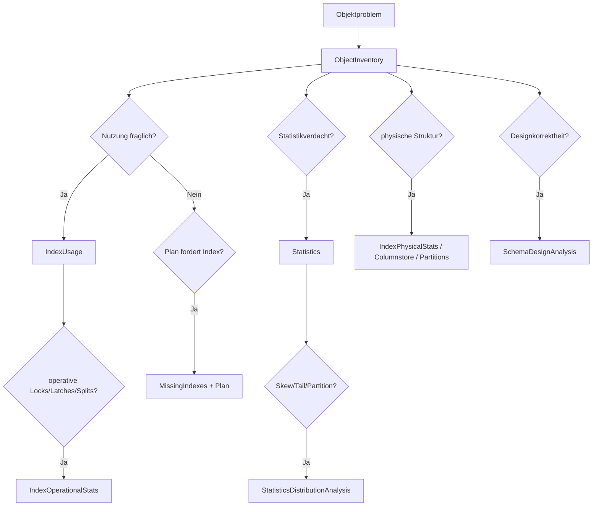

# Object und Index: Inventar, Nutzung, Struktur und Statistiken

**Procedures:** 11  
**Evidenz:** Katalog, kumulative DMVs, DMFs und Histogramme  
**Kosten:** LOW bis HIGH_OPT_IN

## Grundregeln

1. Ein Index ist nicht allein deshalb überflüssig, weil seit dem letzten Reset kein Read gezählt wurde.
2. Eine Missing-Index-Zeile ist eine Optimizerbeobachtung, kein fertiger DDL-Auftrag.
3. Fragmentierung ist nur zusammen mit `PageCount`, Seitendichte, Workload und Wartungsfolgen sinnvoll.
4. Statistikalter ist weniger wichtig als Datenänderung, Sample, Verteilung und betroffene Query.
5. Breite `VOLL`-, Physical-, Histogramm-, Segment- und Dictionarypfade sind gruppengeschützt.

## Collationgrenzen

Die Textspalten der lokalen Arbeitstabellen verwenden explizit
`SQL_Latin1_General_CP1_CS_AS`. Der TABLE-Export erhält diese
Frameworkcollation auch bei abweichender Server- oder `tempdb`-Collation.
`USP_ObjectInventory` und `USP_IndexPhysicalStats` vergleichen ihre
textuellen Steuerwerte nach einem dynamischen Datenbankwechsel ebenfalls
mit der expliziten Frameworkcollation. Exakte Objektfilter behalten die
case-sensitive Frameworksemantik unabhängig von der Quelldatenbankcollation.

---

## 1. [monitor].[USP_ObjectInventory]

### Zweck

Die Procedure liefert Objekt- und Indexinventar mit Größe, Zeilenzahl, Partitionierung, Kompression, Speicherart, optionalen Key-/Include-Spaltenlisten sowie capability-adaptiven SQL-Server-2025-JSON-Index- und Pfadmetadaten.

### Wann einsetzen?

- vor jeder Index- oder Statistikänderung,
- zur Größen- und Strukturorientierung,
- für Heaps, deaktivierte/hypothetische/filtered Indizes,
- zur Unterscheidung von Memory-Optimized, Temporal und klassischen Tabellen.

### Aufrufe

```sql
EXEC [monitor].[USP_ObjectInventory]
      @DatabaseNames = N'[ExampleDatabase]',
      @SchemaNames = N'[ExampleSchema]',
      @ObjectNames = N'[ExampleTable]',
      @ResultSetArt = 'RAW';
```

```sql
EXEC [monitor].[USP_ObjectInventory]
      @DatabaseNames = N'[ExampleDatabase]',
      @AnalyseModus = 'VOLL',
      @MitSpaltenlisten = 1,
      @ResultSetArt = 'RAW';
```

`VOLL` benötigt `CATALOG_DEEP`.

### Resultsets

1. Modulstatus.
2. Datenbankstatus.
3. Inventar.

### Inventarspalten

| Gruppe | Spalten | Bedeutung |
|---|---|---|
| Scope | `DatabaseName`, `SchemaName`, `ObjectName`, `ObjectType`, `ObjectId` | qualifizierte Objektidentität |
| Objektart | `IsMsShipped`, `IsMemoryOptimized`, `TemporalTypeDesc`, `DurabilityDesc` | System-, In-Memory-, Temporal- und Durability-Kontext |
| Zeit | `CreateDate`, `ModifyDate` | Katalogzeitpunkte; ModifyDate ist kein belastbarer Datenänderungszeitpunkt |
| Objektgröße | `ObjectRowCount`, `ObjectReservedMb`, `ObjectUsedMb` | Summe des Objekts; Zeilen sind Katalog-/Partitionsschätzwerte |
| Indexidentität | `IndexId`, `IndexName`, `IndexTypeDesc` | `IndexId=0` kann Heap bedeuten |
| Indexeigenschaften | `IsUnique`, `IsPrimaryKey`, `IsUniqueConstraint`, `IsDisabled`, `IsHypothetical`, `HasFilter`, `FilterDefinition` | vor Löschung oder Redesign zwingend prüfen |
| Wartung | `FillFactor`, `AllowRowLocks`, `AllowPageLocks`, `OptimizeForSequentialKey` | Konfiguration, kein Qualitätsurteil |
| Ablage | `DataSpaceName`, `PartitionCount` | Filegroup/Partition Scheme und Partitionszahl |
| Indexgröße | `IndexRowCount`, `IndexReservedMb`, `IndexUsedMb` | physischer Umfang je Index |
| Kompression | `MinCompressionDesc`, `MaxCompressionDesc`, `HasMixedCompression` | gemischte Kompression kann absichtlich partitioniert sein |
| Definition | `KeyColumns`, `IncludedColumns` | Reihenfolge und Includeumfang; nur bei aktivierter Spaltenliste |
| JSON-Index | `IsJsonIndex`, `OptimizeForArraySearch`, `JsonPathCount`, `JsonPaths` | sichtbare Definition und SQL/JSON-Pfadmetadaten; keine JSON-Dokumentwerte |
| JSON-Evidenz | `JsonIndexStatusCode`, `JsonIndexEvidenceLimit` | Version-, Build-, Schema-, Sichtbarkeits- und Fehlergrenze |

`databaseStatus` enthält zusätzlich JSON-Index-/Pfadzeilenzähler und einen
isolierten Quellenfehler. Vor SQL Server 2025 werden `sys.json_indexes` und
`sys.json_index_paths` nicht referenziert. Auf SQL Server 2025 wird jede
Quelle je Datenbank und Aufruf höchstens einmal gelesen; fehlt die Pfadquelle,
bleibt eine sichtbare Indexdefinition als `AVAILABLE_LIMITED` erhalten.

### Beispiele

| Fall | Interpretation |
|---|---|
| Heap mit 2 TB, viele Updates | Forwarded Records und Zugriffsmuster prüfen; Heap ist nicht automatisch falsch |
| zwei ähnliche Indizes, unterschiedliche Includes | noch keine Duplikatentscheidung; Usage, Constraints und Pläne prüfen |
| `HasMixedCompression=1` auf partitionierter Tabelle | häufig absichtliche Hot-/Cold-Strategie |
| `IsHypothetical=1` | meist Tuningartefakt; Ursprung prüfen |
| `OptimizeForSequentialKey=1` | Hinweis auf sequentiellen Last-Page-Kontext, kein Beweis für Nutzen |
| sichtbarer JSON-Index mit zwei Pfaden | strukturelle Definition; kein Beweis für Nutzung, Gesundheit, Nutzen oder Rebuildbedarf |

### Folgeanalyse

`USP_IndexUsage`, `USP_IndexOperationalStats`, `USP_Partitions`, `USP_IndexPhysicalStats`, `USP_SchemaDesignAnalysis`.

[SQL-Server-2025-JSON-Index-Vertrag](../Architecture/SQL_Server_2025_JSON_Index_Inventory.md)

---

## 2. [monitor].[USP_IndexUsage]

### Zweck

Die Procedure zeigt die kumulative Nutzung klassischer Indizes seit dem DMV-Reset und liefert ein separates Resultset für In-Memory-OLTP-Indizes.

### RAW-Resultsets

1. Modulstatus.
2. Datenbank-/Quellenstatus.
3. Rowstore/Columnstore/Spatial.
4. XTP, wenn `@MitMemoryOptimized=1`.

### Klassische Indexnutzung

| Gruppe | Spalten | Bedeutung |
|---|---|---|
| Identität | `DatabaseName`, `SchemaName`, `ObjectName`, `ObjectId`, `IndexId`, `IndexName`, `IndexTypeDesc` | Scope |
| Spezialart | `IsMemoryOptimized`, `IsSpatialIndex`, `IsPrimaryKey`, `IsUniqueConstraint`, `IsDisabled` | Einschränkungen und Schutz vor voreiligem Entfernen |
| Umfang | `RowCount` | Index-/Partitionszeilenzahl |
| User Reads | `UserSeeks`, `UserScans`, `UserLookups`, `TotalUserReads` | Zahl von Zugriffsvorgängen, nicht gelesene Zeilen oder Seiten |
| Writes | `UserUpdates` | Indexwartungsvorgänge, nicht Anzahl geänderter Zeilen |
| Relation | `ReadWriteRatio` | Reads geteilt durch Updates; `NULL` bei 0 Updates |
| Zeit | `LastUserSeek`, `LastUserScan`, `LastUserLookup`, `LastUserUpdate` | letzte Aktivität seit sichtbarer DMV-Zeile |
| System | `SystemSeeks`, `SystemScans`, `SystemLookups`, `SystemUpdates` | interne SQL-Server-Zugriffe getrennt halten |
| Reset | `DmvResetTimeServerLocal` | Serverstart als untere Resetgrenze; DB-/Metadatenereignisse können später resetten |
| Klasse | `UsageClassification` | `DISABLED`, `SPATIAL_NOT_IN_USAGE_DMV`, `NO_DMV_ROW`, `WRITE_ONLY_SINCE_RESET`, `UNUSED_SINCE_RESET`, `READ_ONLY_SINCE_RESET`, `READ_AND_WRITE` |

### XTP-Resultset

| Spalten | Bedeutung |
|---|---|
| Identität | Datenbank, Schema, Objekt, Objekt-/Index-ID, Name, Typ, PK/Unique |
| `BucketCount` | Hashbucketzahl, nur Hashindex |
| `ScansStarted`, `ScansRetries` | Scanstarts und Wiederholungen |
| `RowsReturned`, `RowsTouched` | Ergebnis- und geprüfte Zeilen |
| `RowsReturnedPerScan`, `RowsTouchedPerReturned`, `RetryPercent` | Effizienzrelationen |
| `CounterScope`, `UsageClassification` | explizite Zählergrenze und Einordnung |

### Fehlinterpretationen

- `UNUSED_SINCE_RESET` nach Neustart am Morgen sagt wenig.
- Saisonale Reports können monatelang ungenutzt erscheinen.
- PK-/Unique-Indizes sichern Datenqualität, auch ohne Reads.
- Foreign Keys, Replikation, CDC, Change Tracking oder seltene Notfallabfragen können Abhängigkeiten erzeugen.
- `UserUpdates` misst Operationen, nicht tatsächliche Wartungskosten.

### Plakatives Beispiel

| Reads | Updates | Resetalter | Bewertung |
|---:|---:|---:|---|
| 0 | 8.000.000 | 180 Tage | starker Kandidat für Review, aber Abhängigkeiten/Pläne prüfen |
| 0 | 40 | 2 Stunden | nicht belastbar |
| 1 | 10.000.000 | 365 Tage | seltene Nutzung; fachliche Kritikalität kann höher als Frequenz sein |
| 500.000 | 5.000 | 90 Tage | klar genutzt |

### Folgeanalyse

`USP_ObjectInventory`, `USP_IndexOperationalStats`, Query Store, Abhängigkeits- und Deploymentanalyse.

### Parameter und weitere Aufrufbeispiele

| Parameter | Datentyp | Default | Eingabeform und Wirkung |
|---|---|---|---|
| `@DatabaseNames` | `nvarchar(max)` | `NULL` | Ein einzelner Datenbankname oder bracket-aware Pipe-Liste einteiliger SQL-Namen. NULL oder nach Trim leere Eingabe bedeutet keine explizite Auswahl und lässt die Datenbankauswahl alle zulässigen sichtbaren Online-Datenbanken bestimmen. Nichtleere Liste: äußere Elementleerzeichen werden getrimmt, [] quotiert Namen und ]] maskiert ]; Pipe trennt außerhalb von Klammern. Leere Elemente, ungültige SQL-Namen und case-sensitive Duplikate führen zu INVALID_PARAMETER. Eine nichtleere Liste ist mit @DatabaseNamePattern gegenseitig exklusiv; NULL/Leerraum plus Pattern ist möglich. Eine Datenbankliste allein erfüllt den GEZIELT-Objektfilter nicht. Die Namensprüfung verlangt PARSENAME-Teil 1 ungleich NULL, Teil 2 gleich NULL und LEN von Teil 1 höchstens 128; Teile 3 und 4 werden nicht gesondert geprüft. Rohsegmente über 4000 UTF-16-Codeeinheiten sind ungültig. |
| `@SystemdatenbankenEinbeziehen` | `bit` | `0` | bit-Schalter: 0 schließt master, model, msdb und tempdb aus; 1 erlaubt ihre Aufnahme, soweit sichtbar und online. SQL Server konvertiert beim Binden von 0 verschiedene, zu bit konvertierbare Zahlenwerte eines bit-Parameters zu 1. NULL wird vom Datenbankauswahlhelfer als INVALID_PARAMETER abgewiesen. |
| `@DatabaseNamePattern` | `nvarchar(4000)` | `NULL` | Optionales Pattern für Datenbanknamen nach TVF_ParsePattern: äußere Leerzeichen trimmen; Präfixe like:, regex: und regexi: werden ohne Beachtung der Großschreibung erkannt; ohne Präfix gilt LIKE. Der verbleibende Inhalt wird nicht erneut getrimmt; NULL bedeutet kein Pattern, leerer Wert oder leeres Präfix ist ungültig. Datenbankname-Pattern ist mit nichtleerer @DatabaseNames-Liste exklusiv. LIKE-Wildcards gelten im Datenbankkandidatenpfad. regex: setzt Flag c, regexi: Flag i; Regex-Verfügbarkeit wird am Installationsdatenbank-Kontext geprüft und erfordert SQL Server 2025 sowie Compatibility Level 170. LIKE nutzt %, _ und Zeichenklassen [...] unter expliziter case-sensitiver Framework-Collation. Ein Übergabebeispiel ist N'like:App%'; nach Präfixentfernung wird nicht erneut getrimmt. |
| `@HighImpactConfirmed` | `bit` | `0` | bit-Bestätigung für den VOLL-Pfad CATALOG_DEEP, der erst nach OBJECT_ANALYSIS_CURRENT aktiviert wird: 0 bestätigt den Deep-Pfad nicht; 1 erfüllt die Bestätigungsanforderung, erteilt selbst aber keine Berechtigung. SQL Server konvertiert gebundene von 0 verschiedene, zu bit konvertierbare Zahlenwerte eines bit-Parameters zu 1. NULL wird vom Datenbankauswahlhelfer als INVALID_PARAMETER abgewiesen. GEZIELT nutzt OBJECT_ANALYSIS_CURRENT und verlangt diese Bestätigung nicht. |
| `@SchemaNames` | `nvarchar(max)` | `NULL` | Exakte einteilige Schemanamen als bracket-aware Pipe-Liste. NULL bedeutet kein Filter; eine leere oder nur aus Leerzeichen bestehende Liste ist kein NULL und wird als ungültige Namensliste abgewiesen. Pipe trennt außerhalb von [...]; ]] maskiert eine Klammer. Namen werden getrimmt, als einteilige SQL-Namen mit höchstens 128 Zeichen geprüft und case-sensitive verglichen; Rohsegmente über 4000 UTF-16-Codeeinheiten sind ungültig. Doppelte Werte derselben Namensart sind ungültig. Nicht gemeinsam mit @SchemaNamePattern. Bei @FullObjectNames ist die Kombination mit @SchemaNames oder @ObjectNames ungültig. |
| `@SchemaNamePattern` | `nvarchar(4000)` | `NULL` | Optionales Schema-Pattern gemäß TVF_ParsePattern: NULL = keines; äußere Leerzeichen trimmen, Präfix like:/regex:/regexi: ohne Beachtung der Großschreibung, sonst LIKE; leerer Inhalt oder leeres Präfix ungültig. LIKE-Schemavergleiche sind case-sensitive und nutzen SQL-LIKE-Wildcards. regex: verwendet Flag c, regexi: Flag i. Schema-Regex wird am Schemaquellpfad ausgeführt; dieser Pfad prüft SQL Server 2025 und Compatibility Level 170. Exakte Liste und Pattern derselben Eigenschaft sind exklusiv. LIKE nutzt %, _ und Zeichenklassen [...] unter expliziter case-sensitiver Framework-Collation. Ein Übergabebeispiel ist N'like:App%'; nach Präfixentfernung wird nicht erneut getrimmt. |
| `@ObjectNames` | `nvarchar(max)` | `NULL` | Exakte einteilige Objektnamen als bracket-aware Pipe-Liste; NULL bedeutet kein Filter, eine leere Liste ist ungültig. Pipe trennt außerhalb geklammerter Namen; ]] maskiert ]. Elemente werden getrimmt und als einteilige SQL-Namen mit höchstens 128 Zeichen validiert, case-sensitive verglichen; Rohsegmente über 4000 UTF-16-Codeeinheiten sind ungültig; Duplikate derselben Namensart sind ungültig. Nicht gemeinsam mit @ObjectNamePattern. Bei @FullObjectNames ist die Kombination mit @SchemaNames oder @ObjectNames ungültig. Für GEZIELT genügt eine nichtleere exakte Namensliste als Objektfilter; zusätzliche Schemafilter können den Scope weiter einschränken. |
| `@ObjectNamePattern` | `nvarchar(4000)` | `NULL` | Optionales Objekt-Pattern gemäß TVF_ParsePattern: NULL = keines; äußerer Trim; Präfix like:/regex:/regexi: wird ohne Beachtung der Großschreibung erkannt, sonst LIKE; leere Werte oder leeres Präfix sind ungültig. LIKE-Objektvergleiche sind case-sensitive und nutzen SQL-LIKE-Wildcards. regex: verwendet Flag c, regexi: Flag i; Objekt-Regex wird im Objektquellpfad ausgeführt und prüft SQL Server 2025/Compatibility Level 170. Nicht gemeinsam mit @ObjectNames. LIKE nutzt %, _ und Zeichenklassen [...] unter expliziter case-sensitiver Framework-Collation. Ein Übergabebeispiel ist N'like:App%'; nach Präfixentfernung wird nicht erneut getrimmt. |
| `@FullObjectNames` | `nvarchar(max)` | `NULL` | Bracket-aware Pipe-Liste vollständiger Objektbezüge mit 1 bis 3 Teilen: Objekt, Schema.Objekt oder Datenbank.Schema.Objekt; bei Datenbankteil ist das Schema erforderlich, vier Teile sind unzulässig. Rohsegmente über 4000 UTF-16-Codeeinheiten sind ungültig; Namensbestandteile werden nach PARSENAME und sysname-Länge geprüft. Pipe trennt nur außerhalb von [...]; ]] maskiert ]. NULL bedeutet kein Filter; N'' ist EMPTY_LIST, Leerzeichen erzeugt ein ungültiges Element. Bestandteile werden case-sensitive verglichen; nicht angegebene Datenbank-/Schemaanteile bleiben im Prädikat offen. Doppelte vollständige Bezüge sind ungültig. Der Helper weist @FullObjectNames zusammen mit @SchemaNames oder @ObjectNames ab, sobald die betreffenden Eingaben nicht NULL sind; auch leere Nicht-NULL-Listen sind also eine Kombination. Dient als zulässiger Objektfilter für GEZIELT. |
| `@AnalyseModus` | `varchar(16)` | `'GEZIELT'` | Nach LTRIM/RTRIM und Großschreibung sind nur GEZIELT und VOLL gültig; NULL wird wie GEZIELT normalisiert. GEZIELT verlangt eine exakte Namenliste, FullObjectNames oder mindestens ein Schema-/Objekt-Pattern; nur DatabaseNames genügt nicht. VOLL erweitert auf die breite Indexkataloganalyse und aktiviert CATALOG_DEEP. Dieser Pfad benötigt die Freigabe für CATALOG_DEEP sowie @HighImpactConfirmed=1; GEZIELT verlangt keine High-Impact-Bestätigung. Leer oder nur Leerzeichen sowie andere Werte sind INVALID_PARAMETER. |
| `@NurUngenutzt` | `bit` | `0` | bit-Filter auf beide Resultsets: 0 lässt Rowstore- und XTP-Zeilen unabhängig von Nutzung zu; 1 lässt Rowstore-Indizes ohne User-Seeks, Scans und Lookups seit sichtbarem Reset zu und XTP-Indizes mit ScansStarted=0. SQL Server konvertiert gebundene von 0 verschiedene, zu bit konvertierbare Zahlenwerte des bit-Parameters zu 1. Bei NULL macht die jeweilige Gleich-Null-ODER-Ungenutzt-Bedingung reguläre genutzte Zeilen nicht wahr; nur Zeilen, deren Ungenutzt-Prüfung wahr ist, können passieren. |
| `@MinUserUpdates` | `bigint` | `0` | Nichtnegative bigint-Mindestzahl kumulativer User-Update-Operationen im klassischen Rowstore-Resultset; zulässiger Bereich 0 bis 9223372036854775807, Default 0 schränkt nicht ein. Negative Werte führen bei fachlicher Validierung zu INVALID_PARAMETER. NULL besteht den Kleiner-Null-Prüftest in SQL-Dreifachlogik, macht danach aber COALESCE(user_updates,0) &gt;= @MinUserUpdates UNKNOWN und lässt dadurch keine Rowstore-Zeile passieren. Für XTP wird dieser Filter nicht angewandt. |
| `@PrimaryUndUniqueEinbeziehen` | `bit` | `1` | bit-Schalter für Primary-Key- und Unique-Constraint-Indizes in Rowstore und XTP: 0 schließt diese beiden Schutzarten aus; 1 lässt sie zu. Bei NULL lautet die Filterbedingung @P=1 OR (is_primary_key=0 AND is_unique_constraint=0): normale Indizes können passieren, PK-/Unique-Constraint-Indizes nicht. Von 0 verschiedene, zu bit konvertierbare Zahlenwerte des bit-Parameters werden beim Binden zu 1 konvertiert. |
| `@MitMemoryOptimized` | `bit` | `1` | bit-Schalter für die separate XTP-Abfrage: 0 überspringt sie; 1 versucht sys.dm_db_xtp_index_stats und befüllt bei Erfolg den XTP-Datenbestand; das vierte RAW-Resultset und der JSON-Schlüssel memoryOptimizedIndexes existieren auch bei übersprungenem Zweig mit leerer Datenmenge. SQL Server konvertiert gebundene von 0 verschiedene, zu bit konvertierbare Zahlenwerte des bit-Parameters zu 1. NULL erfüllt IF @MitMemoryOptimized=1 nicht und überspringt den Zweig. Der klassische Rowstore-Zweig bleibt separat. |
| `@MaxZeilen` | `int` | `5000` | Nichtnegative int-TOP-Grenze, Bereich 0 bis 2147483647, Default 5000; 0 oder NULL wird intern zu der bigint-Grenze 9223372036854775807 umgerechnet. Negative Werte führen zu INVALID_PARAMETER. Die Grenze gilt je Datenbank und getrennt für die Rowstore- und XTP-Quellabfragen. Rowstore-TOP sortiert vorab nach UserUpdates absteigend, dann RowCount absteigend; XTP-TOP nach ScansStarted absteigend, dann RowsTouched absteigend. Keine globale Zeilenobergrenze; die Endausgabe hat eigene Sortierung und Katalog-/DMV-Vorarbeit ist nicht dadurch begrenzt. |
| `@LockTimeoutMs` | `int` | `0` | int in Millisekunden; gültiger nicht-NULL-Wertebereich 0 bis 60000, 0 setzt vor den fachlichen Zugriffen NOWAIT. Der Bereichstest @LockTimeoutMs NOT BETWEEN 0 AND 60000 wertet NULL als UNKNOWN; zusammen mit nichtnegativem MaxZeilen wird NULL dadurch nicht als INVALID_PARAMETER erkannt. Anschließend wird der Wert mit N'SET LOCK_TIMEOUT ' + CONVERT(nvarchar(11), @LockTimeoutMs) + ... in dynamisches SQL konkateniniert. Bei NULL wird der zusammengebaute SQL-Text NULL; der Quellcode setzt darin keinen konkreten Wert. Vor der Datenbankschleife setzt die Procedure ausdrücklich LOCK_TIMEOUT 0. Der NULL-Batch setzt keine andere konkrete Wartezeit; die zuvor gesetzte NOWAIT-Einstellung bleibt für diesen Ausführungspfad maßgeblich. |
| `@ResultSetArt` | `varchar(16)` | `'CONSOLE'` | varchar(16), nach LTRIM/RTRIM und UPPER genau CONSOLE, RAW, TABLE oder NONE. NULL und leer werden als leerer String normalisiert und als INVALID_PARAMETER validiert, nicht als NONE behandelt. CONSOLE gibt nur das menschenlesbare Rowstore-Fachresultset als Resultset aus; RAW gibt Modulstatus, Datenbankstatus, Rowstore und stets als viertes Resultset den XTP-Datensatz, bei übersprungenem XTP-Zweig leer als Resultsets aus; TABLE schreibt das Rowstore-Fachresultset ins Ziel; NONE unterdrückt normale Resultsets. JSON entsteht unabhängig über @JsonErzeugen. Statuswarnungen können bei @PrintMeldungen=1 zusätzlich als Meldung ausgegeben werden. |
| `@ResultTablesJson` | `nvarchar(max)` | `NULL` | Nur für TABLE wird ein JSON-Objekt mit exakt einem erlaubten, case-sensitive Resultnamen und Stringziel erwartet: rowstoreIndexes als Schlüssel. Ziel ist eine vorhandene, leere lokale #Temp-Tabelle, kein ##Temp oder #Monitor*-Name, mit genau einer Seed-Spalte; Zielzuordnungen sind eindeutig. NULL/leer bei TABLE scheitert am Preflight. Bei jeder nicht-TABLE-Ausgabe löst ein nichtleerer, nicht aus Leerzeichen bestehender Wert THROW 51011 aus; NULL, leerer oder nur aus Leerzeichen bestehender Wert ist zulässig. Der Zielname darf höchstens 116 Zeichen haben; Beispiel: N'{"rowstoreIndexes":"#IndexHelpTarget"}'. |
| `@JsonErzeugen` | `bit` | `0` | bit-Schalter: 0 erzeugt kein JSON; 1 erstellt JSON unabhängig von @ResultSetArt. Das JSON-Objekt enthält die Schlüssel meta, rowstoreIndexes, memoryOptimizedIndexes und databaseStatus. Von 0 verschiedene, zu bit konvertierbare Zahlenwerte eines gebundenen bit-Parameters werden zu 1 konvertiert; NULL aktiviert die IF-Bedingung nicht und erzeugt kein JSON. |
| `@Json` | `nvarchar(max) OUTPUT` | `NULL` | nvarchar(max)-OUTPUT-Parameter; zum Empfangen des JSON eine nvarchar(max)-Variable mit OUTPUT binden; der Parameter darf ausgelassen werden, dann gilt der deklarierte Default NULL. Die Procedure setzt den Wert beim Eintritt auf NULL; wenn @JsonErzeugen=1, wird das JSON-Dokument mit meta, rowstoreIndexes, memoryOptimizedIndexes und databaseStatus zurückgegeben, andernfalls bleibt der Output NULL; der frühe @Hilfe-Zweig gibt ebenfalls kein JSON zurück. |
| `@PrintMeldungen` | `bit` | `1` | bit-Schalter: 0 unterdrückt strukturierte Warnmeldungen; 1 sendet bei Status ungleich AVAILABLE eine RAISERROR-Meldung mit Severity 10 und NOWAIT. Von 0 verschiedene, zu bit konvertierbare Zahlenwerte werden beim Binden zu 1 konvertiert. NULL erfüllt IF @PrintMeldungen=1 nicht und unterdrückt die Meldung. |
| `@Hilfe` | `bit` | `0` | bit-Schalter: 0 führt nach Auswahl-/Filtervorbereitung die Fachanalyse aus; 1 gibt die eingebauten PRINT-Zeilen aus und kehrt vor der fachlichen DMV-/Katalogerhebung zurück. Namefilter- und Datenbankkandidatenauswahl sowie Gate-Prüfungen liegen davor; TABLE führt außerdem das Mapping-Preflight vorher aus. Die Vorbereitung wird durch den Hilfezweig nicht unterlassen. Von 0 verschiedene, zu bit konvertierbare Zahlenwerte werden beim Binden zu 1 konvertiert; NULL erfüllt den Hilfezweig nicht. |

```sql
DECLARE @Json nvarchar(max);
EXEC [monitor].[USP_IndexUsage] @DatabaseNames=N'[ExampleDatabase]', @SchemaNames=N'dbo', @ObjectNames=N'ExampleTable', @ResultSetArt='RAW', @JsonErzeugen=1, @Json=@Json OUTPUT;
SELECT @Json;
CREATE TABLE #IndexUsageTarget([Seed] int NULL);
BEGIN TRY
    EXEC [monitor].[USP_IndexUsage] @DatabaseNames=N'[ExampleDatabase]', @SchemaNames=N'dbo', @ObjectNames=N'ExampleTable', @ResultSetArt='TABLE', @ResultTablesJson=N'{"rowstoreIndexes":"#IndexUsageTarget"}';
END TRY
BEGIN CATCH
    DROP TABLE #IndexUsageTarget;
    THROW;
END CATCH;
DROP TABLE #IndexUsageTarget;
EXEC [monitor].[USP_IndexUsage] @Hilfe=1;
```

---

## 3. [monitor].[USP_IndexOperationalStats]

### Zweck

Die Procedure liefert kumulative, partitionsgenaue Betriebszähler aus `sys.dm_db_index_operational_stats`. Dazu gehören DML, Page Allocations und Merges, Scans und Lookups, Forwarded Fetches, Locks, Latches, I/O-Latches, Eskalationen und Kompression.

### Spalten

| Gruppe | Spalten |
|---|---|
| Scope | `DatabaseName`, `SchemaName`, `ObjectName`, `ObjectId`, `IsMemoryOptimized`, `IndexId`, `IndexName`, `IndexTypeDesc`, `PartitionNumber`, `HobtId` |
| DML | `LeafInsertCount`, `LeafDeleteCount`, `LeafUpdateCount`, `LeafGhostCount` |
| Struktur | `LeafPageAllocationCount`, `NonleafPageAllocationCount`, `LeafPageMergeCount` |
| Zugriff | `RangeScanCount`, `SingletonLookupCount`, `ForwardedFetchCount`, `LobFetchPages`, `RowOverflowFetchPages` |
| Locks | `RowLockCount`, `RowLockWaitCount`, `RowLockWaitMs`, `PageLockCount`, `PageLockWaitCount`, `PageLockWaitMs`, `LockPromotionAttemptCount`, `LockPromotionCount` |
| Latches | `PageLatchWaitCount`, `PageLatchWaitMs`, `PageIoLatchWaitCount`, `PageIoLatchWaitMs`, `TreePageLatchWaitCount`, `TreePageLatchWaitMs` |
| Kompression | `PageCompressionAttemptCount`, `PageCompressionSuccessCount` |
| Relationen | `LeafAllocationsPerInsert`, `LockWaitMsPerWait`, `PageLatchWaitMsPerWait`, `PageIoLatchWaitMsPerWait` |
| Einordnung | `UsageClassification` |

### Interpretation

- Hohe `LeafAllocationsPerInsert` kann auf Page Splits oder sequentielle Expansion hinweisen; Fill Factor nicht automatisch senken.
- Viele `ForwardedFetchCount` sind bei Heaps ein Prüfauftrag.
- `LockPromotionAttemptCount` ohne Promotion kann normale Vermeidung oder Konflikt bedeuten.
- Latchwaits sind interne Synchronisierung; I/O-Latches betreffen Seiten-I/O. Nicht verwechseln.
- Zähler können verschwinden, wenn Metadaten aus dem Cache entfernt werden.

### Grenzfälle

| Fall | Bewertung |
|---|---|
| hohe Page Allocations bei monoton wachsendem Index | normal möglich |
| hohe Latchzeit bei sehr vielen kurzen Waits | Durchschnitt und aktuelles Delta prüfen |
| einzelne Partition dominiert Locks | Hot-Partition/Lastverteilung prüfen |
| viele Forwarded Fetches, aber kaum Reads | geringe Auswirkung möglich |

### Kosten

GEZIELT moderat. VOLL benötigt `INDEX_OPERATIONAL_DEEP` und kann bei vielen Datenbanken/Indizes teuer werden.

### Parameter und weitere Aufrufbeispiele

| Parameter | Datentyp | Default | Eingabeform und Wirkung |
|---|---|---|---|
| `@DatabaseNames` | `nvarchar(max)` | `NULL` | Ein einzelner Datenbankname oder bracket-aware Pipe-Liste einteiliger SQL-Namen. NULL oder nach Trim leere Eingabe bedeutet keine explizite Auswahl und lässt die Datenbankauswahl alle zulässigen sichtbaren Online-Datenbanken bestimmen. Nichtleere Liste: äußere Elementleerzeichen werden getrimmt, [] quotiert Namen und ]] maskiert ]; Pipe trennt außerhalb von Klammern. Leere Elemente, ungültige SQL-Namen und case-sensitive Duplikate führen zu INVALID_PARAMETER. Eine nichtleere Liste ist mit @DatabaseNamePattern gegenseitig exklusiv; NULL/Leerraum plus Pattern ist möglich. Eine Datenbankliste allein erfüllt den GEZIELT-Objektfilter nicht. Die Namensprüfung verlangt PARSENAME-Teil 1 ungleich NULL, Teil 2 gleich NULL und LEN von Teil 1 höchstens 128; Teile 3 und 4 werden nicht gesondert geprüft. Rohsegmente über 4000 UTF-16-Codeeinheiten sind ungültig. |
| `@SystemdatenbankenEinbeziehen` | `bit` | `0` | bit-Schalter: 0 schließt master, model, msdb und tempdb aus; 1 erlaubt ihre Aufnahme, soweit sichtbar und online. SQL Server konvertiert beim Binden von 0 verschiedene, zu bit konvertierbare Zahlenwerte eines bit-Parameters zu 1. NULL wird vom Datenbankauswahlhelfer als INVALID_PARAMETER abgewiesen. |
| `@DatabaseNamePattern` | `nvarchar(4000)` | `NULL` | Optionales Pattern für Datenbanknamen nach TVF_ParsePattern: äußere Leerzeichen trimmen; Präfixe like:, regex: und regexi: werden ohne Beachtung der Großschreibung erkannt; ohne Präfix gilt LIKE. Der verbleibende Inhalt wird nicht erneut getrimmt; NULL bedeutet kein Pattern, leerer Wert oder leeres Präfix ist ungültig. Datenbankname-Pattern ist mit nichtleerer @DatabaseNames-Liste exklusiv. LIKE-Wildcards gelten im Datenbankkandidatenpfad. regex: setzt Flag c, regexi: Flag i; Regex-Verfügbarkeit wird am Installationsdatenbank-Kontext geprüft und erfordert SQL Server 2025 sowie Compatibility Level 170. LIKE nutzt %, _ und Zeichenklassen [...] unter expliziter case-sensitiver Framework-Collation. Ein Übergabebeispiel ist N'like:App%'; nach Präfixentfernung wird nicht erneut getrimmt. |
| `@HighImpactConfirmed` | `bit` | `0` | bit-Bestätigung für den VOLL-Pfad INDEX_OPERATIONAL_DEEP, der erst nach OBJECT_ANALYSIS_CURRENT aktiviert wird: 0 bestätigt den Deep-Pfad nicht; 1 erfüllt die Bestätigungsanforderung, erteilt selbst aber keine Berechtigung. SQL Server konvertiert gebundene von 0 verschiedene, zu bit konvertierbare Zahlenwerte eines bit-Parameters zu 1. NULL wird vom Datenbankauswahlhelfer als INVALID_PARAMETER abgewiesen. GEZIELT nutzt OBJECT_ANALYSIS_CURRENT und verlangt diese Bestätigung nicht. |
| `@SchemaNames` | `nvarchar(max)` | `NULL` | Exakte einteilige Schemanamen als bracket-aware Pipe-Liste. NULL bedeutet kein Filter; eine leere oder nur aus Leerzeichen bestehende Liste ist kein NULL und wird als ungültige Namensliste abgewiesen. Pipe trennt außerhalb von [...]; ]] maskiert eine Klammer. Namen werden getrimmt, als einteilige SQL-Namen mit höchstens 128 Zeichen geprüft und case-sensitive verglichen; Rohsegmente über 4000 UTF-16-Codeeinheiten sind ungültig. Doppelte Werte derselben Namensart sind ungültig. Nicht gemeinsam mit @SchemaNamePattern. Bei @FullObjectNames ist die Kombination mit @SchemaNames oder @ObjectNames ungültig. In GEZIELT benötigt diese Liste zusätzlich die exakte @ObjectNames-Liste; alternativ wird ausschließlich @FullObjectNames verwendet. |
| `@SchemaNamePattern` | `nvarchar(4000)` | `NULL` | Optionales Schema-Pattern gemäß TVF_ParsePattern: NULL = keines; äußere Leerzeichen trimmen, Präfix like:/regex:/regexi: ohne Beachtung der Großschreibung, sonst LIKE; leerer Inhalt oder leeres Präfix ungültig. LIKE-Schemavergleiche sind case-sensitive und nutzen SQL-LIKE-Wildcards. regex: verwendet Flag c, regexi: Flag i. Schema-Regex wird am Schemaquellpfad ausgeführt; dieser Pfad prüft SQL Server 2025 und Compatibility Level 170. Exakte Liste und Pattern derselben Eigenschaft sind exklusiv. In GEZIELT ersetzt ein Muster nicht die Voraussetzung aus FullObjectNames oder beiden exakten Listen. LIKE nutzt %, _ und Zeichenklassen [...] unter expliziter case-sensitiver Framework-Collation. Ein Übergabebeispiel ist N'like:App%'; nach Präfixentfernung wird nicht erneut getrimmt. |
| `@ObjectNames` | `nvarchar(max)` | `NULL` | Exakte einteilige Objektnamen als bracket-aware Pipe-Liste; NULL bedeutet kein Filter, eine leere Liste ist ungültig. Pipe trennt außerhalb geklammerter Namen; ]] maskiert ]. Elemente werden getrimmt und als einteilige SQL-Namen mit höchstens 128 Zeichen validiert, case-sensitive verglichen; Rohsegmente über 4000 UTF-16-Codeeinheiten sind ungültig; Duplikate derselben Namensart sind ungültig. Nicht gemeinsam mit @ObjectNamePattern. Bei @FullObjectNames ist die Kombination mit @SchemaNames oder @ObjectNames ungültig. Im GEZIELT-Modus benötigt diese Liste zusätzlich eine exakte @SchemaNames-Liste; Pattern ersetzt diese nicht. @FullObjectNames ist eine alternative Auswahl und darf nicht damit kombiniert werden. |
| `@ObjectNamePattern` | `nvarchar(4000)` | `NULL` | Optionales Objekt-Pattern gemäß TVF_ParsePattern: NULL = keines; äußerer Trim; Präfix like:/regex:/regexi: wird ohne Beachtung der Großschreibung erkannt, sonst LIKE; leere Werte oder leeres Präfix sind ungültig. LIKE-Objektvergleiche sind case-sensitive und nutzen SQL-LIKE-Wildcards. regex: verwendet Flag c, regexi: Flag i; Objekt-Regex wird im Objektquellpfad ausgeführt und prüft SQL Server 2025/Compatibility Level 170. Nicht gemeinsam mit @ObjectNames. Ein Muster allein erfüllt die GEZIELT-Auswahlvoraussetzung nicht. LIKE nutzt %, _ und Zeichenklassen [...] unter expliziter case-sensitiver Framework-Collation. Ein Übergabebeispiel ist N'like:App%'; nach Präfixentfernung wird nicht erneut getrimmt. |
| `@FullObjectNames` | `nvarchar(max)` | `NULL` | Bracket-aware Pipe-Liste vollständiger Objektbezüge mit 1 bis 3 Teilen: Objekt, Schema.Objekt oder Datenbank.Schema.Objekt; bei Datenbankteil ist das Schema erforderlich, vier Teile sind unzulässig. Rohsegmente über 4000 UTF-16-Codeeinheiten sind ungültig; Namensbestandteile werden nach PARSENAME und sysname-Länge geprüft. Pipe trennt nur außerhalb von [...]; ]] maskiert ]. NULL bedeutet kein Filter; N'' ist EMPTY_LIST, Leerzeichen erzeugt ein ungültiges Element. Bestandteile werden case-sensitive verglichen; nicht angegebene Datenbank-/Schemaanteile bleiben im Prädikat offen. Doppelte vollständige Bezüge sind ungültig. Der Helper weist @FullObjectNames zusammen mit @SchemaNames oder @ObjectNames ab, sobald die betreffenden Eingaben nicht NULL sind; auch leere Nicht-NULL-Listen sind also eine Kombination. Dient als zulässiger Objektfilter für GEZIELT. |
| `@IndexNames` | `nvarchar(max)` | `NULL` | Exakte einteilige Indexnamen als bracket-aware Pipe-Liste; NULL bedeutet kein Indexnamenfilter, eine leere oder nur aus Leerzeichen bestehende Liste ist ungültig. Pipe trennt außerhalb von [...]; ]] maskiert ]. Elemente werden getrimmt, als einteilige SQL-Namen validiert und case-sensitive verglichen. Rohsegmente über 4000 UTF-16-Codeeinheiten und Namen über die sysname-Grenze werden abgewiesen. Case-sensitive Duplikate sind ungültig. Nicht gemeinsam mit @IndexNamePattern verwenden. |
| `@IndexNamePattern` | `nvarchar(4000)` | `NULL` | Optionales Indexnamen-Pattern gemäß TVF_ParsePattern: NULL = keines; äußerer Trim; Präfix like:, regex: oder regexi: ohne Beachtung der Großschreibung, sonst LIKE. Leerer Rest/Präfix ist ungültig. LIKE ist case-sensitive mit SQL-Wildcards; regex: verwendet Flag c und regexi: Flag i und benötigt SQL Server 2025/Compatibility Level 170, geprüft am Indexquellpfad. Nicht gemeinsam mit @IndexNames. LIKE nutzt %, _ und Zeichenklassen [...] unter expliziter case-sensitiver Framework-Collation. Ein Übergabebeispiel ist N'like:App%'; nach Präfixentfernung wird nicht erneut getrimmt. |
| `@AnalyseModus` | `varchar(16)` | `'GEZIELT'` | Nach LTRIM/RTRIM und Großschreibung sind nur GEZIELT und VOLL gültig; NULL wird wie GEZIELT normalisiert. GEZIELT verlangt @FullObjectNames oder beide exakten Listen @SchemaNames und @ObjectNames. Die Filter können mehrere Objekte bezeichnen; der Quellcode löst @ObjectIdFilter per SELECT-Variablenzuweisung auf passende Objekte auf und garantiert dabei keine bestimmte Auswahl, falls mehrere übereinstimmen. VOLL aktiviert INDEX_OPERATIONAL_DEEP und benötigt dessen Freigabe sowie @HighImpactConfirmed=1. Leer oder nur Leerzeichen sowie andere Werte sind INVALID_PARAMETER. |
| `@PartitionNumber` | `int` | `NULL` | Optionale positive int-Partitionsnummer, Bereich 1 bis 2147483647. In GEZIELT wird sie für die zugewiesene ObjectId an die DMF übergeben; NULL umfasst dort alle Partitionen dieses Objekts. VOLL verlangt NULL und verwendet den breiten Rowset-Pfad; nur ein nicht-NULL-Wert ist auf GEZIELT beschränkt. Werte kleiner 1 sind INVALID_PARAMETER. |
| `@NurMitAktivitaet` | `bit` | `1` | bit-Filter: 0 lässt auch Nullaktivitätszeilen zu; 1 verlangt mindestens einen der im Quellprädikat addierten DML-, Range-/Lookup-, Lock-, Page-Latch- oder I/O-Latch-Zähler größer Null. Von 0 verschiedene, zu bit konvertierbare Zahlenwerte konvertieren beim Binden zu 1. Bei NULL wird die Bedingung @P=0 OR Aktivitätsausdruck&gt;0 für Nullaktivität nicht TRUE, sodass solche Zeilen ausgeschlossen werden. |
| `@MinLeafPageAllocations` | `bigint` | `0` | Nichtnegative bigint-Mindestzahl kumulativer Leaf-Page-Allokationen je Partition, Bereich 0 bis 9223372036854775807; Default 0 schränkt nicht ein. Negative Werte sind INVALID_PARAMETER. NULL besteht den negativen Wertecheck durch UNKNOWN, macht aber leaf_allocation_count &gt;= @P UNKNOWN und lässt keine Zeile passieren. |
| `@MinLockWaitMs` | `bigint` | `0` | Nichtnegative bigint-Mindestzeit in Millisekunden für Row- plus Page-Lock-Wait-Zeit, Bereich 0 bis 9223372036854775807; Default 0 schränkt nicht ein. Negative Werte sind INVALID_PARAMETER. NULL besteht den negativen Wertecheck durch UNKNOWN, macht aber den nachfolgenden Summenvergleich UNKNOWN und lässt keine Zeile passieren. |
| `@MaxZeilen` | `int` | `5000` | Nichtnegative int-TOP-Grenze, Bereich 0 bis 2147483647, Default 5000; 0 oder NULL wird intern zu der bigint-Grenze 9223372036854775807 umgerechnet. Negative Werte führen zu INVALID_PARAMETER. TOP gilt für die Operational-Stats-Quellabfrage je Datenbank. Die Auswahl sortiert vorab nach I/O-Latch-Wartezeit, Page-Latch-Wartezeit, Row-/Page-Lock-Wartezeit und Leaf-Page-Allokationen absteigend; die Endausgabe verwendet eine eigene Sortierung. Keine globale Zeilenobergrenze und kein Limit für die vorherige DMF-/Katalogarbeit. |
| `@LockTimeoutMs` | `int` | `0` | int in Millisekunden; gültiger nicht-NULL-Wertebereich 0 bis 60000, 0 setzt vor den fachlichen Zugriffen NOWAIT. Der Bereichstest @LockTimeoutMs NOT BETWEEN 0 AND 60000 wertet NULL als UNKNOWN; mit nichtnegativen übrigen Zahlen wird NULL dadurch nicht als INVALID_PARAMETER erkannt. Anschließend wird der Wert mit N'SET LOCK_TIMEOUT ' + CONVERT(nvarchar(11), @LockTimeoutMs) + ... in dynamisches SQL konkateniniert. Bei NULL wird der zusammengebaute SQL-Text NULL; der Quellcode setzt darin keinen konkreten Wert. Vor der Datenbankschleife setzt die Procedure ausdrücklich LOCK_TIMEOUT 0. Der NULL-Batch setzt keine andere konkrete Wartezeit; die zuvor gesetzte NOWAIT-Einstellung bleibt für diesen Ausführungspfad maßgeblich. |
| `@ResultSetArt` | `varchar(16)` | `'CONSOLE'` | varchar(16), nach LTRIM/RTRIM und UPPER genau CONSOLE, RAW, TABLE oder NONE. NULL und leer werden als leerer String normalisiert und als INVALID_PARAMETER validiert, nicht als NONE behandelt. CONSOLE gibt nur das menschenlesbare Operational-Stats-Fachresultset als Resultset aus; RAW gibt Modulstatus, Datenbankstatus und Fachresultset aus; TABLE schreibt das Fachresultset ins Ziel; NONE unterdrückt normale Resultsets. JSON entsteht unabhängig über @JsonErzeugen. Statuswarnungen können bei @PrintMeldungen=1 zusätzlich als Meldung ausgegeben werden. |
| `@ResultTablesJson` | `nvarchar(max)` | `NULL` | Nur für TABLE wird ein JSON-Objekt mit exakt einem erlaubten, case-sensitiven Resultnamen und Stringziel erwartet: indexOperationalStats als Schlüssel. Ziel ist eine vorhandene, leere lokale #Temp-Tabelle, kein ##Temp oder #Monitor*-Name, mit genau einer Seed-Spalte; Zielzuordnungen sind eindeutig. NULL/leer bei TABLE scheitert am Preflight. Bei jeder nicht-TABLE-Ausgabe löst ein nichtleerer, nicht aus Leerzeichen bestehender Wert THROW 51011 aus; NULL, leerer oder nur aus Leerzeichen bestehender Wert ist zulässig. Der Zielname darf höchstens 116 Zeichen haben; Beispiel: N'{"indexOperationalStats":"#IndexHelpTarget"}'. |
| `@JsonErzeugen` | `bit` | `0` | bit-Schalter: 0 erzeugt kein JSON; 1 erstellt JSON unabhängig von @ResultSetArt. Das JSON-Objekt enthält die Schlüssel meta, indexOperationalStats und databaseStatus. Von 0 verschiedene, zu bit konvertierbare Zahlenwerte eines gebundenen bit-Parameters werden zu 1 konvertiert; NULL aktiviert die IF-Bedingung nicht und erzeugt kein JSON. |
| `@Json` | `nvarchar(max) OUTPUT` | `NULL` | nvarchar(max)-OUTPUT-Parameter; zum Empfangen des JSON eine nvarchar(max)-Variable mit OUTPUT binden; der Parameter darf ausgelassen werden, dann gilt der deklarierte Default NULL. Die Procedure setzt den Wert beim Eintritt auf NULL; wenn @JsonErzeugen=1, wird das JSON-Dokument mit meta, indexOperationalStats und databaseStatus zurückgegeben, andernfalls bleibt der Output NULL; der frühe @Hilfe-Zweig gibt ebenfalls kein JSON zurück. |
| `@PrintMeldungen` | `bit` | `1` | bit-Schalter: 0 unterdrückt strukturierte Warnmeldungen; 1 sendet bei Status ungleich AVAILABLE eine RAISERROR-Meldung mit Severity 10 und NOWAIT. Von 0 verschiedene, zu bit konvertierbare Zahlenwerte werden beim Binden zu 1 konvertiert. NULL erfüllt IF @PrintMeldungen=1 nicht und unterdrückt die Meldung. |
| `@Hilfe` | `bit` | `0` | bit-Schalter: 0 führt nach Auswahl-/Filtervorbereitung die Fachanalyse aus; 1 gibt die eingebauten PRINT-Zeilen aus und kehrt vor der fachlichen DMV-/Katalogerhebung zurück. Namefilter- und Datenbankkandidatenauswahl sowie Gate-Prüfungen liegen davor; TABLE führt außerdem das Mapping-Preflight vorher aus. Die Vorbereitung wird durch den Hilfezweig nicht unterlassen. Von 0 verschiedene, zu bit konvertierbare Zahlenwerte werden beim Binden zu 1 konvertiert; NULL erfüllt den Hilfezweig nicht. |

```sql
DECLARE @Json nvarchar(max);
EXEC [monitor].[USP_IndexOperationalStats] @DatabaseNames=N'[ExampleDatabase]', @FullObjectNames=N'dbo.ExampleTable', @ResultSetArt='RAW', @JsonErzeugen=1, @Json=@Json OUTPUT;
SELECT @Json;
CREATE TABLE #IndexOperationalStatsTarget([Seed] int NULL);
BEGIN TRY
    EXEC [monitor].[USP_IndexOperationalStats] @DatabaseNames=N'[ExampleDatabase]', @FullObjectNames=N'dbo.ExampleTable', @ResultSetArt='TABLE', @ResultTablesJson=N'{"indexOperationalStats":"#IndexOperationalStatsTarget"}';
END TRY
BEGIN CATCH
    DROP TABLE #IndexOperationalStatsTarget;
    THROW;
END CATCH;
DROP TABLE #IndexOperationalStatsTarget;
EXEC [monitor].[USP_IndexOperationalStats] @Hilfe=1;
```

---

## 4. [monitor].[USP_MissingIndexes]

### Zweck

Die Procedure liest flüchtige Missing-Index-DMVs und berechnet eine Priorisierungsmetrik sowie einen **nur als Entwurf** zu verstehenden CREATE-INDEX-Text.

### Spalten

| Spalte | Bedeutung |
|---|---|
| `DatabaseName`, `SchemaName`, `ObjectName`, `ObjectId` | Zielobjekt; Name kann bei eingeschränkter Metadatensicht fehlen |
| `IndexHandle`, `IndexGroupHandle` | flüchtige DMV-Handles |
| `UniqueCompiles` | Zahl unterschiedlicher Compiles, die die Gruppe meldeten |
| `UserSeeks`, `UserScans`, `TotalUserReads` | beobachtete erwartete Nutzung |
| `LastUserSeek`, `LastUserScan` | letzter Hinweiszeitpunkt |
| `AvgTotalUserCost` | durchschnittlich geschätzte Plankosten betroffener Queries |
| `AvgUserImpact` | geschätzte prozentuale Kostenverbesserung; Optimizerprognose |
| `ImprovementMeasure` | Cost × Impact × Reads; Ranking, keine Zeit-/Geldersparnis |
| `EqualityColumns` | Gleichheitsprädikate |
| `InequalityColumns` | Bereichs-/Ungleichheitsprädikate |
| `IncludedColumns` | vorgeschlagene Coverspalten |
| `StatementName` | DMV-Objektbezug |
| `ProposedIndexName` | synthetischer technischer Name |
| `ProposedCreateIndex` | Entwurf, nicht ungeprüft ausführen |
| `WarningText` | verbindliche Aussagegrenze |

### Kritische Grenzen

- Vorschläge kennen vorhandene ähnliche Indizes nur begrenzt.
- Schlüsselreihenfolge und Includeumfang müssen manuell optimiert werden.
- Schreib-, Speicher-, Wartungs- und Lockkosten fehlen.
- DMVs werden bei Restart, Failover und weiteren Ereignissen geleert.
- Maximalzahl gespeicherter Vorschläge ist begrenzt.
- Vorschläge können sich stark überlappen.

### Beispiele

| Vorschlag | Bewertung |
|---|---|
| Impact 98 %, 2 Reads | plakativ, aber statistisch schwach |
| Impact 25 %, 5 Mio. Reads | möglicherweise hoher Gesamtnutzen |
| 30 Include-Spalten | Coveragevorschlag wahrscheinlich zu breit |
| drei Vorschläge mit gleichem Prefix | konsolidieren statt drei Indizes |
| Vorschlag dupliziert vorhandenen Index bis auf Reihenfolge | konkrete Pläne und Selektivität prüfen |

### Folgeanalyse

`USP_ObjectInventory`, `USP_IndexUsage`, `USP_QueryStats`/Query Store, Showplan. Erst danach DDL-Entwurf mit Write-Kosten und Rollbackplan.

---

## 5. [monitor].[USP_Statistics]

### Zweck

Die Procedure inventarisiert Statistiken, Materialisierung, Sample, Änderungszähler, Alter, Filter und optional inkrementelle Partitionsdetails. Auf SQL Server 2025 ergänzt sie die Herkunft persistierter Statistiken auf lesbaren Replikaten und trennt diese von der aktuellen Datenbankrolle.

### Hauptspalten

| Gruppe | Spalten |
|---|---|
| Scope | `DatabaseName`, `SchemaName`, `ObjectName`, `ObjectId`, `StatisticsId`, `StatisticsName` |
| Herkunft | `IsIndexStatistics`, `IsAutoCreated`, `IsUserCreated` |
| Definition | `IsFiltered`, `FilterDefinition`, `NoRecompute`, `IsIncremental`, `HasPersistedSample`, `StatisticsColumns` |
| Replikatkontext | `IsTemporary`, `CurrentReplicaRole`, `CurrentReplicaRoleStatus`, `ReplicaRoleId`, `ReplicaRoleDesc`, `ReplicaName`, `ReplicaMetadataStatus` |
| Aktualität | `LastUpdated`, `DaysSinceLastUpdate` |
| Umfang/Sample | `Rows`, `RowsSampled`, `SamplePercent`, `Steps`, `UnfilteredRows`, `PersistedSamplePercent` |
| Änderung | `ModificationCounter`, `ModificationPercent` |
| Status | `VisibilityOrState` mit etwa `VISIBLE`, `NOT_VISIBLE_OR_NOT_MATERIALIZED`, `EMPTY_OR_FILTER_NO_ROWS` |

### Inkrementelle Spalten

Datenbank, Schema, Objekt, Statistik-ID/-Name, `PartitionNumber`, `LastUpdated`, `Rows`, `RowsSampled`, `Steps`, `UnfilteredRows`, `ModificationCounter`, `ModificationPercent`.

### Interpretation

- `LastUpdated=NULL` kann noch nicht materialisiert, leer, gefiltert oder nicht sichtbar bedeuten.
- `ModificationPercent` ist bei kleinen Tabellen schnell hoch und bei sehr großen Tabellen trotz vieler Änderungen niedrig.
- 100-%-Sample ist nicht automatisch nötig oder besser.
- `NoRecompute=1` kann absichtliche Stabilisierung oder gefährliche Veraltung bedeuten.
- Mehrspaltenstatistiken besitzen nur für die führende Spalte ein Histogramm.
- Alter allein ist kein Updatekriterium.
- `CurrentReplicaRole` beschreibt den Erfassungsort; `ReplicaRoleId`, `ReplicaRoleDesc` und `ReplicaName` beschreiben Herkunft beziehungsweise letzte Aktualisierungsrolle der Statistik.
- Secondary-Herkunft ist kein Verwendungsnachweis. Ein späteres Primary-Update kann die ausgewiesene Herkunft zum Primary übertragen.
- `ReplicaName=NULL` ist bei Primary-Herkunft regulär; `NOT_RECORDED` unterstellt keine Rolle.
- Temporäre und persistierte Fassungen können bis Recompilation oder Neustart gleichzeitig bestehen. Das ist allein kein Defekt.
- Auf SQL Server 2019/2022 bleibt das Schema typstabil und meldet `UNAVAILABLE_VERSION`; `PARTIAL_METADATA` oder ein begrenzter Rollenstatus markieren eine Evidenzgrenze, keinen Healthbefund.

### Beispiele

| Rows | Modifications | Sample | Bewertung |
|---:|---:|---:|---|
| 1.000 | 300 | 100 % | 30 % Änderung, aber absolute Größe klein |
| 10 Mrd. | 100 Mio. | 2 % | nur 1 % Änderung, aber 100 Mio. Zeilen können relevant sein |
| 100 Mio. | 0 | 1 % | nicht veraltet, aber Sample/Verteilung kann für kritische Query unzureichend sein |
| filtered stats, 90 % Gesamtänderung außerhalb Filter | Statistik kann trotzdem passend sein |

### Folgeanalyse

`USP_StatisticsDistributionAnalysis`, Query-/Plananalyse, `UPDATE STATISTICS` nur nach Query- und Workloadprüfung.

---

## 6. [monitor].[USP_StatisticsDistributionAnalysis]

### Zweck

Die Procedure begrenzt ausgewählte Statistiken und wertet Histogrammverteilung, dominierende Schritte, Tails, Skew sowie inkrementelle Partitionsabweichungen aus. Sie liefert normalisierte Findings.

### Kandidaten

`DatabaseName`, `SchemaName`, `ObjectName`, `ObjectId`, `StatisticsId`, `StatisticsName`, `Rows`, `RowsSampled`, `SamplePercent`, `Steps`, `ModificationCounter`, `ModificationPercent`, `DaysSinceLastUpdate`, `IsFiltered`, `IsIncremental`, `HasPersistedSample`, `PersistedSamplePercent`, `CandidateOrdinal`.

### Distribution

| Spalte | Bedeutung |
|---|---|
| führende Spalte | `LeadingColumnName`, `LeadingTypeName` |
| Basis | Rows, Sample, Modification, Age, Filter-/Incremental-/Persisted-Sample-Kennzeichen |
| Histogramm | `HistogramSteps`, `HistogramEstimatedRows` |
| Spitzen | `MaxEqualRows`, `MaxRangeRows`, `MaxStepRows`, `DominantStepPercent` |
| Skew | `EqualRowsSkewRatio`, `AverageRangeRowsSkewRatio` |
| Tail | `TailStepRows`, `TailStepPercent`, `TailVsAverageStepRatio` |
| Status | `AnalysisState`, `EvidenceLimit` |

### PartitionVariation

`PartitionCount`, `PartitionsWithRows`, `TotalRows`, `TotalModificationCounter`, `WeightedModificationPercent`, `MinModificationPercent`, `MaxModificationPercent`, `ModificationSpreadPercentPoints`.

### Findings

`FindingOrdinal`, Scope, `Severity`, `Confidence`, `FindingCode`, `MetricName`, `MetricValue`, `ThresholdValue`, `Evidence`, `EvidenceLimit`, `RecommendedNextCheck`.

TABLE, CONSOLE, RAW und JSON verwenden dieselbe mit `@MaxZeilen` begrenzte Findingsmenge. NULL und 0 bedeuten unbegrenzt. Modulstatus und Findingszähler bewerten die vollständige Sammlung; Datenbankstatus bleibt unbegrenzt. RAW und JSON begrenzen außerdem die Distribution- und PartitionVariation-Zeilen. Die Begrenzung verändert weder die Kandidatenauswahl noch die Histogrammschritte.

`FindingOrdinal` behält die ursprünglichen Werte der vollständigen Sammlung. Die gemeinsame Exportquelle besitzt keine Identity; RAW und positive CONSOLE melden für das Feld nativ `IsIdentity=False`. TABLE war bereits ohne Identity. Die übrigen Feldmetadaten und SchemaVersion 1 bleiben erhalten.

### Grenzen

- Histogramm maximal 200 Schritte.
- Nur führende Statistikspalte hat ein Histogramm.
- Hoher Skew ist nicht automatisch schlecht; er kann die reale Datenverteilung korrekt beschreiben.
- Problematisch wird Skew zusammen mit unbekannten Parametern, schwachem Sample, veraltetem Tail oder Plankonflikten.
- Konvertierte Boundarywerte dürfen nicht als vollständige Fachdatenanalyse missverstanden werden.

### Beispiele

| Befund | Bewertung |
|---|---|
| `DominantStepPercent=70`, Query filtert genau diesen Wert | Parameter-/Planvarianz wahrscheinlich |
| hoher Skew, aber immer Recompile und korrekte Schätzung | kein akutes Problem |
| Tail 30× Durchschnitt, stark geänderte neue Werte | Ascending-Key-/Tail-Risiko |
| Partitionsspread 80 Prozentpunkte | inkrementelles Update auf Hot-Partition prüfen |

---

## 7. [monitor].[USP_Partitions]

### Zweck

Die Procedure zeigt partitionsgenaue Größe, Kompression, Filegroupzuordnung, Partition Scheme/Function und echte Grenzintervalle.

### Spalten

| Gruppe | Spalten |
|---|---|
| Scope | Datenbank, Schema, Objekt, Objekt-ID, Index-ID/-Name/-Typ |
| Partition | `PartitionNumber`, `PartitionCount`, `PartitionId`, `HobtId`, `RowCount` |
| Größe | `ReservedMb`, `UsedMb` |
| Kompression | `DataCompressionDesc`, `XmlCompressionDesc`, `HasMixedCompression` |
| Ablage | `DataSpaceName`, `DestinationFilegroupName`, `PartitionSchemeName`, `PartitionFunctionName` |
| Range | `BoundaryOnRight`, `LowerBoundaryValue`, `LowerBoundaryInclusive`, `UpperBoundaryValue`, `UpperBoundaryInclusive` |

### Interpretation

- Leere Randpartitionen können für Sliding Window normal und erwünscht sein.
- Mixed Compression ist häufig Hot-/Cold-Design.
- Ungleichmäßige RowCounts können reale Zeit- oder Mandantenverteilung abbilden.
- Grenzwerte sind textuell konvertiert; beachten Sie Datentyp und Zeitzone.
- Partitionierung verbessert die Queryperformance nicht automatisch; prüfen Sie Partition Elimination und Indexausrichtung.

### Folgeanalyse

Showplan, `USP_IndexUsage`, `USP_Statistics` mit inkrementellen Details, Kapazitätsanalyse.

---

## 8. [monitor].[USP_Columnstore]

### Zweck

Die Procedure analysiert Rowgroups; optional physische Rowgroupdetails, Segmente und Dictionaries.

### Basis-/Physical-Rowgroups

| Spalte | Bedeutung |
|---|---|
| Scope | Datenbank, Schema, Objekt, Objekt-ID, Index-ID/-Name/-Typ, Partition, RowGroupId |
| Zustand | `StateDesc` |
| Zeilen | `TotalRows`, `DeletedRows`, `ActiveRows`, `DeletedPercent`, `FullnessPercent` |
| Größe | `SizeMb`, `DeltaStoreHobtId` |
| Physical | `TrimReasonDesc`, `TransitionToCompressedStateDesc`, `HasVertipaqOptimization`, `Generation`, `CreatedTime`, `ClosedTime` |
| Bewertung | `Assessment`: unter anderem `TOMBSTONE`, `CLOSED_WAITING_FOR_TUPLE_MOVER`, `OPEN_DELTA_STORE`, `HIGH_DELETED_ROWS`, `SMALL_COMPRESSED_ROWGROUP`, `NORMAL` |

### Segmente

Datenbank/Objekt/Index/Partition/Spalte, `RowGroupId`, `EncodingType`, `EncodingTypeDesc`, `RowCount`, `HasNulls`, `PrimaryDictionaryId`, `SecondaryDictionaryId`, `OnDiskSizeMb`.

### Dictionaries

Datenbank/Objekt/Index/Partition/Spalte, `DictionaryId`, `DictionaryType`, `DictionaryTypeDesc`, `EntryCount`, `OnDiskSizeMb`.

### Framework-Heuristiken

- `DeletedPercent >= 20` erzeugt in der Basislogik `HIGH_DELETED_ROWS`.
- komprimierte Rowgroup mit weniger als 102.400 Zeilen wird als `SMALL_COMPRESSED_ROWGROUP` markiert.

Diese Schwellen sind Prüfregeln, keine pauschalen Reorganize-/Rebuild-Anweisungen.

### Grenzfälle

| Fall | Interpretation |
|---|---|
| 40 % Deleted Rows in kleiner, kaum gelesener Partition | Wartung eventuell nicht lohnend |
| viele kleine komprimierte Rowgroups nach Trickle Load | Ladebatch-/Tuple-Mover-Design prüfen |
| offene Delta Stores während laufender Last | normal |
| lange CLOSED-Zustände | Tuple Mover, Druck und Wartung prüfen |
| große Dictionaries | hohe Kardinalität; Segment Elimination und Speicher prüfen |

### Kosten

Basis moderat. Physical/Segmente/Dictionaries benötigen `COLUMNSTORE_DEEP` und können große Ergebnismengen erzeugen.

---

## 9. [monitor].[USP_IndexPhysicalStats]

### Zweck

Die Procedure ruft `sys.dm_db_index_physical_stats` gezielt oder breit mit `LIMITED`, `SAMPLED` oder `DETAILED` auf.

### Spalten

`DatabaseName`, `SchemaName`, `ObjectName`, `ObjectId`, `IndexId`, `IndexName`, `IndexTypeDesc`, `PartitionNumber`, `IndexLevel`, `AllocationUnitTypeDesc`, `IndexDepth`, `IndexTypeDescPhysical`, `AvgFragmentationPercent`, `FragmentCount`, `AvgFragmentSizePages`, `PageCount`, `AvgPageSpaceUsedPercent`, `RecordCount`, `GhostRecordCount`, `VersionGhostRecordCount`, `MinRecordSizeBytes`, `MaxRecordSizeBytes`, `AvgRecordSizeBytes`, `ForwardedRecordCount`, `CompressedPageCount`, `ScanMode`.

### Interpretation

- `PageCount` zuerst lesen. Kleine Strukturen verzerren Prozentwerte.
- `AvgPageSpaceUsedPercent` kann wichtiger sein als Fragmentierung, besonders bei Read-/Cacheeffizienz.
- `ForwardedRecordCount` betrifft Heaps.
- Ghost Records sind während des Cleanups normal; prüfen Sie persistente große Werte im jeweiligen Kontext.
- IndexLevel 0 ist Leaf; höhere Levels beschreiben B-Tree-Ebenen.
- LIMITED ist der sicherste Einstieg; DETAILED liest deutlich mehr Seiten.

### Beispiele

| Pages | Fragmentation | Dichte | Bewertung |
|---:|---:|---:|---|
| 8 | 99 % | 70 % | meist irrelevant |
| 5 Mio. | 45 % | 55 % | relevant, aber Workload/Wartungswirkung prüfen |
| 5 Mio. | 5 % | 50 % | geringe Fragmentierung, dennoch schlechte Dichte möglich |
| 1 Mio. | 80 % | 98 % | Range-Scan-Workload entscheidet; kein reflexartiger Rebuild |

`@MinPageCount=1000` ist Framework-Default, keine universelle Produktgrenze.

### Kosten

Immer `PHYSICAL_STATS_DEEP`. `DETAILED` auf großen Datenbanken kann selbst substanzielle I/O-Last verursachen.

---

## 10. [monitor].[USP_VectorIndexAnalysis]

### Zweck

Die Procedure inventarisiert sichtbare SQL-Server-2025-Vector-Indizes und
korreliert sie mit dem aktuellen Hintergrundwartungszustand. Auf SQL Server
2019 und 2022 liefert sie `UNAVAILABLE_VERSION`, ohne die neueren Quellen zu
referenzieren.

### Resultsets und Grenzen

- `vectorIndexes` enthält Typ, Distanzmetrik und Disabled-Status.
- `maintenance` enthält ungefähre Staleness und den letzten Hintergrundtask.
- `sourceStatus` trennt Version, Feature, Schema, Berechtigung und Timeout.
- `findings` erzeugt ausschließlich Reviewhinweise; kein Finding ist eine
  automatische Rebuildempfehlung.
- Vector-Werte und interne `build_parameters` werden nicht gelesen.

### Aufruf

```sql
EXEC [monitor].[USP_VectorIndexAnalysis]
      @DatabaseNames = N'[ExampleDatabase]',
      @FullObjectNames = N'[ExampleSchema].[ExampleTable]',
      @StalenessReviewPercent = 15,
      @MaxZeilen = 100,
      @ResultSetArt = 'RAW';
```

[Eigenständige Procedure-Seite](Procedures/USP_VectorIndexAnalysis.md)

---

## 11. [monitor].[USP_SchemaDesignAnalysis]

### Zweck

Die Procedure erzeugt normalisierte Designfindings, unter anderem für:

- deaktivierte oder nicht vertrauenswürdige Foreign Keys,
- deaktivierte oder nicht vertrauenswürdige Check Constraints,
- Foreign Keys ohne passenden beginnenden Unterstützungsindex,
- deaktivierte und hypothetische Indizes,
- exakt duplizierte Indexdefinitionen,
- weitere Schema-/Identity-Risiken gemäß aktueller Implementierung.

### Findings-Spalten

| Spalte | Bedeutung |
|---|---|
| `DatabaseId`, `DatabaseName` | Scope |
| `FindingCode` | stabile Befundklasse |
| `Severity` | `INFO`, `MEDIUM`, `HIGH` als Triage |
| `ObjectType`, `SchemaName`, `ObjectName`, `RelatedObjectName` | betroffenes und verwandtes Objekt |
| `MetricValue` | findingabhängige Messzahl, etwa Spaltenzahl oder Identity-Auslastung |
| `Evidence` | komprimierter Katalogbeleg |
| `EvidenceLimit` | warum keine automatische Änderung folgt |

### Bewertung

- Nicht vertrauenswürdige Constraints können Optimizerinformationen einschränken, aber `WITH CHECK CHECK` kann teuer und blockierend sein.
- FK ohne passgenauen Index ist ein Review, kein automatischer Indexauftrag.
- Exakt gleiche Indexdefinitionen können trotzdem Constraints, unterschiedliche Kompression oder betriebliche Abhängigkeiten besitzen.
- Disabled Index kann absichtlicher Lade-/Deploymentzustand sein.
- Identity-Auslastung hängt vom Datentyp, Seed/Increment, Negativbereich und geplantem Wachstum ab.

### Aufruf

```sql
EXEC [monitor].[USP_SchemaDesignAnalysis]
      @DatabaseNames = N'[ExampleDatabase]',
      @IdentityWarnPercent = 80,
      @ResultSetArt = 'RAW';
```

---

## 12. [monitor].[USP_ObjectAnalysis]

### Zweck

Die Procedure orchestriert alle Objekt- und Indexmodule mit einem gemeinsamen Filtervertrag. Standardmäßig sind Inventar, Usage und Missing Indexes aktiviert; die Tiefenmodule müssen ausdrücklich angefordert werden. Das bestehende `USP_ObjectInventory` liefert dabei ohne neuen Schalter die SQL25-002-JSON-Indexmetadaten, wenn Indexdetails aktiviert sind; die Zahl der Childmodule ändert sich dadurch nicht.

### Childreihenfolge

1. `USP_ObjectInventory`
2. `USP_IndexUsage`
3. `USP_MissingIndexes`
4. `USP_IndexOperationalStats`
5. `USP_Statistics`
6. `USP_StatisticsDistributionAnalysis`
7. `USP_Partitions`
8. `USP_Columnstore`
9. `USP_IndexPhysicalStats`
10. `USP_VectorIndexAnalysis`
11. `USP_SchemaDesignAnalysis`

### Modulstatus

`ModuleName`, `StatusCode`, `ErrorNumber`, `ErrorMessage` dokumentieren isolierte Childfehler. Im JSON stehen benannte Child-Envelopes.

### Aufrufe

```sql
EXEC [monitor].[USP_ObjectAnalysis]
      @DatabaseNames = N'[ExampleDatabase]',
      @FullObjectNames = N'[ExampleSchema].[ExampleTable]',
      @ResultSetArt = 'CONSOLE';
```

```sql
EXEC [monitor].[USP_ObjectAnalysis]
      @DatabaseNames = N'[ExampleDatabase]',
      @FullObjectNames = N'[ExampleSchema].[ExampleTable]',
      @MitStatistics = 1,
      @MitStatisticsDistribution = 1,
      @MitPartitions = 1,
      @MitColumnstore = 1,
      @MitVectorIndexes = 1,
      @ResultSetArt = 'RAW';
```

### Grenzen

- `@Vollanalyse=1` macht aus `GEZIELT` einen breiten Lauf, hebt aber Child-Gates nicht auf.
- Ein einzelnes `@MaxZeilen` wird an Children weitergegeben; Gesamtzeilenzahl kann deutlich höher sein.
- Wrapperresultsets ersetzen nicht die Child-Metaresultsets.
- JSON-Indexpräsenz, Pfadzahl und Array-Suchoption sind Inventar, kein Health- oder DDL-Befund.
- Führen Sie Physical-, Histogramm- und Columnstore-Deep-Analysen nicht routinemäßig als Polling aus.

## Anfänger-Entscheidungsbaum



## Quellen

- [sys.dm_db_index_usage_stats](https://learn.microsoft.com/sql/relational-databases/system-dynamic-management-views/sys-dm-db-index-usage-stats-transact-sql)
- [sys.dm_db_index_operational_stats](https://learn.microsoft.com/sql/relational-databases/system-dynamic-management-views/sys-dm-db-index-operational-stats-transact-sql)
- [Missing index suggestions](https://learn.microsoft.com/sql/relational-databases/indexes/tune-nonclustered-missing-index-suggestions)
- [Statistics](https://learn.microsoft.com/sql/relational-databases/statistics/statistics)
- [sys.dm_db_stats_properties](https://learn.microsoft.com/en-us/sql/relational-databases/system-dynamic-management-objects/sys-dm-db-stats-properties-transact-sql?view=sql-server-ver17)
- [sys.dm_db_stats_histogram](https://learn.microsoft.com/en-us/sql/relational-databases/system-dynamic-management-views/sys-dm-db-stats-histogram-transact-sql?view=sql-server-ver17)
- [sys.dm_db_index_physical_stats](https://learn.microsoft.com/sql/relational-databases/system-dynamic-management-views/sys-dm-db-index-physical-stats-transact-sql)
- [sys.dm_db_vector_indexes](https://learn.microsoft.com/en-us/sql/relational-databases/system-dynamic-management-objects/sys-dm-db-vector-indexes-transact-sql?view=sql-server-ver17)
- [Columnstore index guidance](https://learn.microsoft.com/sql/relational-databases/indexes/columnstore-indexes-overview)
- [Partitioned tables and indexes](https://learn.microsoft.com/sql/relational-databases/partitions/partitioned-tables-and-indexes)
- [Brent Ozar: Missing indexes](https://www.brentozar.com/blitz/missing-index/)
- [Brent Ozar: Index fragmentation](https://www.brentozar.com/archive/2012/08/sql-server-index-fragmentation/)
