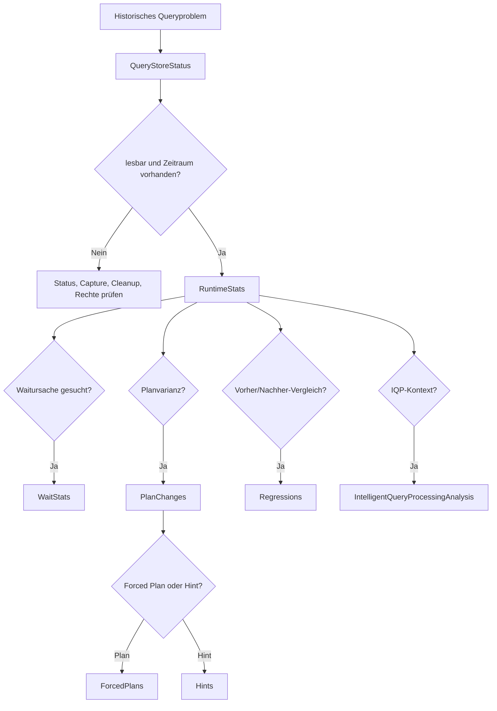

# Query Store: historisierte Laufzeit-, Wait- und Plananalyse

**Procedures:** 9  
**Evidenz:** datenbankbezogene Query-Store-Historie und IQP-Konfiguration  
**Kosten:** LOW bis HIGH_OPT_IN

## Grundregeln

Query Store ist historischer und stabiler als der Plan Cache, aber nicht lückenlos. Jede Interpretation muss mindestens prüfen:

- `actual_state_desc` und `readonly_reason`,
- Capture Mode und Capture Policy,
- Storageauslastung und Cleanup,
- Runtime-Intervalllänge,
- angefordertes Zeitfenster,
- Zahl der Ausführungen je Fenster,
- Query-Store-Datenbank versus im Plan referenzierte Datenbank,
- Plan-/Query-Retention und Planlimit.

Für einen gezielt gewählten Query-Store-Plan kann
`USP_ExecutionPlanAnalysis` zusätzlich `queryStoreContext` und
`feedbackAndVariants` liefern. Der Pfad liest keinen Querytext. Persistierte
Feedback-/Hintpayloads sind standardmäßig ausgelassen, im TOKENIZED-Modus nur
gehasht und nur nach expliziter Bestätigung roh sichtbar. Das Vorhandensein
eines Hints, Feedbackeintrags oder einer Variantenbeziehung ist kein
Wirksamkeits- oder Regressionsnachweis.

**Wichtiger Grenzfall:** Die Procedures verwenden Runtime-Intervalle, die das angeforderte Zeitfenster überlappen. Ein Randintervall kann auch Messanteile außerhalb der exakten Start-/Endzeit enthalten. Je größer das Query-Store-Intervall gegenüber dem Analysefenster ist, desto ungenauer ist die zeitliche Abgrenzung.

---

## 1. [monitor].[USP_QueryStoreStatus]

### Zweck

Die Procedure inventarisiert Query-Store-Zustand und Konfiguration für eine oder mehrere Datenbanken. Dies ist der erste Aufruf vor jeder historischen Analyse.

### Aufrufe

```sql
EXEC [monitor].[USP_QueryStoreStatus]
      @QueryStoreDatabaseNames = N'[ExampleDatabase]',
      @ResultSetArt = 'RAW';
```

```sql
EXEC [monitor].[USP_QueryStoreStatus]
      @QueryStoreDatabaseNames = NULL,
      @ResultSetArt = 'RAW';
```

### Resultsets

RAW liefert Meta/Status, die Query-Store-Statusmenge und Fehler/Warnungen je Datenbank. JSON enthält `meta`, `queryStoreStatus` und `warnings`; TABLE registriert ausschließlich `queryStoreStatus`. Die gemeinsame früh angelegte Ergebnistabelle besitzt 27 Felder, sieben explizite Frameworktextcollations und genau eine NOT-NULL-Spalte (`DatabaseName`); alle Felder sind ohne Identity. Die aktive CONSOLE ergänzt die fachliche Menge um `Ergebnis` oder liefert bei leerer Menge eine dreifeldrige Hinweiszeile.

Ohne Filter, einschließlich NULL, leerem String und Leerzeichen, werden alle sichtbaren Online-Benutzerdatenbanken gelesen. Exakte Pipe-Listen und getrennte Pattern beschränken diesen Scope. Ein Zeilenlimit, Zeitfenster oder Problemfilter existiert nicht. OFF bleibt eine ausgabefähige Optionszeile. Fehlende explizite Namen erzeugen `DATABASE_NOT_FOUND`; bei gemischter gültiger und fehlender Auswahl bleibt die gültige Menge mit `AVAILABLE_LIMITED` und Partialität erhalten.

### Zustandsspalten

| Spalte | Bedeutung und Interpretation |
|---|---|
| `DatabaseId`, `DatabaseName` | Query-Store-Quelldatenbank |
| `DesiredState`, `DesiredStateDesc` | gewünschter Zustand |
| `ActualState`, `ActualStateDesc` | tatsächlich aktiver Zustand; für Auswertung maßgeblich |
| `ReadonlyReason` | bitcodierter Grund für Read-only; Microsoft-Dokumentation zur Decodierung verwenden |
| `CurrentStorageSizeMb`, `MaxStorageSizeMb`, `StorageUsedPercent` | aktueller Query-Store-Speicher; 90 % erzeugt im Code einen Statushinweis |
| `FlushIntervalSeconds` | Flushintervall von In-Memory-Daten auf Disk |
| `IntervalLengthMinutes` | Aggregationsintervall der Runtime Stats |
| `StaleQueryThresholdDays` | zeitbasierte Retention |
| `MaxPlansPerQuery` | Planlimit je Query |
| `QueryCaptureMode`, `QueryCaptureModeDesc` | ALL, AUTO, CUSTOM oder NONE je Version/Konfiguration |
| `SizeBasedCleanupMode`, `SizeBasedCleanupModeDesc` | größenbasierter Cleanup |
| `WaitStatsCaptureMode`, `WaitStatsCaptureModeDesc` | Wait-Erfassung aktiviert oder deaktiviert |
| `CapturePolicyExecutionCount` | Mindestanzahl gemäß Custom Capture Policy |
| `CapturePolicyTotalCompileCpuTimeMs` | Compile-CPU-Schwelle der Capture Policy |
| `CapturePolicyTotalExecutionCpuTimeMs` | Execution-CPU-Schwelle der Capture Policy |
| `CapturePolicyStaleThresholdHours` | Beobachtungsfenster der Policy |
| `IsEnabled` | Query Store ist lesbar aktiv (`actual_state` 1, 2 oder 4) |
| `IsWritable` | `actual_state=READ_WRITE` |
| `StatusHint` | codebasierte Kurzinterpretation |

### Beispiele

| Zustand | Bewertung |
|---|---|
| Desired/Actual `READ_WRITE`, 35 % Storage | normaler Ausgangspunkt |
| Desired `READ_WRITE`, Actual `READ_ONLY` | `ReadonlyReason` und Storage/Cleanup prüfen |
| `StorageUsedPercent=94` | Frameworkhinweis; Cleanup und MaxSize prüfen |
| Capture Mode `AUTO` | seltene oder billige Queries können fehlen |
| Wait Stats Capture OFF | leeres Wait-Resultset ist erwartbar |
| Interval 60 min, Analysefenster 10 min | zeitliche Aussage stark vergröbert |

### Folgeanalyse

Rufen Sie `USP_QueryStoreRuntimeStats`, `USP_QueryStoreWaitStats` oder die Planmodule nur bei einem geeigneten Zustand auf.

### Kosten

LOW. Cross-Database-Katalogzugriff; keine Plan-XML-Analyse.

### Parameter und weitere Aufrufbeispiele

| Parameter | Datentyp | Default | Eingabeform und Wirkung |
|---|---|---|---|
| `@QueryStoreDatabaseNames` | `nvarchar(max)` | `NULL` | Im normalen Analysepfad: Bei Auslassung gilt NULL. NULL sowie N'', N' ' oder ausschließlich äußere U+0020-Leerzeichen bedeuten keine Namenseinschränkung; damit werden alle sichtbaren, zugreifbaren Online-Datenbanken im durch @SystemdatenbankenEinbeziehen bestimmten Scope gewählt, sofern kein Pattern gesetzt ist. Sonst eine bracket-aware Pipe-Liste eintragen: &#124; trennt Elemente nur außerhalb von eckigen Klammern, ]] maskiert eine schließende Klammer; äußere Leerzeichen je Element werden entfernt. Vorgesehen ist ein einteiliger SQL-Name je Element; leere Elemente, ungültige Klammern und ungültige Namen sind INVALID_PARAMETER. Die Liste wird gegen sichtbare Datenbanknamen verglichen; die Parsefunktion ist keine allgemeine Bezeichnervalidierung und prüft weder Existenz noch Zugriff. Doppelte gültige Namen werden vom Auswahlhelfer abgelehnt (Vergleich mit SQL_Latin1_General_CP1_CS_AS). Eine wirksame nichtleere explizite Liste und ein nicht-NULL Pattern sind unzulässig zusammen. Eine nicht auffindbare/offline/nicht zugreifbare explizite Datenbank erzeugt eine Warnung; gültige übrige Treffer können als AVAILABLE_LIMITED ausgegeben werden. Ausgelassen gilt der deklarierte Default NULL. Die tatsächliche Namensprüfung verlangt PARSENAME-Teil 1 ungleich NULL, Teil 2 gleich NULL und höchstens 128 Zeichen für Teil 1; Teile 3 und 4 werden nicht gesondert geprüft. Rohsegmente über 4000 UTF-16-Codeeinheiten sind ungültig. |
| `@SystemdatenbankenEinbeziehen` | `bit` | `0` | Im normalen Analysepfad: Bei Auslassung gilt 0. 0 schließt Systemdatenbanken mit database_id 1 bis 4 aus; 1 bezieht diese ein. NULL ist INVALID_PARAMETER und wird nicht als 0 behandelt. Der Wert muss als bit 0 oder 1 gebunden werden. Leere Textwerte sind keine bit-Eingabeform. Bei @Hilfe=1 kehrt die Procedure vor dem Aufruf von 083 zurück; die NULL-Prüfung des normalen Auswahlpfads wird im Hilfezweig übersprungen. Ausgelassen gilt der deklarierte Default 0. Als SQL-bit 0 oder 1 übergeben; vor dem Körper bleibt numerisch 0 gleich 0, ein von 0 verschiedener konvertierbarer Zahlenwert wird 1. |
| `@QueryStoreDatabaseNamePattern` | `nvarchar(4000)` | `NULL` | Im normalen Analysepfad: Bei Auslassung gilt NULL und es wird kein Pattern angewandt. NULL ist gültig; leerer Text oder ein nach äußerem LTRIM/RTRIM leerer Wert ist INVALID_PARAMETER. Alle erlaubten Präfixe werden ohne Beachtung der Groß-/Kleinschreibung erkannt: kein Präfix oder like: wählt SQL-LIKE-Modus (case-sensitive Vergleich); regex: wählt case-sensitive Regex (Flag c); regexi: wählt case-insensitive Regex (Flag i). Nach dem Präfix wird der Inhalt nicht erneut getrimmt und darf nicht leer sein. Regex wird nur auf SQL Server 2025 bei Compatibility Level 170 der Installationsdatenbank ausgeführt; diese Voraussetzung wird nicht je Quelldatenbank geprüft. Die Regex-Syntax wird vom Parser nicht vorab validiert. Das Pattern wirkt auf die Kandidatennamen im Frameworkhelfer und ist keine pro Quelldatenbank erneut ausgeführte Patternabfrage. Ein nicht-NULL Pattern und eine nichtleere explizite Namensliste sind gegenseitig exklusiv. Ausgelassen gilt der deklarierte Default NULL. LIKE verwendet %, _ und Zeichenklassen [...]. Präfix- und Eingabeformat sind Textwerte, zum Beispiel N'like:App%'; nach Präfixentfernung bleiben Inhalt und Groß-/Kleinschreibung erhalten. |
| `@HighImpactConfirmed` | `bit` | `0` | Im normalen Auswahlpfad: Default: 0. Bei Auslassung gilt 0. 0 übergibt keine High-Impact-Bestätigung; 1 übergibt den gesetzten Bestätigungswert an InternalCheckAnalysisPath. NULL ist INVALID_PARAMETER und wird nicht als Default behandelt. QUERY_STORE_CURRENT ist in diesem Quellstand keine gruppengeschützte Analyseklasse (RequiresGroupGate=0); 1 löst in dieser Procedure keinen zusätzlichen Deep-Pfad aus und ist kein Nachweis, dass ein Gate erforderlich war oder passiert wurde. Leere Textwerte sind keine bit-Eingabeform. Bei @Hilfe=1 wird 083 nicht aufgerufen; diese normale Validierung wird dann übersprungen. Ausgelassen gilt der deklarierte Default 0. Als SQL-bit 0 oder 1 übergeben; vor dem Körper bleibt numerisch 0 gleich 0, ein von 0 verschiedener konvertierbarer Zahlenwert wird 1. |
| `@ResultSetArt` | `varchar(16)` | `'CONSOLE'` | Im normalen Analysepfad: Bei Auslassung gilt CONSOLE. Der Eingabetext wird vor der Auswertung mit LTRIM/RTRIM und UPPER normalisiert (nach Bindung an varchar(16)); NULL wird zu leerem Text und ist INVALID_PARAMETER. Zulässig sind genau CONSOLE, RAW, TABLE und NONE, jeweils ohne Beachtung der Groß-/Kleinschreibung: CONSOLE ruft InternalEmitConsoleResult auf und liefert die fachliche Statusdatenmenge oder bei Leere einen formatierten Hinweis; RAW liefert drei Resultsets mit Modulmetadaten/-status, queryStoreStatus-Daten und Fehlern; TABLE schreibt ausschließlich das Resultset queryStoreStatus in das vorab gemappte Ziel; NONE unterdrückt Grid-Resultsets. JSON-Erzeugung ist unabhängig von dieser Auswahl. Andere Werte sind INVALID_PARAMETER. Ausgelassen gilt der deklarierte Default 'CONSOLE'. Maßgeblich ist der bereits an varchar(16) zugewiesene Wert; eine längere Textangabe kann davor auf die Typbreite gekürzt werden. LTRIM/RTRIM entfernt nur äußere U+0020-Leerzeichen. |
| `@ResultTablesJson` | `nvarchar(max)` | `NULL` | Bei Auslassung gilt NULL. Nur für TABLE ist eine nichtleere Zuordnung zulässig und dort zwingend erforderlich. Sie muss ein gültiges, nichtleeres JSON-Objekt mit genau einem Schlüssel queryStoreStatus und einem nichtleeren Stringwert sein, z. B. N'{"queryStoreStatus":"#QueryStoreStatusTarget"}'. Das Ziel muss eine bereits vorhandene, leere lokale #Temp-Tabelle sein, die genau eine beliebige Seed-Spalte hat; das vollständige Ergebnisschema wird nicht als Seed angelegt. Das Mapping wird vor HELP und vor fachlichen Quellenzugriffen validiert; Fehler werfen bei dieser Procedure. Bei CONSOLE, RAW oder NONE führt eine nicht-NULL, nicht nur aus äußerem LTRIM/RTRIM-Leerraum bestehende Zuordnung zu THROW 51011. NULL oder leerer/U+0020-Leerzeichen-Wert ist außerhalb TABLE zulässig, erfüllt aber die TABLE-Pflicht nicht. Ausgelassen gilt der deklarierte Default NULL. Schlüssel werden binär einschließlich Groß-/Kleinschreibung verglichen; doppelte Schlüssel sind ungültig. Zielnamen sind Strings mit LEN höchstens 116, beginnen mit #, aber nicht ## oder case-insensitiv #Monitor; doppelte Ziele werden case-insensitiv abgewiesen. Die einzelne Seed-Spalte hat einen beliebigen Namen und Typ; eine Seed-Zeile ist nicht zulässig. |
| `@JsonErzeugen` | `bit` | `0` | Im normalen Analysepfad: Bei Auslassung gilt 0. 0 oder NULL erzeugt kein JSON; 1 erzeugt im @Json-OUTPUT-Parameter das JSON-Objekt mit meta, queryStoreStatus und warnings, unabhängig von @ResultSetArt. Der Parameter wird nur auf =1 geprüft; NULL wird daher wie ausgeschaltet behandelt und ist kein INVALID_PARAMETER. Als Eingabeform ist ein bit-Wert 0 oder 1 vorgesehen; leere Textwerte sind keine bit-Eingabeform. Ausgelassen gilt der deklarierte Default 0. Als SQL-bit 0 oder 1 übergeben; vor dem Körper bleibt numerisch 0 gleich 0, ein von 0 verschiedener konvertierbarer Zahlenwert wird 1. |
| `@Json` | `nvarchar(max) OUTPUT` | `NULL` | Bei Auslassung gilt NULL und es gibt keinen Empfänger für den Output. Zur Übernahme ist eine nvarchar(max)-kompatible lokale Variable mit OUTPUT zu binden. Die Procedure setzt den Parameter am Anfang auf NULL; nur wenn @JsonErzeugen=1 wird anschließend das JSON mit meta, queryStoreStatus und warnings zugewiesen. Ohne JSON-Erzeugung bleibt der gebundene Output NULL. Ein nicht gebundener OUTPUT-Aufruf kann kein JSON zurückgeben. Ausgelassen gilt der deklarierte Default NULL. Der Eingabewert dient nicht als Steuerwert; bei Hilfe bleibt der intern zurückgesetzte Wert NULL. Bei vorzeitigem THROW ist kein übernommener OUTPUT zugesichert. |
| `@PrintMeldungen` | `bit` | `1` | Bei Auslassung gilt 1. 1 gibt die normalen Warn-/Statusmeldungen als RAISERROR severity 10 aus, wenn der jeweilige Fehler-/Warnpfad erreicht wird; 0 unterdrückt diese Meldungen. NULL wird nur auf =1 geprüft und unterdrückt daher ebenfalls. Der Schalter ändert weder gespeicherte Error-/Warning-Daten noch Resultsets oder JSON; der HELP-Zweig verwendet PRINT unabhängig davon. Als Eingabeform ist ein bit-Wert 0 oder 1 vorgesehen; leere Textwerte sind keine bit-Eingabeform. Ausgelassen gilt der deklarierte Default 1. Als SQL-bit 0 oder 1 übergeben; vor dem Körper bleibt numerisch 0 gleich 0, ein von 0 verschiedener konvertierbarer Zahlenwert wird 1. |
| `@Hilfe` | `bit` | `0` | Bei Auslassung gilt 0. 1 druckt die eingebaute Parameterhilfe und beendet die Procedure danach; 0 führt die Statusprüfung aus. NULL erfüllt die Prüfung =1 nicht und führt deshalb die normale Verarbeitung aus. Bei @ResultSetArt=TABLE wird das Mapping vor der Hilfe validiert und kann vor dem PRINT mit Fehler abbrechen. Als Eingabeform ist ein bit-Wert 0 oder 1 vorgesehen; leere Textwerte sind keine bit-Eingabeform. Ausgelassen gilt der deklarierte Default 0. Als SQL-bit 0 oder 1 übergeben; vor dem Körper bleibt numerisch 0 gleich 0, ein von 0 verschiedener konvertierbarer Zahlenwert wird 1. Die normale Validierung von Ausgabemodus, Pattern, Namenslisten und Auswahlhelferparametern wird im Hilfezweig übersprungen; der frühe Nicht-TABLE-Mappingguard und TABLE-Zielpreflight bleiben aktiv. |

```sql
EXEC [monitor].[USP_QueryStoreStatus] @Hilfe = 1;
```

```sql
EXEC [monitor].[USP_QueryStoreStatus] @QueryStoreDatabaseNames = N'[ExampleDatabase]', @ResultSetArt = 'RAW';
```

```sql
DECLARE @Json nvarchar(max) = NULL;
EXEC [monitor].[USP_QueryStoreStatus]
      @QueryStoreDatabaseNames=N'[ExampleDatabase]'
    , @ResultSetArt = 'NONE'
    , @JsonErzeugen = 1
    , @Json = @Json OUTPUT;
SELECT @Json AS [JsonPayload];
```

```sql
CREATE TABLE [#QueryStoreStatusTarget] ([Seed] bit NULL);
EXEC [monitor].[USP_QueryStoreStatus]
      @ResultSetArt = 'TABLE'
    , @ResultTablesJson = N'{"queryStoreStatus":"#QueryStoreStatusTarget"}';
SELECT * FROM [#QueryStoreStatusTarget];
DROP TABLE [#QueryStoreStatusTarget];
```

---

## 2. [monitor].[USP_QueryStoreRuntimeStats]

### Zweck

Die Procedure aggregiert Laufzeitwerte je Query und Plan über ein Zeitfenster und mehrere Query-Store-Datenbanken. Das Standardzeitfenster umfasst die letzte Stunde.

### Aufrufe

```sql
EXEC [monitor].[USP_QueryStoreRuntimeStats]
      @QueryStoreDatabaseNames = N'[ExampleDatabase]',
      @VonUtc = DATEADD(HOUR, -1, SYSUTCDATETIME()),
      @BisUtc = SYSUTCDATETIME(),
      @Sortierung = 'CPU_TOTAL',
      @ResultSetArt = 'RAW';
```

```sql
EXEC [monitor].[USP_QueryStoreRuntimeStats]
      @QueryStoreDatabaseNames = NULL,
      @ReferencedDatabaseNames = N'[ExampleReferencedDatabase]',
      @MitPlanXml = 1,
      @AnalyseModus = 'VOLL',
      @ResultSetArt = 'RAW';
```

Der Referenzdatenbankfilter parst Showplan-XML und ist ein Deep-Pfad.

RuntimeStats, WaitStats, PlanChanges, Regressions und ForcedPlans lösen den Parser exakter Referenzlisten in der Frameworkdatenbank auf, auch wenn die dynamische Abfrage bereits in einer anderen Quelldatenbank läuft. Der vor `USE` über den NOLOCK-Katalog gelesene und mit `QUOTENAME` geschützte Frameworkname bildet den dreigliedrigen Helpernamen. `NULL` bedeutet keinen Referenzlistenfilter; leere Listen sind ungültig. Gültige doppelte Namen bleiben erlaubt. Die explizite CS-Namensprüfung und die getrennten LIKE-/Regexpfade bleiben erhalten. Bei PlanChanges betrifft der Referenzfilter die Summaryaggregation; die Plandetails ausgewählter Querykeys bleiben vollständig.

### Hauptspalten

| Gruppe | Spalten | Bedeutung |
|---|---|---|
| Quelle | `QueryStoreDatabaseId`, `QueryStoreDatabaseName` | Datenbank, in der Query Store gespeichert ist |
| Identität | `QueryId`, `PlanId`, `QueryHash`, `QueryPlanHash`, `ObjectId`, `ObjectName` | IDs sind nur innerhalb der Query-Store-DB eindeutig |
| Ausführung | `ExecutionTypeDesc`, `FirstExecutionTimeUtc`, `LastExecutionTimeUtc`, `ExecutionCount` | normale, abgebrochene oder Ausnahmeausführungen können getrennt sein |
| Dauer | `TotalDurationMs`, `AverageDurationMs` | gewichtete Aggregation über Runtimezeilen |
| CPU | `TotalCpuMs`, `AverageCpuMs` | CPU je Plan/Query im Fenster |
| I/O | `TotalLogicalReads`, `AverageLogicalReads`, `TotalLogicalWrites`, `AverageLogicalWrites`, `TotalPhysicalReads` | Query-Store-Metriken, nicht Storage-Latenz |
| Memory | `TotalMemoryGrantKb`, `MaxMemoryGrantKb` | aggregierte Grant-Evidenz |
| Ergebnis | `TotalRowCount` | aggregierte Zeilenanzahl |
| Log/TempDB | `TotalLogBytes`, `TotalTempdbKb` | versionsabhängige Runtimewerte; partielle Verfügbarkeit möglich |
| Inhalt | `QuerySqlText`, `QueryPlan` | Text optional gekürzt, Plan nur mit `@MitPlanXml=1` |

### Sortierungen

`CPU_TOTAL`, `DURATION_TOTAL`, `READS_TOTAL`, `WRITES_TOTAL`, `EXECUTIONS`, `MEMORY_MAX`, `TEMPDB_TOTAL`, `LOG_BYTES_TOTAL`, `LAST_EXECUTION`.

### Ausgabe und Mengenvertrag

RAW, CONSOLE, TABLE und JSON verwenden einen gemeinsamen Export mit 40 Feldern und zehn expliziten Frameworktextcollations. Datenbankname, QueryId und PlanId sind NOT NULL, alle übrigen Felder nullable und alle Spalten ohne Identity. Ein positives `@MaxZeilen` begrenzt einmal global nach der gewählten Sortierung und den bestehenden Secondarykeys. NULL und 0 sind unbegrenzt; Status, Kandidatenzähler, `hasMoreRows`, Textwarnung und Planstatus werden vorher aus allen lokalen N+1-Kandidaten berechnet.

Die dynamische Projektion verwendet eindeutiges `A.object_id` und Aliase für die neun bestehenden Rankausdrücke. `LAST_EXECUTION` verwendet den lokalen Zeit-Sortausdruck einmal; weitere Sorttie-Schlüssel werden nicht ergänzt. Ungültige Zeilen- und Textlimits liefern über die bestehende Statusprüfung eine leere `INVALID_PARAMETER`-Menge. NULL und 0 als Textlimit erhalten den vollständigen Text. Plan-XML bleibt nativ typisiert in RAW und TABLE; JSON serialisiert seinen XML-Wert als Text.

### Interpretation

| Konstellation | Bewertung |
|---|---|
| hohe Total-CPU, niedrige Avg-CPU, sehr viele Ausführungen | kumulative Optimierungschance |
| hohe Avg-Dauer, geringe CPU | Wait-/Blocking-/I/O-Kontext nötig |
| hoher `MaxMemoryGrantKb`, geringe Ausführungszahl | Ausreißer möglich; Plan und Zeitintervalle prüfen |
| hohe TempDB-KB | Spill-/Worktable-/Versioningverdacht, aber Plan validieren |
| mehrere PlanIds derselben Query mit stark unterschiedlicher Avg-Dauer | Planwechsel oder Parameter-Sensitivity prüfen |
| Query fehlt vollständig | Capture Mode, Cleanup, Zeitraum und Query-Store-Zustand prüfen |

### Deep-Kriterien des Codes

`QUERY_STORE_DEEP` wird bei mindestens einem der folgenden gültigen Aufrufwerte aktiviert:

- `@AnalyseModus=VOLL`,
- `@MitPlanXml=1`,
- `@MaxZeilen>1000` oder unbegrenzt mit NULL/0,
- `DATEDIFF(HOUR,@VonUtc,@BisUtc)>24`; dies zählt überschrittene Stundengrenzen,
- nicht-NULL Referenzdatenbankliste oder Referenzpattern,
- Querytextfilter mit `regex:` oder `regexi:`.

Der Pfad erfordert `@HighImpactConfirmed=1` und die aktuelle Gruppenfreigabe; die Bestätigung vergibt keine SQL-Rechte.

### Aussagegrenzen

- Runtimewerte werden je Plan, Intervall und Ausführungstyp gesammelt; die gespeicherten Durchschnittswerte werden mit Ausführungszahlen gewichtet und anschließend zusammengeführt.
- Randintervalle werden vollständig einbezogen, wenn sie das Fenster schneiden.
- Durchschnittswerte können multimodale Verteilungen verdecken.
- `Total*` ist nur innerhalb des gewählten Fensters und sichtbaren Retentionsbereichs vergleichbar.
- Ein Query Store auf einer sekundären Replica kann je Version/Konfiguration abweichende Daten liefern.

### Folgeanalyse

`USP_QueryStoreWaitStats`, `USP_QueryStorePlanChanges`, `USP_QueryStoreRegressions`, `USP_ShowplanAnalysis`.

### Parameter und weitere Aufrufbeispiele

| Parameter | Datentyp | Default | Eingabeform und Wirkung |
|---|---|---|---|
| `@QueryStoreDatabaseNames` | `nvarchar(max)` | `NULL` | Im normalen Analysepfad: Gibt exakte Query-Store-Quelldatenbanken als bracket-aware Pipe-Liste an; jedes Element ist ein einteiliger SQL-Name. Pipe trennt außerhalb von [...], ]] maskiert dort eine schließende Klammer, Rand-Leerzeichen je Element werden entfernt. Ausgelassen oder NULL sowie N'' oder nur äußere Leerzeichen: keine Namenseinschränkung, also alle sichtbaren geeigneten Online-Benutzerdatenbanken. Nichtleere Liste: ungültige Elemente und doppelte gültige Namen ergeben INVALID_PARAMETER; Liste und @QueryStoreDatabaseNamePattern dürfen nicht gleichzeitig aktiv sein. Dies filtert Quell-Datenbanken, nicht Showplan-Referenzen. Ausgelassen gilt der deklarierte Default NULL. Die tatsächliche Namensprüfung verlangt PARSENAME-Teil 1 ungleich NULL, Teil 2 gleich NULL und höchstens 128 Zeichen für Teil 1; Teile 3 und 4 werden nicht gesondert geprüft. Rohsegmente über 4000 UTF-16-Codeeinheiten sind ungültig. |
| `@QueryStoreDatabaseNamePattern` | `nvarchar(4000)` | `NULL` | Im normalen Analysepfad: Alternativer Patternfilter für Query-Store-Quelldatenbanken. NULL: kein Pattern. Äußere Leerzeichen werden getrimmt; optionale Präfixe LIKE/Regex werden ohne Beachtung der Großschreibung erkannt, der Patternwert danach nicht erneut getrimmt. Unpräfigiert oder like: bedeutet case-sensitive SQL-LIKE; regex: case-sensitive (Flag c); regexi: case-insensitive (Flag i). Leer/U+0020-Leerzeichen und leeres Präfixergebnis sind ungültig. Nicht-NULL Pattern und wirksame exakte Quellliste schließen einander aus. Regex erfordert SQL Server 2025 und Compatibility Level 170 der Installationsdatenbank; der Auswahlhelfer führt den Regexfilter dort auf Kandidatennamen aus. Dies ist nicht die spätere Regexprüfung je Query-Store-Quelldatenbank. Filtert keine Showplan-Referenzen. Ausgelassen gilt der deklarierte Default NULL. LIKE verwendet %, _ und Zeichenklassen [...]. Präfix- und Eingabeformat sind Textwerte, zum Beispiel N'like:App%'; nach Präfixentfernung bleiben Inhalt und Groß-/Kleinschreibung erhalten. |
| `@HighImpactConfirmed` | `bit` | `0` | Im normalen Auswahlpfad: Bestätigt einen tatsächlich aktivierten High-Impact-Pfad mit 1. NULL ist INVALID_PARAMETER durch 083, unabhängig davon, ob die Analyseklasse ein Gruppengate verlangt; 0 lässt Bestätigung aus. QUERY_STORE_CURRENT verlangt derzeit kein Gruppengate; QUERY_STORE_DEEP hat RequiresGroupGate=1. Bestätigung aktiviert Deep nicht und gewährt keine Gruppen- oder SQL-Berechtigung; Freigabe und Rechte werden getrennt geprüft. Ausgelassen gilt der deklarierte Default 0. Als SQL-bit 0 oder 1 übergeben; vor dem Körper bleibt numerisch 0 gleich 0, ein von 0 verschiedener konvertierbarer Zahlenwert wird 1. |
| `@ReferencedDatabaseNames` | `nvarchar(max)` | `NULL` | Im normalen Analysepfad: Filtert Querys anhand einteiliger Namen in gespeicherten Showplans, nicht die Quell-Datenbanken. NULL/ausgelassen: kein Referenzfilter. Nicht-NULL muss eine gültige bracket-aware Pipe-Liste sein; N''/nur Leerzeichen und ungültige Parserwerte sind INVALID_PARAMETER. Gültige Duplikate sind zulässig; EXISTS vervielfacht Treffer nicht. Exakte Liste und @ReferencedDatabaseNamePattern dürfen nicht gleichzeitig non-NULL sein. Jedes gesetzte Referenzlistenfilter ist Deep und erfordert gespeicherte Showplan-XML. Ausgelassen gilt der deklarierte Default NULL. Die tatsächliche Namensprüfung verlangt PARSENAME-Teil 1 ungleich NULL, Teil 2 gleich NULL und höchstens 128 Zeichen für Teil 1; Teile 3 und 4 werden nicht gesondert geprüft. Rohsegmente über 4000 UTF-16-Codeeinheiten sind ungültig. |
| `@ReferencedDatabaseNamePattern` | `nvarchar(4000)` | `NULL` | Im normalen Analysepfad: Filtert nach in gespeicherten Showplans referenzierten Datenbanknamen; keine Quell-DB-Auswahl. NULL: kein Pattern. Unpräfigiert oder like: case-sensitive LIKE; regex: case-sensitive mit Flag c; regexi: case-insensitive mit Flag i. Äußere Leerzeichen werden vor Präfixerkennung getrimmt, danach der Inhalt nicht erneut. Leer/U+0020-Leerzeichen oder leeres Präfixergebnis ungültig. Jeder gesetzte Referenzpatternwert ist exklusiv zu @ReferencedDatabaseNames und löst Deep aus. Regex benötigt SQL Server 2025 und Compatibility Level 170 je Quelldatenbank. Ausgelassen gilt der deklarierte Default NULL. LIKE verwendet %, _ und Zeichenklassen [...]. Präfix- und Eingabeformat sind Textwerte, zum Beispiel N'like:App%'; nach Präfixentfernung bleiben Inhalt und Groß-/Kleinschreibung erhalten. |
| `@QueryId` | `bigint` | `NULL` | Filtert auf die exakte QueryId in jeder gewählten Query-Store-Quelldatenbank. NULL/ausgelassen: kein QueryId-Filter. Jeder signed-bigint-Wert ist zulässig; keine zusätzliche Positivitätsprüfung. Wirkung bleibt auf Quellen, Zeitfenster und übrige Filter beschränkt. |
| `@QueryHash` | `binary(8)` | `NULL` | Filtert exakt auf den 8-Byte-QueryHash. NULL/ausgelassen: kein Hashfilter. Der Wert muss zu binary(8) konvertierbar sein; Hexwerte als 0x plus 16 Hexziffern angeben. Hash ersetzt nicht die Identität aus Quelldatenbank und QueryId. |
| `@TextPattern` | `nvarchar(4000)` | `NULL` | Im normalen Analysepfad: Filtert den gespeicherten SQL-Text. NULL/ausgelassen: kein Filter. Unpräfigiert oder like: SQL-LIKE unter expliziter case-sensitive Framework-Collation; regex: case-sensitive Regex (Flag c); regexi: case-insensitive Regex (Flag i). Präfixerkennung case-insensitive; äußere Leerzeichen werden zuerst getrimmt, nach Präfixentfernung der Wert nicht erneut. Leerer/U+0020-Leerzeichen Wert oder leeres Präfixergebnis ungültig. Regex benötigt SQL Server 2025 und Compatibility Level 170 in jeder Quelldatenbank und aktiviert Deep; unpassende Quelle wird als unavailable/partial gemeldet. Ausgelassen gilt der deklarierte Default NULL. LIKE verwendet %, _ und Zeichenklassen [...]. Präfix- und Eingabeformat sind Textwerte, zum Beispiel N'like:App%'; nach Präfixentfernung bleiben Inhalt und Groß-/Kleinschreibung erhalten. |
| `@VonUtc` | `datetime2(7)` | `NULL` | Im normalen Analysepfad: UTC-Untergrenze; caller liefert UTC, datetime2 hat keinen Offset und es erfolgt keine Zeitzonenkonvertierung. NULL wird nach Auflösung von @BisUtc auf BisUtc minus eine Stunde gesetzt. Erforderlich ist VonUtc &lt; BisUtc; Gleichheit oder größer ist ungültig. Intervalle werden bei end_time &gt; VonUtc und start_time &lt; BisUtc vollständig berücksichtigt, ohne anteilige Kürzung; gemeldete Execution-Zeiten können außerhalb des Fensters liegen. Ausgelassen gilt der deklarierte Default NULL. Übergabeform zum Beispiel '2026-01-01T12:00:00.0000000' als UTC-datetime2(7); kein Offset wird umgerechnet. |
| `@BisUtc` | `datetime2(7)` | `NULL` | UTC-Obergrenze; caller liefert UTC ohne Offsetkonvertierung. NULL/ausgelassen wird zu SYSUTCDATETIME() aufgelöst; zugleich NULLes @VonUtc ergibt eine Stunde Fenster. Muss größer als @VonUtc sein. Mit end_time &gt; VonUtc und start_time &lt; BisUtc schneiden Intervalle das Fenster; sie werden vollständig und nicht anteilig einbezogen. Ausgelassen gilt der deklarierte Default NULL. Übergabeform zum Beispiel '2026-01-01T12:00:00.0000000' als UTC-datetime2(7); kein Offset wird umgerechnet. |
| `@Sortierung` | `varchar(32)` | `'CPU_TOTAL'` | Im normalen Analysepfad: Werte werden getrimmt und großgeschrieben; NULL/ausgelassen wird CPU_TOTAL, leer oder unbekannt ist ungültig. Geschlossene Wertemenge mit tatsächlichem Rank-Ausdruck, jeweils DESC: CPU_TOTAL=TotalCpuMs (gesamte CPU ms); DURATION_TOTAL=TotalDurationMs (Gesamtdauer ms); READS_TOTAL=TotalLogicalReads (aggregierte logische Lesezugriffe); WRITES_TOTAL=TotalLogicalWrites (aggregierte logische Schreibzugriffe); EXECUTIONS=ExecutionCount (Ausführungsanzahl); MEMORY_MAX=MaxMemoryGrantKb (größter beobachteter Query-Speicherwert in KB); TEMPDB_TOTAL=TotalTempdbKb (aggregierte TempDB-Menge in KB); LOG_BYTES_TOTAL=TotalLogBytes (aggregierte Logbytes); LAST_EXECUTION=LastExecutionTimeUtc (letzte Ausführung). Im globalen Ranking folgen letzter Ausführungszeitpunkt DESC, Query-Store-Datenbankname, QueryId und PlanId; lokal wird nach Rang und gegebenenfalls letztem Ausführungszeitpunkt geordnet. Bestimmt den globalen Ausschnitt; RAW und JSON ordnen ausdrücklich. Für TABLE und die aktive CONSOLE besteht keine zusätzliche physische Reihenfolgegarantie. Ausgelassen gilt der deklarierte Default 'CPU_TOTAL'. Maßgeblich ist der bereits an varchar(32) zugewiesene Wert; eine längere Textangabe kann davor auf die Typbreite gekürzt werden. LTRIM/RTRIM entfernt nur äußere U+0020-Leerzeichen. |
| `@AnalyseModus` | `varchar(16)` | `'TOP'` | Im normalen Analysepfad: Werte werden getrimmt und großgeschrieben; NULL/ausgelassen wird TOP. Geschlossene Menge: TOP ist der Standard-Rankingpfad und fordert allein keinen Deep-Pfad an; VOLL aktiviert QUERY_STORE_DEEP und dessen High-Impact-/Zugriffsgate, hebt aber nicht das Zeilenlimit auf. Leer/unbekannt ist ungültig. Unabhängige Deep-Auslöser: MitPlanXml=1, effektives MaxZeilen &gt;1000, DATEDIFF(HOUR,VonUtc,BisUtc)&gt;24, nicht-NULL Referenznamen/-pattern oder Querytext-REGEX/REGEXI. Ausgelassen gilt der deklarierte Default 'TOP'. Maßgeblich ist der bereits an varchar(16) zugewiesene Wert; eine längere Textangabe kann davor auf die Typbreite gekürzt werden. LTRIM/RTRIM entfernt nur äußere U+0020-Leerzeichen. |
| `@MaxZeilen` | `int` | `100` | Im normalen Analysepfad: Globales Ergebnislimit nach lokalem Ranking. Ausgelassen: 100; NULL/0 unbegrenzt; positiver int 1 bis 2147483647 begrenzt; negative Werte INVALID_PARAMETER. Je Quelle werden höchstens N+1 lokale Kandidaten gelesen, außer int-Maximum verwendet N; NULL/0 nutzt unbegrenzte lokale Kandidaten. Nach Quellenaggregation/-sortierung folgen Textprojektion, Plan-XML-Parsing, Warnungen und Zähler für alle Kandidaten vor dem globalen TOP. Effektives Limit &gt;1000 sowie unbegrenzt (NULL/0) aktivieren Deep. ResultLimited/hasMoreRows zeigt global abgeschnittene Treffer an. |
| `@MitPlanXml` | `bit` | `0` | Nur genau 1 aktiviert Planausgabe und XML-Parsen gespeicherter Plantexte für ausgewählte Kandidaten und löst Deep aus. 0 unterdrückt Planausgabe und XML-Parsen, QueryPlan bleibt NULL und QueryPlanStatus wird NOT_REQUESTED. NULL aktiviert weder Planausgabe/XML-Parsen noch Deep, erhält aber durch den Status-CASE PENDING statt NOT_REQUESTED. Nur bei 1 werden Plantexte tatsächlich geparst; XML-Inhalt kann AVAILABLE/XML_EMPTY/SOURCE_NULL oder Fehlerstatus liefern. Erhöht Quell- und Parseaufwand. Ausgelassen gilt der deklarierte Default 0. Als SQL-bit 0 oder 1 übergeben; vor dem Körper bleibt numerisch 0 gleich 0, ein von 0 verschiedener konvertierbarer Zahlenwert wird 1. Der Quell-CTE referenziert und gruppiert den gespeicherten Plantexteintrag unabhängig vom Schalter; 0 oder NULL garantiert deshalb keine Vermeidung nativer Plantexte-Zugriffe. |
| `@MaxSqlTextZeichen` | `int` | `4000` | Im normalen Analysepfad: Maximale exportierte SQL-Textlänge je Treffer. Default 4000; NULL/0: vollständig; positiv: Grenze in Unicode-Zeichen unter SC-Collation, Surrogatpaar zählt als ein Zeichen und wird nicht geteilt; Graphemcluster werden nicht gezählt. Negativ ist INVALID_PARAMETER. QuerySqlTextCharacters/QuerySqlTextBytes bleiben verfügbar und QuerySqlTextIsTruncated kennzeichnet Kürzung. Eine zusammengefasste Warnung wird bei Kürzung nur mit @PrintMeldungen=1 ausgegeben. Die Grenze projiziert nach Materialisierung des Quelltexts. Ausgelassen gilt der deklarierte Default 4000. |
| `@ResultSetArt` | `varchar(16)` | `'CONSOLE'` | Im normalen Analysepfad: Werte werden getrimmt und großgeschrieben, daher case-insensitiv. Geschlossene Menge: CONSOLE formatiert nur die fachliche Exportmenge oder bei Leere einen Hinweis; RAW liefert drei technische Resultsets (Metadaten, runtimeStats, Warnungen); TABLE schreibt nur runtimeStats ins benannte Ziel und unterdrückt Grids; NONE unterdrückt Resultsetgrids. JSON über @JsonErzeugen/@Json ist unabhängig davon. Nur TABLE erlaubt nichtleeres @ResultTablesJson. TABLE verlangt eine gültige Zuordnung und bestehende leere lokale #Temp-Zieltabelle mit genau einer beliebigen Seed-Spalte; Helper-Preflight erfolgt vor fachlichem Zugriff. NULL wird zu leer und ist wie leer/unbekannt ungültig. Ausgelassen gilt der deklarierte Default 'CONSOLE'. Maßgeblich ist der bereits an varchar(16) zugewiesene Wert; eine längere Textangabe kann davor auf die Typbreite gekürzt werden. LTRIM/RTRIM entfernt nur äußere U+0020-Leerzeichen. |
| `@ResultTablesJson` | `nvarchar(max)` | `NULL` | JSON-Zuordnung für das einzelne TABLE-Resultset runtimeStats. Bei TABLE ist ein gültiges nichtleeres JSON-Objekt erforderlich; NULL/ausgelassen, leer/U+0020-Leerzeichen oder ungültiges JSON schlägt den Preflight fehl. Das Objekt muss genau den Schlüssel runtimeStats auf ein vorhandenes, eindeutiges lokales #Temp-Ziel abbilden; unbekannte/doppelte Namen oder Ziele sind ungültig. Ziel muss bereits existieren und leer sein, mit genau einer beliebigen Seed-Spalte; es braucht nicht die volle RuntimeStats-Zielstruktur. Preflight vor fachlichen Datenquellen. Nichtleeres Mapping ausschließlich mit TABLE; für andere ResultSetArt wird es vor dem fachlichen Zugriff abgewiesen. Ausgelassen gilt der deklarierte Default NULL. Schlüssel werden binär einschließlich Groß-/Kleinschreibung verglichen; doppelte Schlüssel sind ungültig. Zielnamen sind Strings mit LEN höchstens 116, beginnen mit #, aber nicht ## oder case-insensitiv #Monitor; doppelte Ziele werden case-insensitiv abgewiesen. Die einzelne Seed-Spalte hat einen beliebigen Namen und Typ; eine Seed-Zeile ist nicht zulässig. Sowohl diese TABLE-Vorprüfung als auch die Ablehnung eines nichtleeren Mappings außerhalb TABLE liegen vor dem Hilfezweig. |
| `@JsonErzeugen` | `bit` | `0` | Nur genau 1 baut @Json als Objekt mit meta, runtimeStats und warnings. 0 oder NULL erzeugt kein JSON; der Parameter ist nicht abhängig von @ResultSetArt, daher auch mit NONE möglich. Die JSON-Daten reflektieren die gemeinsame Exportmenge, Sortierung und globale Begrenzung. Ausgelassen gilt der deklarierte Default 0. Als SQL-bit 0 oder 1 übergeben; vor dem Körper bleibt numerisch 0 gleich 0, ein von 0 verschiedener konvertierbarer Zahlenwert wird 1. |
| `@Json` | `nvarchar(max) OUTPUT` | `NULL` | Optionale OUTPUT-Bindung zum Empfang des JSON. Beim Procedure-Eintritt wird der Ausgabewert immer auf NULL zurückgesetzt; ohne callerseitige OUTPUT-Bindung gibt es keinen empfangenen Wert. Nur mit @JsonErzeugen=1 wird das meta/runtimeStats/warnings-Objekt zugewiesen; ansonsten bleibt NULL. Im EXEC-Aufruf muss auch die empfangende Variable mit OUTPUT gebunden werden. Ausgelassen gilt der deklarierte Default NULL. Der Eingabewert dient nicht als Steuerwert; bei Hilfe bleibt der intern zurückgesetzte Wert NULL. Bei vorzeitigem THROW ist kein übernommener OUTPUT zugesichert. |
| `@PrintMeldungen` | `bit` | `1` | Steuert Severity-10-Meldungen, nicht Warning-Datensätze oder JSON. Default/1: erlaubte Quellenfehler und Truncationwarnung werden als Meldungen ausgegeben. 0/NULL: Meldungen unterdrückt; Fehler-/Warning-Daten in RAW und JSON warnings bleiben erhalten; die aktive CONSOLE hat kein separates Warnungsresultset. Nur genau 1 aktiviert die Meldungsausgabe. Ausgelassen gilt der deklarierte Default 1. Als SQL-bit 0 oder 1 übergeben; vor dem Körper bleibt numerisch 0 gleich 0, ein von 0 verschiedener konvertierbarer Zahlenwert wird 1. |
| `@Hilfe` | `bit` | `0` | Genau 1 druckt integrierte Parameterhilfe via PRINT und kehrt unmittelbar zurück, vor Zeitauflösung, Datenbankkandidaten, fachlichen Quellen und Ausgabe. Default/0 führt Analyse aus; NULL löst den Hilfezweig nicht aus. Hilfe erzeugt keine fachlichen Resultsets. Ausgelassen gilt der deklarierte Default 0. Als SQL-bit 0 oder 1 übergeben; vor dem Körper bleibt numerisch 0 gleich 0, ein von 0 verschiedener konvertierbarer Zahlenwert wird 1. Die nichtleere Mappingzuordnung außerhalb TABLE wird ebenso wie der TABLE-Zielpreflight bereits vor der Hilfe geprüft; ein Mappingfehler kann den Hilfereturn verhindern. Die normale Validierung von Ausgabemodus, Sortierung, Analysemodus, Namen, Pattern, Zeitfenster, Zeilen-/Textgrenzen und Analysefreigaben entfällt im Hilfezweig; die frühen Mappingprüfungen bleiben aktiv. |

```sql
EXEC [monitor].[USP_QueryStoreRuntimeStats] @Hilfe=1;
```

```sql
DECLARE @BisUtc datetime2(7) = SYSUTCDATETIME();
DECLARE @VonUtc datetime2(7) = DATEADD(HOUR, -1, @BisUtc);
EXEC [monitor].[USP_QueryStoreRuntimeStats]
      @QueryStoreDatabaseNames = N'[ExampleDatabase]',
      @VonUtc = @VonUtc,
      @BisUtc = @BisUtc,
      @Sortierung = 'CPU_TOTAL',
      @MaxZeilen = 100,
      @ResultSetArt = 'CONSOLE';
```

```sql
DECLARE @Json nvarchar(max);
EXEC [monitor].[USP_QueryStoreRuntimeStats]
      @QueryStoreDatabaseNames = N'[ExampleDatabase]',
      @ResultSetArt = 'NONE',
      @JsonErzeugen = 1,
      @Json = @Json OUTPUT;
SELECT @Json AS [Json];
```

```sql
CREATE TABLE [#QueryStoreRuntimeStats_HelpExample] ([seed] int NULL); EXEC [monitor].[USP_QueryStoreRuntimeStats] @QueryStoreDatabaseNames=N'[ExampleDatabase]', @ResultSetArt='TABLE', @ResultTablesJson=N'{"runtimeStats":"#QueryStoreRuntimeStats_HelpExample"}'; SELECT * FROM [#QueryStoreRuntimeStats_HelpExample]; DROP TABLE [#QueryStoreRuntimeStats_HelpExample];
```

---

## 3. [monitor].[USP_QueryStoreWaitStats]

### Zweck

Die Procedure aggregiert Query-Store-Waitkategorien je Plan und Ausführungstyp über ein Zeitfenster. Das Standardzeitfenster umfasst die letzte Stunde.

### Spalten

| Spalte | Bedeutung |
|---|---|
| `QueryStoreDatabaseId`, `QueryStoreDatabaseName` | Quelldatenbank |
| `QueryId`, `PlanId`, `QueryHash`, `QueryPlanHash` | Query-/Planidentität |
| `WaitCategory`, `WaitCategoryDesc` | Query-Store-Waitkategorie, nicht einzelner Waittyp |
| `ExecutionTypeDesc` | normale oder abweichende Ausführungsart |
| `FirstIntervalStartUtc`, `LastIntervalEndUtc` | sichtbare Intervallspanne |
| `RecordedRows` | Zahl aggregierter Query-Store-Waitzeilen, nicht Zahl einzelner Waitevents |
| `TotalQueryWaitTimeMs` | Summe der aufgezeichneten Query-Waitzeit |
| `AverageRecordedQueryWaitTimeMs` | Ungewichtetes Mittel der gespeicherten Record-Durchschnittswerte; nicht nach Ausführungen gewichtet |
| `MaxQueryWaitTimeMs` | größter gespeicherter Maximalwert |
| `QuerySqlText` | optional gekürzter Text |

### Ausgabe und Grenzen

Die gemeinsame 25-Feld-Exportmenge versorgt RAW, CONSOLE, TABLE und JSON. Ihre acht Textspalten sind explizit mit `SQL_Latin1_General_CP1_CS_AS` collatiert; Datenbankname und Truncationflag sind NOT NULL, alle Spalten ohne Identity. Ein positives `@MaxZeilen` begrenzt global nach Totalzeit und letztem Intervallende absteigend; NULL und 0 sind unbegrenzt. Status, Zähler, `hasMoreRows` und Truncationwarnung entstehen aus den vollständigen lokalen N+1-Kandidaten vor dem Export. Sortties begründen keine feste Auswahl zwischen Aufrufen.

Überlappende Intervalle werden vollständig übernommen, einschließlich ihrer nativen Grenzen; es erfolgt keine zeitanteilige Kürzung. Der Beschreibungskategorienfilter behält seinen nativen Vergleich. Nur der konvertierte numerische Kategorienarm wird beidseitig Framework-collatiert; führende Nullen werden nicht normalisiert. Negative Zeilen- und Textlimits liefern kontrolliert `INVALID_PARAMETER` und eine leere Menge; NULL und 0 als Textlimit behalten den vollständigen Text.

### Interpretation

- Kategorien sind gröber als Live-Waittypen.
- `TotalQueryWaitTimeMs` priorisiert Gesamtwirkung.
- `AverageRecordedQueryWaitTimeMs` ist kein exakter Durchschnitt pro Ausführung, weil der Code gespeicherte Record-Durchschnittswerte ungewichtet mittelt.
- `RecordedRows` misst Messpunkte; mehr Messpunkte bedeuten nicht automatisch mehr Ausführungen.
- Wait Capture muss aktiviert gewesen sein.

### Beispiele

| Fall | Bewertung |
|---|---|
| Lock-Kategorie dominiert nur ein Intervall | zeitlich lokaler Blockingburst möglich |
| CPU-Kategorie hoch und Runtime-CPU hoch | CPU-/Scheduler-/Plananalyse |
| Buffer-I/O hoch, aber nur 2 Ausführungen | einzelne schwere analytische Query möglich |
| keine Zeilen, Status READ_WRITE, Wait Capture OFF | erwartetes leeres Resultset |
| hohe Waitsumme bei hoher Ausführungszahl, niedriger Maxwert | viele kleine Wartezeiten statt einzelner Ausreißer |

### Folgeanalyse

Aktuell reproduzierbar: `USP_CurrentWaits` und `USP_CurrentRequests`. Historisch: PlanChanges/Regressions und XE.

### Parameter und weitere Aufrufbeispiele

| Parameter | Datentyp | Default | Eingabeform und Wirkung |
|---|---|---|---|
| `@QueryStoreDatabaseNames` | `nvarchar(max)` | `NULL` | Ausgelassen/NULL, N'' oder nur äußere U+0020-Leerzeichen: keine Einschränkung. Sonst bracket-aware Pipe-Liste exakter einteiliger SQL-Datenbanknamen, zum Beispiel N'[ExampleDatabase]&#124;[OtherDatabase]'; &#124; trennt außerhalb von [...], ]] maskiert ]. Leere Elemente, ungültige Namen und Duplikate sind INVALID_PARAMETER. Eine effektive nichtleere Liste ist exklusiv mit dem nicht-NULL Quellpattern. Ohne Filter werden sichtbare geeignete Online-Benutzerdatenbanken gewählt; Systemdatenbanken bleiben ausgeschlossen. |
| `@QueryStoreDatabaseNamePattern` | `nvarchar(4000)` | `NULL` | ausgelassen/NULL kein Filter. Äußeres Trimmen, dann like: bedeutet SQL-LIKE-Muster, regex: regulärer Ausdruck mit Flag c (case-sensitiv), regexi: regulärer Ausdruck mit Flag i (case-insensitiv); Präfixe ohne Beachtung der Großschreibung entfernen. Ohne Präfix gilt LIKE; Rest wird nicht erneut getrimmt. Leer oder leer nach Präfix ist ungültig; exklusiv mit @QueryStoreDatabaseNames. REGEX/REGEXI laufen in der Installationsdatenbank und benötigen SQL Server 2025 plus CL170 dort; Syntax wird nicht vorab validiert. |
| `@HighImpactConfirmed` | `bit` | `0` | ausgelassen/0 = nicht bestätigt. NULL ist im Datenbankhelfer INVALID_PARAMETER. 1 bestätigt nur ein aktiviertes Gruppengate: QUERY_STORE_CURRENT hat kein Gruppengate, QUERY_STORE_DEEP verwendet es. Die Bestätigung ändert keinen Scope und erteilt weder SQL-Berechtigung noch Gruppenmitgliedschaft. Als bit 0 oder 1 übergeben; SQL-Typkonvertierung kann andere numerische Nichtnullwerte auf 1 abbilden. |
| `@ReferencedDatabaseNames` | `nvarchar(max)` | `NULL` | ausgelassen/NULL kein Showplan-Referenzfilter. Sonst nichtleere bracket-aware Pipe-Liste einteiliger SQL-Namen; &#124; trennt außerhalb von [...], ]] maskiert ]. Leerwert/Leerzeichen ungültig. Teil 1 muss nicht NULL, Teil 2 NULL und LEN(Teil 1) höchstens 128 sein; Teile 3/4 werden nicht gesondert geprüft. Gültige Namen werden mit expliziter Framework-Collation SQL_Latin1_General_CP1_CS_AS verglichen. Duplikate sind erlaubt; EXISTS vervielfacht keine Zeilen. Exklusiv mit @ReferencedDatabaseNamePattern; setzt QUERY_STORE_DEEP voraus. |
| `@ReferencedDatabaseNamePattern` | `nvarchar(4000)` | `NULL` | ausgelassen/NULL kein Filter. Äußeres Trimmen, dann like: bedeutet SQL-LIKE-Muster, regex: regulärer Ausdruck mit Flag c (case-sensitiv), regexi: regulärer Ausdruck mit Flag i (case-insensitiv); Präfixe ohne Beachtung der Großschreibung. Ohne Präfix LIKE; Rest wird nicht erneut getrimmt; leer/leer nach Präfix ungültig. Exklusiv mit @ReferencedDatabaseNames; setzt QUERY_STORE_DEEP voraus. REGEX/REGEXI laufen je Quelldatenbank und benötigen SQL Server 2025 sowie CL170 dort; Syntax wird nicht vorab validiert. |
| `@QueryId` | `bigint` | `NULL` | Ausgelassen/NULL: kein Query-ID-Filter. Einen ganzzahligen bigint-Wert von -9223372036854775808 bis 9223372036854775807 übergeben; keine zusätzliche Positivitäts- oder Existenzprüfung. Exakter Vergleich je Quelle; Query-IDs sind quellenspezifisch. |
| `@QueryHash` | `binary(8)` | `NULL` | Ausgelassen/NULL: kein Hashfilter. Acht Byte als Binärwert übergeben, zum Beispiel 0x0123456789ABCDEF; exakter Vergleich ohne zusätzliche Werte- oder Existenzprüfung. SQL-Typkonvertierungen erfolgen vor dem Procedurekörper. |
| `@WaitCategory` | `nvarchar(128)` | `NULL` | ausgelassen/NULL kein Filter. Einzelner Literalwert ohne Trim, Liste, LIKE oder Regex. wait_category_desc wird mit seiner nativen Quellcollation verglichen; keine allgemeine Case-Zusage. Zusätzlich vergleicht CONVERT(nvarchar(10),wait_category) explizit mit SQL_Latin1_General_CP1_CS_AS; 03 ist nicht 3. Leer-, Leerzeichen- und unbekannte Werte sind zulässige Literalfilter. Höchstens 128 Zeichen. Kein abgeschlossener Modul-Optionskatalog: native Beschreibung oder dezimaler Kategoriencode als Text, zum Beispiel N'3', werden als Filterwert verwendet. |
| `@VonUtc` | `datetime2(7)` | `NULL` | ausgelassen/NULL wird nach Ermittlung von @BisUtc auf @BisUtc minus eine Stunde gesetzt. UTC-Start muss kleiner als @BisUtc sein, sonst INVALID_PARAMETER. Überlappung: Intervallende &gt; @VonUtc und Intervallstart &lt; @BisUtc; vollständige Intervalle, keine anteilige Kürzung. Leerwert ist keine datetime2-Eingabe. Als datetime2(7)-Variable oder ISO-8601-Literal wie 2026-01-01T12:00:00.0000000 in UTC übergeben; keine Zeitzonenumrechnung. Keine Leerzeichenfolge als Datum verwenden. |
| `@BisUtc` | `datetime2(7)` | `NULL` | ausgelassen/NULL = SYSUTCDATETIME(). UTC-Überlappungsfenster mit @VonUtc; Intervallende &gt; Startparameter und Intervallstart &lt; Endparameter. @VonUtc &gt;= @BisUtc ist INVALID_PARAMETER; bei NULLem @VonUtc reicht das Fenster eine Stunde zurück. DATEDIFF(HOUR,@VonUtc,@BisUtc)&gt;24 fordert QUERY_STORE_DEEP an. Leerwert ist keine datetime2-Eingabe. Als datetime2(7)-Variable oder ISO-8601-Literal wie 2026-01-01T12:00:00.0000000 in UTC übergeben; keine Zeitzonenumrechnung. Keine Leerzeichenfolge als Datum verwenden. |
| `@AnalyseModus` | `varchar(16)` | `'TOP'` | ausgelassen/NULL = TOP; äußeres Trim und Großschreibungsnormalisierung. Geschlossene Wertemenge: TOP sammelt lokale N+1-Kandidaten je Datenbank und begrenzt danach global; VOLL fordert QUERY_STORE_DEEP an. VOLL hebt @MaxZeilen nicht auf. Leer/Leerzeichen/andere Werte sind ungültig. |
| `@MaxZeilen` | `int` | `100` | ausgelassen verwendet diesen Wert. NULL/0 global unbegrenzt; positiver int begrenzt global nach TotalQueryWaitTimeMs DESC, LastIntervalEndUtc DESC. Je DB bis N+1 lokale Kandidaten, bei INT_MAX ohne +1. Negative Werte INVALID_PARAMETER; keine Tie-Garantie. Unbegrenzt oder &gt;1000 fordert QUERY_STORE_DEEP an. VOLL hebt das Limit nicht auf. Zähler, HasMoreRows, Textprojektion und Warnungen entstehen vor dem globalen Limit. |
| `@MaxSqlTextZeichen` | `int` | `4000` | ausgelassen verwendet diesen Wert. NULL/0 vollständiger SQL-Text; positiver Wert begrenzt Zeichen und liefert Originalzeichen/-bytes sowie Truncation-Flag. Negativ = INVALID_PARAMETER mit leerer fachlicher Exportmenge. Kürzung erzeugt bei @PrintMeldungen=1 eine technische Severity-10-Warnung. NULL/0 löst allein kein QUERY_STORE_DEEP aus. Surrogatpaare zählen als ein SC-Zeichen, keine Grapheme. |
| `@ResultSetArt` | `varchar(16)` | `'CONSOLE'` | ausgelassen verwendet diesen Wert. Nach Trim/Upper exakt RAW (Metadaten, Rohdaten, Warnungen), CONSOLE (Waitdaten und Formatierungshinweis; keine zusätzlichen Metadaten-/Warnungsgrids), TABLE (nur waitStats ins geprüfte lokale Ziel) oder NONE (keine normalen Resultsets). NULL/leer/Leerzeichen/andere Werte ungültig. JSON wird separat gesteuert. TABLE-Preflight läuft vor Hilfe und Fachvalidierung. |
| `@ResultTablesJson` | `nvarchar(max)` | `NULL` | außerhalb TABLE nur NULL, leer oder Leerzeichen zulässig; anderer nichtleerer Inhalt wirft 51011. Bei TABLE nichtleeres JSON-Objekt mit genau dem Schlüssel waitStats und einem Ziel. Ziel: vorhandene, leere lokale #Temp-Tabelle (kein ##), maximal 116 Zeichen und genau eine beliebige Seed-Spalte; das volle Ergebnis-Schema muss nicht angelegt werden. Fehlendes/ungültiges Mapping/Ziel wird im frühen Preflight abgelehnt; leerer Wert ist in TABLE ungültig. Schlüssel binär exakt und ohne Duplikate; Ziele dürfen weder ## noch das reservierte #Monitor-Präfix verwenden. Ein Seed-Datensatz ist nicht zulässig; der Writer ersetzt die Seed-Struktur durch das Ergebnisschema. |
| `@JsonErzeugen` | `bit` | `0` | ausgelassen/0/NULL erzeugt kein JSON. 1 erzeugt @Json mit meta, waitStats und warnings aus der Exportmenge. Unabhängig von @ResultSetArt, auch mit NONE; erweitert den Scope nicht. Als bit 0 oder 1 übergeben; SQL-Typkonvertierung kann andere numerische Nichtnullwerte auf 1 abbilden. |
| `@Json` | `nvarchar(max) OUTPUT` | `NULL` | OUTPUT-Parameter. Zum Empfang nvarchar(max)-Variable als @Json=@Variable OUTPUT binden. Beim Eintritt auf NULL gesetzt und nur bei @JsonErzeugen=1 gefüllt; bei Hilfe bleibt es NULL. Ausgelassen gilt der Vorgabewert, das Ergebnis ist dann nicht abrufbar. Leerwert als Eingabe wird nicht ausgewertet. Bei ungefangenem THROW besteht keine Zusage einer OUTPUT-Rückübertragung. |
| `@PrintMeldungen` | `bit` | `1` | ausgelassen lässt Meldungen zu. 1 erlaubt Fehlerhinweise und die Truncationwarnung; 0 unterdrückt diese Meldungen. NULL unterdrückt die Truncationwarnung und erfüllt die direkte Fehlerausgabebedingung nicht. Status, Resultsets und Datenmenge bleiben davon unberührt. Als bit 0 oder 1 übergeben; SQL-Typkonvertierung kann andere numerische Nichtnullwerte auf 1 abbilden. |
| `@Hilfe` | `bit` | `0` | ausgelassen/NULL führt normal aus. Nur 1 druckt die Hilfe und beendet vor normaler Parameter- und Datenvalidierung. Rohe SQL-Bindung und früher TABLE-Mapping-Preflight bleiben aktiv und können vorher scheitern; @Json wurde beim Eintritt geleert. Als bit 0 oder 1 übergeben; SQL-Typkonvertierung kann andere numerische Nichtnullwerte auf 1 abbilden. |

```sql
EXEC [monitor].[USP_QueryStoreWaitStats]
      @Hilfe = 1;
```

```sql
DECLARE @ExampleBisUtc datetime2(7) = SYSUTCDATETIME();
DECLARE @ExampleVonUtc datetime2(7) = DATEADD(HOUR, -1, @ExampleBisUtc);

EXEC [monitor].[USP_QueryStoreWaitStats]
      @QueryStoreDatabaseNames = N'[ExampleDatabase]'
    , @VonUtc = @ExampleVonUtc
    , @BisUtc = @ExampleBisUtc
    , @MaxZeilen = 100
    , @ResultSetArt = 'RAW';
```

```sql
DECLARE @ExampleJson nvarchar(max);
DECLARE @ExampleBisUtc datetime2(7) = SYSUTCDATETIME();
DECLARE @ExampleVonUtc datetime2(7) = DATEADD(HOUR, -1, @ExampleBisUtc);

EXEC [monitor].[USP_QueryStoreWaitStats]
      @QueryStoreDatabaseNames = N'[ExampleDatabase]'
    , @VonUtc = @ExampleVonUtc
    , @BisUtc = @ExampleBisUtc
    , @ResultSetArt = 'NONE'
    , @JsonErzeugen = 1
    , @Json = @ExampleJson OUTPUT;

SELECT @ExampleJson AS [Json];
```

```sql
CREATE TABLE [#QueryStoreWaitStats_HelpExample]([Seed] int NULL);
DECLARE @ExampleBisUtc datetime2(7) = SYSUTCDATETIME();
DECLARE @ExampleVonUtc datetime2(7) = DATEADD(HOUR, -1, @ExampleBisUtc);

BEGIN TRY
    EXEC [monitor].[USP_QueryStoreWaitStats]
          @QueryStoreDatabaseNames = N'[ExampleDatabase]'
        , @VonUtc = @ExampleVonUtc
        , @BisUtc = @ExampleBisUtc
        , @MaxZeilen = 100
        , @ResultSetArt = 'TABLE'
        , @ResultTablesJson = N'{"waitStats":"#QueryStoreWaitStats_HelpExample"}';

    SELECT * FROM [#QueryStoreWaitStats_HelpExample];
    DROP TABLE IF EXISTS [#QueryStoreWaitStats_HelpExample];
END TRY
BEGIN CATCH
    DROP TABLE IF EXISTS [#QueryStoreWaitStats_HelpExample];
    THROW;
END CATCH;
```

---

## 4. [monitor].[USP_QueryStorePlanChanges]

### Zweck

Die Procedure findet Queries mit mehreren Query-Store-Plänen und liefert eine Queryzusammenfassung sowie alle zugehörigen Planmetadaten.

### Query-Summary

| Spalte | Bedeutung |
|---|---|
| `QueryStoreDatabaseId`, `QueryStoreDatabaseName`, `QueryId`, `QueryHash` | Scope und Identität |
| `ObjectId`, `ObjectName` | Modulbezug, sofern vorhanden |
| `PlanCount` | Zahl Query-Store-Planzeilen |
| `ForcedPlanCount` | aktuell als forced markierte Pläne |
| `DistinctPlanHashCount` | strukturell verschiedene Plan Hashes |
| `FirstCompileTimeUtc`, `LastCompileTimeUtc` | Compilezeitraum |
| `LastExecutionTimeUtc` | jüngste Planaktivität |
| `TotalCompiles` | Summe `count_compiles` |
| `QuerySqlText` | Querytext |

### Plans

| Spalte | Bedeutung |
|---|---|
| `PlanId`, `QueryPlanHash` | Query-Store-Planidentität |
| `EngineVersion`, `CompatibilityLevel` | Compileumgebung |
| `IsParallelPlan` | Parallelitätskennzeichen |
| `IsForcedPlan`, `PlanForcingTypeDesc` | Planforcingstatus und Quelle |
| `ForceFailureCount`, `LastForceFailureReason`, `LastForceFailureReasonDesc` | Force-Probleme |
| `CountCompiles` | Recompile-/Compileevidenz |
| `InitialCompileStartTimeUtc`, `LastCompileStartTimeUtc`, `LastExecutionTimeUtc` | Planlebenszyklus |
| `AverageCompileDurationMs`, `LastCompileDurationMs` | Compilekosten |
| `QueryPlan` | optionales Plan-XML |

### Ausgabegrenze und Scope

`queries` enthält 22 Felder mit sieben expliziten Frameworktextcollations, `plans` 28 Felder mit neun. Beide Datenbanknamenspalten sind NOT NULL; die übrigen Felder sind nullable, keine Spalte ist eine Identity. RAW, CONSOLE, TABLE und JSON verwenden dieselbe nach letzter Ausführung und letzter Kompilierung absteigend begrenzte Querymenge. NULL und 0 bei `@MaxZeilen` bleiben unbegrenzt. Gleiche Sortwerte bestimmen keine eindeutige Auswahl.

Die Planmenge gehört zu den tatsächlich exportierten Datenbank-/Querykeys; das globale Limit zählt Queries statt einzelner Pläne. Je Quelle werden lokal N+1 Querykandidaten gesammelt; anschließend begrenzt die globale Sortierung nach `LastExecutionTimeUtc` und `LastCompileTimeUtc` die Summarymenge. `@VonUtc` qualifiziert Summaries, wenn mindestens ein Plan der Query `last_compile_start_time >= @VonUtc` oder `last_execution_time >= @VonUtc` erfüllt. Referenzlisten und Referenzpatterns qualifizieren ebenfalls nur die Summaryaggregation. Der Planexport enthält alle gespeicherten Pläne der ausgewählten Querykeys, unabhängig von Zeit- und Referenzfiltern, und kann deshalb mehr Zeilen als der gefilterte `PlanCount` enthalten. Summarytexte werden vor der globalen Begrenzung projiziert; Truncationwarnungen beziehen sich auf die lokal gesammelte Kandidatenmenge.

### Grenzfälle

- `PlanCount > 1`, aber `DistinctPlanHashCount=1`: mehrere Query-Store-Planzeilen können strukturell gleich sein.
- Unterschiedliche Engine-/Compatibility-Level können erwartete Planwechsel erklären.
- Alter, nie mehr ausgeführter Plan ist nicht automatisch relevant.
- Forced Plan und zusätzliche neue Pläne können aus Force-Fehlern, Recompile oder Featureverhalten entstehen.
- `@NurMehrerePlaene=1` betrachtet Query-Store-Zeilen, nicht zwingend gleichzeitig aktive Pläne.

### Folgeanalyse

RuntimeStats je Plan, Regressions, ForcedPlans und Showplanvergleich.

### Parameter und weitere Aufrufbeispiele

| Parameter | Datentyp | Default | Eingabeform und Wirkung |
|---|---|---|---|
| `@QueryStoreDatabaseNames` | `nvarchar(max)` | `NULL` | Ausgelassen/NULL, N'' oder nur äußere U+0020-Leerzeichen: keine Einschränkung. Sonst bracket-aware Pipe-Liste exakter einteiliger SQL-Datenbanknamen, zum Beispiel N'[ExampleDatabase]&#124;[OtherDatabase]'; &#124; trennt außerhalb von [...], ]] maskiert ]. Leere Elemente, ungültige Namen und Duplikate sind INVALID_PARAMETER. Eine effektive nichtleere Liste ist exklusiv mit dem nicht-NULL Quellpattern. Ohne Filter werden sichtbare geeignete Online-Benutzerdatenbanken gewählt; Systemdatenbanken bleiben ausgeschlossen. |
| `@QueryStoreDatabaseNamePattern` | `nvarchar(4000)` | `NULL` | ausgelassen/NULL kein Filter. Äußeres Trimmen, dann like: bedeutet SQL-LIKE-Muster, regex: regulärer Ausdruck mit Flag c (case-sensitiv), regexi: regulärer Ausdruck mit Flag i (case-insensitiv); Präfixe ohne Beachtung der Großschreibung entfernen. Ohne Präfix gilt LIKE; Rest wird nicht erneut getrimmt. Leer oder leer nach Präfix ist ungültig; exklusiv mit @QueryStoreDatabaseNames. REGEX/REGEXI laufen in der Installationsdatenbank und benötigen SQL Server 2025 plus CL170 dort; Syntax wird nicht vorab validiert. |
| `@HighImpactConfirmed` | `bit` | `0` | ausgelassen/0 = nicht bestätigt. NULL ist im Datenbankhelfer INVALID_PARAMETER. 1 bestätigt nur ein aktiviertes Gruppengate: QUERY_STORE_CURRENT hat kein Gruppengate, QUERY_STORE_DEEP verwendet es. Die Bestätigung ändert keinen Scope und erteilt weder SQL-Berechtigung noch Gruppenmitgliedschaft. Als bit 0 oder 1 übergeben; SQL-Typkonvertierung kann andere numerische Nichtnullwerte auf 1 abbilden. |
| `@ReferencedDatabaseNames` | `nvarchar(max)` | `NULL` | ausgelassen/NULL kein Showplan-Referenzfilter. Sonst nichtleere bracket-aware Pipe-Liste einteiliger SQL-Namen; &#124; trennt außerhalb von [...], ]] maskiert ]. Leerwert/Leerzeichen ungültig. Teil 1 muss nicht NULL, Teil 2 NULL und LEN(Teil 1) höchstens 128 sein; Teile 3/4 werden nicht gesondert geprüft. Gültige Namen werden mit expliziter Framework-Collation SQL_Latin1_General_CP1_CS_AS verglichen. Duplikate sind erlaubt; EXISTS vervielfacht keine Zeilen. Exklusiv mit @ReferencedDatabaseNamePattern; setzt QUERY_STORE_DEEP voraus. Der Filter wirkt auf die Summaryaggregation; der Planexport enthält anschließend alle gespeicherten Pläne der ausgewählten Datenbank-/Querykeys. |
| `@ReferencedDatabaseNamePattern` | `nvarchar(4000)` | `NULL` | ausgelassen/NULL kein Filter. Äußeres Trimmen, dann like: bedeutet SQL-LIKE-Muster, regex: regulärer Ausdruck mit Flag c (case-sensitiv), regexi: regulärer Ausdruck mit Flag i (case-insensitiv); Präfixe ohne Beachtung der Großschreibung. Ohne Präfix LIKE; Rest wird nicht erneut getrimmt; leer/leer nach Präfix ungültig. Exklusiv mit @ReferencedDatabaseNames; setzt QUERY_STORE_DEEP voraus. REGEX/REGEXI laufen je Quelldatenbank und benötigen SQL Server 2025 sowie CL170 dort; Syntax wird nicht vorab validiert. Der Filter wirkt auf die Summaryaggregation; der Planexport enthält anschließend alle gespeicherten Pläne der ausgewählten Datenbank-/Querykeys. |
| `@QueryId` | `bigint` | `NULL` | Ausgelassen/NULL: kein Query-ID-Filter. Einen ganzzahligen bigint-Wert von -9223372036854775808 bis 9223372036854775807 übergeben; keine zusätzliche Positivitäts- oder Existenzprüfung. Exakter Vergleich je Quelle; Query-IDs sind quellenspezifisch. |
| `@QueryHash` | `binary(8)` | `NULL` | Ausgelassen/NULL: kein Hashfilter. Acht Byte als Binärwert übergeben, zum Beispiel 0x0123456789ABCDEF; exakter Vergleich ohne zusätzliche Werte- oder Existenzprüfung. SQL-Typkonvertierungen erfolgen vor dem Procedurekörper. |
| `@VonUtc` | `datetime2(7)` | `NULL` | NULL ohne Zeitfilter. Sonst skalarer UTC-Grenzzeitpunkt; Query qualifiziert, wenn ein Plan last_compile_start_time &gt;= Wert ODER last_execution_time &gt;= Wert erfüllt. Keine relative Stunde/obere Grenze; Plandetails bleiben zeitlich unbeschränkt. Als datetime2(7)-Variable oder ISO-8601-Literal wie 2026-01-01T12:00:00.0000000 in UTC übergeben; keine Zeitzonenumrechnung. Keine Leerzeichenfolge als Datum verwenden. |
| `@NurMehrerePlaene` | `bit` | `1` | 1 und NULL verlangen HAVING COUNT_BIG(*)&gt;1; NULL wird nicht coalesced. 0 schließt auch Queries mit genau einem Plan ein. Als bit 0 oder 1 übergeben; SQL-Typkonvertierung kann andere numerische Nichtnullwerte auf 1 abbilden. Gezählt werden Planzeilen nach Zeit-/Referenzfilter der Summaryaggregation; nicht zwingend gleichzeitig aktive oder verschiedene Planhashes. |
| `@MitPlanXml` | `bit` | `0` | 1 fordert gespeicherte XML für alle lokal gesammelten Pläne an, parst/exportiert vor globalem Querylimit; Deep-Prüfung. 0 unterdrückt Ausgabe/Parsing mit NOT_REQUESTED. NULL unterdrückt ebenfalls, Status PENDING. Referenzfilter können XML unabhängig vom Export lesen. Als bit 0 oder 1 übergeben; SQL-Typkonvertierung kann andere numerische Nichtnullwerte auf 1 abbilden. Gespeicherter historischer Showplan, kein aktueller Laufzeitplan. Ungültiges XML bleibt als Rohtext mit Fehler-/Partialhinweis erhalten. |
| `@AnalyseModus` | `varchar(16)` | `'TOP'` | Ausgelassen/NULL: TOP. Nach äußerem Trimmen von U+0020 und Großschreibungsnormalisierung sind genau TOP und VOLL erlaubt: TOP verwendet lokale N+1-Querykandidaten und das globale Querylimit; VOLL aktiviert QUERY_STORE_DEEP, hebt @MaxZeilen aber nicht auf. Leer, nur Leerzeichen oder andere Werte sind ungültig. Deep wird außerdem durch @MitPlanXml=1, ein normalisiertes Zeilenlimit über 1000 (einschließlich NULL/0 unbegrenzt) oder einen nicht-NULL Referenzfilter aktiviert; @VonUtc allein aktiviert Deep nicht. |
| `@MaxZeilen` | `int` | `100` | Positiv: globales Limit an Query-Summaryzeilen. NULL/0 unbegrenzt; negativ ungültig. Je Quelle lokale N+1-Kandidaten (bei int.MaxValue N ohne Überlauf), danach globale Sortierung LastExecutionTimeUtc DESC, LastCompileTimeUtc DESC; gleiche Sortwerte nicht eindeutig. Limit zählt Queries, nicht Pläne; alle Pläne der Querykeys bleiben. &gt;1000 sowie NULL/0 unbegrenzt aktivieren Deep. |
| `@MaxSqlTextZeichen` | `int` | `4000` | Begrenzt nur QuerySqlText in Unicode-Zeichen/SC-Codepoints, nicht Grapheme und nicht Plan-XML. NULL/0 vollständig; negativ ungültig. Projektion/Truncationbewertung vor globaler Querybegrenzung. |
| `@ResultSetArt` | `varchar(16)` | `'CONSOLE'` | Ausgelassen: CONSOLE. Nach U+0020-Trim/Großschreibung sind genau vier Werte erlaubt: RAW liefert vier Resultsets (Metadaten, Querysummaries, Plandetails, Warnungen); CONSOLE liefert die Querysummary und einen Formatierungshinweis; TABLE schreibt nur die angeforderte nichtleere Teilmenge queries/plans in geprüfte lokale Temp-Ziele; NONE unterdrückt normale Fachresultsets. JSON ist unabhängig. NULL, leer, nur Leerzeichen und andere Werte sind im normalen Analysepfad ungültig. Der TABLE-Preflight läuft bereits vor Hilfe und Fachvalidierung. |
| `@ResultTablesJson` | `nvarchar(max)` | `NULL` | Nur TABLE. Nichtleerer Wert außerhalb TABLE löst vor Hilfe/Normalvalidierung Fehler aus. NULL/leer sind im TABLE-Aufruf ungültig. Erforderlich ist ein nichtleeres JSON-Objekt mit einem oder beiden Schlüsseln queries/plans; Werte sind unterschiedliche, vorhandene, leere lokale #Temp-Tabellen mit genau einer beliebigen Seed-Spalte. Resultsetnamen werden exakt und case-sensitiv geprüft; doppelte Namen, doppelte Ziele, unbekannte Namen, Nicht-Stringwerte, Zielnamen &gt;116 Zeichen, ##-Ziele und Namen mit #Monitor-Präfix sind ungültig. Eine Seed-Zeile ist nicht zulässig; der Writer ersetzt die Seed-Struktur durch das jeweilige Ergebnisschema. queries bezeichnet die begrenzte Querysummary, plans alle gespeicherten Pläne ihrer ausgewählten Querykeys. |
| `@JsonErzeugen` | `bit` | `0` | 1 erzeugt JSON unabhängig von ResultSetArt. 0 oder NULL deaktiviert. Als bit 0 oder 1 übergeben; SQL-Typkonvertierung kann andere numerische Nichtnullwerte auf 1 abbilden. Die JSON-Objekte heißen meta (Metadaten), queries (begrenzte Summaries), plans (alle Pläne ausgewählter Querykeys), warnings (Warnungen). |
| `@Json` | `nvarchar(max) OUTPUT` | `NULL` | OUTPUT-Parameter für JSON mit meta, queries, plans und warnings; beim Eintritt NULL, nur bei @JsonErzeugen=1 befüllt. Zum Empfang eine nvarchar(max)-Variable als @Json=@Variable OUTPUT binden. Ausgelassen wird kein Ergebnis an den Aufrufer zurückgegeben; ein Eingabewert wird überschrieben. Bei Hilfe bleibt NULL; bei einem ungefangenen THROW besteht keine Zusage einer OUTPUT-Rückübertragung. Summaries sind global begrenzt, Pläne vollständig je ausgewähltem Querykey. |
| `@PrintMeldungen` | `bit` | `1` | ausgelassen lässt Meldungen zu. 1 erlaubt Fehlerhinweise und die Truncationwarnung; 0 unterdrückt diese Meldungen. NULL unterdrückt die Truncationwarnung und erfüllt die direkte Fehlerausgabebedingung nicht. Status, Resultsets und Datenmenge bleiben davon unberührt. Als bit 0 oder 1 übergeben; SQL-Typkonvertierung kann andere numerische Nichtnullwerte auf 1 abbilden. |
| `@Hilfe` | `bit` | `0` | 1 gibt Hilfe aus und kehrt vor normaler Parameterprüfung/Datenbankverarbeitung zurück. Typbindung bleibt erforderlich; frühe TABLE-Mapping-Prüfung läuft vorher. 0/NULL normale Ausführung. @Json beim Eintritt auch für Hilfe NULL; PrintMeldungen steuert Hilfe-PRINTs nicht. Als bit 0 oder 1 übergeben; SQL-Typkonvertierung kann andere numerische Nichtnullwerte auf 1 abbilden. |

```sql
EXEC [monitor].[USP_QueryStorePlanChanges]
      @Hilfe = 1;
```

```sql
DECLARE @ExampleVonUtc datetime2(7) = DATEADD(HOUR, -1, SYSUTCDATETIME());

EXEC [monitor].[USP_QueryStorePlanChanges]
      @QueryStoreDatabaseNames = N'[ExampleDatabase]'
    , @VonUtc = @ExampleVonUtc
    , @MaxZeilen = 100
    , @ResultSetArt = 'RAW';
```

```sql
DECLARE @ExampleJson nvarchar(max);
DECLARE @ExampleVonUtc datetime2(7) = DATEADD(HOUR, -1, SYSUTCDATETIME());

EXEC [monitor].[USP_QueryStorePlanChanges]
      @QueryStoreDatabaseNames = N'[ExampleDatabase]'
    , @VonUtc = @ExampleVonUtc
    , @ResultSetArt = 'NONE'
    , @JsonErzeugen = 1
    , @Json = @ExampleJson OUTPUT;

SELECT @ExampleJson AS [Json];
```

```sql
CREATE TABLE [#QueryStorePlanChanges_HelpQueries]([Seed] int NULL);
DECLARE @ExampleVonUtc datetime2(7) = DATEADD(HOUR, -1, SYSUTCDATETIME());

BEGIN TRY
    EXEC [monitor].[USP_QueryStorePlanChanges]
          @QueryStoreDatabaseNames = N'[ExampleDatabase]'
        , @VonUtc = @ExampleVonUtc
        , @MaxZeilen = 100
        , @ResultSetArt = 'TABLE'
        , @ResultTablesJson = N'{"queries":"#QueryStorePlanChanges_HelpQueries"}';

    SELECT * FROM [#QueryStorePlanChanges_HelpQueries];
    DROP TABLE IF EXISTS [#QueryStorePlanChanges_HelpQueries];
END TRY
BEGIN CATCH
    DROP TABLE IF EXISTS [#QueryStorePlanChanges_HelpQueries];
    THROW;
END CATCH;
```

---

## 5. [monitor].[USP_QueryStoreRegressions]

### Zweck

Die Procedure vergleicht zwei nicht überlappende Zeitfenster. Standardmäßig gelten folgende Fenster:

- Vergleich: letzte Stunde,
- Baseline: die Stunde unmittelbar davor,
- Metrik: `DURATION_AVG`,
- Mindestregression: 20 %,
- mindestens eine Ausführung je Fenster.

### Unterstützte Metriken

`DURATION_AVG`, `CPU_AVG`, `READS_AVG`, `WRITES_AVG`, `EXECUTIONS`.

### Resultset

| Spalte | Bedeutung |
|---|---|
| `QueryStoreDatabaseId`, `QueryStoreDatabaseName`, `QueryId`, `QueryHash` | Queryscope |
| `ObjectId`, `ObjectName` | Modulbezug |
| `BaselineExecutions`, `ComparisonExecutions` | Stichprobengröße beider Fenster |
| `BaselinePlanCount`, `ComparisonPlanCount` | Planvielfalt je Fenster |
| `BaselineValue`, `ComparisonValue` | gewählte Metrik |
| `AbsoluteChange` | Vergleich minus Baseline |
| `RegressionPercent` | Änderung relativ zum Absolutwert der Baseline |
| `LastExecutionTimeUtc` | jüngste Vergleichsaktivität |
| `QuerySqlText` | Querytext |

### Interpretation

| Fall | Bewertung |
|---|---|
| 100 ms → 150 ms, je 100.000 Ausführungen | 50 % Regression mit hoher Evidenz |
| 1 ms → 10 ms, je 1 Ausführung | 900 %, aber sehr schwache Stichprobe |
| 0 → positiver Wert | Prozentwert nicht sinnvoll/NULL; absolute Änderung lesen |
| PlanCount steigt 1 → 4 | Planvarianz als mögliche Erklärung |
| CPU stabil, Duration steigt | Wait-/Blocking-/I/O-Änderung möglich |
| Executions steigt, Avg stabil | Lastanstieg, keine Queryeffizienzregression |

### Ausgabegrenze und Zeitvertrag

Die 25 Felder von `regressions` werden nach vollständiger lokaler N+1-Sammlung, SQL-Textprojektion und Statusbewertung einmal global begrenzt. RAW, CONSOLE, TABLE und JSON lesen diese gemeinsame Exportmenge. Die sieben Textspalten sind explizit `SQL_Latin1_General_CP1_CS_AS` collatiert. Datenbankname und Truncationbit sind NOT NULL, die übrigen 23 Felder nullable; der Export besitzt keine Identity. Die vorhandene Sortierung nach Regressionprozent und absoluter Änderung absteigend lässt bei gleichen Werten unterschiedliche Auswahlen zwischen Aufrufen zu.

NULL und 0 bei `@MaxZeilen` bleiben unbegrenzt, negative Zeilen- und Textlimits liefern `INVALID_PARAMETER` ohne Projektionsausnahme. NULL und 0 beim Textlimit bleiben unbegrenzt; NULL-Mindestfilter ergeben nach dem bestehenden SQL-Prädikat eine leere Menge. Status, `hasMoreRows` und Truncationwarnungen werden vor dem Ausgabelimit bestimmt. Die vorhandene Auswahlwarninggrenze wird nicht erweitert.

Die Fensterzuordnung verwendet jeweils `end_time > VonUtc AND start_time < BisUtc`. Überlappende Intervalle werden mit ihren gesamten Ausführungen und gewichteten Messwerten berücksichtigt, ohne anteilige Zerlegung. Query Store, Fensteraggregation und LEFT-JOIN-Modulauflösung bleiben read-only. Ohne Datenbankfilter gilt die vorhandene Auswahl sichtbarer geeigneter Online-Benutzerdatenbanken; der sichere Beispielscope ist davon getrennt.

### Wichtige Grenzen

- Workloadmix, Parameter und Datenvolumen können zwischen Fenstern unterschiedlich sein.
- Intervallüberlappung verwässert scharfe Grenzen.
- Durchschnitt verdeckt P95/P99 und bimodale Verteilung.
- Der Standardwert `MinAusfuehrungenJeFenster=1` ist für belastbare Produktionsergebnisse häufig zu niedrig; erhöhen Sie ihn passend zur Workload.
- Eine Regression rechtfertigt nicht automatisch Planforcing.

### Folgeanalyse

PlanChanges, RuntimeStats je Plan, WaitStats, ForcedPlans und Showplan.

---

## 6. [monitor].[USP_QueryStoreForcedPlans]

### Zweck

Die Procedure inventarisiert erzwungene Query-Store-Pläne und priorisiert Force-Fehler.

### Spalten

`QueryStoreDatabaseId`, `QueryStoreDatabaseName`, `QueryId`, `PlanId`, `QueryHash`, `QueryPlanHash`, `ObjectId`, `ObjectName`, `IsForcedPlan`, `PlanForcingTypeDesc`, `ForceFailureCount`, `LastForceFailureReason`, `LastForceFailureReasonDesc`, `CountCompiles`, `LastCompileStartTimeUtc`, `LastExecutionTimeUtc`, `EngineVersion`, `CompatibilityLevel`, `QuerySqlText`, optional `QueryPlan`.

### Ausgabegrenze

Die 32 Felder von `forcedPlans` werden nach vollständiger Sammlung und Bewertung einmal global begrenzt. RAW, CONSOLE, TABLE und JSON lesen diese gemeinsame Exportmenge. NULL und 0 bei `@MaxZeilen` bleiben unbegrenzt; negative Werte werden abgelehnt. Die zwölf Textspalten sind explizit `SQL_Latin1_General_CP1_CS_AS` collatiert. `QueryStoreDatabaseName` ist NOT NULL, die übrigen 31 Felder sind nullable; der Export besitzt keine Identity.

Die vorhandene Sortierung priorisiert `LastForceFailureReason <> 0` und danach die letzte Ausführung absteigend. Gleiche Sortwerte ergeben keine eindeutige Auswahl. Status, `hasMoreRows` und Truncationwarnungen entstehen vor der Ausgabe aus der lokal mit N+1 gesammelten Menge. Eine fehlende Datenbank erhält weiterhin keine zusätzliche Auswahlwarning. Die Procedure verändert keine Planbindung oder Query-Store-Konfiguration.

### Interpretation

- `IsForcedPlan=1` beweist nicht, dass der Plan aktuell optimal ist.
- `ForceFailureCount>0` und `LastForceFailureReason<>0` benötigen Prüfung.
- Ein alter Forced Plan ohne aktuelle Ausführung kann technisch irrelevant, aber als Konfigurationsschuld wichtig sein.
- Schema-, Index-, Engine- oder Compatibility-Änderungen können Planforcing beeinflussen.
- Unterscheiden Sie Automatic Plan Correction und manuelles Forcing über `PlanForcingTypeDesc`.

### Beispiele

| Fall | Bewertung |
|---|---|
| Forced, 0 Fehler, aktuelle stabile Performance | beobachten, nicht reflexartig entfernen |
| 50 Force-Fehler, letzter Grund `NO_PLAN`/ähnlich | akut prüfen |
| Forced Plan aus alter Engineversion nach Upgrade | Regression und aktuellen Alternativplan vergleichen |
| Forced Plan langsam, aber stabiler als Alternativen | SLA-/Risikokontext statt reine Durchschnittsmetrik |

### Folgeanalyse

PlanChanges, Regressions, RuntimeStats und vollständiger Planvergleich.

---

## 7. [monitor].[USP_QueryStoreHints]

### Zweck

Die Procedure inventarisiert Query Store Hints ab SQL Server 2022 und priorisiert Hintfehler.

### Spalten

| Spalte | Bedeutung |
|---|---|
| `QueryStoreDatabaseId`, `QueryStoreDatabaseName` | Scope |
| `QueryHintId`, `QueryId`, `ReplicaGroupId`, `QueryHash` | Hint-/Queryidentität |
| `QueryHintText` | angewendeter Hinttext |
| `LastQueryHintFailureReason`, `LastQueryHintFailureReasonDesc` | letzter Fehler |
| `QueryHintFailureCount` | Fehleranzahl |
| `Source`, `SourceDesc` | Herkunft des Hints |
| `QuerySqlText` | Zielquery |

### Ausgabegrenze

Der gemeinsame Export enthält 22 Felder mit neun expliziten Frameworktextcollations. Datenbankname und Truncationflag sind NOT NULL, die übrigen Felder nullable; keine Spalte ist eine Identity. RAW, CONSOLE, TABLE und JSON verwenden dieselbe einmalig global begrenzte Hintmenge. NULL und 0 bei `@MaxZeilen` bedeuten unbegrenzt; negative Zeilen- oder Textlimits liefern kontrolliert `INVALID_PARAMETER` mit leerem Export. NULL und 0 bei `@MaxSqlTextZeichen` erhalten den ungekürzten Querytext. Status, `hasMoreRows` und Truncationwarnungen entstehen vorher aus der lokal mit N+1 gesammelten Menge.

Die bestehende Reihenfolge priorisiert Fehlergründe ungleich 0, danach Failurecounts absteigend und Hint-IDs aufsteigend. Datenbanklokale Hint-IDs können dieselben Sortwerte erzeugen; getrennte Aufrufe müssen daher keine identische Auswahl liefern. Der bestehende Fehlerfilter umfasst bei 0 alle Hints und bei 1 oder NULL nur positive Failurecounts oder Fehlergründe ungleich 0.

### Interpretation

- Ein Hint ist eine betriebliche Intervention und benötigt Owner, Begründung, Reviewdatum und Rücknahmepfad.
- Fehler können durch inkompatible Queryform, Version, Syntax oder spätere Änderungen entstehen.
- Ein fehlerfreier Hint kann trotzdem inzwischen unnötig oder schädlich sein.
- Hints können Optimizerfortschritte nach Upgrade überdecken.
- `ReplicaGroupId` ist in Replikaszenarien relevant.

### Folgeanalyse

RuntimeStats, Regressions, PlanChanges, ForcedPlans und Change-Dokumentation.

---

## 8. [monitor].[USP_IntelligentQueryProcessingAnalysis]

### Zweck

Die Procedure dokumentiert versionsadaptive IQP-Voraussetzungen und aggregierte Evidenz, ohne Querytext, Plan oder Benutzerdaten zu lesen.

### DatabaseState

| Spalte | Bedeutung |
|---|---|
| `DatabaseId`, `DatabaseName`, `CompatibilityLevel` | Scope |
| `QueryStoreActualStateDesc`, `QueryStoreDesiredStateDesc`, `QueryStoreReadonlyReason` | Query-Store-Voraussetzung |
| `PspEligible` | SQL Server 2022+ und Compatibility Level 160+ |
| `OppoEligible` | SQL Server 2025+ und Compatibility Level 170+ |
| `FindingCode`, `FindingSeverity` | etwa Query Store OFF/READ_ONLY oder Compatibility zu niedrig |
| `EvidenceLimit` | Featureeignung ist kein Wirksamkeitsbeweis |

### Configuration

`DatabaseId`, `DatabaseName`, `ConfigurationName`, `ConfigurationValue`, `IsValueDefault` für unter anderem:

- Parameter Sensitive Plan Optimization,
- Optional Parameter Plan Optimization,
- Memory Grant Feedback Persistence/Percentile,
- DOP Feedback,
- CE Feedback,
- Batch-/Row-Mode Memory Grant Feedback,
- Adaptive Joins,
- Interleaved Execution,
- Deferred Compilation für Table Variables.

### AutomaticTuning

`DatabaseId`, `DatabaseName`, `OptionName`, `DesiredStateDesc`, `ActualStateDesc`, `ReasonDesc`.

### Signals

| Spalte | Bedeutung |
|---|---|
| `SignalCode` | `QUERY_VARIANTS`, `PLAN_FEEDBACK`, `TUNING_RECOMMENDATIONS` |
| `IsSourceAvailable` | Katalogsicht auf dieser Version verfügbar |
| `EvidenceCount` | aggregierte Zahl sichtbarer Evidenzzeilen |
| `Interpretation` | explizite Aussagegrenze |

TABLE schreibt ausschließlich `signals` mit sechs Feldern; CONSOLE ergänzt die Ergebnisbeschriftung. Alle drei Signaltexte sind explizit Framework-CS collatiert, `EvidenceCount` ist das einzige nullable Feld und die Exportquelle besitzt keine Identity. Die einmal nach vollständiger Bewertung ausgewählten Signale gelten identisch für TABLE, CONSOLE, RAW und JSON. Die Auswahl erfolgt nach `DatabaseId, SignalCode`; RAW und JSON sortieren diese Menge ausdrücklich.

`@MaxZeilen` gilt getrennt für Datenbankzustand, Konfiguration, Automatic Tuning und Signale; NULL/0 sind unbegrenzt. Negative Werte liefern `INVALID_PARAMETER`/`IsPartial=1` und leere Fachmengen. Warnungen bleiben unbegrenzt, Modulstatus und Partialität berücksichtigen die vollständige Sammlung. Ohne Datenbankliste oder Pattern werden alle sichtbaren online befindlichen Benutzerdatenbanken ausgewählt. Der Pfad verlangt die bestehende `CATALOG_DEEP`-Freigabe; ein Zeitfenster oder Problemfilter existiert nicht. Die Zustandsvergleiche im dynamischen Datenbankkontext sind explizit Framework-CS collatiert; Eligibility und Evidenzzähler bleiben getrennte Aussagen.

### Interpretation

- `PspEligible=1` bedeutet nur, dass Version/Compatibility passen.
- `EvidenceCount=0` beweist weder, dass keine Parameter Sensitivity existiert, noch dass IQP fehlschlug.
- Query Store OFF/READ_ONLY begrenzt persistentes Feedback.
- Database-scoped Configuration kann Feature deaktivieren oder vom Default abweichen.
- Automatic-Tuning-Empfehlungen sind keine automatisch umzusetzenden Änderungen.

### Folgeanalyse

Prüfen Sie bei auffälligen Signalen Query Store Runtime und Plan Changes, Showplan und die konkrete Queryanalyse.

---

## 9. [monitor].[USP_QueryStoreAnalysis]

### Zweck

Die Procedure orchestriert alle Query-Store-Module. Standardmäßig sind Status und Runtime Stats aktiviert.

### Reihenfolge

1. `USP_QueryStoreStatus`
2. `USP_QueryStoreRuntimeStats`
3. `USP_QueryStoreWaitStats`
4. `USP_QueryStorePlanChanges`
5. `USP_QueryStoreRegressions`
6. `USP_QueryStoreForcedPlans`
7. `USP_QueryStoreHints`
8. `USP_QueryStoreReplicaAnalysis`
9. `USP_IntelligentQueryProcessingAnalysis`

### Orchestratorresultsets

- Childresultsets in Ausführungsreihenfolge.
- Metaresultset.
- RAW-Modulstatus: `ExecutionOrdinal`, `ModuleName`, `InvocationStatus`, `ErrorNumber`, `ErrorMessage`.
- JSON mit benannten Childobjekten.

TABLE schreibt das benannte Resultset `moduleStatus`; CONSOLE liest dieselbe vollständige fünfteilige Modulstatusmenge und ergänzt die Ergebnisbeschriftung. Bei leerer Menge bleibt die dreifeldrige CONSOLE-Leeranzeige erhalten. Alle drei Textfelder sind explizit `SQL_Latin1_General_CP1_CS_AS` collatiert. `@MaxZeilen` gilt für die entsprechenden Childresultate, nicht für Modulstatuszeilen; NULL/0 bleiben unbegrenzt und negative Werte werden vor Childaufrufen abgelehnt.

JSON behält benannte Childobjekte und die vorhandene `warnings`-Projektion; es besitzt kein `modules`-Array.

### Aufrufe

```sql
EXEC [monitor].[USP_QueryStoreAnalysis]
      @QueryStoreDatabaseNames = N'[ExampleDatabase]',
      @MitStatus = 1,
      @MitRuntimeStats = 1,
      @ResultSetArt = 'CONSOLE';
```

```sql
EXEC [monitor].[USP_QueryStoreAnalysis]
      @QueryStoreDatabaseNames = N'[ExampleDatabase]',
      @MitStatus = 1,
      @MitRuntimeStats = 1,
      @MitWaitStats = 1,
      @MitPlanChanges = 1,
      @MitRegressionen = 1,
      @MitForcedPlans = 1,
      @MitHints = 1,
      @MitIQP = 1,
      @ResultSetArt = 'RAW';
```

### Grenzfall der Regressionen im Wrapper

Der Wrapper übergibt `@VonUtc/@BisUtc` als **Vergleichsfenster**. Das Baselinefenster wird von `USP_QueryStoreRegressions` unmittelbar davor abgeleitet. Dies muss bei der Interpretation explizit beachtet werden.

### Kosten

Der Standardaufruf liegt in der Kostenklasse LOW bis MEDIUM. Ein vollständiger Aufruf mit Referenzdatenbankfiltern, Plan-XML, langen Zeiträumen und vielen Datenbanken ist als HIGH_OPT_IN eingestuft.

## Anfänger-Entscheidungsbaum



## Quellen

- [Monitor performance with Query Store](https://learn.microsoft.com/sql/relational-databases/performance/monitoring-performance-by-using-the-query-store)
- [Query Store usage scenarios](https://learn.microsoft.com/sql/relational-databases/performance/query-store-usage-scenarios)
- [sys.database_query_store_options](https://learn.microsoft.com/sql/relational-databases/system-catalog-views/sys-database-query-store-options-transact-sql)
- [sys.query_store_runtime_stats](https://learn.microsoft.com/sql/relational-databases/system-catalog-views/sys-query-store-runtime-stats-transact-sql)
- [sys.query_store_wait_stats](https://learn.microsoft.com/sql/relational-databases/system-catalog-views/sys-query-store-wait-stats-transact-sql)
- [sys.query_store_plan](https://learn.microsoft.com/sql/relational-databases/system-catalog-views/sys-query-store-plan-transact-sql)
- [Query Store hints](https://learn.microsoft.com/sql/relational-databases/performance/query-store-hints)
- [Intelligent Query Processing](https://learn.microsoft.com/sql/relational-databases/performance/intelligent-query-processing)
- [Parameter Sensitive Plan optimization](https://learn.microsoft.com/sql/relational-databases/performance/parameter-sensitive-plan-optimization)


## Replica-aware Query Store ab SQL Server 2025

`USP_QueryStoreReplicaAnalysis` trennt Runtime-, Wait- und Plan-Forcing-Evidenz
nach `replica_group_id`. Der Query-Store-Orchestrator aktiviert diesen Kontext
standardmäßig. Vor SQL Server 2025 liefert das Modul kontrolliert
`UNAVAILABLE_VERSION`, ohne neuere Kataloge zu referenzieren. Historische
Query-Store-Rollen sind von der aktuellen AG-Rolle und von Health- oder
Synchronitätsaussagen zu trennen.

Die sieben vorhandenen Resultsets besitzen 105 Felder und 45 explizit
Framework-CS-collatierte Textfelder. RAW, TABLE und JSON verwenden dieselben
materialisierten Mengen; CONSOLE zeigt nur den 17-Feld-Modulstatus mit einem
Ergebnislabel. NULL oder 0 als Zeilenlimit bedeuten unbegrenzt. Ein positives
`@MaxZeilen` begrenzt die vier fachlichen Mengen jeweils getrennt, während
Quellenstatus und Warnungen erhalten bleiben. Modulzähler zählen die Ausgabe,
Quellenzähler die Sammlung vor der globalen Begrenzung.

TABLE kann einzelne Resultsets auswählen; nicht angeforderte Ziele bleiben
einschließlich ihrer Zeilen unverändert. Auch bei einem ungültigen fachlichen
Parameter erhalten gültig zugeordnete Ziele ihr vollständiges Schema. Ein
negatives Zeilenlimit liefert `INVALID_PARAMETER`, leere fachliche Mengen und
setzt alle vier `HasMore*`-Flags auf `false`. Die Auswahl bewahrt die vorhandenen Sortschlüssel;
TABLE und CONSOLE garantieren keine Reihenfolge. Die standardmäßige Auswahl
umfasst alle sichtbaren Online-Benutzerdatenbanken. Runtime und Waits lesen
vollständige überlappende Intervalle der letzten Stunde, sofern kein UTC-Fenster
angegeben wird; Replica-Katalog und Forcing-Locations haben keinen Zeitfilter.
