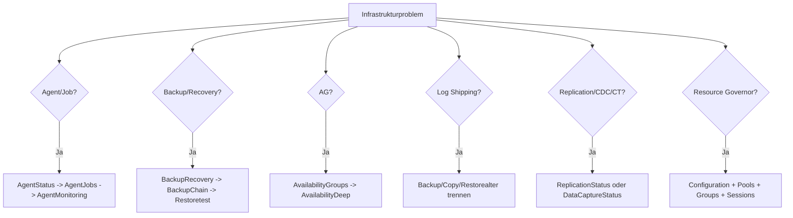

# Infrastruktur: Agent, Recovery, Hochverfügbarkeit und Datenerfassung

**Procedures:** 12  
**Evidenz:** Dienststatus, msdb-Historie, HADR-/Resource-Governor-DMVs und Featurekataloge  
**Kosten:** LOW bis HIGH_OPT_IN

## Grundregeln

- Alter, Queue und Lag sind nur relativ zu RPO, RTO, SLA und Betriebsfenster sinnvoll.
- msdb-Historie kann bereinigt, migriert oder unvollständig sein.
- Dienst-, Job- und HADR-Status sind Momentaufnahmen.
- Backupmetadaten beweisen keine Wiederherstellbarkeit; nur ein erfolgreicher Test-Restore tut dies.
- Keine Procedure führt Failover, Resume, Restore, Jobstart, Alertanlage oder Konfigurationsänderung aus.

---

## 1. [monitor].[USP_AgentStatus]

Die [Procedure-Referenz](Procedures/USP_AgentStatus.md) erläutert Einsatz, Ausgabe und Aussagegrenzen.

### Zweck

Die Procedure liefert SQL-Server-Agent-Dienststatus und ein kleines Basisinventar.

### RAW-Spalten

| Spalte | Bedeutung |
|---|---|
| `ServiceName` | sichtbarer Agentdienst |
| `StartupTypeDesc` | Dienststarttyp |
| `StatusDesc` | aktueller Dienststatus |
| `ProcessId` | Prozess-ID, nur für aktuellen Lauf gültig |
| `LastStartupTime` | letzter Agentstart aus msdb-Sessions |
| `AgentSessionId` | jüngste Agent-Session-ID |
| `JobCount` | Jobs gesamt |
| `EnabledJobCount` | aktivierte Jobs |

### Interpretation

| Fall | Bewertung |
|---|---|
| Status `Running`, Startup Automatic | typischer Sollzustand |
| Service Running, aber `LastStartupTime=NULL` | msdb-Sicht/Berechtigung oder ungewöhnlicher Startkontext prüfen |
| Service Stopped | Agentjobs, Backups und Alerts können ausfallen; Betriebsmodell prüfen |
| `JobCount=0` | kann legitime Instanz ohne Agentworkload sein |
| `EnabledJobCount < JobCount` | deaktivierte Jobs sind nicht automatisch problematisch |

### Folgeanalyse

`USP_AgentJobs` und `USP_AgentMonitoringAnalysis`.
### Parameterverträge

| Parameter | Datentyp | Default | Eingabeform und Wirkung |
|---|---|---|---|
| `@ResultSetArt` | `varchar(16)` | Default: `'CONSOLE'` | NULL wird zu leerem Text; äußere Leerzeichen werden entfernt und der Vergleich erfolgt ohne Beachtung der Groß-/Kleinschreibung. CONSOLE liefert eine beschriftete Console-Ausgabe, RAW den Modulstatus und die Rohzeile, TABLE exportiert agentStatus in das zugeordnete Ziel, NONE unterdrückt Resultsets. CONSOLE und TABLE unterdrücken zuerst direkte Resultsets und rufen anschließend ihren Ausgabeadapter auf. Andere Werte werden nach dem Hilferücksprung als INVALID_PARAMETER gemeldet. Bei ausgelassenem Argument gilt der angegebene Default. |
| `@ResultTablesJson` | `nvarchar(max)` | Default: `NULL` | NULL, leerer Text und nur aus Leerzeichen bestehender Text werden außerhalb von TABLE ignoriert. Ein nichtleerer Wert ist nur mit ResultSetArt=TABLE zulässig; andernfalls wird vor der Hilfe Fehler 51011 ausgelöst. TABLE erwartet die JSON-Objektform {"agentStatus":"#ExampleTarget"}: genau dieser case-sensitive Schlüssel, ein String mit dem lokalen Zielnamen als Wert und keine weiteren Eigenschaften. Das Ziel muss eine vorhandene, leere lokale #Temp-Tabelle mit genau einer Seed-Spalte sein; globale ##-Tabellen, #Monitor-Namen und Namen über 116 Zeichen sind unzulässig. Eine fehlende oder fehlerhafte Zuordnung sowie ein ungeeignetes Ziel lösen beim Preflight vor der Hilfe Fehler 51011 aus. Bei ausgelassenem Argument gilt der angegebene Default. |
| `@JsonErzeugen` | `bit` | Default: `0` | 0 oder NULL deaktiviert JSON; bei 1 wird @Json OUTPUT mit meta und agentStatus einschließlich NULL-Werten und einem leeren Array befüllt. SQL Server konvertiert das Argument vor Eintritt in den Prozedurcode zu bit: 0 ergibt 0, ein konvertierbarer Wert ungleich 0 ergibt 1. Konvertierungsfehler treten vor der Prozedurausführung auf. Bei ausgelassenem Argument gilt der angegebene Default. |
| `@Json` | `nvarchar(max) OUTPUT` | Default: `NULL` | Binden Sie eine nvarchar(max)-Variable mit @Json=@Variable OUTPUT. Die Procedure setzt sie zu Beginn auf NULL und befüllt sie nur bei @JsonErzeugen=1. Ohne OUTPUT-Bindung wird kein Wert an eine aufrufende Variable zurückgegeben. |
| `@PrintMeldungen` | `bit` | Default: `1` | Bei 1 wird nach einem abgefangenen Lesefehler eine Meldung mit Severity 10 und NOWAIT ausgegeben; 0 und NULL unterdrücken sie. SQL Server konvertiert das Argument vor Eintritt zu bit; Konvertierungsfehler treten vor der Prozedurausführung auf. Bei ausgelassenem Argument gilt der angegebene Default. |
| `@Hilfe` | `bit` | Default: `0` | 0 führt die normale Analyse aus. Bei 1 gibt die Procedure ihre Hilfe mit PRINT aus und kehrt vor der Agentdatensammlung zurück; sie startet, stoppt oder konfiguriert den Dienst nicht. NULL wirkt wie 0. SQL Server konvertiert das Argument vor Eintritt zu bit. Die Prüfung der ResultTables-Kombination und der TABLE-Zieltabellen-Preflight liegen vor dem Hilfezweig und können auch dabei Fehler 51011 auslösen. Bei ausgelassenem Argument gilt der angegebene Default. |

### Aufrufbeispiele zu den Parameterverträgen

Die Beispiele verwenden synthetische Namen. Die TABLE-Beispiele benötigen eine neue, leere lokale Tabelle und entfernen sie auch bei einem Fehler. Verfügbarkeit und Berechtigung der Agentquellen bleiben gesondert zu prüfen.

```sql
EXEC [monitor].[USP_AgentStatus] @Hilfe=1;

EXEC [monitor].[USP_AgentStatus] @ResultSetArt='RAW', @PrintMeldungen=0;

DECLARE @AgentStatusJson nvarchar(max); EXEC [monitor].[USP_AgentStatus] @ResultSetArt='NONE', @JsonErzeugen=1, @Json=@AgentStatusJson OUTPUT, @PrintMeldungen=0; SELECT @AgentStatusJson AS [Json];

CREATE TABLE #AgentStatus_HelpExample ([Seed] int NULL); BEGIN TRY EXEC [monitor].[USP_AgentStatus] @ResultSetArt='TABLE', @ResultTablesJson=N'{"agentStatus":"#AgentStatus_HelpExample"}', @PrintMeldungen=0; SELECT * FROM #AgentStatus_HelpExample; DROP TABLE #AgentStatus_HelpExample; END TRY BEGIN CATCH DROP TABLE #AgentStatus_HelpExample; THROW; END CATCH;
```

---

## 2. [monitor].[USP_AgentJobs]

Die [Procedure-Referenz](Procedures/USP_AgentJobs.md) erläutert Einsatz, Ausgabe und Aussagegrenzen.

### Zweck

Die Procedure analysiert Jobdefinition, aktuellen Lauf, letzte Gesamtausführung, Schedules und letzte Stepausführung.

Die Laufzeitschwelle ist eine Sichtungsgrenze in Minuten und kein allgemeiner SLA-Grenzwert. Der individuelle Parametervertrag folgt unten.

### Jobs

| Spalte | Bedeutung |
|---|---|
| `JobId`, `JobName` | Jobidentität |
| `Enabled` | Job aktiviert |
| `OwnerName` | Owner; Berechtigung und Existenz prüfen |
| `CategoryName` | Agentkategorie |
| `IsRunning`, `RunStart`, `RunningMinutes` | aktueller Lauf |
| `LastRunDateTime`, `LastRunStatus`, `LastRunStatusDesc` | letzte Job-Gesamtausführung |
| `LastRunDurationSeconds` | Dauer des letzten Laufs |
| `LastMessage` | letzte Agentmeldung; Runtime kann interne Inhalte enthalten |
| `ScheduleCount`, `EnabledScheduleCount` | angehängte Schedules |
| `StepCount` | Jobsteps |
| `ProblemCode` | `DISABLED`, `LONG_RUNNING`, `LAST_FAILED`, `NO_SCHEDULE`, `NO_ENABLED_SCHEDULE` |

### Steps

`JobName`, `StepId`, `StepName`, `Subsystem`, `LastRunOutcome`, `LastRunOutcomeDesc`, `LastRunDateTime`, `LastRunDurationSeconds`, `LastRunRetries`, `LastRunMessage`.

### Beispiele

| Konstellation | Bewertung |
|---|---|
| enabled, kein Schedule | kann On-Demand-Job sein; nicht automatisch Fehler |
| letzter Lauf failed, Job seitdem erfolgreich manuell ausgeführt | aktuelle Historyreihenfolge prüfen |
| 180 Minuten laufend, historisch immer 240 Minuten | wahrscheinlich normaler Job, SLA prüfen |
| 20 Minuten laufend, historisch 2 Minuten | auffällige Abweichung trotz unter 60-Minuten-Schwelle |
| Job erfolgreich, Step hatte Retry | Stabilitätsproblem möglich |
| Owner nicht mehr gültig | Jobausführung kann scheitern, besonders nicht-T-SQL-Subsysteme |

### Folgeanalyse

`USP_AgentMonitoringAnalysis`, Jobhistory, betroffene Query-/Blockinganalyse.
### Parameterverträge

| Parameter | Datentyp | Default | Eingabeform und Wirkung |
|---|---|---|---|
| `@JobNames` | `nvarchar(max)` | Default: `NULL` | NULL deaktiviert den exakten Namensfilter. Andernfalls wird eine bracket-aware Pipe-Liste einteiliger SQL-Namen erwartet: \| trennt außerhalb von eckigen Klammern; innerhalb gehört das Pipe-Zeichen zum Namen und ]] maskiert eine schließende Klammer. Äußere Segmentleerzeichen werden entfernt. Gültige Duplikate werden nach SQL_Latin1_General_CP1_CS_AS zusammengeführt; Namen mit abweichender Groß-/Kleinschreibung bleiben getrennt. Jedes Element muss als einteiliger SQL-Name mit höchstens 128 Zeichen auswertbar sein. Leere oder ungültige Elemente und rohe Segmente über 4000 UTF-16-Codeeinheiten sind ungültig; die Existenz im Katalog wird nicht geprüft. Eine leere Liste ist ungültig. @JobNames und ein nicht-NULL @JobNamePattern dürfen nicht zusammen verwendet werden. Ungültige Listen werden nach der Hilfe als INVALID_PARAMETER gemeldet, ohne Parser-THROW. Bei ausgelassenem Argument gilt der angegebene Default. |
| `@JobNamePattern` | `nvarchar(4000)` | Default: `NULL` | NULL deaktiviert den Patternfilter; leerer oder nur aus Leerzeichen bestehender Wert ist ungültig. Äußere Leerzeichen werden entfernt. Ohne Präfix gilt LIKE. Case-insensitive Präfixe: like: verwendet SQL-LIKE, regex: reguläre Ausdrücke mit Flag c, regexi: reguläre Ausdrücke mit Flag i. Der verbleibende Inhalt wird nicht erneut getrimmt; ein Präfix ohne Inhalt ist ungültig. Regex erfordert SQL Server 2025/ProductMajorVersion 17 oder neuer und Compatibility Level 170 der Installationsdatenbank; sonst wird UNAVAILABLE_FEATURE gemeldet. Die Regexsyntax wird nicht vorab geprüft; Fehler bei REGEXP_LIKE werden abgefangen. @JobNames und Pattern sind gegenseitig exklusiv. Das Parsing erfolgt vor der Hilfe, die übrige Validierung danach. Bei ausgelassenem Argument gilt der angegebene Default. |
| `@NurProblematisch` | `bit` | Default: `0` | Bei 0 werden alle passenden Jobs ausgewählt; bei 1 werden deaktivierte, zuletzt fehlgeschlagene Jobs, Jobs ohne Schedule, ohne aktivierten Schedule sowie laufende Jobs ab dem LongRunningMinutes-Grenzwert berücksichtigt. Steps erscheinen bei 1 nur mit letztem Status FAILED, RETRY oder CANCELED. NULL ist nicht gleich 0: SQL UNKNOWN bewirkt, dass Jobs nur bei einem zutreffenden Problemprädikat erhalten bleiben; Steps nur bei einem der drei genannten Statuswerte. SQL Server konvertiert das Argument vor Eintritt zu bit; 0 ergibt 0, ein konvertierbarer Wert ungleich 0 ergibt 1. Bei ausgelassenem Argument gilt der angegebene Default. |
| `@LongRunningMinutes` | `int` | Default: `60` | Die Laufzeitschwelle wird als ganze Zahl in Minuten übergeben; erlaubt sind 1 bis 2147483647. Werte kleiner als 1 setzen INVALID_PARAMETER. NULL passiert die Bereichsprüfung, ergibt beim Laufzeitvergleich aber UNKNOWN und erzeugt deshalb keinen LONG_RUNNING-Befund. Die aktuelle Laufzeit wird mit DATEDIFF(MINUTE, Startzeit, GETDATE()) verglichen. Bei @NurProblematisch=1 dient dieser Grenzwert auch als Filter. Bei ausgelassenem Argument gilt der angegebene Default. |
| `@MaxZeilen` | `int` | Default: `2000` | Eine positive Grenze ist eine ganze Zeilenzahl von 1 bis 2147483647. Negative Werte setzen INVALID_PARAMETER. Positive Werte begrenzen Job- und Stepzeilen; NULL oder 0 bedeutet unbegrenzt. Bei Nicht-Regexfiltern begrenzt bereits das erste TOP der Jobabfrage auf @EffectiveMaxZeilen und sortiert laufende Jobs zuerst, danach nach JobName. Zeilen außerhalb dieses ersten Ausschnitts können durch die spätere Problemsortierung nicht wieder aufgenommen werden; diese Sortierung bevorzugt ProblemCode-Zeilen nur unter den bereits materialisierten Jobs. Im Regexmodus wird zuerst ohne diese Grenze materialisiert, dann das Regex angewendet und anschließend die Problem-/Jobnamenpriorisierung begrenzt. Steps verwenden unabhängig davon TOP(@EffectiveMaxZeilen), geordnet nach JobName und StepId. Es gibt keine explizite Kürzungskennzeichnung oder zusätzliche Kürzungsanzahl. JSON requestedMaxRows enthält den übergebenen Wert. Bei ausgelassenem Argument gilt der angegebene Default. |
| `@ResultSetArt` | `varchar(16)` | Default: `'CONSOLE'` | NULL wird zu leerem Text; äußere Leerzeichen werden entfernt, der Vergleich erfolgt ohne Beachtung der Groß-/Kleinschreibung. CONSOLE liefert ausschließlich beschriftete Jobs, RAW den Modulstatus sowie Jobs und Steps, TABLE nur Jobs, NONE keine fachlichen Resultsets. CONSOLE und TABLE unterdrücken direkte Resultsets und verwenden anschließend ihre Ausgabeadapter. Andere Werte werden nach der Hilfe als INVALID_PARAMETER gemeldet. Bei ausgelassenem Argument gilt der angegebene Default. |
| `@ResultTablesJson` | `nvarchar(max)` | Default: `NULL` | NULL, leerer Text und nur aus Leerzeichen bestehender Text werden außerhalb von TABLE ignoriert. Ein nichtleerer Wert ist nur mit ResultSetArt=TABLE zulässig; andernfalls wird vor der Hilfe Fehler 51011 ausgelöst. TABLE erwartet die JSON-Objektform {"jobs":"#ExampleTarget"}: genau dieser case-sensitive Schlüssel, ein String mit dem lokalen Zielnamen als Wert und keine weiteren Eigenschaften. Das Ziel muss eine vorhandene, leere lokale #Temp-Tabelle mit genau einer Seed-Spalte sein; globale ##-Tabellen, #Monitor-Namen und Namen über 116 Zeichen sind unzulässig. Eine fehlende oder fehlerhafte Zuordnung sowie ein ungeeignetes Ziel lösen beim Preflight vor der Hilfe Fehler 51011 aus. Exportiert werden nur Jobs, keine Steps. Bei ausgelassenem Argument gilt der angegebene Default. |
| `@JsonErzeugen` | `bit` | Default: `0` | 0 oder NULL deaktiviert JSON; bei 1 wird @Json OUTPUT mit meta, jobs und steps, Mengenangaben und Arrays befüllt. SQL Server konvertiert das Argument vor Eintritt zu bit; 0 ergibt 0, ein konvertierbarer Wert ungleich 0 ergibt 1. Konvertierungsfehler treten vor der Prozedurausführung auf. Bei ausgelassenem Argument gilt der angegebene Default. |
| `@Json` | `nvarchar(max) OUTPUT` | Default: `NULL` | Binden Sie eine nvarchar(max)-Variable mit @Json=@Variable OUTPUT. Die Procedure setzt sie zu Beginn auf NULL und befüllt sie nur bei @JsonErzeugen=1. Ohne OUTPUT-Bindung wird kein Wert an eine aufrufende Variable zurückgegeben. |
| `@PrintMeldungen` | `bit` | Default: `1` | Bei 1 wird nach einem abgefangenen Sammlungsfehler eine Meldung mit Severity 10 und NOWAIT ausgegeben; 0 und NULL unterdrücken sie. SQL Server konvertiert das Argument vor Eintritt zu bit; Konvertierungsfehler treten vor der Prozedurausführung auf. Bei ausgelassenem Argument gilt der angegebene Default. |
| `@Hilfe` | `bit` | Default: `0` | 0 führt die normale Analyse aus. Bei 1 gibt die Procedure ihre Hilfe mit PRINT aus und kehrt ohne Jobdatensammlung zurück. NULL wirkt wie 0. SQL Server konvertiert das Argument vor Eintritt zu bit. Ausgabe-/TABLE-Preflight und Patternparsing erfolgen vor der Hilfe; Joblistenvalidierung, Parameter- und Regexfeatureprüfung sowie Datensammlung danach. Ein Preflightfehler kann daher auch mit @Hilfe=1 auftreten. Bei ausgelassenem Argument gilt der angegebene Default. |

### Aufrufbeispiele zu den Parameterverträgen

Die Beispiele verwenden synthetische Namen. Die TABLE-Beispiele benötigen eine neue, leere lokale Tabelle und entfernen sie auch bei einem Fehler. Verfügbarkeit und Berechtigung der Agentquellen bleiben gesondert zu prüfen.

```sql
EXEC [monitor].[USP_AgentJobs] @Hilfe=1;

EXEC [monitor].[USP_AgentJobs] @JobNames=N'[ExampleJobA]|[ExampleJobB]', @MaxZeilen=100, @ResultSetArt='RAW', @PrintMeldungen=0;

DECLARE @AgentJobsJson nvarchar(max); EXEC [monitor].[USP_AgentJobs] @ResultSetArt='NONE', @JsonErzeugen=1, @Json=@AgentJobsJson OUTPUT, @PrintMeldungen=0; SELECT @AgentJobsJson AS [Json];

CREATE TABLE #AgentJobs_HelpExample ([Seed] int NULL); BEGIN TRY EXEC [monitor].[USP_AgentJobs] @ResultSetArt='TABLE', @ResultTablesJson=N'{"jobs":"#AgentJobs_HelpExample"}', @PrintMeldungen=0; SELECT * FROM #AgentJobs_HelpExample; DROP TABLE #AgentJobs_HelpExample; END TRY BEGIN CATCH DROP TABLE #AgentJobs_HelpExample; THROW; END CATCH;

EXEC [monitor].[USP_AgentJobs] @JobNamePattern=N'like:ExampleJob%', @MaxZeilen=100, @ResultSetArt='RAW';

EXEC [monitor].[USP_AgentJobs] @NurProblematisch=1, @LongRunningMinutes=60, @MaxZeilen=100, @ResultSetArt='RAW';
```

---

## 3. [monitor].[USP_ResourceGovernorAnalysis]

### Zweck

Die Procedure vergleicht gespeicherte und effektive Resource-Governor-Konfiguration, Pools, Workload Groups und optionale Sessions.

### Configuration

`ClassifierFunctionId`, `IsEnabled`, `ReconfigurationPending`, `ClassifierFunctionName`.

**Grenzfall:** `ReconfigurationPending=1` bedeutet, dass gespeicherte und aktive Konfiguration abweichen können.

### ResourcePools

| Gruppe | Spalten |
|---|---|
| Limits | `MinCpuPercent`, `MaxCpuPercent`, `MinMemoryPercent`, `MaxMemoryPercent`, `CapCpuPercent`, `MinIopsPerVolume`, `MaxIopsPerVolume` |
| Zeitraum | `StatisticsStartTime` |
| CPU/Memory | `TotalCpuUsageMs`, `CacheMemoryMb`, `UsedWorkspaceMemoryMb`, `TargetWorkspaceMemoryMb`, `MaxWorkspaceMemoryMb` |
| Druck | `OutOfMemoryCount`, `ActiveMemgrantCount`, `PendingMemgrantCount` |
| Relationen | `UsedOfTargetMemoryPercent`, `UsedOfMaxMemoryPercent` |

### WorkloadGroups

| Gruppe | Spalten |
|---|---|
| Identität | `GroupId`, `GroupName`, `PoolId`, `PoolName`, `Importance` |
| Grants | `RequestMaxMemoryGrantPercent`, `ConfiguredRequestMaxGrantMemoryMb`, `TargetRequestMaxGrantMemoryMb`, `HistoricalMaxRequestGrantMemoryMb`, `RequestMemoryGrantTimeoutSec` |
| CPU/DOP | `RequestMaxCpuTimeSec`, `MaxDop`, `EffectiveMaxDop` |
| Concurrency | `GroupMaxRequests`, `ActiveRequestCount`, `QueuedRequestCount`, `TotalQueuedRequestCount` |
| Historie | `TotalRequestCount`, `TotalReducedMemgrantCount`, `TotalCpuUsageMs`, `TotalLockWaitCount`, `TotalLockWaitTimeMs` |

### tempdbGovernance (SQL Server 2025)

| Gruppe | Spalten |
|---|---|
| Identität | `GroupId`, `GroupName`, `PoolId`, `PoolName` |
| gespeichert | `ConfiguredGroupMaxTempdbDataMb`, `ConfiguredGroupMaxTempdbDataPercent` |
| wirksam | `TempdbMaximumSizeMb`, `EffectiveGroupMaxTempdbDataMb`, `EffectiveLimitSource`, `IsPercentLimitEffective`, `EffectiveLimitUtilizationPercent` |
| Runtimefenster | `TempdbDataSpaceMb`, `PeakTempdbDataSpaceMb`, `TotalTempdbDataLimitViolationCount`, `HasRecordedLimitViolation`, `StatisticsStartTime` |
| Status | `IsResourceGovernorEnabled`, `ReconfigurationPending`, `SourceStatusCode`, `IsPartial`, `EvidenceLimit` |

Das MB-Limit hat Vorrang vor einem gleichzeitig gespeicherten Prozentlimit.
Ein Prozentlimit ist nur bei geeigneter TempDB-Dateikonfiguration wirksam.
`StatisticsStartTime` begrenzt Peak und Verletzungszähler seit Serverstart oder
`ALTER RESOURCE GOVERNOR RESET STATISTICS`. Kein Limit ist kein Fehler;
Version Store und TempDB-Log gehören nicht zu dieser Governance.

### Sessions

`SessionId`, `LoginName`, `HostName`, `ProgramName`, `GroupId`, `GroupName`, `PoolName`, `Status`, `CpuTimeMs`, `MemoryUsagePages`, `MemoryUsageMb`, `Reads`, `Writes`, `LogicalReads`.

### Interpretation

- Konfiguriertes Grantlimit basiert auf Max Pool Memory; Targetlimit auf aktueller Target Memory; Historical Max ist beobachtete DMV-Evidenz.
- `PendingMemgrantCount>0` oder `QueuedRequestCount>0` ist relevanter als ein enges Limit allein.
- `OutOfMemoryCount` ist kumulativ seit `StatisticsStartTime`.
- `EffectiveMaxDop` kann von konfiguriertem `MaxDop` abweichen.
- Interpretieren Sie Default- und Internal-Pools nicht wie benutzerdefinierte Pools.
- Sessionzuordnung zeigt Classifier-Ergebnis, nicht zwingend die fachlich gewünschte Klassifizierung.
- Workload-Group- und Sessionwerte besitzen unterschiedliche Granularitäten und sind nicht additiv.
- `ReconfigurationPending=1` trennt gespeicherte von belastbar aktiver Konfiguration.

### Folgeanalyse

`USP_CurrentMemoryGrants`, `USP_CurrentRequests`, `USP_CurrentTempDB`,
`USP_ServerMemory`.

---

## 4. [monitor].[USP_AvailabilityGroups]

### Zweck

Die Procedure erstellt ein Basisinventar für AG-Replikate, Datenbanken, Listener und Read-only Routing.

### Replicas

`AgName`, `ReplicaServerName`, `LocalReplica`, `RoleDesc`, `OperationalStateDesc`, `ConnectedStateDesc`, `RecoveryHealthDesc`, `SynchronizationHealthDesc`, `AvailabilityModeDesc`, `FailoverModeDesc`, `SessionTimeout`, `EndpointUrl`, `PrimaryRoleAllowConnectionsDesc`, `SecondaryRoleAllowConnectionsDesc`, `ReadOnlyRoutingUrl`.

### Databases

| Spalte | Bedeutung |
|---|---|
| `AgName`, `ReplicaServerName`, `DatabaseName`, `IsLocal`, `IsPrimaryReplica` | Scope |
| `SynchronizationStateDesc`, `SynchronizationHealthDesc`, `DatabaseStateDesc` | Zustand |
| `IsSuspended`, `SuspendReasonDesc` | Data Movement |
| `LogSendQueueKb`, `LogSendRateKbSec`, `EstimatedSendSeconds` | Sendqueue und momentane Rate |
| `RedoQueueKb`, `RedoRateKbSec`, `EstimatedRedoSeconds` | Redoqueues |
| `LastSentTime`, `LastReceivedTime`, `LastHardenedTime`, `LastRedoneTime` | Pipelinezeitpunkte |
| `SecondaryLagSeconds` | versions-/modusabhängige Lag-Evidenz |

### Listener

`AgName`, `ListenerDnsName`, `Port`, `IsConformant`, `IpAddress`, `IpSubnetMask`, `NetworkSubnetIp`, `NetworkSubnetPrefixLength`, `StateDesc`.

### Routing

`AgName`, `ReplicaServerName`, `RoutingPriority`, `ReadOnlyReplicaServerName`.

### Interpretation

- Queue ÷ aktuelle Rate ist nur eine grobe Schätzung; Rate kann 0 oder stark schwankend sein.
- Asynchrones Commit darf dauerhaft `SYNCHRONIZING` sein.
- Synchronous Commit erwartet je Ziel/SLA andere Healthbedingungen.
- Listenerzustand auf einem Node ist kein vollständiger Clientkonnektivitätstest.
- Routingliste beweist nicht, dass Anwendung mit `ApplicationIntent=ReadOnly` verbindet.

### Folgeanalyse

`USP_AvailabilityDeepAnalysis`, Performance Counter, Netzwerk-/Cluster-/Storageüberwachung.

---

## 5. [monitor].[USP_BackupRecovery]

### Zweck

Die Procedure bewertet Backupfrische und zeigt Backup-/Restorehistorie.

### Framework-Schwellen

| Parameter | Default |
|---|---:|
| `@FullWarnHours` | 48 h |
| `@DiffWarnHours` | 24 h |
| `@LogWarnMinutes` | 30 min |

Diese Defaults sind keine universellen RPOs.

### Freshness

`DatabaseName`, `StateDesc`, `RecoveryModelDesc`, `LastFullFinish`, `FullAgeMinutes`, `LastDiffFinish`, `DiffAgeMinutes`, `LastLogFinish`, `LogAgeMinutes`, `LastCopyOnlyFullFinish`, `BackupStatus`.

`BackupStatus`:

- `TEMPDB_NO_BACKUP`
- `NO_FULL_BACKUP`
- `FULL_TOO_OLD`
- `NO_LOG_BACKUP`
- `LOG_TOO_OLD`
- `DIFF_OLD_INFORMATIONAL`
- `OK`

### Backups

`DatabaseName`, `BackupType`, `BackupTypeDesc`, `BackupStartDate`, `BackupFinishDate`, `DurationSeconds`, `BackupSizeMb`, `CompressedSizeMb`, `IsCopyOnly`, `IsSnapshot`, `HasBackupChecksums`, `IsDamaged`, `MediaPath`.

### Restores

`DestinationDatabaseName`, `RestoreDate`, `UserName`, `RestoreType`, `Replace`, `Recovery`, `Restart`, `SourceDatabaseName`, `BackupFinishDate`.

### Interpretation

- `OK` bedeutet nur, dass msdb-Zeitpunkte den Schwellen entsprechen.
- Copy-only Full ist keine normale Differentialbasis.
- `IsDamaged=1` ist hoch relevant.
- Backup Checksum verbessert Evidenz, beweist aber keine erfolgreiche Wiederherstellung.
- Restorehistory kann einen Restore auf derselben DB zeigen, nicht zwingend einen isolierten Recoverytest.
- `MediaPath` ist schutzbedürftige Laufzeitinformation und darf nur im erforderlichen Umfang exportiert oder weitergegeben werden.

### Folgeanalyse

`USP_BackupChainAnalysis`, `USP_DatabaseIntegrityAnalysis`, echter Restore-Test.

---

## 6. [monitor].[USP_LogShippingStatus]

### Zweck

Die Procedure zeigt Primary-Backup- und Secondary-Copy-/Restorezustand.

### Primary

`PrimaryServer`, `PrimaryDatabase`, `BackupDirectory`, `BackupShare`, `BackupRetentionPeriod`, `BackupThreshold`, `ThresholdAlertEnabled`, `LastBackupFile`, `LastBackupDate`, `BackupAgeMinutes`, `LastBackupDateUtc`, `HistoryRetentionPeriod`.

### Secondary

`SecondaryServer`, `SecondaryDatabase`, `PrimaryServer`, `PrimaryDatabase`, `RestoreDelay`, `RestoreThreshold`, `ThresholdAlertEnabled`, `LastCopiedFile`, `LastCopiedDate`, `CopyAgeMinutes`, `LastRestoredFile`, `LastRestoredDate`, `RestoreAgeMinutes`, `LastRestoredLatency`, `RestoreMode`, `DisconnectUsers`.

### Interpretation

- Lesen Sie `BackupAgeMinutes` zusammen mit `BackupThreshold` und dem RPO.
- `CopyAgeMinutes` hoch, BackupAge normal: Transport-/Shareproblem möglich.
- Copy normal, RestoreAge hoch: Restorejob, RestoreDelay oder Secondaryproblem.
- Konfigurierter `RestoreDelay` kann absichtlich hohes Restorealter erzeugen.
- `ThresholdAlertEnabled=0` bedeutet nicht zwingend, dass die Komponente unüberwacht ist; prüfen Sie das externe Monitoring.
- Last file/date können Monitorhistory und nicht realen Dateibestand widerspiegeln.

---

## 7. [monitor].[USP_ReplicationStatus]

### Zweck

Die Procedure inventarisiert sichtbare Replikationsrollen. Distributiondetails sind opt-in und gruppengeschützt.

### Databases

`DatabaseName`, `IsPublished`, `IsSubscribed`, `IsMergePublished`, `IsDistributor`.

### Publications

`PublicationId`, `PublisherDatabase`, `PublicationName`, `PublicationType`, `ImmediateSync`, `AllowPush`, `AllowPull`, `Status`.

### Subscriptions

`PublisherDatabase`, `PublicationName`, `SubscriberName`, `SubscriberDatabase`, `SubscriptionType`, `Status`, `AgentId`, `LastAction`, `LastTimestamp`.

### Errors

`ErrorId`, `ErrorTime`, `SourceName`, `ErrorCode`, `ErrorText`.

### Interpretation

- Basisrollen ohne Distributiondetails sagen wenig über Latenz oder Agentgesundheit.
- `LastAction` ist Freitext aus Distributionhistory; fachlich prüfen und nicht ungeprüft persistieren.
- Alte Fehlerzeilen können einen bereits behobenen Zustand beschreiben; beachten Sie Zeitpunkt und Wiederholung.
- Keine online sichtbare Distribution-DB kann Feature nicht vorhanden, remote Distributor oder fehlende Sicht bedeuten.
- Statuscodes sind replizierungsspezifische numerische Codes; interpretieren Sie diese anhand der Microsoft-Dokumentation.

---

## 8. [monitor].[USP_DataCaptureStatus]

### Zweck

Die Procedure inventarisiert CDC und Change Tracking über ausgewählte Datenbanken sowie CDC-Agentjobs.

### Besonderheit

Der Procedureheader hat `@DatabaseNames=N''`; die dokumentierte Semantik behandelt `N''` jedoch als ungültig. Verwenden Sie daher eine explizite Liste, ein Pattern oder `NULL` und prüfen Sie das Statusresultset.

### Databases

`DatabaseName`, `StateDesc`, `IsCdcEnabled`, `IsChangeTrackingEnabled`, `RetentionPeriod`, `RetentionPeriodUnitsDesc`, `IsAutoCleanupOn`, `CurrentCtVersion`, `StatusCode`, `ErrorMessage`.

### CDC Tables

`DatabaseName`, `CaptureInstance`, `SourceSchema`, `SourceTable`, `ObjectId`, `StartLsn`, `SupportsNetChanges`, `RoleName`, `IndexName`, `CreateDate`, `PartitionSwitch`.

### Change Tracking Tables

`DatabaseName`, `SchemaName`, `TableName`, `ObjectId`, `IsTrackColumnsUpdatedOn`, `BeginVersion`, `CleanupVersion`, `MinValidVersion`.

### CDC Jobs

`DatabaseName`, `JobType`, `JobName`, `Enabled`, `LastRunOutcome`, `LastRunDateTime`, `LastMessage`.

### Interpretation

- CT-Consumer mit Synchronisationsversion kleiner als `MinValidVersion` muss reinitialisieren.
- Retention muss maximale Consumer-Ausfallzeit abdecken.
- Auto Cleanup OFF kann Wachstum verursachen, kann aber absichtliche externe Steuerung sein.
- CDC-DB enabled ohne Capture Instances ist möglich.
- Capture/Cleanup-Job deaktiviert ist bei Always On oder speziellen Betriebsmodellen kontextabhängig.
- `SupportsNetChanges=1` benötigt geeigneten eindeutigen Index und beeinflusst Nutzungsmöglichkeiten.

### Folgeanalyse

AgentJobs, Log-/Kapazitätsanalyse und Consumerzustand außerhalb des Frameworks.

---

## 9. [monitor].[USP_BackupChainAnalysis]

### Zweck

Die Procedure prüft Full-/Differentialbasis, Log-LSN-Übergänge, Recovery Forks, Damage-/Checksumflags und Restoreevidenz innerhalb eines Historienfensters. Medienpfade und Benutzernamen werden bewusst nicht gelesen.

### Backupdetails

| Spalte | Bedeutung |
|---|---|
| `BackupSetId`, `BackupType`, `BackupTypeDesc`, Start/Finish | Backupidentität und Zeit |
| `FirstLsn`, `LastLsn`, `CheckpointLsn`, `DatabaseBackupLsn`, `DifferentialBaseLsn` | Kettenevidenz |
| `FirstRecoveryForkGuid`, `LastRecoveryForkGuid` | Recovery-Fork-Kontext |
| `IsCopyOnly`, `HasBackupChecksums`, `IsDamaged`, `IsEncrypted` | Backupmerkmale |
| `PreviousLogLastLsn`, `LogGapDetected` | vom Code berechneter Logübergang |

### Summary

`DatabaseId`, `DatabaseName`, `RecoveryModelDesc`, `LatestFullFinish`, `LatestMatchingDifferentialFinish`, `LatestLogFinish`, `LogBackupCountInWindow`, `LogGapCountInWindow`, `RecoveryForkTransitionCount`, `DamagedBackupCount`, `BackupWithoutChecksumCount`, `LatestRestoreDate`, `FindingCode`, `FindingSeverity`, `EvidenceLimit`.

### Grenzen

- `HistoryDays=35` kann ältere, noch nötige Basisinformationen ausschließen; der letzte non-copy-only Full wird zusätzlich einbezogen.
- LSN-Lücke aus msdb kann Cleanup oder extern erzeugte Backups widerspiegeln.
- Forktransition kann legitimen Restore-/Recoveryverlauf darstellen.
- `LatestRestoreDate` ist nur lokaler msdb-Beleg.
- Nur vollständiger Test-Restore beweist Recoveryfähigkeit.

### Beispiele

| Befund | Bewertung |
|---|---|
| Matching Full + Diff + fortlaufende Logs | gute Metadatenevidenz, kein Restorebeweis |
| `LogGapCountInWindow>0` | sofort Medienbestand und Restoresequenz verifizieren |
| `DamagedBackupCount>0` | hoch kritisch |
| kein Restorebeleg | nicht automatisch schlecht, aber Recoverytest-Policy prüfen |
| Forktransition nach geplantem Point-in-Time-Restore | erwartbar, neue Kette klar identifizieren |

---

## 10. [monitor].[USP_AvailabilityDeepAnalysis]

### Zweck

Die Procedure erweitert die AG-Analyse um Clusterquorum, Clusterknoten und -netzwerke, Replikabefunde, Datenbankqueues, Seeding und Auto Page Repair.

### Framework-Schwellen

- `@QueueWarnMb=1024`
- `@SecondaryLagWarnSeconds=60`

Diese Werte dienen als Sichtungsgrenzen und stellen keine universellen Service Level Objectives dar.

### Resultsets

| Resultset | Schlüsselspalten |
|---|---|
| Cluster | `ClusterName`, `QuorumTypeDesc`, `QuorumStateDesc`, `FindingCode` |
| Members | `MemberName`, `MemberTypeDesc`, `MemberStateDesc`, `NumberOfQuorumVotes` |
| Networks | `MemberName`, `NetworkSubnetIp`, `NetworkSubnetPrefixLength`, `IsPublic`, `IsIpv4` |
| Replicas | AG/Server, Rolle, Operational/Connected/Health, Availability-/Failover-/Seedingmode, `FindingCode` |
| Databases | AG/Replica/DB, Synchronisierung, Suspension, Send-/Redoqueue, Lag, LastCommit, `FindingCode`, `FindingSeverity` |
| Seeding | Remote Machine, Rolle, DB, Zustand, FailureCode, Transfer-/DB-Größe, Rate, Start/End |
| PageRepair | DB/File/Page, ErrorType, PageStatus, ModificationTime, `FindingCode` |

TABLE und das aktive CONSOLE verwenden ausschließlich die Replikamenge mit elf Feldern und zehn explizit collatierten Textspalten. Nach vollständiger Statusbewertung wird diese Menge einmal geordnet und begrenzt; RAW und JSON übernehmen dieselbe Auswahl. Die übrigen RAW-/JSON-Mengen behalten ihre Limits, während Cluster ohne Mengenlimit bleibt. `NULL` und `0` bedeuten unbegrenzt; negative Limits liefern sicher `INVALID_PARAMETER`. JSON enthält Metadaten und sieben fachliche Arrays ohne zusätzliche Quellenstatus- oder Warning-Arrays.

Der begrenzte Common-162-Vertrag prüft ausschließlich den nativ bestätigten HADR-deaktivierten Leerscope mit Schema, Collations, JSON-Struktur und Parametern. Bei aktiviertem oder unbekanntem HADR meldet er `NOT_EXECUTED`. Die Akzeptanz positiver Limits in leeren Mengen belegt keine positive Replikabegrenzung oder andere HADR-Featurewirkung.

### Interpretation

- Quorumabweichung ist Clusterkontext; kein automatischer Failoverauftrag.
- `DISCONNECTED`, `NOT_HEALTHY`, `NOT_SYNCHRONIZING` oder suspended sind hohe Priorität.
- Die Queuegröße allein ist volumenabhängig; ergänzen Sie Lag, Raten und Trend.
- Seeding-Rate 0 kann Pause, Fehler oder momentane Messung bedeuten.
- Page Repair `SUCCEEDED` ist weiterhin Integritätsevidenz und Anlass für CHECKDB-/Storageprüfung.
- Netzwerkkatalog zeigt Topologie, nicht Paketverlust, Latenz oder Firewallpfad.

---

## 11. [monitor].[USP_AgentMonitoringAnalysis]

Die [Procedure-Referenz](Procedures/USP_AgentMonitoringAnalysis.md) erläutert Einsatz, Ausgabe und Aussagegrenzen.

### Zweck

Die Procedure bewertet Agentservice, Standardalarmabdeckung, Alert-Routing, Operatorstatus, Jobzustand und aggregierten Database-Mail-Status. Sie liest keine Mailadressen, Empfänger, Betreffzeilen, Jobstepbefehle oder Meldungstexte als Findings.

### Services

`ServiceName`, `StatusDesc`, `StartupTypeDesc`, `LastStartupTime`, `FindingCode`.

### Findings

`Category`, `FindingCode`, `Severity`, `ScopeType`, `ScopeName`, `MetricValue`, `Evidence`, `EvidenceLimit`.

Wichtige Codes:

- `REQUIRED_AGENT_ALERT_MISSING` für 823, 824, 825 sowie Severity 19–25,
- `ENABLED_ALERT_WITHOUT_ACTION`,
- `ALERT_TARGET_OPERATOR_DISABLED`,
- `ALERT_OCCURRED_IN_WINDOW`,
- job- und mailbezogene Befunde.

### Jobs

`JobId`, `JobName`, `IsEnabled`, `LatestRunDateTime`, `LatestRunStatus`, `LatestRunDuration`, `ScheduleCount`, `EnabledScheduleCount`, `FindingCode`.

### Mail

`SentStatus`, `ItemCount`, `OldestRequestDate`, `NewestRequestDate` im gewählten Historienfenster.

### Interpretation

- Fehlender SQL-Agent-Alert kann durch externes Monitoring kompensiert sein.
- Aktivierter Alert ohne Operator/Job ist meist nicht handlungsfähig.
- Operator disabled ist nur dann kritisch, wenn kein alternativer Kanal existiert.
- `occurrence_count` kann kumulativ sein; letzter Zeitpunkt ist wichtiger.
- Failed Mail kann Folge eines bereits bekannten Infrastrukturfehlers sein.
- On-Demand-Job ohne Schedule ist normal möglich.
### Parameterverträge

| Parameter | Datentyp | Default | Eingabeform und Wirkung |
|---|---|---|---|
| `@HistoryHours` | `int` | Default: `24` | Ganze Stundenzahl für das lokale Historienfenster der Alertaktivität und Database-Mail-Zeilen; erlaubt sind 1 bis 8760. Nach dem Hilfezweig wird der Cutoff mit DATEADD(HOUR, -@HistoryHours, GETDATE()) vor der Bereichsprüfung berechnet. NULL sowie Werte außerhalb des erlaubten Bereichs setzen INVALID_PARAMETER und IsPartial=1 und überspringen die Fachquellen, sofern die Cutoff-Berechnung erfolgreich war. Extreme int-Werte können vorher ungefangen an Negation oder datetime-Überlauf scheitern; dabei werden die Status-/Fehler-OUTPUTs nicht zugewiesen. Jobhistory wird ohne Zeitfilter nach dem letzten Gesamtoutcome durchsucht; der Cutoff klassifiziert nur diesen letzten Lauf. Übergeben Sie eine ganze Zahl oder eine int-Variable. Andere Literalformen durchlaufen zunächst die SQL-Typkonvertierung; eine leere Zeichenfolge ist kein eigener Leerwert des Prozedurcodes. Bei ausgelassenem Argument gilt der angegebene Default. |
| `@MitJobStatus` | `bit` | Default: `1` | Steuert, ob Jobzustand, letzter Gesamtoutcome und Schedule-Zahlen aus msdb erhoben werden. Genau 1 aktiviert den Pfad. 0 und NULL lassen ihn aus; andere ursprüngliche Werte werden bereits beim Binden an bit durch SQL Server konvertiert oder abgewiesen. Der Jobpfad liest die vollständige sichtbare Gesamtzeilen-History ohne @HistoryHours-Filter und klassifiziert danach den letzten Outcome relativ zum Cutoff. Er führt keine Jobs aus oder ändert deren Zustand. Bei ausgelassenem Argument gilt der angegebene Default. |
| `@MitDatabaseMail` | `bit` | Default: `1` | Steuert die Aggregation der Database-Mail-Zeilen aus msdb innerhalb des mit @HistoryHours gebildeten Cutoffs. Genau 1 aktiviert den Pfad; 0 und NULL lassen ihn aus. Andere Eingaben durchlaufen vor Prozedurbeginn die SQL-Konvertierung zu bit oder schlagen bei der Bindung fehl. Der Pfad liest nur Status, Anzahl und älteste/neuste Anforderungszeit; Adressen, Empfänger, Betreff und Nachrichtentext werden nicht ausgewertet. Ein Lesefehler setzt Partialstatus. Bei ausgelassenem Argument gilt der angegebene Default. |
| `@MaxZeilen` | `int` | Default: `1000` | Begrenzt die ausgegebenen Findings und Jobzeilen. NULL oder 0 bedeutet unbegrenzt; positive ganze Werte von 1 bis 2147483647 sind die Zeilenobergrenze; negative Werte setzen INVALID_PARAMETER und IsPartial=1 und überspringen die Quellen. Findings werden vor einer positiven Begrenzung nach HIGH, MEDIUM, INFO, Kategorie und Scope-Name gereiht; Jobs werden nach Jobname gereiht. Das Limit reduziert keine vorherige Katalog- oder Historyaggregation. Services und Mailstatus werden nicht mit dieser Zeilengrenze gekürzt. Bei ausgelassenem Argument gilt der angegebene Default. |
| `@ResultSetArt` | `varchar(16)` | Default: `'CONSOLE'` | Nach Entfernen äußerer Leerzeichen und Umwandlung in Großbuchstaben sind ausschließlich RAW, CONSOLE, NONE und TABLE erlaubt. NULL wird wie leer behandelt und ist ungültig. RAW liefert fünf Resultsets: Modulstatus, Services, begrenzte Findings, begrenzte Jobs und Mailaggregation. CONSOLE liefert genau eine Findingsausgabe mit verständlicher Hinweiszeile bei leerer Menge; es gibt dabei keine zusätzlichen Service- oder Modulstatus-Resultsets. NONE unterdrückt fachliche Resultsets. TABLE schreibt ausschließlich findings in das vorgeprüfte Ziel. JSON über @JsonErzeugen und die Status-/Fehler-OUTPUTs sind davon unabhängig. Ungültige Werte führen nach dem Hilfezweig zu INVALID_PARAMETER mit IsPartial=1. Eingaben werden zunächst an varchar(16) gebunden. Bei ausgelassenem Argument gilt der angegebene Default. |
| `@ResultTablesJson` | `nvarchar(max)` | Default: `NULL` | Enthält ausschließlich für TABLE die JSON-Zuordnung des einen exportierbaren Resultsets findings, in der Form {"findings":"#ExampleTarget"}: genau dieser case-sensitive Schlüssel mit dem lokalen Zielnamen als JSON-Stringwert, keine weiteren Eigenschaften. Der Zielname darf höchstens 116 Zeichen lang sein. Das Ziel muss eine vorhandene, leere lokale #Temp-Tabelle mit genau einer Seed-Spalte sein; globale ##Temp-Tabellen, permanente Tabellen, das reservierte Präfix #Monitor, unbekannte oder doppelte Namen/Ziele, nichtstringige Werte, leere Ziele und zusätzliche Schlüssel sind unzulässig. Das JSON muss ein Objekt sein; NULL, leer oder nur Leerzeichen ist kein gültiges TABLE-Mapping. Außerhalb TABLE sind NULL/leer/Leerzeichen zulässig; jeder nichtleere Wert löst Fehler 51011 aus. TABLE-Mapping und Ziel werden vor der Hilfeausgabe vorgeprüft, sodass ein ungültiges Mapping auch mit @Hilfe=1 fehlschlägt. Der Helper erwartet OPENJSON-kompatibles JSON und installiertes Framework. Bei ausgelassenem Argument gilt der angegebene Default. |
| `@JsonErzeugen` | `bit` | Default: `0` | Aktiviert die zusätzliche JSON-Erzeugung nur bei exakt 1; 0 und NULL überspringen sie. SQL Server bindet Eingaben zuerst an bit und konvertiert oder verwirft abweichende Formen. Bei Aktivierung enthält @Json das Objekt meta sowie die vier Arrays services, findings, jobs und mailStatus. Die Arrays verwenden INCLUDE_NULL_VALUES; meta wird ohne INCLUDE_NULL_VALUES serialisiert, sodass NULL-Eigenschaften dort entfallen. meta enthält UTC-Erstellungszeit, Status, Partialflag und @HistoryHours. Findings und Jobs folgen @MaxZeilen; Services und Mailstatus bleiben vollständige getrennte Arrays. Die Ausgabe enthält keine Mailadressen, Empfänger, Betreffzeilen, Jobbefehle oder Meldungstexte. @Json wird am Prozedureintritt auf NULL gesetzt und bleibt bei deaktiviertem Schalter oder vorzeitigem Hilfe-RETURN NULL. Bei ausgelassenem Argument gilt der angegebene Default. |
| `@Json` | `nvarchar(max) OUTPUT` | Default: `NULL` | Empfängt bei @JsonErzeugen=1 das erzeugte JSON nvarchar(max) mit meta-, services-, findings-, jobs- und mailStatus-Elementen. Der Wert wird zu Beginn immer auf NULL gesetzt und nur nach abgeschlossener Erhebung bei aktiviertem JSON-Schalter befüllt; bei Hilfe-RETURN und Fehlern vor der Erzeugung bleibt er NULL. NULL-Werte werden in den Kontextarrays erhalten. Findings und Jobs verwenden die Begrenzung aus @MaxZeilen. Status-/Fehler-OUTPUTs werden bei Hilfe-RETURN nicht aktualisiert. Ohne OUTPUT-Bindung wird kein Wert an eine aufrufende Variable zurückgegeben. |
| `@PrintMeldungen` | `bit` | Default: `1` | Wird in der Implementierung nicht gelesen und steuert daher weder PRINT-Ausgaben noch Resultsets. Die fest codierten PRINT-Zeilen der Hilfeausgabe erscheinen bei @Hilfe=1 unabhängig von diesem Schalter. NULL sowie 0 oder 1 ändern das Verhalten nicht; eine Bit-Konvertierung oder ein Konvertierungsfehler geschieht vor dem Prozedurcode. Bei ausgelassenem Argument gilt der angegebene Default. |
| `@Hilfe` | `bit` | Default: `0` | Bei exakt 1 gibt die Procedure ihre Hilfe mit PRINT aus und kehrt vor der Analyse mit RETURN zurück. 0 und NULL führen in den normalen Ablauf; abweichende Formen werden beim Binden an bit konvertiert oder abgewiesen. @Json wird zuvor auf NULL gesetzt. Die Status-, Partial- und Fehler-OUTPUTs werden im Hilfezweig nicht belegt und behalten ihre Eingangs-/Bindungswerte. Die Ausgabeoptionen werden vor diesem Zweig geprüft: ein ungültiger Nicht-TABLE-Wert von @ResultTablesJson oder ein fehlerhafter TABLE-Preflight kann daher trotz Hilfe einen Fehler auslösen. Bei ausgelassenem Argument gilt der angegebene Default. |
| `@StatusCodeOut` | `varchar(40) OUTPUT` | Default: `NULL` | Empfängt genau einen der vier Modulstatuswerte: INVALID_PARAMETER bei einem nach erfolgreicher Cutoff-Berechnung erkannten ungültigen Historien-, Zeilen- oder Ausgabewert; AVAILABLE_LIMITED bei mindestens einem abgefangenen Quellenfehler; AVAILABLE_WITH_FINDING bei mindestens einem HIGH-/MEDIUM-Finding oder einem nicht laufenden sichtbaren Agentdienst ohne Quellenfehler; AVAILABLE sonst, auch bei ausschließlich INFO-Findings. Der Status wird vor der Ausgabegrenze auf der vollständigen Erhebung bestimmt. Binden Sie eine varchar(40)-Variable mit OUTPUT. Bei @Hilfe=1 sowie bei einem Fehler des frühen TABLE-Preflights oder der Cutoff-Berechnung bleibt die Eingangs-/Bindungsvariable unverändert. Ohne OUTPUT-Bindung wird kein Wert an eine aufrufende Variable zurückgegeben. |
| `@IsPartialOut` | `bit OUTPUT` | Default: `NULL` | Empfängt das Partialflag: 0 bei vollständiger Erhebung, 1 bei ungültigem Historien-/Zeilen-/Ausgabewert oder einem abgefangenen Fehler eines Quellenpfads. Ein ausgelassener optionaler Job- oder Mailpfad allein setzt das Flag nicht. Bei @Hilfe=1 sowie bei Fehlern im frühen Ausgabepreflight wird der Wert vor Abbruch/RETURN nicht beschrieben. Ohne OUTPUT-Bindung wird kein Wert an eine aufrufende Variable zurückgegeben. |
| `@ErrorNumberOut` | `int OUTPUT` | Default: `NULL` | Empfängt die erste abgefangene SQL-Quellenfehlernummer oder NULL, wenn kein Quellenfehler erfasst wurde. Ein ungültiger Analyseparameter setzt keinen Fehlernummernwert. Bei @Hilfe=1 und bei einem Fehler des frühen Output-Mappings erfolgt keine Zuweisung. Ohne OUTPUT-Bindung wird kein Wert an eine aufrufende Variable zurückgegeben. |
| `@ErrorMessageOut` | `nvarchar(2048) OUTPUT` | Default: `NULL` | Empfängt NULL ohne abgefangenen Quellenfehler oder den ersten abgefangenen SQL-Fehler mit einem quellenspezifischen Präfix in nvarchar(2048). Bei ungültigen Analyseparametern steht hier eine generische Parameterfehlermeldung; spätere Quellenfehler überschreiben die erste gespeicherte Fehlermeldung nicht. Die Texte können SQL-Fehlerdetails enthalten, umfassen aber keine gelesenen Mail- oder Jobnachrichten. Bei Hilfe-RETURN und frühem Mappingfehler erfolgt keine Zuweisung. Ohne OUTPUT-Bindung wird kein Wert an eine aufrufende Variable zurückgegeben. |

### Aufrufbeispiele zu den Parameterverträgen

Die Beispiele verwenden synthetische Namen. Eine positive Zeilengrenze begrenzt die Ausgabe und ersetzt keinen Filter auf vorherige Katalog- oder Historyzugriffe. Das TABLE-Beispiel benötigt eine neue, leere lokale Tabelle und entfernt sie auch bei einem Fehler.

```sql
EXEC [monitor].[USP_AgentMonitoringAnalysis] @Hilfe=1;

EXEC [monitor].[USP_AgentMonitoringAnalysis] @HistoryHours=24, @MaxZeilen=100, @ResultSetArt='RAW';

DECLARE @AgentMonitoringJson nvarchar(max), @AgentMonitoringStatus varchar(40), @AgentMonitoringPartial bit, @AgentMonitoringError int, @AgentMonitoringMessage nvarchar(2048); EXEC [monitor].[USP_AgentMonitoringAnalysis] @HistoryHours=24, @MaxZeilen=100, @ResultSetArt='NONE', @JsonErzeugen=1, @Json=@AgentMonitoringJson OUTPUT, @StatusCodeOut=@AgentMonitoringStatus OUTPUT, @IsPartialOut=@AgentMonitoringPartial OUTPUT, @ErrorNumberOut=@AgentMonitoringError OUTPUT, @ErrorMessageOut=@AgentMonitoringMessage OUTPUT; SELECT @AgentMonitoringStatus AS [StatusCode], @AgentMonitoringPartial AS [IsPartial], @AgentMonitoringError AS [ErrorNumber], @AgentMonitoringMessage AS [ErrorMessage], @AgentMonitoringJson AS [Json];

CREATE TABLE #AgentMonitoring_HelpExample ([Seed] int NULL); BEGIN TRY EXEC [monitor].[USP_AgentMonitoringAnalysis] @MaxZeilen=100, @ResultSetArt='TABLE', @ResultTablesJson=N'{"findings":"#AgentMonitoring_HelpExample"}'; SELECT * FROM #AgentMonitoring_HelpExample; DROP TABLE #AgentMonitoring_HelpExample; END TRY BEGIN CATCH DROP TABLE #AgentMonitoring_HelpExample; THROW; END CATCH;

EXEC [monitor].[USP_AgentMonitoringAnalysis] @HistoryHours=24, @MitJobStatus=0, @MitDatabaseMail=0, @MaxZeilen=100, @ResultSetArt='RAW';
```

---

## 12. [monitor].[USP_InfrastructureAnalysis]

### Zweck

Die Procedure orchestriert alle elf Infrastrukturmodule. Die Basisfunktionen sind standardmäßig aktiv; Backup Chain, Availability Deep und Agent Monitoring müssen ausdrücklich angefordert werden.

### Modulreihenfolge

1. AgentStatus
2. AgentJobs
3. ResourceGovernorAnalysis
4. AvailabilityGroups
5. BackupRecovery
6. LogShippingStatus
7. ReplicationStatus
8. DataCaptureStatus
9. BackupChainAnalysis, opt-in
10. AvailabilityDeepAnalysis, opt-in
11. AgentMonitoringAnalysis, opt-in

### Resultsets

- Childresultsets in Reihenfolge.
- `ModuleStatus(ModuleName, StatusCode, ErrorNumber, ErrorMessage)`.
- JSON mit benannten Modulobjekten.

### Grenzen

- `EXECUTED` bei älteren Children bedeutet nur, dass kein äußerer CATCH ausgelöst wurde; lesen Sie deshalb die Child-Metadaten.
- Neuere Deep-Children geben ihre eigenen Statuscodes an den Wrapper zurück.
- Ein `@MaxZeilen` gilt je Modul.
- Der Default ist breit und für häufiges Polling ungeeignet.
- `@MitReplicationDetails=1` und Deep-Module können zusätzliche Gates und Cross-Database-Zugriffe auslösen.

### Anfänger-Entscheidungsbaum



## Quellen

- [SQL Server Agent](https://learn.microsoft.com/sql/ssms/agent/sql-server-agent)
- [Resource Governor](https://learn.microsoft.com/sql/relational-databases/resource-governor/resource-governor)
- [Monitor Availability Groups](https://learn.microsoft.com/sql/database-engine/availability-groups/windows/monitor-availability-groups-transact-sql)
- [Backup and restore](https://learn.microsoft.com/sql/relational-databases/backup-restore/back-up-and-restore-of-sql-server-databases)
- [Backup history and header information](https://learn.microsoft.com/sql/relational-databases/backup-restore/backup-history-and-header-information-sql-server)
- [Log shipping tables](https://learn.microsoft.com/sql/database-engine/log-shipping/log-shipping-tables-and-stored-procedures)
- [Replication monitoring](https://learn.microsoft.com/sql/relational-databases/replication/monitor/monitoring-replication)
- [Change Data Capture](https://learn.microsoft.com/sql/relational-databases/track-changes/about-change-data-capture-sql-server)
- [Change Tracking](https://learn.microsoft.com/sql/relational-databases/track-changes/about-change-tracking-sql-server)

---

## 13. [monitor].[USP_MaintenanceOperations]

### Zweck

Die Procedure erstellt eine korrelierte, ausschließlich lesende Sicht auf vier getrennte Evidenzbereiche: resumierbare Indexoperationen je gewählter Datenbank, laufende technische Wartungsrequests, ADR/PVS-Momentaufnahmen sowie ausschließlich explizit nach Namen oder Pattern ausgewählte Agent-Jobs.

### Ausgabegrenzen

TABLE exportiert ausschließlich `resumableOperations` mit 15 Feldern und acht explizit collatierten Textfeldern. Das aktive CONSOLE verwendet dieselbe Menge. RAW und JSON führen zusätzlich Requests, ADR/PVS und ausgewählte Jobs. Auswahlwarnings bleiben im vorhandenen RAW-Pfad; die öffentliche JSON-Struktur bleibt unverändert.

Die vier fachlichen Mengen werden nach vollständiger Befundbewertung jeweils einmal gefiltert und begrenzt. Alle Ausgaben verwenden anschließend diese gemeinsame Auswahl. `NULL` und `0` sind unbegrenzt, positive Werte begrenzen jede Menge und negative Werte liefern sicher `INVALID_PARAMETER`. Auswahlwarnings begrenzen den Modulstatus, während erfolgreiche Quellenstatus unabhängig erhalten bleiben. Ein Problemfilter oder Limit entfernt keinen bereits ermittelten Befund aus der Modulbewertung.

Der begrenzte Runtimevertrag Common 161 verwendet native PVS-Messungen vor und nach dem Aufruf als Zahlenintervall für die veränderliche PVS-Größe. Die übrigen acht PVS-Felder bleiben exakt geprüft. Eigene Datenbanken ohne Nutzdaten können interne ADR-Allokationen besitzen; dieser Schwellwertvertrag belegt keine Hochlast oder Bereinigungsstörung und keine positive resumierbare Operation.

### Leserichtung

1. Prüfen Sie `SourceStatus`. Auf SQL Server 2019 ist der ausführliche PVS-Vertrag bewusst `UNAVAILABLE_VERSION`; der ADR-Konfigurationskontext bleibt erhalten.
2. Priorisieren Sie pausierte resumierbare Operationen nach Pausenzeit und Fortschritt. Eine Pause kann geplant sein.
3. Bewerten Sie Requests nur bei sichtbarer Blockierung zusammen mit Waitdauer und Fortschritt. Engine-Restzeitschätzungen sind unverbindlich.
4. PVS-Größe und Anzahl abgebrochener Transaktionen sind Schwellwertbeobachtungen, keine Bereinigungsdiagnose aus einem Einzelwert.
5. Jobdaten erscheinen nur, wenn `@JobNames` oder `@JobNamePattern` gesetzt wurde. Ohne Filter wird die Quelle nicht gelesen.

### Sicherheits- und Datenschutzgrenze

Das Modul liest keine SQL-Texte oder Handles, Jobschritte, Jobbefehle, Meldungen, Owner, Logins, Clients oder Wait-Ressourcen. Es führt weder `RESUME`, `ABORT`, `KILL`, Cleanup, Jobstart noch Jobstop aus. Laufzeitnamen dürfen im interaktiven Resultset erscheinen und sind bei Export oder Weitergabe zu schützen.

### Primärquellen

- [sys.index_resumable_operations](https://learn.microsoft.com/en-us/sql/relational-databases/system-catalog-views/sys-index-resumable-operations)
- [sys.dm_exec_requests](https://learn.microsoft.com/en-us/sql/relational-databases/system-dynamic-management-views/sys-dm-exec-requests-transact-sql)
- [ADR verwalten](https://learn.microsoft.com/en-us/sql/relational-databases/accelerated-database-recovery-management)
- [sys.dm_tran_persistent_version_store_stats](https://learn.microsoft.com/en-us/sql/relational-databases/system-dynamic-management-views/sys-dm-tran-persistent-version-store-stats?view=sql-server-ver17)
- [sys.dm_hadr_auto_page_repair](https://learn.microsoft.com/en-us/sql/relational-databases/system-dynamic-management-objects/sys-dm-hadr-auto-page-repair-transact-sql?view=sql-server-ver17)

---

## 14. [monitor].[USP_ErrorLogAnalysis]

### Zweck

Die Procedure liest SQL-Server- und optional Agent-Errorlogs über die dokumentierten
`sp_readerrorlog`-Filter. Der Standard liefert nur Kategorien, Häufigkeiten und
serverlokale Zeitgrenzen des aktuellen SQL-Server-Logs. Meldungstext, Agent und
ältere Archive sind opt-in.

### Leserichtung

1. Prüfen Sie `moduleStatus` und `sourceStatus` auf Rechte, Archive und Quelllimit.
2. Lesen Sie `summary` nach Kategorie sowie erstem und letztem Zeitpunkt.
3. Aktivieren Sie `details` nur gezielt und berücksichtigen Sie dabei die Kürzungsmetriken.
4. Korrelieren Sie Treffer immer mit einer unabhängigen Engine-, OS-, Storage- oder
   Workloadquelle.

### Grenzen

`sp_readerrorlog` besitzt keinen dokumentierten Zeitparameter. Keywordfilter
wirken in der Systemprocedure, die Zeitgrenze wirkt anschließend. Rotation,
Lokalisierung und fehlende Rechte begrenzen Negativaussagen. Das Modul wechselt
oder löscht kein Log und persistiert keinen Meldungstext.

### Primärquelle

- [sp_readerrorlog](https://learn.microsoft.com/en-us/sql/relational-databases/system-stored-procedures/sp-readerrorlog-transact-sql?view=sql-server-ver17)
