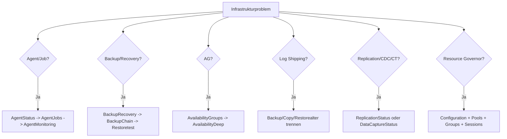

# Infrastruktur: Agent, Recovery, Hochverfügbarkeit und Datenerfassung

**Procedures:** 12  
**Evidenz:** Dienststatus, msdb-Historie, HADR-/Resource-Governor-DMVs und Featurekataloge  
**Kosten:** LOW bis HIGH_OPT_IN

## Grundregeln

- Alter, Queue und Lag sind nur relativ zu RPO, RTO, SLA und Betriebsfenster sinnvoll.
- msdb-Historie kann bereinigt, migriert oder unvollständig sein.
- Dienst-, Job- und HADR-Status sind Momentaufnahmen.
- Backupmetadaten beweisen keine Wiederherstellbarkeit; nur ein erfolgreicher Test-Restore tut dies.
- Keine Procedure führt Failover, Resume, Restore, Jobstart, Alertanlage oder Konfigurationsänderung aus.

---

## 1. [monitor].[USP_AgentStatus]

Die [Procedure-Referenz](Procedures/USP_AgentStatus.md) erläutert Einsatz, Ausgabe und Aussagegrenzen.

### Zweck

Die Procedure liefert SQL-Server-Agent-Dienststatus und ein kleines Basisinventar.

### RAW-Spalten

| Spalte | Bedeutung |
|---|---|
| `ServiceName` | sichtbarer Agentdienst |
| `StartupTypeDesc` | Dienststarttyp |
| `StatusDesc` | aktueller Dienststatus |
| `ProcessId` | Prozess-ID, nur für aktuellen Lauf gültig |
| `LastStartupTime` | letzter Agentstart aus msdb-Sessions |
| `AgentSessionId` | jüngste Agent-Session-ID |
| `JobCount` | Jobs gesamt |
| `EnabledJobCount` | aktivierte Jobs |

### Interpretation

| Fall | Bewertung |
|---|---|
| Status `Running`, Startup Automatic | typischer Sollzustand |
| Service Running, aber `LastStartupTime=NULL` | msdb-Sicht/Berechtigung oder ungewöhnlicher Startkontext prüfen |
| Service Stopped | Agentjobs, Backups und Alerts können ausfallen; Betriebsmodell prüfen |
| `JobCount=0` | kann legitime Instanz ohne Agentworkload sein |
| `EnabledJobCount < JobCount` | deaktivierte Jobs sind nicht automatisch problematisch |

### Folgeanalyse

`USP_AgentJobs` und `USP_AgentMonitoringAnalysis`.
### Parameterverträge

| Parameter | Datentyp | Default | Eingabeform und Wirkung |
|---|---|---|---|
| `@ResultSetArt` | `varchar(16)` | Default: `'CONSOLE'` | NULL wird zu leerem Text; äußere Leerzeichen werden entfernt und der Vergleich erfolgt ohne Beachtung der Groß-/Kleinschreibung. CONSOLE liefert eine beschriftete Console-Ausgabe, RAW den Modulstatus und die Rohzeile, TABLE exportiert agentStatus in das zugeordnete Ziel, NONE unterdrückt Resultsets. CONSOLE und TABLE unterdrücken zuerst direkte Resultsets und rufen anschließend ihren Ausgabeadapter auf. Andere Werte werden nach dem Hilferücksprung als INVALID_PARAMETER gemeldet. Bei ausgelassenem Argument gilt der angegebene Default. |
| `@ResultTablesJson` | `nvarchar(max)` | Default: `NULL` | NULL, leerer Text und nur aus Leerzeichen bestehender Text werden außerhalb von TABLE ignoriert. Ein nichtleerer Wert ist nur mit ResultSetArt=TABLE zulässig; andernfalls wird vor der Hilfe Fehler 51011 ausgelöst. TABLE erwartet die JSON-Objektform {"agentStatus":"#ExampleTarget"}: genau dieser case-sensitive Schlüssel, ein String mit dem lokalen Zielnamen als Wert und keine weiteren Eigenschaften. Das Ziel muss eine vorhandene, leere lokale #Temp-Tabelle mit genau einer Seed-Spalte sein; globale ##-Tabellen, #Monitor-Namen und Namen über 116 Zeichen sind unzulässig. Eine fehlende oder fehlerhafte Zuordnung sowie ein ungeeignetes Ziel lösen beim Preflight vor der Hilfe Fehler 51011 aus. Bei ausgelassenem Argument gilt der angegebene Default. |
| `@JsonErzeugen` | `bit` | Default: `0` | 0 oder NULL deaktiviert JSON; bei 1 wird @Json OUTPUT mit meta und agentStatus einschließlich NULL-Werten und einem leeren Array befüllt. SQL Server konvertiert das Argument vor Eintritt in den Prozedurcode zu bit: 0 ergibt 0, ein konvertierbarer Wert ungleich 0 ergibt 1. Konvertierungsfehler treten vor der Prozedurausführung auf. Bei ausgelassenem Argument gilt der angegebene Default. |
| `@Json` | `nvarchar(max) OUTPUT` | Default: `NULL` | Binden Sie eine nvarchar(max)-Variable mit @Json=@Variable OUTPUT. Die Procedure setzt sie zu Beginn auf NULL und befüllt sie nur bei @JsonErzeugen=1. Ohne OUTPUT-Bindung wird kein Wert an eine aufrufende Variable zurückgegeben. |
| `@PrintMeldungen` | `bit` | Default: `1` | Bei 1 wird nach einem abgefangenen Lesefehler eine Meldung mit Severity 10 und NOWAIT ausgegeben; 0 und NULL unterdrücken sie. SQL Server konvertiert das Argument vor Eintritt zu bit; Konvertierungsfehler treten vor der Prozedurausführung auf. Bei ausgelassenem Argument gilt der angegebene Default. |
| `@Hilfe` | `bit` | Default: `0` | 0 führt die normale Analyse aus. Bei 1 gibt die Procedure ihre Hilfe mit PRINT aus und kehrt vor der Agentdatensammlung zurück; sie startet, stoppt oder konfiguriert den Dienst nicht. NULL wirkt wie 0. SQL Server konvertiert das Argument vor Eintritt zu bit. Die Prüfung der ResultTables-Kombination und der TABLE-Zieltabellen-Preflight liegen vor dem Hilfezweig und können auch dabei Fehler 51011 auslösen. Bei ausgelassenem Argument gilt der angegebene Default. |

### Aufrufbeispiele zu den Parameterverträgen

Die Beispiele verwenden synthetische Namen. Die TABLE-Beispiele benötigen eine neue, leere lokale Tabelle und entfernen sie auch bei einem Fehler. Verfügbarkeit und Berechtigung der Agentquellen bleiben gesondert zu prüfen.

```sql
EXEC [monitor].[USP_AgentStatus] @Hilfe=1;

EXEC [monitor].[USP_AgentStatus] @ResultSetArt='RAW', @PrintMeldungen=0;

DECLARE @AgentStatusJson nvarchar(max); EXEC [monitor].[USP_AgentStatus] @ResultSetArt='NONE', @JsonErzeugen=1, @Json=@AgentStatusJson OUTPUT, @PrintMeldungen=0; SELECT @AgentStatusJson AS [Json];

CREATE TABLE #AgentStatus_HelpExample ([Seed] int NULL); BEGIN TRY EXEC [monitor].[USP_AgentStatus] @ResultSetArt='TABLE', @ResultTablesJson=N'{"agentStatus":"#AgentStatus_HelpExample"}', @PrintMeldungen=0; SELECT * FROM #AgentStatus_HelpExample; DROP TABLE #AgentStatus_HelpExample; END TRY BEGIN CATCH DROP TABLE #AgentStatus_HelpExample; THROW; END CATCH;
```

---

## 2. [monitor].[USP_AgentJobs]

Die [Procedure-Referenz](Procedures/USP_AgentJobs.md) erläutert Einsatz, Ausgabe und Aussagegrenzen.

### Zweck

Die Procedure analysiert Jobdefinition, aktuellen Lauf, letzte Gesamtausführung, Schedules und letzte Stepausführung.

Die Laufzeitschwelle ist eine Sichtungsgrenze in Minuten und kein allgemeiner SLA-Grenzwert. Der individuelle Parametervertrag folgt unten.

### Jobs

| Spalte | Bedeutung |
|---|---|
| `JobId`, `JobName` | Jobidentität |
| `Enabled` | Job aktiviert |
| `OwnerName` | Owner; Berechtigung und Existenz prüfen |
| `CategoryName` | Agentkategorie |
| `IsRunning`, `RunStart`, `RunningMinutes` | aktueller Lauf |
| `LastRunDateTime`, `LastRunStatus`, `LastRunStatusDesc` | letzte Job-Gesamtausführung |
| `LastRunDurationSeconds` | Dauer des letzten Laufs |
| `LastMessage` | letzte Agentmeldung; Runtime kann interne Inhalte enthalten |
| `ScheduleCount`, `EnabledScheduleCount` | angehängte Schedules |
| `StepCount` | Jobsteps |
| `ProblemCode` | `DISABLED`, `LONG_RUNNING`, `LAST_FAILED`, `NO_SCHEDULE`, `NO_ENABLED_SCHEDULE` |

### Steps

`JobName`, `StepId`, `StepName`, `Subsystem`, `LastRunOutcome`, `LastRunOutcomeDesc`, `LastRunDateTime`, `LastRunDurationSeconds`, `LastRunRetries`, `LastRunMessage`.

### Beispiele

| Konstellation | Bewertung |
|---|---|
| enabled, kein Schedule | kann On-Demand-Job sein; nicht automatisch Fehler |
| letzter Lauf failed, Job seitdem erfolgreich manuell ausgeführt | aktuelle Historyreihenfolge prüfen |
| 180 Minuten laufend, historisch immer 240 Minuten | wahrscheinlich normaler Job, SLA prüfen |
| 20 Minuten laufend, historisch 2 Minuten | auffällige Abweichung trotz unter 60-Minuten-Schwelle |
| Job erfolgreich, Step hatte Retry | Stabilitätsproblem möglich |
| Owner nicht mehr gültig | Jobausführung kann scheitern, besonders nicht-T-SQL-Subsysteme |

### Folgeanalyse

`USP_AgentMonitoringAnalysis`, Jobhistory, betroffene Query-/Blockinganalyse.
### Parameterverträge

| Parameter | Datentyp | Default | Eingabeform und Wirkung |
|---|---|---|---|
| `@JobNames` | `nvarchar(max)` | Default: `NULL` | NULL deaktiviert den exakten Namensfilter. Andernfalls wird eine bracket-aware Pipe-Liste einteiliger SQL-Namen erwartet: \| trennt außerhalb von eckigen Klammern; innerhalb gehört das Pipe-Zeichen zum Namen und ]] maskiert eine schließende Klammer. Äußere Segmentleerzeichen werden entfernt. Gültige Duplikate werden nach SQL_Latin1_General_CP1_CS_AS zusammengeführt; Namen mit abweichender Groß-/Kleinschreibung bleiben getrennt. Jedes Element muss als einteiliger SQL-Name mit höchstens 128 Zeichen auswertbar sein. Leere oder ungültige Elemente und rohe Segmente über 4000 UTF-16-Codeeinheiten sind ungültig; die Existenz im Katalog wird nicht geprüft. Eine leere Liste ist ungültig. @JobNames und ein nicht-NULL @JobNamePattern dürfen nicht zusammen verwendet werden. Ungültige Listen werden nach der Hilfe als INVALID_PARAMETER gemeldet, ohne Parser-THROW. Bei ausgelassenem Argument gilt der angegebene Default. |
| `@JobNamePattern` | `nvarchar(4000)` | Default: `NULL` | NULL deaktiviert den Patternfilter; leerer oder nur aus Leerzeichen bestehender Wert ist ungültig. Äußere Leerzeichen werden entfernt. Ohne Präfix gilt LIKE. Case-insensitive Präfixe: like: verwendet SQL-LIKE, regex: reguläre Ausdrücke mit Flag c, regexi: reguläre Ausdrücke mit Flag i. Der verbleibende Inhalt wird nicht erneut getrimmt; ein Präfix ohne Inhalt ist ungültig. Regex erfordert SQL Server 2025/ProductMajorVersion 17 oder neuer und Compatibility Level 170 der Installationsdatenbank; sonst wird UNAVAILABLE_FEATURE gemeldet. Die Regexsyntax wird nicht vorab geprüft; Fehler bei REGEXP_LIKE werden abgefangen. @JobNames und Pattern sind gegenseitig exklusiv. Das Parsing erfolgt vor der Hilfe, die übrige Validierung danach. Bei ausgelassenem Argument gilt der angegebene Default. |
| `@NurProblematisch` | `bit` | Default: `0` | Bei 0 werden alle passenden Jobs ausgewählt; bei 1 werden deaktivierte, zuletzt fehlgeschlagene Jobs, Jobs ohne Schedule, ohne aktivierten Schedule sowie laufende Jobs ab dem LongRunningMinutes-Grenzwert berücksichtigt. Steps erscheinen bei 1 nur mit letztem Status FAILED, RETRY oder CANCELED. NULL ist nicht gleich 0: SQL UNKNOWN bewirkt, dass Jobs nur bei einem zutreffenden Problemprädikat erhalten bleiben; Steps nur bei einem der drei genannten Statuswerte. SQL Server konvertiert das Argument vor Eintritt zu bit; 0 ergibt 0, ein konvertierbarer Wert ungleich 0 ergibt 1. Bei ausgelassenem Argument gilt der angegebene Default. |
| `@LongRunningMinutes` | `int` | Default: `60` | Die Laufzeitschwelle wird als ganze Zahl in Minuten übergeben; erlaubt sind 1 bis 2147483647. Werte kleiner als 1 setzen INVALID_PARAMETER. NULL passiert die Bereichsprüfung, ergibt beim Laufzeitvergleich aber UNKNOWN und erzeugt deshalb keinen LONG_RUNNING-Befund. Die aktuelle Laufzeit wird mit DATEDIFF(MINUTE, Startzeit, GETDATE()) verglichen. Bei @NurProblematisch=1 dient dieser Grenzwert auch als Filter. Bei ausgelassenem Argument gilt der angegebene Default. |
| `@MaxZeilen` | `int` | Default: `2000` | Eine positive Grenze ist eine ganze Zeilenzahl von 1 bis 2147483647. Negative Werte setzen INVALID_PARAMETER. Positive Werte begrenzen Job- und Stepzeilen; NULL oder 0 bedeutet unbegrenzt. Bei Nicht-Regexfiltern begrenzt bereits das erste TOP der Jobabfrage auf @EffectiveMaxZeilen und sortiert laufende Jobs zuerst, danach nach JobName. Zeilen außerhalb dieses ersten Ausschnitts können durch die spätere Problemsortierung nicht wieder aufgenommen werden; diese Sortierung bevorzugt ProblemCode-Zeilen nur unter den bereits materialisierten Jobs. Im Regexmodus wird zuerst ohne diese Grenze materialisiert, dann das Regex angewendet und anschließend die Problem-/Jobnamenpriorisierung begrenzt. Steps verwenden unabhängig davon TOP(@EffectiveMaxZeilen), geordnet nach JobName und StepId. Es gibt keine explizite Kürzungskennzeichnung oder zusätzliche Kürzungsanzahl. JSON requestedMaxRows enthält den übergebenen Wert. Bei ausgelassenem Argument gilt der angegebene Default. |
| `@ResultSetArt` | `varchar(16)` | Default: `'CONSOLE'` | NULL wird zu leerem Text; äußere Leerzeichen werden entfernt, der Vergleich erfolgt ohne Beachtung der Groß-/Kleinschreibung. CONSOLE liefert ausschließlich beschriftete Jobs, RAW den Modulstatus sowie Jobs und Steps, TABLE nur Jobs, NONE keine fachlichen Resultsets. CONSOLE und TABLE unterdrücken direkte Resultsets und verwenden anschließend ihre Ausgabeadapter. Andere Werte werden nach der Hilfe als INVALID_PARAMETER gemeldet. Bei ausgelassenem Argument gilt der angegebene Default. |
| `@ResultTablesJson` | `nvarchar(max)` | Default: `NULL` | NULL, leerer Text und nur aus Leerzeichen bestehender Text werden außerhalb von TABLE ignoriert. Ein nichtleerer Wert ist nur mit ResultSetArt=TABLE zulässig; andernfalls wird vor der Hilfe Fehler 51011 ausgelöst. TABLE erwartet die JSON-Objektform {"jobs":"#ExampleTarget"}: genau dieser case-sensitive Schlüssel, ein String mit dem lokalen Zielnamen als Wert und keine weiteren Eigenschaften. Das Ziel muss eine vorhandene, leere lokale #Temp-Tabelle mit genau einer Seed-Spalte sein; globale ##-Tabellen, #Monitor-Namen und Namen über 116 Zeichen sind unzulässig. Eine fehlende oder fehlerhafte Zuordnung sowie ein ungeeignetes Ziel lösen beim Preflight vor der Hilfe Fehler 51011 aus. Exportiert werden nur Jobs, keine Steps. Bei ausgelassenem Argument gilt der angegebene Default. |
| `@JsonErzeugen` | `bit` | Default: `0` | 0 oder NULL deaktiviert JSON; bei 1 wird @Json OUTPUT mit meta, jobs und steps, Mengenangaben und Arrays befüllt. SQL Server konvertiert das Argument vor Eintritt zu bit; 0 ergibt 0, ein konvertierbarer Wert ungleich 0 ergibt 1. Konvertierungsfehler treten vor der Prozedurausführung auf. Bei ausgelassenem Argument gilt der angegebene Default. |
| `@Json` | `nvarchar(max) OUTPUT` | Default: `NULL` | Binden Sie eine nvarchar(max)-Variable mit @Json=@Variable OUTPUT. Die Procedure setzt sie zu Beginn auf NULL und befüllt sie nur bei @JsonErzeugen=1. Ohne OUTPUT-Bindung wird kein Wert an eine aufrufende Variable zurückgegeben. |
| `@PrintMeldungen` | `bit` | Default: `1` | Bei 1 wird nach einem abgefangenen Sammlungsfehler eine Meldung mit Severity 10 und NOWAIT ausgegeben; 0 und NULL unterdrücken sie. SQL Server konvertiert das Argument vor Eintritt zu bit; Konvertierungsfehler treten vor der Prozedurausführung auf. Bei ausgelassenem Argument gilt der angegebene Default. |
| `@Hilfe` | `bit` | Default: `0` | 0 führt die normale Analyse aus. Bei 1 gibt die Procedure ihre Hilfe mit PRINT aus und kehrt ohne Jobdatensammlung zurück. NULL wirkt wie 0. SQL Server konvertiert das Argument vor Eintritt zu bit. Ausgabe-/TABLE-Preflight und Patternparsing erfolgen vor der Hilfe; Joblistenvalidierung, Parameter- und Regexfeatureprüfung sowie Datensammlung danach. Ein Preflightfehler kann daher auch mit @Hilfe=1 auftreten. Bei ausgelassenem Argument gilt der angegebene Default. |

### Aufrufbeispiele zu den Parameterverträgen

Die Beispiele verwenden synthetische Namen. Die TABLE-Beispiele benötigen eine neue, leere lokale Tabelle und entfernen sie auch bei einem Fehler. Verfügbarkeit und Berechtigung der Agentquellen bleiben gesondert zu prüfen.

```sql
EXEC [monitor].[USP_AgentJobs] @Hilfe=1;

EXEC [monitor].[USP_AgentJobs] @JobNames=N'[ExampleJobA]|[ExampleJobB]', @MaxZeilen=100, @ResultSetArt='RAW', @PrintMeldungen=0;

DECLARE @AgentJobsJson nvarchar(max); EXEC [monitor].[USP_AgentJobs] @ResultSetArt='NONE', @JsonErzeugen=1, @Json=@AgentJobsJson OUTPUT, @PrintMeldungen=0; SELECT @AgentJobsJson AS [Json];

CREATE TABLE #AgentJobs_HelpExample ([Seed] int NULL); BEGIN TRY EXEC [monitor].[USP_AgentJobs] @ResultSetArt='TABLE', @ResultTablesJson=N'{"jobs":"#AgentJobs_HelpExample"}', @PrintMeldungen=0; SELECT * FROM #AgentJobs_HelpExample; DROP TABLE #AgentJobs_HelpExample; END TRY BEGIN CATCH DROP TABLE #AgentJobs_HelpExample; THROW; END CATCH;

EXEC [monitor].[USP_AgentJobs] @JobNamePattern=N'like:ExampleJob%', @MaxZeilen=100, @ResultSetArt='RAW';

EXEC [monitor].[USP_AgentJobs] @NurProblematisch=1, @LongRunningMinutes=60, @MaxZeilen=100, @ResultSetArt='RAW';
```

---

## 3. [monitor].[USP_ResourceGovernorAnalysis]

### Zweck

Die Procedure vergleicht gespeicherte und effektive Resource-Governor-Konfiguration, Pools, Workload Groups und optionale Sessions.

### Parameter und Aufrufbeispiele

| Parameter | Typ | Default | Eingabe und Wirkung |
|---|---|---|---|
| `@MitSessions` | `bit` | `1` | 1 erfasst sichtbare Benutzerprozesse aus sys.dm_exec_sessions und ordnet sie nach GroupId zu. 0 überspringt die Quelle und die Sessionausgabe in RAW und CONSOLE. JSON enthält dann ein leeres sessions-Array. NULL ergibt INVALID_PARAMETER. |
| `@MaxZeilen` | `int` | `5000` | Eine positive ganze Zahl begrenzt Pools, Workload Groups, tempdbGovernance und Sessions jeweils separat. NULL oder 0 hebt die Grenze auf. Negative Werte ergeben INVALID_PARAMETER. Die Konfigurationszeile bleibt unberührt. Sessions werden vor der Gruppenzuordnung nach CPU-Zeit absteigend und SessionId begrenzt. |
| `@ResultSetArt` | `varchar(16)` | `'CONSOLE'` | CONSOLE zeigt beschriftete Fachergebnisse. RAW gibt zuerst Status und Metadaten, dann die Daten und Warnungen aus. TABLE schreibt nur zugeordnete Fachergebnisse in lokale Temp-Tabellen. NONE unterdrückt diese Ausgaben. Leerzeichen am Rand werden entfernt und Groß-/Kleinschreibung wird normalisiert. NULL, leere Eingaben und alle anderen Werte ergeben INVALID_PARAMETER. JSON und Statusmeldungen werden separat gesteuert. |
| `@ResultTablesJson` | `nvarchar(max)` | `NULL` | Bei TABLE ist ein nichtleeres JSON-Objekt erforderlich. Die exakten Schlüssel sind configuration für Konfiguration, resourcePools für Pools, workloadGroups für Gruppen, sessions für Sessions und tempdbGovernance für TempDB-Limits und Laufzeitevidenz. Wählen Sie mindestens einen Schlüssel. Jeder Wert ist der Name einer vorhandenen leeren lokalen #Temp-Tabelle mit genau einer Seed-Spalte. Der Name darf höchstens 116 Zeichen lang sein. ## und #Monitor als Präfix sind unzulässig. Doppelte Schlüssel und Ziele sind unzulässig. Die Vorprüfung erfolgt vor dem Lesen der fachlichen Quellen. Außerhalb von TABLE sind nur NULL, die leere Zeichenfolge und reine Leerzeichen zulässig. |
| `@JsonErzeugen` | `bit` | `0` | 1 erzeugt das JSON-Dokument unabhängig von @ResultSetArt. 0 lässt @Json auf NULL. NULL ergibt INVALID_PARAMETER. |
| `@Json` | `nvarchar(max) OUTPUT` | `NULL` | Binden Sie eine nvarchar(max)-Variable mit OUTPUT. Die Procedure setzt den Wert vor Hilfe und Validierung auf NULL. Bei @JsonErzeugen=1 erhält die Variable das Dokument der SchemaVersion 2 mit Metadaten, Konfiguration, Pools, Gruppen, TempDB-Governance, Sessions und Warnungen einschließlich NULL-Feldern. |
| `@PrintMeldungen` | `bit` | `1` | 1 gibt bei einem Status ungleich AVAILABLE eine informative Meldung mit Schweregrad 10 aus. 0 oder NULL unterdrückt diese Meldung. |
| `@Hilfe` | `bit` | `0` | 1 zeigt diese Hilfe und beendet den Aufruf vor Validierung, TABLE-Vorprüfung, fachlichen Quellzugriffen und JSON-Erzeugung. 0 oder NULL führt die Analyse aus. |

Der [Procedure-Guide](Procedures/USP_ResourceGovernorAnalysis.md#aufrufbeispiele) enthält Beispiele für Hilfe, RAW, JSON und TABLE.

### Configuration

`ClassifierFunctionId`, `IsEnabled`, `ReconfigurationPending`, `ClassifierFunctionName`.

**Grenzfall:** `ReconfigurationPending=1` bedeutet, dass gespeicherte und aktive Konfiguration abweichen können.

### ResourcePools

| Gruppe | Spalten |
|---|---|
| Limits | `MinCpuPercent`, `MaxCpuPercent`, `MinMemoryPercent`, `MaxMemoryPercent`, `CapCpuPercent`, `MinIopsPerVolume`, `MaxIopsPerVolume` |
| Zeitraum | `StatisticsStartTime` |
| CPU/Memory | `TotalCpuUsageMs`, `CacheMemoryMb`, `UsedWorkspaceMemoryMb`, `TargetWorkspaceMemoryMb`, `MaxWorkspaceMemoryMb` |
| Druck | `OutOfMemoryCount`, `ActiveMemgrantCount`, `PendingMemgrantCount` |
| Relationen | `UsedOfTargetMemoryPercent`, `UsedOfMaxMemoryPercent` |

### WorkloadGroups

| Gruppe | Spalten |
|---|---|
| Identität | `GroupId`, `GroupName`, `PoolId`, `PoolName`, `Importance` |
| Grants | `RequestMaxMemoryGrantPercent`, `ConfiguredRequestMaxGrantMemoryMb`, `TargetRequestMaxGrantMemoryMb`, `HistoricalMaxRequestGrantMemoryMb`, `RequestMemoryGrantTimeoutSec` |
| CPU/DOP | `RequestMaxCpuTimeSec`, `MaxDop`, `EffectiveMaxDop` |
| Concurrency | `GroupMaxRequests`, `ActiveRequestCount`, `QueuedRequestCount`, `TotalQueuedRequestCount` |
| Historie | `TotalRequestCount`, `TotalReducedMemgrantCount`, `TotalCpuUsageMs`, `TotalLockWaitCount`, `TotalLockWaitTimeMs` |

### tempdbGovernance (SQL Server 2025)

| Gruppe | Spalten |
|---|---|
| Identität | `GroupId`, `GroupName`, `PoolId`, `PoolName` |
| gespeichert | `ConfiguredGroupMaxTempdbDataMb`, `ConfiguredGroupMaxTempdbDataPercent` |
| wirksam | `TempdbMaximumSizeMb`, `EffectiveGroupMaxTempdbDataMb`, `EffectiveLimitSource`, `IsPercentLimitEffective`, `EffectiveLimitUtilizationPercent` |
| Runtimefenster | `TempdbDataSpaceMb`, `PeakTempdbDataSpaceMb`, `TotalTempdbDataLimitViolationCount`, `HasRecordedLimitViolation`, `StatisticsStartTime` |
| Status | `IsResourceGovernorEnabled`, `ReconfigurationPending`, `SourceStatusCode`, `IsPartial`, `EvidenceLimit` |

Das MB-Limit hat Vorrang vor einem gleichzeitig gespeicherten Prozentlimit.
Ein Prozentlimit ist nur bei geeigneter TempDB-Dateikonfiguration wirksam.
`StatisticsStartTime` begrenzt Peak und Verletzungszähler seit Serverstart oder
`ALTER RESOURCE GOVERNOR RESET STATISTICS`. Kein Limit ist kein Fehler;
Version Store und TempDB-Log gehören nicht zu dieser Governance.

### Sessions

`SessionId`, `LoginName`, `HostName`, `ProgramName`, `GroupId`, `GroupName`, `PoolName`, `Status`, `CpuTimeMs`, `MemoryUsagePages`, `MemoryUsageMb`, `Reads`, `Writes`, `LogicalReads`.

### Interpretation

- Konfiguriertes Grantlimit basiert auf Max Pool Memory; Targetlimit auf aktueller Target Memory; Historical Max ist beobachtete DMV-Evidenz.
- `PendingMemgrantCount>0` oder `QueuedRequestCount>0` ist relevanter als ein enges Limit allein.
- `OutOfMemoryCount` ist kumulativ seit `StatisticsStartTime`.
- `EffectiveMaxDop` kann von konfiguriertem `MaxDop` abweichen.
- Interpretieren Sie Default- und Internal-Pools nicht wie benutzerdefinierte Pools.
- Sessionzuordnung zeigt Classifier-Ergebnis, nicht zwingend die fachlich gewünschte Klassifizierung.
- Workload-Group- und Sessionwerte besitzen unterschiedliche Granularitäten und sind nicht additiv.
- `ReconfigurationPending=1` trennt gespeicherte von belastbar aktiver Konfiguration.

### Folgeanalyse

`USP_CurrentMemoryGrants`, `USP_CurrentRequests`, `USP_CurrentTempDB`,
`USP_ServerMemory`.

---

## 4. [monitor].[USP_AvailabilityGroups]

Die [Procedure-Referenz](Procedures/USP_AvailabilityGroups.md) erläutert Einsatz und Aussagegrenzen.

### Zweck

Die Procedure erstellt ein Basisinventar für AG-Replikate, Datenbanken, Listener und Read-only Routing.

### Replicas

`AgName`, `ReplicaServerName`, `LocalReplica`, `RoleDesc`, `OperationalStateDesc`, `ConnectedStateDesc`, `RecoveryHealthDesc`, `SynchronizationHealthDesc`, `AvailabilityModeDesc`, `FailoverModeDesc`, `SessionTimeout`, `EndpointUrl`, `PrimaryRoleAllowConnectionsDesc`, `SecondaryRoleAllowConnectionsDesc`, `ReadOnlyRoutingUrl`.

### Databases

| Spalte | Bedeutung |
|---|---|
| `AgName`, `ReplicaServerName`, `DatabaseName`, `IsLocal`, `IsPrimaryReplica` | Scope |
| `SynchronizationStateDesc`, `SynchronizationHealthDesc`, `DatabaseStateDesc` | Zustand |
| `IsSuspended`, `SuspendReasonDesc` | Data Movement |
| `LogSendQueueKb`, `LogSendRateKbSec`, `EstimatedSendSeconds` | Sendqueue und momentane Rate |
| `RedoQueueKb`, `RedoRateKbSec`, `EstimatedRedoSeconds` | Redoqueues |
| `LastSentTime`, `LastReceivedTime`, `LastHardenedTime`, `LastRedoneTime` | Pipelinezeitpunkte |
| `SecondaryLagSeconds` | versions-/modusabhängige Lag-Evidenz |

### Listener

`AgName`, `ListenerDnsName`, `Port`, `IsConformant`, `IpAddress`, `IpSubnetMask`, `NetworkSubnetIp`, `NetworkSubnetPrefixLength`, `StateDesc`.

### Routing

`AgName`, `ReplicaServerName`, `RoutingPriority`, `ReadOnlyReplicaServerName`.

### Interpretation

- Queue ÷ aktuelle Rate ist nur eine grobe Schätzung; Rate kann 0 oder stark schwankend sein.
- Asynchrones Commit darf dauerhaft `SYNCHRONIZING` sein.
- Synchronous Commit erwartet je Ziel/SLA andere Healthbedingungen.
- Listenerzustand auf einem Node ist kein vollständiger Clientkonnektivitätstest.
- Routingliste beweist nicht, dass Anwendung mit `ApplicationIntent=ReadOnly` verbindet.

### Folgeanalyse

`USP_AvailabilityDeepAnalysis`, Performance Counter, Netzwerk-/Cluster-/Storageüberwachung.
### Parameterverträge

| Parameter | Datentyp | Default | Eingabeform und Wirkung |
|---|---|---|---|
| `@MitRouting` | `bit` | Default: `1` | SQL Server konvertiert das Argument vor Aufruf; NULL bleibt NULL. Nur ein Argument, das SQL Server zu bit 1 konvertiert, führt die zusätzliche Read-only-Abfrage der Read-Only-Routinglisten aus. Bei 0 oder NULL bleibt diese Ergebnismenge leer. Bei ausgelassenem Argument gilt der angegebene Default. |
| `@MaxZeilen` | `int` | Default: `5000` | Der SQL-int-Bereich von -2.147.483.648 bis 2.147.483.647. Ein negativer Wert ergibt INVALID_PARAMETER. NULL oder 0 wird in bigint-Maximalwert umgerechnet und bedeutet damit praktisch unbegrenzt; ein positiver Wert begrenzt jede der vier Ergebnismengen getrennt. Er filtert weder AGs noch Datenbanken vor der Quellabfrage. Nicht konvertierbare Argumente scheitern bereits vor dem Procedure-Body. Einheit: Zeilen je Ergebnismenge. Ein negativer Wert allein lässt IsPartial=0. Bei ausgelassenem Argument gilt der angegebene Default. |
| `@ResultSetArt` | `varchar(16)` | Default: `'CONSOLE'` | SQL-Konvertierung findet vor dem Body statt; danach werden Leerzeichen an den Rändern entfernt und die Eingabe in Großbuchstaben normalisiert. Vorgesehen sind CONSOLE, RAW, TABLE und NONE. NULL, leerer oder unbekannter Wert ist ungültig. RAW liefert zuerst den Modulstatus und danach vier native Ergebnismengen; NONE unterdrückt Ergebnismengen. CONSOLE wird intern zunächst zu NONE und am Ende über den erreichbaren gemeinsamen Console-Adapter für die Replikamenge ausgegeben. TABLE unterdrückt die nativen Mengen und exportiert nur replicas. Außerhalb von TABLE muss ResultTablesJson NULL oder leer sein. Bei ausgelassenem Argument gilt der angegebene Default. |
| `@ResultTablesJson` | `nvarchar(max)` | Default: `NULL` | Nur im TABLE-Modus wird ein JSON-Objekt mit dem exakt erlaubten Schlüssel replicas angenommen; sein Zeichenkettenwert muss auf eine bereits angelegte, leere lokale #Temp-Tabelle mit genau einer beliebigen Seed-Spalte zeigen. Globale ##Temp- und permanente Ziele sind unzulässig; der Tabellenname darf höchstens 116 Zeichen lang sein. NULL oder leer wird im TABLE-Modus vom Helper abgelehnt. Außerhalb davon löst nichtleeres JSON nach Trimmen Fehler 51011 aus; Whitespace gilt als leer. Der Helper prüft Schlüssel und Stringtyp, Eindeutigkeit sowie den Zielnamen. Diese Prüfung liegt vor HELP. Das Präfix #Monitor ist unabhängig von Groß- und Kleinschreibung reserviert. Der Preflight kann vor HELP vorübergehend eine Markerspalte hinzufügen und entfernen. Bei ausgelassenem Argument gilt der angegebene Default. |
| `@JsonErzeugen` | `bit` | Default: `0` | Nur der nach SQL-Konvertierung vorliegende Wert 1 aktiviert die JSON-Erzeugung für den OUTPUT-Parameter Json; NULL wirkt wie deaktiviert. JSON-Erzeugung ist unabhängig von ResultSetArt. Der gebundene Wert 0 deaktiviert die JSON-Erzeugung. Bei ausgelassenem Argument gilt der angegebene Default. |
| `@Json` | `nvarchar(max) OUTPUT` | Default: `NULL` | Die Procedure setzt ihn am Eintritt auf NULL; nur bei JsonErzeugen=1 enthält er ein JSON-Objekt mit den Schlüsseln meta, replicas, databases, listeners und routing. Die Arrays enthalten auch NULL-Felder. Die OUTPUT-Bindung ändert die normalen Resultsets nicht. Binden Sie eine Variable des deklarierten Typs mit OUTPUT. |
| `@PrintMeldungen` | `bit` | Default: `1` | Bei einem abgefangenen Fehler der Erfassung gibt nur der Wert 1 eine Meldung mit Severity 10 und WITH NOWAIT aus. 0 oder NULL unterdrücken nur diese Zusatzmeldung, nicht Status oder Daten. SQL-konvertierte bit-Eingaben werden vor dem Body gebunden. Bei ausgelassenem Argument gilt der angegebene Default. |
| `@Hilfe` | `bit` | Default: `0` | Nur der gebundene bit-Wert 1 gibt die Hilfe mit PRINT aus und kehrt vor der Erfassung zurück. 0 und NULL aktivieren die Hilfe nicht. Json wird vorher auf NULL gesetzt; auch die TABLE-Vorprüfung findet bereits statt. Bei ausgelassenem Argument gilt der angegebene Default. |

### Aufrufbeispiele zu den Parameterverträgen

Das TABLE-Beispiel erwartet einen freien lokalen Tabellennamen. Es legt das leere Ziel mit einer Seed-Spalte an und entfernt es nach dem Aufruf oder bei einem Aufruffehler.

```sql
EXEC [monitor].[USP_AvailabilityGroups] @Hilfe=1;

EXEC [monitor].[USP_AvailabilityGroups] @MitRouting=0, @MaxZeilen=100, @ResultSetArt='RAW';

DECLARE @AgJson nvarchar(max); EXEC [monitor].[USP_AvailabilityGroups] @MaxZeilen=100, @ResultSetArt='NONE', @JsonErzeugen=1, @Json=@AgJson OUTPUT; SELECT @AgJson AS [Json];

CREATE TABLE #AvailabilityGroups_HelpExample ([Seed] int NULL); BEGIN TRY EXEC [monitor].[USP_AvailabilityGroups] @MaxZeilen=100, @ResultSetArt='TABLE', @ResultTablesJson=N'{"replicas":"#AvailabilityGroups_HelpExample"}'; SELECT * FROM #AvailabilityGroups_HelpExample; DROP TABLE #AvailabilityGroups_HelpExample; END TRY BEGIN CATCH DROP TABLE #AvailabilityGroups_HelpExample; THROW; END CATCH;
```

---

## 5. [monitor].[USP_BackupRecovery]

Die [Procedure-Referenz](Procedures/USP_BackupRecovery.md) erläutert Einsatz, Ausgabe und Aussagegrenzen.

### Zweck

Die Procedure bewertet Backupfrische und zeigt Backup-/Restorehistorie.

### Framework-Schwellen

| Parameter | Default |
|---|---:|
| `@FullWarnHours` | 48 h |
| `@DiffWarnHours` | 24 h |
| `@LogWarnMinutes` | 30 min |

Diese Defaults sind keine universellen RPOs.

### Freshness

`DatabaseName`, `StateDesc`, `RecoveryModelDesc`, `LastFullFinish`, `FullAgeMinutes`, `LastDiffFinish`, `DiffAgeMinutes`, `LastLogFinish`, `LogAgeMinutes`, `LastCopyOnlyFullFinish`, `BackupStatus`.

`BackupStatus`:

- `TEMPDB_NO_BACKUP`
- `NO_FULL_BACKUP`
- `FULL_TOO_OLD`
- `NO_LOG_BACKUP`
- `LOG_TOO_OLD`
- `DIFF_OLD_INFORMATIONAL`
- `OK`

### Backups

`DatabaseName`, `BackupType`, `BackupTypeDesc`, `BackupStartDate`, `BackupFinishDate`, `DurationSeconds`, `BackupSizeMb`, `CompressedSizeMb`, `IsCopyOnly`, `IsSnapshot`, `HasBackupChecksums`, `IsDamaged`, `MediaPath`.

### Restores

`DestinationDatabaseName`, `RestoreDate`, `UserName`, `RestoreType`, `Replace`, `Recovery`, `Restart`, `SourceDatabaseName`, `BackupFinishDate`.

### Interpretation

- `OK` bedeutet nur, dass msdb-Zeitpunkte den Schwellen entsprechen.
- Copy-only Full ist keine normale Differentialbasis.
- `IsDamaged=1` ist hoch relevant.
- Backup Checksum verbessert Evidenz, beweist aber keine erfolgreiche Wiederherstellung.
- Restorehistory kann einen Restore auf derselben DB zeigen, nicht zwingend einen isolierten Recoverytest.
- `MediaPath` ist schutzbedürftige Laufzeitinformation und darf nur im erforderlichen Umfang exportiert oder weitergegeben werden.

### Folgeanalyse

`USP_BackupChainAnalysis`, `USP_DatabaseIntegrityAnalysis`, echter Restore-Test.
### Parameterverträge

| Parameter | Datentyp | Default | Eingabeform und Wirkung |
|---|---|---|---|
| `@DatabaseNames` | `nvarchar(max)` | Default: `NULL` | NULL sowie nach Trim leere Eingaben wählen alle für den Aufrufer sichtbaren, online befindlichen und zugänglichen Datenbanken, standardmäßig ohne Systemdatenbanken. Andernfalls wird eine Pipe-Liste einteiliger SQL-Datenbanknamen verarbeitet; äußere Leerzeichen je Element werden entfernt. Bracket-quotierte Elemente erlauben ein wörtliches Pipe-Zeichen und maskieren eine schließende Klammer als `]]`. Jedes Element muss ein gültiger höchstens 128 Zeichen langer SQL-Name sein; leere, doppelte, fehlerhaft geklammerte, mehrteilige oder ungültige Namen führen zu `INVALID_PARAMETER`. Eine explizite Liste kann nicht zusammen mit einem Pattern verwendet werden. Die Auswahl wird nicht vorab begrenzt; Namen, die nicht im zugänglichen Kandidatenscope liegen, liefern keine Kandidaten. Gültige explizite Namen außerhalb des zugänglichen Kandidatenscopes erzeugen Warnzeilen mit DATABASE_UNAVAILABLE beziehungsweise SYSTEM_DATABASE_EXCLUDED und führen zu AVAILABLE_LIMITED mit IsPartial=1; sie werden nicht stillschweigend ignoriert. Bei ausgelassenem Argument gilt der angegebene Default. |
| `@SystemdatenbankenEinbeziehen` | `bit` | Default: `0` | 0 schließt die vier Systemdatenbanken anhand ihrer database_id aus; 1 nimmt zugängliche, online befindliche Systemdatenbanken in denselben Kandidatenpfad auf. NULL ist ungültig und führt über die Kandidatenvalidierung zu `INVALID_PARAMETER`. Diese Procedure übergibt `@AnalysisClass = NULL`; deshalb aktiviert dieser Schalter kein High-Impact-Analyse-Gate. SQL Server bindet das Argument vor Eintritt an bit: 0 wird 0, ein konvertierbarer numerischer Wert ungleich 0 wird 1. Andere Literalformen unterliegen der SQL-Typkonvertierung; Bindungsfehler treten vor dem Prozedurcode auf. Bei ausgelassenem Argument gilt der angegebene Default. |
| `@DatabaseNamePattern` | `nvarchar(4000)` | Default: `NULL` | NULL bedeutet kein Pattern; sonst werden äußere Leerzeichen entfernt und der Wert als Pattern ausgewertet. Zulässige Präfixe sind `LIKE:`, `REGEX:` und `REGEXI:` (Präfixerkennung ohne Beachtung der Groß-/Kleinschreibung); ohne Präfix gilt LIKE. `REGEX:` verlangt case-sensitive Regex, `REGEXI:` case-insensitive Regex; `LIKE:` entfernt nur das Präfix und verwendet SQL-LIKE-Musterzeichen. Der Inhalt nach dem Präfix darf nicht leer sein. Die maximale Eingabelänge beträgt 4000 UTF-16-Codeeinheiten. Ein Pattern ist mit einer exakten Namensliste unzulässig. Jedes nicht-NULL Pattern, das nach Trim beziehungsweise Präfixentfernung leer ist, sowie die Kombination mit einer exakten Liste setzen den Status `INVALID_PARAMETER`. Für `REGEX` und `REGEXI` benötigt die Installationsinstanz SQL Server 2025 und Compatibility Level 170; andernfalls meldet der Kandidatenhelfer `UNAVAILABLE_FEATURE`. Bei ausgelassenem Argument gilt der angegebene Default. |
| `@HighImpactConfirmed` | `bit` | Default: `0` | 0 und 1 sind Bestätigungswerte, NULL ist ungültig und wird als `INVALID_PARAMETER` behandelt. Für diese Procedure bleibt die Bestätigung ohne Freischaltwirkung: Der Kandidatenhelfer wird mit `@AnalysisClass = NULL` aufgerufen, sodass kein Analysepfad geprüft oder aktiviert wird. Der Wert ist keine Genehmigung für Backup-, Restore- oder sonstige Änderungen. SQL Server bindet das Argument vor Eintritt an bit: 0 wird 0, ein konvertierbarer numerischer Wert ungleich 0 wird 1. Andere Literalformen unterliegen der SQL-Typkonvertierung; Bindungsfehler treten vor dem Prozedurcode auf. Bei ausgelassenem Argument gilt der angegebene Default. |
| `@FullWarnHours` | `int` | Default: `48` | Zulässige nicht-NULL Werte sind ganze Zahlen von 1 bis 2147483647. Ganzzahlige Stundenschwelle für `FULL_TOO_OLD`; Werte kleiner als 1 sind ungültig. NULL passiert die `< 1`-Prüfung, lässt den Altersvergleich aber wegen SQL-NULL-Semantik nicht zutreffen und unterdrückt damit diese Schwellenklassifikation. Die Schwelle begrenzt keine gelesene msdb-Historie und ist kein RPO. Der Vergleich verwendet DATEDIFF(HOUR, ..., GETDATE()) > @FullWarnHours; DATEDIFF zählt Stundengrenzen. Bei ausgelassenem Argument gilt der angegebene Default. |
| `@DiffWarnHours` | `int` | Default: `24` | Zulässige nicht-NULL Werte sind ganze Zahlen von 1 bis 2147483647. Ganzzahlige Stundenschwelle für den informativen Status `DIFF_OLD_INFORMATIONAL`; Werte kleiner als 1 sind ungültig. NULL passiert die `< 1`-Prüfung, lässt den Altersvergleich aber wegen SQL-NULL-Semantik nicht zutreffen. Die Schwelle begrenzt keine gelesene Historie und ist kein RPO. Der Vergleich verwendet DATEDIFF(HOUR, ..., GETDATE()) > @DiffWarnHours; DATEDIFF zählt Stundengrenzen. Bei ausgelassenem Argument gilt der angegebene Default. |
| `@LogWarnMinutes` | `int` | Default: `30` | Zulässige nicht-NULL Werte sind ganze Zahlen von 1 bis 2147483647. Ganzzahlige Minutenschwelle für `LOG_TOO_OLD`; Werte kleiner als 1 sind ungültig. NULL passiert die `< 1`-Prüfung, lässt den Altersvergleich aber wegen SQL-NULL-Semantik nicht zutreffen. Der Vergleich verwendet `DATEDIFF(MINUTE, ..., GETDATE())`; die Schwelle begrenzt keine msdb-Historie und ist kein RPO. Bei ausgelassenem Argument gilt der angegebene Default. |
| `@MitRestoreHistory` | `bit` | Default: `1` | 0 lässt die Abfrage der msdb-Restorehistorie aus; 1 liest die Restorehistorie für ausgewählte Datenbanken. NULL verhält sich in `IF @MitRestoreHistory = 1` wie nicht aktiviert. Dieser Schalter betrifft nur Restoreausgabe und entfernt weder Backup- noch Freshnessauswertung. SQL Server bindet das Argument vor Eintritt an bit: 0 wird 0, ein konvertierbarer numerischer Wert ungleich 0 wird 1. Andere Literalformen unterliegen der SQL-Typkonvertierung; Bindungsfehler treten vor dem Prozedurcode auf. Bei ausgelassenem Argument gilt der angegebene Default. |
| `@MaxZeilen` | `int` | Default: `5000` | Eine positive Grenze ist eine ganze Zeilenzahl von 1 bis 2147483647. Negative Werte führen zu `INVALID_PARAMETER`; NULL oder 0 werden in eine unbegrenzte Obergrenze umgewandelt. Positive Werte begrenzen Freshness, Backup-, Kompressions-Backupset- und Restoreausgabe jeweils separat; die kleinen serverweiten Konfigurations- und Capability-Einträge bleiben sichtbar. Die Freshnessgrenze wird nach der Bewertung angewandt. Das Limit beschränkt nicht die zuvor geprüfte Backupsetmenge für Aggregation und Freshness und ist kein gemeinsames Gesamtlimit. Bei ausgelassenem Argument gilt der angegebene Default. |
| `@ResultSetArt` | `varchar(16)` | Default: `'CONSOLE'` | Nach `LTRIM`/`RTRIM` und Umwandlung in Großbuchstaben sind ausschließlich `CONSOLE`, `RAW`, `TABLE` und `NONE` zulässig; NULL und andere Texte führen zu `INVALID_PARAMETER`. `CONSOLE` liefert ausschließlich eine formatierte Freshnessausgabe ohne zusätzliches Modulstatus-Resultset; bei leerer Menge wird eine verständliche Hinweiszeile ausgegeben, `RAW` liefert die technischen Resultsets, `TABLE` schreibt ausschließlich die benannten lokalen Ziele, und `NONE` unterdrückt Resultsets. Für `CONSOLE` und `TABLE` wird der interne Resultsetpfad auf NONE gestellt, bevor die jeweilige Ausgabeadapterlogik läuft. Die Auswahl ist unabhängig von JSON-OUTPUT. Bei ausgelassenem Argument gilt der angegebene Default. |
| `@ResultTablesJson` | `nvarchar(max)` | Default: `NULL` | Nur bei `TABLE` darf dieser Wert nicht leer sein: Er muss ein JSON-Objekt mit Stringwerten für die case-sensitiven Schlüssel `freshness` und/oder `compression` enthalten; jeder Wert bezeichnet eine vorhandene lokale `#`-Temp-Tabelle. Ziele müssen leer sein und genau eine Seed-Spalte besitzen; doppelte/unbekannte Schlüssel, doppelte Ziele, globale oder reservierte `#Monitor`-Ziele, falsche Namen/Schemas oder ein ungültiges Mapping lösen den TABLE-Preflightfehler 51011 aus. Der Preflight prüft und verändert Ziele vorübergehend durch Hinzufügen und Entfernen einer Marker-Spalte. Bei allen anderen Ausgabearten ist NULL oder ein Leer-/Whitespacewert zulässig; ein nichtleeres Mapping löst 51011 aus. Das Mapping ändert keine fachlichen Backupdaten. Die Zielnamen dürfen höchstens 116 Zeichen lang sein. Zielnamen-Duplikate werden ohne Beachtung der Groß-/Kleinschreibung geprüft; Resultset-Schlüssel müssen dagegen exakt einschließlich Groß-/Kleinschreibung stimmen. Bei ausgelassenem Argument gilt der angegebene Default. |
| `@JsonErzeugen` | `bit` | Default: `0` | 1 erzeugt das JSON-Dokument und weist es `@Json` zu; 0 oder NULL lässt es bei der anfänglichen Rücksetzung auf NULL. Das Root-Objekt enthält `meta` (u. a. resultName, schemaVersion, generatedAtUtc, statusCode, isPartial, requestedMaxRows, errorNumber und errorMessage), `freshness`, `backups`, `compression`, `restores` und `warnings`. JSON-Erzeugung ist unabhängig von der gewählten Resultsetart. SQL Server bindet das Argument vor Eintritt an bit: 0 wird 0, ein konvertierbarer numerischer Wert ungleich 0 wird 1. Andere Literalformen unterliegen der SQL-Typkonvertierung; Bindungsfehler treten vor dem Prozedurcode auf. Bei ausgelassenem Argument gilt der angegebene Default. |
| `@Json` | `nvarchar(max) OUTPUT` | Default: `NULL` | OUTPUT-Empfangsparameter für das erzeugte JSON-Dokument. Die Procedure setzt ihn zu Beginn immer auf NULL; ein JSON-Text wird nur bei `@JsonErzeugen = 1` zugewiesen. Inhalt und Schlüssel stehen im Vertrag von `@JsonErzeugen`; bei HELP und bei deaktivierter JSON-Erzeugung bleibt der OUTPUT-Wert NULL. Binden Sie eine nvarchar(max)-Variable mit @Json=@Variable OUTPUT. Ohne OUTPUT-Bindung wird kein Wert an eine aufrufende Variable zurückgegeben. |
| `@PrintMeldungen` | `bit` | Default: `1` | 1 erlaubt die vorgesehenen Informations-/Warnmeldungen über `RAISERROR` mit Severity 10; 0 unterdrückt diese Meldungen. NULL wird durch die Prüfung `IF @PrintMeldungen = 1` ebenfalls nicht aktiviert. Der Schalter unterdrückt weder Resultsets noch JSON und ändert keinen Status. SQL Server bindet das Argument vor Eintritt an bit: 0 wird 0, ein konvertierbarer numerischer Wert ungleich 0 wird 1. Andere Literalformen unterliegen der SQL-Typkonvertierung; Bindungsfehler treten vor dem Prozedurcode auf. Bei ausgelassenem Argument gilt der angegebene Default. |
| `@Hilfe` | `bit` | Default: `0` | 1 gibt den Hilfetext mit `PRINT` aus und kehrt vor Kandidatensuche, Backup-/Restoreabfragen und Ausgabeverarbeitung zurück; 0 führt den normalen Ablauf aus. NULL wird nicht als aktiviert behandelt. Die TABLE-Zielvorprüfung liegt vor dieser Verzweigung: Bei `TABLE` kann deshalb bereits vorher Mapping validiert und eine Marker-Spalte temporär hinzugefügt/entfernt werden. HELP ist kein Backup-, Restore- oder Agent-Aufruf. SQL Server bindet das Argument vor Eintritt an bit: 0 wird 0, ein konvertierbarer numerischer Wert ungleich 0 wird 1. Andere Literalformen unterliegen der SQL-Typkonvertierung; Bindungsfehler treten vor dem Prozedurcode auf. Bei ausgelassenem Argument gilt der angegebene Default. |

### Aufrufbeispiele zu den Parameterverträgen

Die Beispiele verwenden synthetische Namen. Die TABLE-Ziele dürfen vor dem Beispiel noch nicht existieren; sie werden leer mit einer Seed-Spalte angelegt und nach dem Aufruf oder einem Aufruffehler entfernt. Eine positive Zeilengrenze ist kein gemeinsames Gesamtlimit und begrenzt keinen vorherigen Historyscan.

```sql
EXEC [monitor].[USP_BackupRecovery] @Hilfe=1;

EXEC [monitor].[USP_BackupRecovery] @DatabaseNames=N'[ExampleDatabase]', @MitRestoreHistory=0, @MaxZeilen=100, @ResultSetArt='RAW';

DECLARE @BackupRecoveryJson nvarchar(max); EXEC [monitor].[USP_BackupRecovery] @DatabaseNames=N'[ExampleDatabase]', @MaxZeilen=100, @ResultSetArt='NONE', @JsonErzeugen=1, @Json=@BackupRecoveryJson OUTPUT; SELECT @BackupRecoveryJson AS [Json];

CREATE TABLE #BackupRecovery_Freshness_HelpExample ([Seed] int NULL); CREATE TABLE #BackupRecovery_Compression_HelpExample ([Seed] int NULL); BEGIN TRY EXEC [monitor].[USP_BackupRecovery] @DatabaseNames=N'[ExampleDatabase]', @MaxZeilen=100, @ResultSetArt='TABLE', @ResultTablesJson=N'{"freshness":"#BackupRecovery_Freshness_HelpExample","compression":"#BackupRecovery_Compression_HelpExample"}'; SELECT * FROM #BackupRecovery_Freshness_HelpExample; SELECT * FROM #BackupRecovery_Compression_HelpExample; DROP TABLE #BackupRecovery_Compression_HelpExample; DROP TABLE #BackupRecovery_Freshness_HelpExample; END TRY BEGIN CATCH DROP TABLE #BackupRecovery_Compression_HelpExample; DROP TABLE #BackupRecovery_Freshness_HelpExample; THROW; END CATCH;

EXEC [monitor].[USP_BackupRecovery] @DatabaseNamePattern=N'like:ExampleDatabase%', @MaxZeilen=100, @ResultSetArt='RAW';

EXEC [monitor].[USP_BackupRecovery] @DatabaseNames=N'[ExampleDatabase]', @FullWarnHours=48, @DiffWarnHours=24, @LogWarnMinutes=30, @MitRestoreHistory=1, @MaxZeilen=100, @ResultSetArt='RAW';
```

---

## 6. [monitor].[USP_LogShippingStatus]

Die [Procedure-Referenz](Procedures/USP_LogShippingStatus.md) erläutert Einsatz, Ausgabe und Aussagegrenzen.

### Zweck

Die Procedure zeigt Primary-Backup- und Secondary-Copy-/Restorezustand.

### Primary

`PrimaryServer`, `PrimaryDatabase`, `BackupDirectory`, `BackupShare`, `BackupRetentionPeriod`, `BackupThreshold`, `ThresholdAlertEnabled`, `LastBackupFile`, `LastBackupDate`, `BackupAgeMinutes`, `LastBackupDateUtc`, `HistoryRetentionPeriod`.

### Secondary

`SecondaryServer`, `SecondaryDatabase`, `PrimaryServer`, `PrimaryDatabase`, `RestoreDelay`, `RestoreThreshold`, `ThresholdAlertEnabled`, `LastCopiedFile`, `LastCopiedDate`, `CopyAgeMinutes`, `LastRestoredFile`, `LastRestoredDate`, `RestoreAgeMinutes`, `LastRestoredLatency`, `RestoreMode`, `DisconnectUsers`.

### Interpretation

- Lesen Sie `BackupAgeMinutes` zusammen mit `BackupThreshold` und dem RPO.
- `CopyAgeMinutes` hoch, BackupAge normal: Transport-/Shareproblem möglich.
- Copy normal, RestoreAge hoch: Restorejob, RestoreDelay oder Secondaryproblem.
- Konfigurierter `RestoreDelay` kann absichtlich hohes Restorealter erzeugen.
- `ThresholdAlertEnabled=0` bedeutet nicht zwingend, dass die Komponente unüberwacht ist; prüfen Sie das externe Monitoring.
- Last file/date können Monitorhistory und nicht realen Dateibestand widerspiegeln.
### Parameterverträge

| Parameter | Datentyp | Default | Eingabeform und Wirkung |
|---|---|---|---|
| `@MaxZeilen` | `int` | Default: `5000` | Eine positive Grenze ist eine ganze Zeilenzahl von 1 bis 2147483647. Negative Werte setzen `INVALID_PARAMETER`; NULL oder 0 werden als unbegrenzte Obergrenze interpretiert. Ein positiver Wert wird getrennt als TOP-Grenze auf Primary- und Secondary-Resultat angewandt, nicht als gemeinsames Gesamtlimit; nach der jeweiligen Sortierung können später eingeordnete Konfigurationen fehlen. Die Eingabe begrenzt nur die ausgegebenen lokalen Konfigurations-/Monitorzeilen, nicht Backup- oder Jobhistory, da solche Quellen nicht abgefragt werden. Bei ausgelassenem Argument gilt der angegebene Default. |
| `@ResultSetArt` | `varchar(16)` | Default: `'CONSOLE'` | Nach Trim und Umwandlung in Großbuchstaben sind ausschließlich `CONSOLE`, `RAW`, `TABLE` und `NONE` gültig; NULL und andere Werte erzeugen `INVALID_PARAMETER`. CONSOLE liefert ausschließlich eine formatierte Primary-Ausgabe ohne zusätzliches Modulstatus- oder Secondary-Resultset; bei leerer Primary-Menge erscheint eine verständliche Hinweiszeile, RAW liefert technische Resultsets, TABLE schreibt das registrierte `primary`-Resultset, NONE unterdrückt Resultsets. CONSOLE und TABLE setzen den internen Resultsetpfad zunächst auf NONE und laufen danach über ihren Ausgabeadapter. Diese Auswahl steuert JSON nicht. Bei ausgelassenem Argument gilt der angegebene Default. |
| `@ResultTablesJson` | `nvarchar(max)` | Default: `NULL` | Bei `TABLE` ist ein nichtleeres JSON-Objekt erforderlich, in der Form {"primary":"#ExampleTarget"}: genau dieser case-sensitive Schlüssel mit einem lokalen Zielnamen als JSON-Stringwert, keine weiteren Eigenschaften. Das Ziel muss leer sein und genau eine Seed-Spalte besitzen. Unbekannte oder doppelte Resultsetnamen, doppelte Ziele, globale/reservierte Ziele, ungültige Namen/Schemas oder fehlende Ziele lösen den TABLE-Preflightfehler 51011 aus. Der Preflight fügt dem Ziel vorübergehend eine Marker-Spalte hinzu und entfernt sie wieder. Außerhalb von TABLE sind NULL und Leer-/Whitespacewerte zulässig; ein nichtleeres Mapping löst 51011 aus. Die Zielnamen dürfen höchstens 116 Zeichen lang sein. Zielnamen-Duplikate werden ohne Beachtung der Groß-/Kleinschreibung geprüft; Resultset-Schlüssel müssen dagegen exakt einschließlich Groß-/Kleinschreibung stimmen. Bei ausgelassenem Argument gilt der angegebene Default. |
| `@JsonErzeugen` | `bit` | Default: `0` | 1 erzeugt JSON; 0 oder NULL lässt `@Json` nach der initialen Rücksetzung NULL. Das Root-Objekt enthält `meta` (u. a. resultName, schemaVersion, generatedAtUtc, statusCode, isPartial, errorNumber und errorMessage), `primary` und `secondary`. Die JSON-Ausgabe ist unabhängig von der Resultsetart. SQL Server bindet das Argument vor Eintritt an bit: 0 wird 0, ein konvertierbarer numerischer Wert ungleich 0 wird 1. Andere Literalformen unterliegen der SQL-Typkonvertierung; Bindungsfehler treten vor dem Prozedurcode auf. Bei ausgelassenem Argument gilt der angegebene Default. |
| `@Json` | `nvarchar(max) OUTPUT` | Default: `NULL` | OUTPUT-Empfangsparameter für das erzeugte JSON. Zu Beginn wird er auf NULL gesetzt; nur bei `@JsonErzeugen = 1` weist die Procedure den JSON-Text zu. Die Struktur ist im Vertrag von `@JsonErzeugen` beschrieben. Bei HELP oder deaktivierter JSON-Erzeugung bleibt der Wert NULL. Binden Sie eine nvarchar(max)-Variable mit @Json=@Variable OUTPUT. Ohne OUTPUT-Bindung wird kein Wert an eine aufrufende Variable zurückgegeben. |
| `@PrintMeldungen` | `bit` | Default: `1` | 1 lässt bei einem behandelten Lesefehler eine Severity-10-Informationsmeldung mit `RAISERROR ... WITH NOWAIT` ausgeben; 0 unterdrückt diese Meldung. NULL wird durch `IF @PrintMeldungen = 1` nicht aktiviert. Der Schalter ändert weder Status noch Resultset-/JSON-Ausgabe. SQL Server bindet das Argument vor Eintritt an bit: 0 wird 0, ein konvertierbarer numerischer Wert ungleich 0 wird 1. Andere Literalformen unterliegen der SQL-Typkonvertierung; Bindungsfehler treten vor dem Prozedurcode auf. Bei ausgelassenem Argument gilt der angegebene Default. |
| `@Hilfe` | `bit` | Default: `0` | 1 gibt die Hilfe mit PRINT aus und kehrt vor Quellenverfügbarkeitsprüfung, Primary-/Secondary-Abfrage und Resultset-/JSON-Erzeugung zurück; 0 führt den normalen Ablauf aus. NULL aktiviert die Hilfe nicht. Die Prüfung von @ResultTablesJson sowie der TABLE-Zielpreflight liegen vor dem Hilfezweig. Ein ungültiges Mapping kann deshalb auch mit @Hilfe=1 Fehler 51011 auslösen; ein gültiges TABLE-Ziel wird bereits vor dem Hilferücksprung durch temporäres Hinzufügen und Entfernen einer Marker-Spalte geprüft. SQL Server bindet das Argument vor Eintritt an bit: 0 wird 0, ein konvertierbarer numerischer Wert ungleich 0 wird 1. Andere Literalformen unterliegen der SQL-Typkonvertierung; Bindungsfehler treten vor dem Prozedurcode auf. Bei ausgelassenem Argument gilt der angegebene Default. |

### Aufrufbeispiele zu den Parameterverträgen

Die Beispiele verwenden synthetische Namen. Die TABLE-Ziele dürfen vor dem Beispiel noch nicht existieren; sie werden leer mit einer Seed-Spalte angelegt und nach dem Aufruf oder einem Aufruffehler entfernt. Eine positive Zeilengrenze ist kein gemeinsames Gesamtlimit und begrenzt keinen vorherigen Historyscan.

```sql
EXEC [monitor].[USP_LogShippingStatus] @Hilfe=1;

EXEC [monitor].[USP_LogShippingStatus] @MaxZeilen=100, @ResultSetArt='RAW';

DECLARE @LogShippingJson nvarchar(max); EXEC [monitor].[USP_LogShippingStatus] @MaxZeilen=100, @ResultSetArt='NONE', @JsonErzeugen=1, @Json=@LogShippingJson OUTPUT; SELECT @LogShippingJson AS [Json];

CREATE TABLE #LogShippingStatus_HelpExample ([Seed] int NULL); BEGIN TRY EXEC [monitor].[USP_LogShippingStatus] @MaxZeilen=100, @ResultSetArt='TABLE', @ResultTablesJson=N'{"primary":"#LogShippingStatus_HelpExample"}'; SELECT * FROM #LogShippingStatus_HelpExample; DROP TABLE #LogShippingStatus_HelpExample; END TRY BEGIN CATCH DROP TABLE #LogShippingStatus_HelpExample; THROW; END CATCH;
```

---

## 7. [monitor].[USP_ReplicationStatus]

Die [Procedure-Referenz](Procedures/USP_ReplicationStatus.md) erläutert Einsatz und Aussagegrenzen.

### Zweck

Die Procedure inventarisiert sichtbare Replikationsrollen. Distributiondetails sind opt-in und gruppengeschützt.

### Databases

`DatabaseName`, `IsPublished`, `IsSubscribed`, `IsMergePublished`, `IsDistributor`.

### Publications

`PublicationId`, `PublisherDatabase`, `PublicationName`, `PublicationType`, `ImmediateSync`, `AllowPush`, `AllowPull`, `Status`.

### Subscriptions

`PublisherDatabase`, `PublicationName`, `SubscriberName`, `SubscriberDatabase`, `SubscriptionType`, `Status`, `AgentId`, `LastAction`, `LastTimestamp`.

### Errors

`ErrorId`, `ErrorTime`, `SourceName`, `ErrorCode`, `ErrorText`.

### Interpretation

- Basisrollen ohne Distributiondetails sagen wenig über Latenz oder Agentgesundheit.
- `LastAction` ist Freitext aus Distributionhistory; fachlich prüfen und nicht ungeprüft persistieren.
- Alte Fehlerzeilen können einen bereits behobenen Zustand beschreiben; beachten Sie Zeitpunkt und Wiederholung.
- Keine online sichtbare Distribution-DB kann Feature nicht vorhanden, remote Distributor oder fehlende Sicht bedeuten.
- Statuscodes sind replizierungsspezifische numerische Codes; interpretieren Sie diese anhand der Microsoft-Dokumentation.
### Parameterverträge

| Parameter | Datentyp | Default | Eingabeform und Wirkung |
|---|---|---|---|
| `@MitDistributionDetails` | `bit` | Default: `0` | Default 0. 0 liest nur sichtbare Replikationsrollen; 1 aktiviert Details aus der online erkannten lokalen Distribution-Datenbank (Publikationen, Subscriptions samt letzter Agent-Historyzeile, Fehler). Fehlt sie, entsteht ein Partialstatus bzw. ohne Basiszeilen UNAVAILABLE_FEATURE. NULL wird nicht geprüft und aktiviert den Pfad nicht. Bei ausgelassenem Argument gilt der angegebene Default. |
| `@MaxZeilen` | `int` | Default: `5000` | Default 5000 je Datenbank-, Publikations-, Subscription- und Fehlerresultset getrennt, ohne gemeinsames Gesamtbudget. Positive Werte begrenzen je Menge; 0 oder NULL bedeutet unbegrenzt. Negative Werte setzen INVALID_PARAMETER/Partial und verhindern die Facherhebung, sofern kein früherer Gate-Status den Status bereits geändert hat. Bei @Hilfe=1 wird der Wert nicht validiert, weil die Hilfe vorher zurückkehrt. Die Grenze verhindert nicht die Latest-History-Auflösung je Subscription. Bei ausgelassenem Argument gilt der angegebene Default. |
| `@HighImpactConfirmed` | `bit` | Default: `0` | Nur bei MitDistributionDetails=1 prüft die Procedure die Klasse ENTERPRISE_TOPOLOGY_DEEP. Der gebundene Wert 0 ergibt HIGH_IMPACT_CONFIRMATION_REQUIRED. Nach Bestätigung mit 1 kann die aktuelle Zugriffspolicy DENIED_GROUP ergeben. Der Detailpfad setzt Bestätigung und aktuelle Berechtigung voraus. NULL ergibt bei aktiviertem Detailpfad INVALID_PARAMETER. Bei deaktiviertem Detailpfad wird der Wert nicht geprüft. Bei ausgelassenem Argument gilt der angegebene Default. |
| `@ResultSetArt` | `varchar(16)` | Default: `'CONSOLE'` | Default CONSOLE. Außen getrimmt und großgeschrieben; erlaubt sind CONSOLE (nur Datenbankrollenansicht über Console-Helper), RAW (Modulstatus plus vier Fachergebnissets), TABLE (nur databases in Zieltemp-Tabelle) und NONE (keine Resultsets). NULL/Leerwert/anderer Wert ergibt INVALID_PARAMETER. CONSOLE und TABLE unterdrücken den normalen Status-/RAW-Pfad. Bei ausgelassenem Argument gilt der angegebene Default. |
| `@ResultTablesJson` | `nvarchar(max)` | Default: `NULL` | Default NULL. Nur mit TABLE zulässig; sonst wird nichtleeres JSON mit Fehler 51011 abgewiesen. Erwartet ein Objekt mit einzigem Resultnamen databases und Ziel als Wert: bestehende leere lokale #Temp-Tabelle, keine ##Temp, kein #Monitor-Präfix, maximal 116 Zeichen und genau eine Seed-Spalte. NULL/leeres JSON ist ungültig. Der Preflight läuft vor HELP und Fachdatenzugriff. Bei ausgelassenem Argument gilt der angegebene Default. |
| `@JsonErzeugen` | `bit` | Default: `0` | Default 0. 1 erzeugt zusätzlich JSON in Json mit meta, databases, publications, subscriptions und errors; 0 nicht. JSON-Erzeugung ist unabhängig von ResultSetArt. NULL aktiviert den IF-Zweig nicht. Bei ausgelassenem Argument gilt der angegebene Default. |
| `@Json` | `nvarchar(max) OUTPUT` | Default: `NULL` | OUTPUT, Default NULL. Wird am Anfang auf NULL gesetzt und bei JsonErzeugen=1 mit dem JSON-Objekt aus meta und vier Ergebnisarrays gebunden. Andernfalls bleibt NULL. Der Aufrufer bindet eine nvarchar(max)-OUTPUT-Variable. Binden Sie eine Variable des deklarierten Typs mit OUTPUT. |
| `@PrintMeldungen` | `bit` | Default: `1` | Default 1. Bei 1 wird eine behandelte Catch-Fehlermeldung mit Severity 10 ausgegeben; 0 unterdrückt sie. NULL wirkt nicht wie 1. Steuert keine Resultsets. Bei ausgelassenem Argument gilt der angegebene Default. |
| `@Hilfe` | `bit` | Default: `0` | Default 0. 1 druckt kurze Hilfe und kehrt zurück, 0 fährt fort; NULL wirkt wie 0. TABLE-Kombinationsprüfung und Preflight laufen vor der Hilfeprüfung. Bei ausgelassenem Argument gilt der angegebene Default. |

### Aufrufbeispiele zu den Parameterverträgen

Das TABLE-Beispiel erwartet einen freien lokalen Tabellennamen. Es legt das leere Ziel mit einer Seed-Spalte an und entfernt es nach dem Aufruf oder bei einem Aufruffehler.

```sql
EXEC [monitor].[USP_ReplicationStatus] @Hilfe=1;

EXEC [monitor].[USP_ReplicationStatus] @MitDistributionDetails=0, @MaxZeilen=100, @ResultSetArt='RAW';

DECLARE @ReplicationJson nvarchar(max); EXEC [monitor].[USP_ReplicationStatus] @MaxZeilen=100, @ResultSetArt='NONE', @JsonErzeugen=1, @Json=@ReplicationJson OUTPUT; SELECT @ReplicationJson AS [Json];

CREATE TABLE #ReplicationStatus_HelpExample ([Seed] int NULL); BEGIN TRY EXEC [monitor].[USP_ReplicationStatus] @MaxZeilen=100, @ResultSetArt='TABLE', @ResultTablesJson=N'{"databases":"#ReplicationStatus_HelpExample"}'; SELECT * FROM #ReplicationStatus_HelpExample; DROP TABLE #ReplicationStatus_HelpExample; END TRY BEGIN CATCH DROP TABLE #ReplicationStatus_HelpExample; THROW; END CATCH;
```

---

## 8. [monitor].[USP_DataCaptureStatus]

Die [Procedure-Referenz](Procedures/USP_DataCaptureStatus.md) erläutert Einsatz und Aussagegrenzen.

### Zweck

Die Procedure inventarisiert CDC und Change Tracking über ausgewählte Datenbanken sowie CDC-Agentjobs.

### Besonderheit

Der Parameter `@DatabaseNames` hat den Default `NULL`. Eine leere oder nur aus Leerzeichen bestehende Liste wird wie `NULL` behandelt und schränkt die Auswahl nicht ein. Verwenden Sie eine explizite Liste oder ein Pattern, wenn der Scope begrenzt werden soll, und prüfen Sie das Statusresultset.

### Databases

`DatabaseName`, `StateDesc`, `IsCdcEnabled`, `IsChangeTrackingEnabled`, `RetentionPeriod`, `RetentionPeriodUnitsDesc`, `IsAutoCleanupOn`, `CurrentCtVersion`, `StatusCode`, `ErrorMessage`.

### CDC Tables

`DatabaseName`, `CaptureInstance`, `SourceSchema`, `SourceTable`, `ObjectId`, `StartLsn`, `SupportsNetChanges`, `RoleName`, `IndexName`, `CreateDate`, `PartitionSwitch`.

### Change Tracking Tables

`DatabaseName`, `SchemaName`, `TableName`, `ObjectId`, `IsTrackColumnsUpdatedOn`, `BeginVersion`, `CleanupVersion`, `MinValidVersion`.

### CDC Jobs

`DatabaseName`, `JobType`, `JobName`, `Enabled`, `LastRunOutcome`, `LastRunDateTime`, `LastMessage`.

### Interpretation

- CT-Consumer mit Synchronisationsversion kleiner als `MinValidVersion` muss reinitialisieren.
- Retention muss maximale Consumer-Ausfallzeit abdecken.
- Auto Cleanup OFF kann Wachstum verursachen, kann aber absichtliche externe Steuerung sein.
- CDC-DB enabled ohne Capture Instances ist möglich.
- Capture/Cleanup-Job deaktiviert ist bei Always On oder speziellen Betriebsmodellen kontextabhängig.
- `SupportsNetChanges=1` benötigt geeigneten eindeutigen Index und beeinflusst Nutzungsmöglichkeiten.

### Folgeanalyse

AgentJobs, Log-/Kapazitätsanalyse und Consumerzustand außerhalb des Frameworks.
### Parameterverträge

| Parameter | Datentyp | Default | Eingabeform und Wirkung |
|---|---|---|---|
| `@DatabaseNames` | `nvarchar(max)` | Default: `NULL` | Default NULL. NULL oder Leer-/Whitespace-Eingabe bedeutet keine Einschränkung und alle zulässigen sichtbaren Online-Datenbanken. Nichtleere Pipe-Liste einteiliger SQL-Namen; \| trennt außerhalb eckiger Klammern, ]] maskiert eine schließende Klammer; Elementränder werden getrimmt. Leere Segmente, ungültige Klammerung, Rohsegment über 4000 UTF-16-Codeeinheiten, Multipartname oder Name über 128 Zeichen sind INVALID_PARAMETER; Duplikate ebenfalls. Gültige, aber fehlende/offline/unzugängliche Namen werden Warnungen/Partial. Bei ausgelassenem Argument gilt der angegebene Default. |
| `@SystemdatenbankenEinbeziehen` | `bit` | Default: `0` | Default 0. 0 schließt master, tempdb, model und msdb aus; explizite Anforderung erzeugt SYSTEM_DATABASE_EXCLUDED. 1 lässt System-IDs bis 4 zu. NULL oder Werte außer 0/1 sind INVALID_PARAMETER. Bei ausgelassenem Argument gilt der angegebene Default. |
| `@DatabaseNamePattern` | `nvarchar(4000)` | Default: `NULL` | Default NULL. NULL heißt kein Pattern. Eingabe außen getrimmt; optionale Präfixe ohne Groß-/Kleinschreibung: like: (LIKE), regex: (case-sensitive Regex), regexi: (case-insensitive Regex); ohne Präfix gilt LIKE. Präfix wird entfernt, Rest nicht erneut getrimmt; leerer Inhalt ist ungültig. Exakte Liste und Pattern sind exklusiv. LIKE ist case-sensitive. Regex benötigt SQL Server 2025 und Compatibility Level 170 der Installationsdatenbank. Bei ausgelassenem Argument gilt der angegebene Default. |
| `@HighImpactConfirmed` | `bit` | Default: `0` | Der Kandidatenhelfer prüft HA_DR_CURRENT. Diese Klasse verlangt keine High-Impact-Bestätigung. 0 genügt für das Bestätigungsbit. Die aktuelle Zugriffspolicy wird weiterhin geprüft und kann DENIED_GROUP ergeben. Auch bei mehreren Datenbanken erfolgt kein zusätzlicher CROSS_DATABASE_DEEP-Check. NULL ergibt INVALID_PARAMETER. Bei ausgelassenem Argument gilt der angegebene Default. |
| `@MaxZeilen` | `int` | Default: `10000` | Default 10000. NULL/0 unbegrenzt; negativ INVALID_PARAMETER, bevor Datenbankauswahl und Facherhebung beginnen (ein TABLE-Preflight kann vorher bereits erfolgt sein). Positive Grenze gilt global getrennt für databases, CDC-Tabellen, Change-Tracking-Tabellen und Jobs, nicht als Gesamtbudget. Auswahl wird nicht vorab begrenzt; lokal höchstens N+1 je Pfad pro Datenbank, danach globale TOP-N. Warnings bleiben ungekürzt. Datenbankausgabe nach DatabaseName sortiert. Bei ausgelassenem Argument gilt der angegebene Default. |
| `@ResultSetArt` | `varchar(16)` | Default: `'CONSOLE'` | Default CONSOLE. Außen getrimmt und großgeschrieben; erlaubt sind CONSOLE, RAW, TABLE, NONE. NULL, Leerwert und andere Werte ungültig. RAW liefert Modulstatus, databases, CDC-Tabellen, CT-Tabellen, Jobs und Warnings. CONSOLE wird intern vor der Ausgabe auf NONE normalisiert; der erreichbare Console-Helper gibt anschließend ausschließlich die databases-Ansicht aus, ohne separaten Modulstatus oder Warnings. TABLE schreibt nur databases; NONE keine normalen Resultsets. Bei ausgelassenem Argument gilt der angegebene Default. |
| `@ResultTablesJson` | `nvarchar(max)` | Default: `NULL` | Default NULL. Nur TABLE zulässig; sonst wird nichtleeres JSON mit 51011 abgewiesen. Einziges Resultat databases. Erwartet JSON-Objekt mit Resultnamen und Zielwert: bestehende leere lokale #Temp-Tabelle, keine ##Temp, kein #Monitor-Präfix, höchstens 116 Zeichen, genau eine Seed-Spalte und eindeutiger Name. Fehlende/ungültige Zuordnung wirft. Preflight vor HELP und Datenbankauswahl. Bei ausgelassenem Argument gilt der angegebene Default. |
| `@JsonErzeugen` | `bit` | Default: `0` | Default 0. 1 erzeugt zusätzlich unabhängig von ResultSetArt JSON mit meta, databases, cdcTables, changeTrackingTables, cdcJobs und warnings; 0 nicht. Warnungen bleiben ungekürzt. Bei ausgelassenem Argument gilt der angegebene Default. |
| `@Json` | `nvarchar(max) OUTPUT` | Default: `NULL` | OUTPUT, Default NULL. Anfangs auf NULL gesetzt; bei JsonErzeugen=1 wird JSON mit Status/Partialität und fünf Arrays an gebundene nvarchar(max)-OUTPUT-Variable zurückgegeben. Binden Sie eine Variable des deklarierten Typs mit OUTPUT. |
| `@PrintMeldungen` | `bit` | Default: `1` | Default 1. Bei Status ungleich AVAILABLE zusätzliche Severity-10-Warnung; 0 unterdrückt sie. NULL wirkt nicht wie 1. Status-/Warning-Resultsets bleiben bestehen. Bei ausgelassenem Argument gilt der angegebene Default. |
| `@Hilfe` | `bit` | Default: `0` | Default 0. 1 druckt kurze Eingabe-, Auswahl- und Ausgabehilfe und kehrt zurück; NULL wirkt wie 0. ResultTablesJson-Kombinationsprüfung und TABLE-Preflight laufen vor HELP. Bei ausgelassenem Argument gilt der angegebene Default. |

### Aufrufbeispiele zu den Parameterverträgen

Das TABLE-Beispiel erwartet einen freien lokalen Tabellennamen. Es legt das leere Ziel mit einer Seed-Spalte an und entfernt es nach dem Aufruf oder bei einem Aufruffehler.

```sql
EXEC [monitor].[USP_DataCaptureStatus] @Hilfe=1;

EXEC [monitor].[USP_DataCaptureStatus] @DatabaseNames=N'[ExampleDatabase]', @MaxZeilen=100, @ResultSetArt='RAW';

DECLARE @CaptureJson nvarchar(max); EXEC [monitor].[USP_DataCaptureStatus] @DatabaseNames=N'[ExampleDatabase]', @MaxZeilen=100, @ResultSetArt='NONE', @JsonErzeugen=1, @Json=@CaptureJson OUTPUT; SELECT @CaptureJson AS [Json];

CREATE TABLE #DataCaptureStatus_HelpExample ([Seed] int NULL); BEGIN TRY EXEC [monitor].[USP_DataCaptureStatus] @DatabaseNames=N'[ExampleDatabase]', @MaxZeilen=100, @ResultSetArt='TABLE', @ResultTablesJson=N'{"databases":"#DataCaptureStatus_HelpExample"}'; SELECT * FROM #DataCaptureStatus_HelpExample; DROP TABLE #DataCaptureStatus_HelpExample; END TRY BEGIN CATCH DROP TABLE #DataCaptureStatus_HelpExample; THROW; END CATCH;
```

---

## 9. [monitor].[USP_BackupChainAnalysis]

Die [Procedure-Referenz](Procedures/USP_BackupChainAnalysis.md) erläutert Einsatz, Ausgabe und Aussagegrenzen.

### Zweck

Die Procedure prüft Full-/Differentialbasis, Log-LSN-Übergänge, Recovery Forks sowie Damage-/Checksumflags im Backup-Historienfenster und optional Restoreevidenz aus der msdb-Historie der ausgewählten Datenbanken. Die Restorehistory-Abfrage enthält kein @HistoryDays-Zeitprädikat. Medienpfade und Benutzernamen werden bewusst nicht gelesen.

### Backupdetails

| Spalte | Bedeutung |
|---|---|
| `BackupSetId`, `BackupType`, `BackupTypeDesc`, Start/Finish | Backupidentität und Zeit |
| `FirstLsn`, `LastLsn`, `CheckpointLsn`, `DatabaseBackupLsn`, `DifferentialBaseLsn` | Kettenevidenz |
| `FirstRecoveryForkGuid`, `LastRecoveryForkGuid` | Recovery-Fork-Kontext |
| `IsCopyOnly`, `HasBackupChecksums`, `IsDamaged`, `IsEncrypted` | Backupmerkmale |
| `PreviousLogLastLsn`, `LogGapDetected` | vom Code berechneter Logübergang |

### Summary

`DatabaseId`, `DatabaseName`, `RecoveryModelDesc`, `LatestFullFinish`, `LatestMatchingDifferentialFinish`, `LatestLogFinish`, `LogBackupCountInWindow`, `LogGapCountInWindow`, `RecoveryForkTransitionCount`, `DamagedBackupCount`, `BackupWithoutChecksumCount`, `LatestRestoreDate`, `FindingCode`, `FindingSeverity`, `EvidenceLimit`.

### Grenzen

- `HistoryDays=35` kann ältere, noch nötige Basisinformationen ausschließen; der letzte non-copy-only Full wird zusätzlich einbezogen.
- LSN-Lücke aus msdb kann Cleanup oder extern erzeugte Backups widerspiegeln.
- Forktransition kann legitimen Restore-/Recoveryverlauf darstellen.
- `LatestRestoreDate` ist nur lokaler msdb-Beleg.
- Nur vollständiger Test-Restore beweist Recoveryfähigkeit.

### Beispiele

| Befund | Bewertung |
|---|---|
| Matching Full + Diff + fortlaufende Logs | gute Metadatenevidenz, kein Restorebeweis |
| `LogGapCountInWindow>0` | sofort Medienbestand und Restoresequenz verifizieren |
| `DamagedBackupCount>0` | hoch kritisch |
| kein Restorebeleg | nicht automatisch schlecht, aber Recoverytest-Policy prüfen |
| Forktransition nach geplantem Point-in-Time-Restore | erwartbar, neue Kette klar identifizieren |
### Parameterverträge

| Parameter | Datentyp | Default | Eingabeform und Wirkung |
|---|---|---|---|
| `@DatabaseNames` | `nvarchar(max)` | Default: `NULL` | Die optionale Liste ist eine durch Pipezeichen getrennte Folge einteiliger SQL-Namen. Der Parser behandelt \| innerhalb von [...] als Namenstext, ]] als maskierte schließende Klammer und entfernt äußere Leerzeichen jedes Elements. Rohsegmente über 4000 UTF-16-Codeeinheiten und Namen über 128 Zeichen sind ungültig; mehrteilige SQL-Namen, ungültige Klammern, leere Elemente und nach SQL_Latin1_General_CP1_CS_AS doppelte Namen führen ebenfalls zu INVALID_PARAMETER. NULL, eine leere Zeichenfolge und ein nur aus Leerzeichen bestehender Wert werden vor dem Listenparser wie keine Liste behandelt und wählen alle für den Aufrufer sichtbaren, online befindlichen und zugänglichen Datenbanken; Systemdatenbanken bleiben ohne Opt-in ausgeschlossen. Nicht verfügbare explizite Namen erzeugen DATABASE_UNAVAILABLE, ohne Opt-in ausgeschlossene Systemnamen SYSTEM_DATABASE_EXCLUDED in der Warning-Tabelle; wenn solche Warnungen vorliegen, wird der Status AVAILABLE_LIMITED. Die Liste ist mit einem nicht-NULL Pattern unvereinbar. Bei ausgelassenem Argument gilt der angegebene Default. |
| `@SystemdatenbankenEinbeziehen` | `bit` | Default: `0` | Der Parameter wird als SQL-bit gebunden; numerische Null wird 0, jeder numerische Nichtnullwert wird 1, NULL bleibt NULL. Nach der Bindung sind nur 0 und 1 gültig: NULL führt beim Kandidatenhelfer zu INVALID_PARAMETER. 0 lässt Systemdatenbanken aus, 1 schließt sie in die Kandidatenauswahl ein. Bei ausgelassenem Argument gilt der angegebene Default. |
| `@DatabaseNamePattern` | `nvarchar(4000)` | Default: `NULL` | Das Eingabefeld ist nvarchar(4000) und nimmt höchstens 4000 UTF-16-Codeeinheiten an. NULL bedeutet Modus NONE; eine leere oder nur aus Leerzeichen bestehende Eingabe ist ungültig, und ein Inhalt, der nach einem Präfix leer bleibt, ebenfalls. Der Parser trimmt äußere Leerzeichen, erkennt LIKE:, REGEX: und REGEXI: ohne Beachtung der Großschreibung und entfernt danach das Präfix; der verbleibende Inhalt wird nicht erneut getrimmt. Ohne Präfix gilt LIKE. LIKE wertet das Pattern mit SQL_Latin1_General_CP1_CS_AS case-sensitiv aus; exakte Datenbanknamen werden ebenfalls mit dieser Collation verglichen; REGEX nutzt Flag c und REGEXI Flag i. REGEX und REGEXI benötigen SQL Server 2025 sowie Compatibility Level 170 der Installationsdatenbank. Ein nicht-NULL Pattern kann nicht zusammen mit einer wirksamen exakten Datenbankliste verwendet werden. Bei ausgelassenem Argument gilt der angegebene Default. |
| `@HighImpactConfirmed` | `bit` | Default: `0` | Der Parameter wird als SQL-bit gebunden: numerische Null wird 0, jeder numerische Nichtnullwert wird 1, NULL bleibt NULL. NULL ist beim Kandidatenhelfer ungültig. Der Aufrufer übergibt @AnalysisClass ausdrücklich als NULL; dadurch wird kein Analyseklassen- oder High-Impact-Gate ausgelöst. Eine gebundene 1 erteilt keine zusätzliche Berechtigung. Bei ausgelassenem Argument gilt der angegebene Default. |
| `@HistoryDays` | `int` | Default: `35` | Zulässige nicht-NULL Werte sind ganze Zahlen von 1 bis 3650 Tagen. Die Backuphistorie wird mit dem Grenzwert DATEADD(DAY, -@HistoryDays, GETDATE()) auf backup_finish_date gefiltert; GETDATE verwendet die lokale Serverzeit. Die Prüfung auf Werte < 1 oder > 3650 steht vor der Backupabfrage, aber nach TABLE-Preflight und Hilfezweig. NULL besteht diese IF-Prüfung wegen SQL-UNKNOWN und ergibt keinen gültigen Cutoff; dann gelangen die normalen Backupsets nicht durch den Zeitvergleich, während der jüngste nicht-copy-only Full je Kandidat per separater OR-Bedingung unabhängig vom Fenster einbezogen wird. Ein zu kurzes Fenster kann weitere benötigte Full-/Diff-/Logevidenz ausschließen. Das Zeitfenster begrenzt Backupsets; die optionale Restorehistory-Abfrage wird nicht durch @HistoryDays begrenzt. msdb-Historie kann bereinigt oder unvollständig sein; ein scheinbares Gap kann deshalb auch aus nicht sichtbarer Historie resultieren. Sichtbare Metadatenkonsistenz beweist weder vorhandene/lesbare Medien noch eine erfolgreiche Wiederherstellung. Bei ausgelassenem Argument gilt der angegebene Default. |
| `@MitRestoreEvidence` | `bit` | Default: `1` | Der SQL-bit-Parameter ist standardmäßig 1; nach Bindung aktiviert nur 1 die zusätzliche Auswertung von msdb.dbo.restorehistory und die Bewertung fehlender Restoreevidenz. Gebundene 0 und NULL deaktivieren beides; NULL wird nicht als ungültiger Parameter geprüft. Die Restorehistory-Abfrage ist für ausgewählte Datenbanken nicht nach @HistoryDays zeitlich eingeschränkt. Ein msdb-Restoreeintrag ist kein Nachweis eines erfolgreichen Test-Restores. Die Abfrage gruppiert nach destination_database_name und nimmt MAX(restore_date); sie belegt deshalb nur den letzten lokalen msdb-Eintrag für das Ziel, keine Zuordnung zu einem konkreten Backupset, Medienverfügbarkeit, Entschlüsselbarkeit oder erfolgreiche Wiederherstellung. SQL Server bindet das Argument vor Eintritt an bit: 0 ergibt 0, ein konvertierbarer numerischer Nichtnullwert ergibt 1, NULL bleibt NULL; Bindungsfehler treten vor dem Prozedurcode auf. Bei ausgelassenem Argument gilt der angegebene Default. |
| `@MaxZeilen` | `int` | Default: `1000` | Der int-Parameter akzeptiert 0 bis 2147483647; negative Werte sind ungültig. NULL und 0 werden vor der Ausgabe in das unbegrenzte bigint-Limit 9223372036854775807 überführt. Ein positives Limit entfernt nach vollständigem msdb-Scan und Kettenaggregation zusätzliche Summaryzeilen nach DatabaseId sowie Backupzeilen nach Abschlusszeit und Backupset-ID absteigend. Das Limit kürzt weder den Scan noch die vollständig berechneten Summaryzähler oder die Warning-Tabelle und setzt kein Truncation- oder Partial-Flag. Bei ausgelassenem Argument gilt der angegebene Default. |
| `@ResultSetArt` | `varchar(16)` | Default: `'CONSOLE'` | Nach COALESCE mit leerem Text, Trimmen und Großschreibung sind RAW, CONSOLE, TABLE und NONE zulässig. CONSOLE und TABLE werden für die Modusprüfung zunächst auf NONE normalisiert, danach aber über getrennte Adapter ausgeführt. RAW liefert vier Resultsets: Status-/Kontextzeile, Summary, Backups und Warnings. CONSOLE liefert nur Summary über InternalEmitConsoleResult; eine leere Summary ergibt dort eine erklärende Zeile, ohne separaten Status- oder Warning-Datensatz. TABLE schreibt nur das Resultset summary in die benannte lokale Zieltabelle und wirft bei einem Schreibfehler. NONE erzeugt keine fachlichen Resultsets. NULL, leer und andere Werte sind ungültig. Bei ausgelassenem Argument gilt der angegebene Default. |
| `@ResultTablesJson` | `nvarchar(max)` | Default: `NULL` | Ein nichtleerer Wert ist ausschließlich bei @ResultSetArt=TABLE zulässig; andernfalls wirft der Code vor Hilfe Fehler 51011. TABLE erwartet vor Hilfe ein gültiges JSON-Objekt mit genau dem case-sensitiven Schlüssel summary und einem JSON-String als Zieltabellennamen. Zulässig ist nur eine vorhandene lokale #Temp-Tabelle, nicht ##, nicht #Monitor*, mit höchstens 116 Zeichen. Das Ziel muss leer sein und genau eine Dummy-Seed-Spalte besitzen; der Schreibhelfer passt eine leere Zieltabelle an die native Struktur von summary an. Bei TABLE fehlt die Zuordnung, ist das JSON ungültig oder ist das Ziel nicht verfügbar, nicht leer oder anders strukturiert, schlägt der Preflight fehl. Bei Nicht-TABLE-Modi sind NULL, leerer oder nur aus Leerzeichen bestehender Wert zulässig. Resultset-Schlüssel und JSON-Stringwerte dürfen nicht doppelt vorkommen; zusätzliche Schlüssel, globale ##-Ziele und reservierte #Monitor-Präfixe sind unzulässig. Der Preflight prüft das Ziel unter anderem durch temporäres Hinzufügen und Entfernen einer Marker-Spalte. Ein ungültiges Mapping kann vor Hilfe Fehler 51011 auslösen; der spätere TABLE-Writer kann nach der Status-OUTPUT-Zuweisung Fehler 51010 werfen. Bei ausgelassenem Argument gilt der angegebene Default. |
| `@JsonErzeugen` | `bit` | Default: `0` | Der SQL-bit-Parameter wird vor der Ausführung konvertiert; nur der gebundene Wert 1 erzeugt JSON, während 0 und NULL überspringen. Das Dokument hat ein meta-Objekt und die Arrays summary, backups und warnings. summary und backups spiegeln das nach @MaxZeilen begrenzte Material; warnings bleiben ungekürzt. meta enthält resultName, schemaVersion, generatedAtUtc, statusCode, isPartial und historyDays und lässt NULL-Eigenschaften weg. Die drei Arrays verwenden INCLUDE_NULL_VALUES; Fehlernummer und Fehlermeldung werden separat über die Fehler-OUTPUTs beziehungsweise RAW bereitgestellt. Bei ausgelassenem Argument gilt der angegebene Default. |
| `@Json` | `nvarchar(max) OUTPUT` | Default: `NULL` | nvarchar(max) OUTPUT wird beim Eintritt auf NULL gesetzt. Nur wenn @JsonErzeugen=1 und der Hilfezweig nicht vorher zurückkehrt, wird ein JSON-Dokument mit meta-Objekt sowie summary-, backups- und warnings-Arrays zugewiesen. Bei fehlender JSON-Anforderung bleibt der OUTPUT-Wert NULL. Binden Sie eine Variable des deklarierten Typs mit @Json=@Variable OUTPUT. Ohne OUTPUT-Bindung wird kein Wert an eine aufrufende Variable zurückgegeben. |
| `@PrintMeldungen` | `bit` | Default: `1` | Der SQL-bit-Parameter wird in der Procedure weder gelesen noch zur Ausgabe verwendet. Die Signatur setzt ihn auf 1; auch ein gebundenes NULL oder 0 ändert den Ausgabepfad nicht. SQL Server bindet das Argument vor Eintritt an bit: 0 ergibt 0, ein konvertierbarer numerischer Nichtnullwert ergibt 1, NULL bleibt NULL; Bindungsfehler treten vor dem Prozedurcode auf. Bei ausgelassenem Argument gilt der angegebene Default. |
| `@Hilfe` | `bit` | Default: `0` | Nur der gebundene bit-Wert 1 gibt die Hilfe mit PRINT aus und kehrt zurück. Numerische Nichtnullwerte werden vor Eintritt zu bit 1 konvertiert; 0 aktiviert die Hilfe nicht. NULL bleibt NULL und aktiviert IF @Hilfe=1 ebenfalls nicht. Modusnormalisierung sowie TABLE-/ResultTablesJson-Vorprüfung liegen vor diesem Rücksprung. Der TABLE-Preflight kann die lokale Zieltabelle bereits durch temporäres Hinzufügen und Entfernen einer Marker-Spalte prüfen. Die Status-, Partial- und Fehler-OUTPUTs bleiben im Hilfezweig auf ihren Eingangs-/Bindungswerten; @Json wurde zuvor bereits auf NULL gesetzt. Bei ausgelassenem Argument gilt der angegebene Default. |
| `@StatusCodeOut` | `varchar(40) OUTPUT` | Default: `NULL` | Empfängt am gemeinsamen Zuweisungspunkt vor JSON und Resultsets genau einen dieser acht Statuswerte: AVAILABLE, wenn ohne Kandidatenwarnungen kein abweichender Summarybefund vorliegt; CHAIN_METADATA_CONSISTENT und TEMPDB_NOT_APPLICABLE sind damit vereinbar. INVALID_PARAMETER bezeichnet eine ungültige Modus-, Historien-, Zeilen- oder Kandidatenauswahl. INTERNAL_ERROR bezeichnet einen Fehler bei der defensiven Kandidatentabellenprobe, ohne die Ursache ausschließlich auf ein falsches Schema festzulegen. UNAVAILABLE_FEATURE bezeichnet einen nicht unterstützten Regex-Engine-/Compatibility-Pfad. AVAILABLE_LIMITED hat bei vorhandenen Kandidatenwarnungen Vorrang. AVAILABLE_WITH_FINDING bezeichnet ohne Kandidatenwarnungen mindestens einen Summarycode außerhalb von CHAIN_METADATA_CONSISTENT und TEMPDB_NOT_APPLICABLE. DENIED_PERMISSION ist die Codeklassifikation des Analyse-CATCH für Fehler 229, 371 oder 916, keine unabhängige Ursachendiagnose. ERROR_HANDLED bezeichnet andere im Analyse-CATCH erfasste SQL-Fehler. @AnalysisClass=NULL überspringt die Analyseklassengates. Bei Hilfe oder frühem Preflight-THROW bleibt der gebundene Eingangswert unverändert. Vom TABLE-Writer behandelte Schreibfehler können nach der OUTPUT-Zuweisung Fehler 51010 auslösen und ändern den bereits zugewiesenen Status nicht. Binden Sie eine Variable des deklarierten Typs mit @StatusCodeOut=@Variable OUTPUT. Ohne OUTPUT-Bindung wird kein Wert an eine aufrufende Variable zurückgegeben. |
| `@IsPartialOut` | `bit OUTPUT` | Default: `NULL` | bit OUTPUT wird im regulären Ablauf gemeinsam mit Status vor JSON und Resultsets zugewiesen; in HELP und bei einem früheren Preflight-THROW bleibt der gebundene OUTPUT-Eingangswert bestehen. Der interne Analyseflag wird mit 0 initialisiert; der Signatur-Default des OUTPUT-Arguments ist NULL. Die Hauptparameterprüfung für @HistoryDays, @MaxZeilen und @ResultSetArt setzt bei Fehlern 1; Kandidatenwarnungen und behandelte Analysefehler setzen ebenfalls 1. Ein Fehlerstatus des Kandidatenhelfers (INVALID_PARAMETER, UNAVAILABLE_FEATURE oder INTERNAL_ERROR) kann dagegen mit Partial=0 ankommen. Ein positives @MaxZeilen-Limit oder Ausgabeabschneiden setzt es nicht auf 1. Binden Sie eine Variable des deklarierten Typs mit @IsPartialOut=@Variable OUTPUT. SQL Server bindet das Argument vor Eintritt an bit: 0 ergibt 0, ein konvertierbarer numerischer Nichtnullwert ergibt 1, NULL bleibt NULL; Bindungsfehler treten vor dem Prozedurcode auf. Ohne OUTPUT-Bindung wird kein Wert an eine aufrufende Variable zurückgegeben. |
| `@ErrorNumberOut` | `int OUTPUT` | Default: `NULL` | int OUTPUT wird am gemeinsamen regulären Zuweisungspunkt befüllt; in HELP und bei einem früheren Preflight-THROW bleibt der gebundene OUTPUT-Eingangswert bestehen. Der Analyse-CATCH setzt ihn auf die abgefangene SQL-Fehlernummer; ohne solchen CATCH bleibt er NULL. Binden Sie eine Variable des deklarierten Typs mit @ErrorNumberOut=@Variable OUTPUT. Ohne OUTPUT-Bindung wird kein Wert an eine aufrufende Variable zurückgegeben. |
| `@ErrorMessageOut` | `nvarchar(2048) OUTPUT` | Default: `NULL` | nvarchar(2048) OUTPUT wird am gemeinsamen regulären Zuweisungspunkt befüllt; in HELP und bei einem früheren Preflight-THROW bleibt der gebundene OUTPUT-Eingangswert bestehen. Er enthält eine Validierungs-, Kandidaten- oder Analysefehlermeldung und bleibt bei erfolgreicher Auswertung NULL. Binden Sie eine Variable des deklarierten Typs mit @ErrorMessageOut=@Variable OUTPUT. Ohne OUTPUT-Bindung wird kein Wert an eine aufrufende Variable zurückgegeben. |

### Aufrufbeispiele zu den Parameterverträgen

Die Beispiele verwenden synthetische Namen. Das TABLE-Ziel darf vor dem Beispiel noch nicht existieren; es wird leer mit einer Seed-Spalte angelegt und nach dem Aufruf oder einem Aufruffehler entfernt. Eine positive Ausgabegrenze ersetzt keinen Filter auf vorherige msdb-Zugriffe.

```sql
EXEC [monitor].[USP_BackupChainAnalysis] @Hilfe=1;

EXEC [monitor].[USP_BackupChainAnalysis] @DatabaseNames=N'[ExampleDatabase]', @HistoryDays=35, @MitRestoreEvidence=0, @MaxZeilen=100, @ResultSetArt='RAW';

DECLARE @BackupChainJson nvarchar(max), @BackupChainStatus varchar(40), @BackupChainPartial bit, @BackupChainError int, @BackupChainMessage nvarchar(2048); EXEC [monitor].[USP_BackupChainAnalysis] @DatabaseNames=N'[ExampleDatabase]', @HistoryDays=35, @MaxZeilen=100, @ResultSetArt='NONE', @JsonErzeugen=1, @Json=@BackupChainJson OUTPUT, @StatusCodeOut=@BackupChainStatus OUTPUT, @IsPartialOut=@BackupChainPartial OUTPUT, @ErrorNumberOut=@BackupChainError OUTPUT, @ErrorMessageOut=@BackupChainMessage OUTPUT; SELECT @BackupChainStatus AS [StatusCode], @BackupChainPartial AS [IsPartial], @BackupChainError AS [ErrorNumber], @BackupChainMessage AS [ErrorMessage], @BackupChainJson AS [Json];

CREATE TABLE #BackupChainAnalysis_HelpExample ([Seed] int NULL); BEGIN TRY EXEC [monitor].[USP_BackupChainAnalysis] @DatabaseNames=N'[ExampleDatabase]', @HistoryDays=35, @MaxZeilen=100, @ResultSetArt='TABLE', @ResultTablesJson=N'{"summary":"#BackupChainAnalysis_HelpExample"}'; SELECT * FROM #BackupChainAnalysis_HelpExample; DROP TABLE #BackupChainAnalysis_HelpExample; END TRY BEGIN CATCH DROP TABLE #BackupChainAnalysis_HelpExample; THROW; END CATCH;

EXEC [monitor].[USP_BackupChainAnalysis] @DatabaseNamePattern=N'like:ExampleDatabase%', @HistoryDays=35, @MaxZeilen=100, @ResultSetArt='RAW';

EXEC [monitor].[USP_BackupChainAnalysis] @DatabaseNames=N'[ExampleDatabase]', @HistoryDays=7, @MitRestoreEvidence=1, @MaxZeilen=100, @ResultSetArt='RAW';
```

---

## 10. [monitor].[USP_AvailabilityDeepAnalysis]

Die [Procedure-Referenz](Procedures/USP_AvailabilityDeepAnalysis.md) erläutert Einsatz und Aussagegrenzen.

### Zweck

Die Procedure erweitert die AG-Analyse um Clusterquorum, Clusterknoten und -netzwerke, Replikabefunde, Datenbankqueues, Seeding und Auto Page Repair.

### Framework-Schwellen

- `@QueueWarnMb=1024`
- `@SecondaryLagWarnSeconds=60`

Diese Werte dienen als Sichtungsgrenzen und stellen keine universellen Service Level Objectives dar.

### Resultsets

| Resultset | Schlüsselspalten |
|---|---|
| Cluster | `ClusterName`, `QuorumTypeDesc`, `QuorumStateDesc`, `FindingCode` |
| Members | `MemberName`, `MemberTypeDesc`, `MemberStateDesc`, `NumberOfQuorumVotes` |
| Networks | `MemberName`, `NetworkSubnetIp`, `NetworkSubnetPrefixLength`, `IsPublic`, `IsIpv4` |
| Replicas | AG/Server, Rolle, Operational/Connected/Health, Availability-/Failover-/Seedingmode, `FindingCode` |
| Databases | AG/Replica/DB, Synchronisierung, Suspension, Send-/Redoqueue, Lag, LastCommit, `FindingCode`, `FindingSeverity` |
| Seeding | Remote Machine, Rolle, DB, Zustand, FailureCode, Transfer-/DB-Größe, Rate, Start/End |
| PageRepair | DB/File/Page, ErrorType, PageStatus, ModificationTime, `FindingCode` |

TABLE und das aktive CONSOLE verwenden ausschließlich die Replikamenge mit elf Feldern und zehn explizit collatierten Textspalten. Nach vollständiger Statusbewertung wird diese Menge einmal geordnet und begrenzt; RAW und JSON übernehmen dieselbe Auswahl. Die übrigen RAW-/JSON-Mengen behalten ihre Limits, während Cluster ohne Mengenlimit bleibt. `NULL` und `0` bedeuten unbegrenzt; negative Limits liefern sicher `INVALID_PARAMETER`. JSON enthält Metadaten und sieben fachliche Arrays ohne zusätzliche Quellenstatus- oder Warning-Arrays.

Der begrenzte Common-162-Vertrag prüft ausschließlich den nativ bestätigten HADR-deaktivierten Leerscope mit Schema, Collations, JSON-Struktur und Parametern. Bei aktiviertem oder unbekanntem HADR meldet er `NOT_EXECUTED`. Die Akzeptanz positiver Limits in leeren Mengen belegt keine positive Replikabegrenzung oder andere HADR-Featurewirkung.

### Interpretation

- Quorumabweichung ist Clusterkontext; kein automatischer Failoverauftrag.
- `DISCONNECTED`, `NOT_HEALTHY`, `NOT_SYNCHRONIZING` oder suspended sind hohe Priorität.
- Die Queuegröße allein ist volumenabhängig; ergänzen Sie Lag, Raten und Trend.
- Seeding-Rate 0 kann Pause, Fehler oder momentane Messung bedeuten.
- Page Repair `SUCCEEDED` ist weiterhin Integritätsevidenz und Anlass für CHECKDB-/Storageprüfung.
- Netzwerkkatalog zeigt Topologie, nicht Paketverlust, Latenz oder Firewallpfad.
### Parameterverträge

| Parameter | Datentyp | Default | Eingabeform und Wirkung |
|---|---|---|---|
| `@QueueWarnMb` | `bigint` | Default: `1024` | Der SQL-bigint-Bereich reicht von -9.223.372.036.854.775.808 bis 9.223.372.036.854.775.807. NULL und negative Werte ergeben INVALID_PARAMETER; 0 ist erlaubt. Der inklusive Sichtungsschwellwert vergleicht COALESCE(Queue-KB, 0) >= decimal(38,0)(MB) * 1024. Die Multiplikation in decimal vermeidet einen bigint-Überlauf. Der Wert ist kein universelles SLO. Die Schwelle gilt getrennt für Send- und Redo-Queue. Bei Schwelle 0 kann auch ein fehlender oder mit 0 gemessener Wert einen Befund auslösen. Suspendierung, ungesunder oder nicht synchronisierender Zustand haben Vorrang. Bei ausgelassenem Argument gilt der angegebene Default. |
| `@SecondaryLagWarnSeconds` | `int` | Default: `60` | Der SQL-int-Bereich reicht von -2.147.483.648 bis 2.147.483.647. NULL und negative Werte ergeben INVALID_PARAMETER; 0 ist erlaubt. Der inklusive Vergleich lautet COALESCE(Lagsekunden, 0) >= Grenzwert. Einheit ist Sekunden. Bei Schwelle 0 kann auch ein fehlender oder mit 0 gemessener Wert einen Befund auslösen. Suspendierung, ungesunder oder nicht synchronisierender Zustand haben Vorrang. Bei ausgelassenem Argument gilt der angegebene Default. |
| `@MitClusterNetzwerken` | `bit` | Default: `0` | SQL Server konvertiert das Argument vor Aufruf; nur ein Argument, das zu bit 1 wird, liest sys.dm_hadr_cluster_networks. 0 und NULL lassen diese optionale Detailabfrage aus. Dies ist ein Read-only-Katalog-Opt-in, keine Netzwerkerreichbarkeitsprüfung und keine Konfigurationsänderung. Bei ausgelassenem Argument gilt der angegebene Default. |
| `@MaxZeilen` | `int` | Default: `1000` | Der SQL-int-Bereich reicht von -2.147.483.648 bis 2.147.483.647. Negative Werte sind ungültig; NULL oder 0 bedeuten durch BIGINT-Maximalwert unbegrenzt. Positive Werte begrenzen die Replikat-Auswahl sowie Mitglieder, Netzwerke, Datenbanken, Seeding und Page Repair bei der Ausgabe; die Cluster-Menge bleibt unbegrenzt. Quellenerfassung und Statusfindings erfolgen vor diesem Ausgabelimit. Einheit ist Zeilen. Bei ausgelassenem Argument gilt der angegebene Default. |
| `@ResultSetArt` | `varchar(16)` | Default: `'CONSOLE'` | Nach SQL-Konvertierung werden Leerzeichen an den Rändern entfernt und der Wert großgeschrieben. Vorgesehen sind CONSOLE, RAW, TABLE und NONE; NULL, leer oder unbekannt ist ungültig. RAW liefert Modulstatus, Cluster, Mitglieder, Netzwerke, Replikate, Datenbanken, Seeding und Seitenreparatur; NONE unterdrückt diese. CONSOLE wird intern zu NONE und anschließend vom erreichbaren gemeinsamen Console-Adapter für die begrenzte Replikamenge ausgegeben. TABLE unterdrückt normale Sets und schreibt nur replicas. Außerhalb TABLE muss ResultTablesJson NULL oder leer sein. Bei ausgelassenem Argument gilt der angegebene Default. |
| `@ResultTablesJson` | `nvarchar(max)` | Default: `NULL` | Außerhalb TABLE löst ein nach Trimmen nichtleerer Wert sofort Fehler 51011 aus; NULL, leer und Whitespace sind erlaubt. Im TABLE-Modus ist genau ein JSON-Objekt mit dem erlaubten Zeichenketten-Schlüssel replicas auf eine bereits angelegte, leere lokale #Temp-Tabelle mit genau einer beliebigen Seed-Spalte erforderlich. Doppelte Schlüssel/Ziele, ##Temp und permanente Ziele sind unzulässig; der Name ist auf 116 Zeichen begrenzt. Der Helper prüft die Seed-Struktur durch temporäres Hinzufügen und Entfernen einer Markerspalte. Das Mapping wird vor HELP validiert. Das Präfix #Monitor ist unabhängig von Groß- und Kleinschreibung reserviert. Der Preflight kann vor HELP vorübergehend eine Markerspalte hinzufügen und entfernen. Bei ausgelassenem Argument gilt der angegebene Default. |
| `@JsonErzeugen` | `bit` | Default: `0` | Nur der nach SQL-Konvertierung vorliegende Wert 1 erzeugt JSON im OUTPUT-Parameter Json; NULL wirkt wie deaktiviert. Der Schalter ist unabhängig vom ResultSetArt-Modus. Der gebundene Wert 0 deaktiviert die JSON-Erzeugung. Bei ausgelassenem Argument gilt der angegebene Default. |
| `@Json` | `nvarchar(max) OUTPUT` | Default: `NULL` | Er wird am Eintritt auf NULL gesetzt und nur bei JsonErzeugen=1 befüllt. Das JSON-Objekt hat genau die Schlüssel meta, cluster, members, networks, replicas, databases, seeding und pageRepair; separate Quellenstatus- oder Warning-Arrays werden nicht erzeugt. Ohne Netzwerke-Opt-in ist das networks-Array leer. Binden Sie eine Variable des deklarierten Typs mit OUTPUT. |
| `@PrintMeldungen` | `bit` | Default: `1` | Die Procedure wertet diesen Parameter nicht aus. Die gebundenen Werte 0, 1 und NULL ändern die Ausgabe nicht. Bei ausgelassenem Argument gilt der angegebene Default. |
| `@Hilfe` | `bit` | Default: `0` | Nur der gebundene bit-Wert 1 gibt die Hilfe mit PRINT aus und kehrt vor der Erfassung zurück. 0 und NULL aktivieren die Hilfe nicht. Json wird vorher auf NULL gesetzt; auch die TABLE-Vorprüfung findet bereits statt. Status- und Fehler-OUTPUTs bleiben beim Hilferücksprung unverändert. Vor HELP wird nur die lokale Replikat-Exporttabelle angelegt; die übrigen Ergebnistabellen folgen erst danach. Bei ausgelassenem Argument gilt der angegebene Default. |
| `@StatusCodeOut` | `varchar(40) OUTPUT` | Default: `NULL` | Die Procedure setzt den Status vor JSON und den Ausgabeadaptern. AVAILABLE steht für eine erfolgreiche Erfassung ohne Befund, AVAILABLE_WITH_FINDING für eine erfolgreiche Erfassung mit Befund vor der Ausgabegrenze. INVALID_PARAMETER meldet ungültige Schwellen-, Zeilen- oder Ausgabeparameter. NOT_APPLICABLE bedeutet, dass die Instanzprüfung HADR nicht als aktiviert bestätigt. DENIED_PERMISSION ist die CATCH-Klassifikation für SQL-Fehler 229, 297, 300 und 371; ERROR_HANDLED bezeichnet andere abgefangene Erfassungsfehler. HELP und ein früher TABLE-Preflight-Fehler lassen die gebundene Variable unverändert. INVALID_PARAMETER, DENIED_PERMISSION und ERROR_HANDLED setzen IsPartial=1; die übrigen drei Statuswerte lassen IsPartial=0. Im CATCH werden die erfasste Fehlernummer und Meldung weitergegeben; die Zuordnung belegt keine Fehlerursache. Binden Sie eine Variable des deklarierten Typs mit OUTPUT. |
| `@IsPartialOut` | `bit OUTPUT` | Default: `NULL` | Er wird zusammen mit den Statuswerten nach der Erfassung gesetzt; HELP kehrt vorher zurück. Ungültige Parameter und abgefangene Runtimefehler setzen 1; NOT_APPLICABLE lässt den Wert 0. Binden Sie eine Variable des deklarierten Typs mit OUTPUT. |
| `@ErrorNumberOut` | `int OUTPUT` | Default: `NULL` | Nur der Runtime-CATCH übernimmt ERROR_NUMBER(); sonst bleibt der Wert NULL. Die Zuweisung erfolgt vor Resultsets; HELP kehrt vorher zurück. Binden Sie eine Variable des deklarierten Typs mit OUTPUT. |
| `@ErrorMessageOut` | `nvarchar(2048) OUTPUT` | Default: `NULL` | Der Runtime-CATCH übernimmt ERROR_MESSAGE(); ungültige Parameter und NOT_APPLICABLE verwenden eine feste deutsche Meldung, regulär verfügbare Statuswerte lassen NULL stehen. Die Zuweisung erfolgt vor Resultsets; HELP kehrt vorher zurück. Binden Sie eine Variable des deklarierten Typs mit OUTPUT. |

### Aufrufbeispiele zu den Parameterverträgen

Das TABLE-Beispiel erwartet einen freien lokalen Tabellennamen. Es legt das leere Ziel mit einer Seed-Spalte an und entfernt es nach dem Aufruf oder bei einem Aufruffehler.

```sql
EXEC [monitor].[USP_AvailabilityDeepAnalysis] @Hilfe=1;

EXEC [monitor].[USP_AvailabilityDeepAnalysis] @MitClusterNetzwerken=0, @MaxZeilen=100, @ResultSetArt='RAW';

DECLARE @AgDeepJson nvarchar(max); EXEC [monitor].[USP_AvailabilityDeepAnalysis] @MaxZeilen=100, @ResultSetArt='NONE', @JsonErzeugen=1, @Json=@AgDeepJson OUTPUT; SELECT @AgDeepJson AS [Json];

CREATE TABLE #AvailabilityDeepAnalysis_HelpExample ([Seed] int NULL); BEGIN TRY EXEC [monitor].[USP_AvailabilityDeepAnalysis] @MaxZeilen=100, @ResultSetArt='TABLE', @ResultTablesJson=N'{"replicas":"#AvailabilityDeepAnalysis_HelpExample"}'; SELECT * FROM #AvailabilityDeepAnalysis_HelpExample; DROP TABLE #AvailabilityDeepAnalysis_HelpExample; END TRY BEGIN CATCH DROP TABLE #AvailabilityDeepAnalysis_HelpExample; THROW; END CATCH;
```

---

## 11. [monitor].[USP_AgentMonitoringAnalysis]

Die [Procedure-Referenz](Procedures/USP_AgentMonitoringAnalysis.md) erläutert Einsatz, Ausgabe und Aussagegrenzen.

### Zweck

Die Procedure bewertet Agentservice, Standardalarmabdeckung, Alert-Routing, Operatorstatus, Jobzustand und aggregierten Database-Mail-Status. Sie liest keine Mailadressen, Empfänger, Betreffzeilen, Jobstepbefehle oder Meldungstexte als Findings.

### Services

`ServiceName`, `StatusDesc`, `StartupTypeDesc`, `LastStartupTime`, `FindingCode`.

### Findings

`Category`, `FindingCode`, `Severity`, `ScopeType`, `ScopeName`, `MetricValue`, `Evidence`, `EvidenceLimit`.

Wichtige Codes:

- `REQUIRED_AGENT_ALERT_MISSING` für 823, 824, 825 sowie Severity 19–25,
- `ENABLED_ALERT_WITHOUT_ACTION`,
- `ALERT_TARGET_OPERATOR_DISABLED`,
- `ALERT_OCCURRED_IN_WINDOW`,
- job- und mailbezogene Befunde.

### Jobs

`JobId`, `JobName`, `IsEnabled`, `LatestRunDateTime`, `LatestRunStatus`, `LatestRunDuration`, `ScheduleCount`, `EnabledScheduleCount`, `FindingCode`.

### Mail

`SentStatus`, `ItemCount`, `OldestRequestDate`, `NewestRequestDate` im gewählten Historienfenster.

### Interpretation

- Fehlender SQL-Agent-Alert kann durch externes Monitoring kompensiert sein.
- Aktivierter Alert ohne Operator/Job ist meist nicht handlungsfähig.
- Operator disabled ist nur dann kritisch, wenn kein alternativer Kanal existiert.
- `occurrence_count` kann kumulativ sein; letzter Zeitpunkt ist wichtiger.
- Failed Mail kann Folge eines bereits bekannten Infrastrukturfehlers sein.
- On-Demand-Job ohne Schedule ist normal möglich.
### Parameterverträge

| Parameter | Datentyp | Default | Eingabeform und Wirkung |
|---|---|---|---|
| `@HistoryHours` | `int` | Default: `24` | Ganze Stundenzahl für das lokale Historienfenster der Alertaktivität und Database-Mail-Zeilen; erlaubt sind 1 bis 8760. Nach dem Hilfezweig wird der Cutoff mit DATEADD(HOUR, -@HistoryHours, GETDATE()) vor der Bereichsprüfung berechnet. NULL sowie Werte außerhalb des erlaubten Bereichs setzen INVALID_PARAMETER und IsPartial=1 und überspringen die Fachquellen, sofern die Cutoff-Berechnung erfolgreich war. Extreme int-Werte können vorher ungefangen an Negation oder datetime-Überlauf scheitern; dabei werden die Status-/Fehler-OUTPUTs nicht zugewiesen. Jobhistory wird ohne Zeitfilter nach dem letzten Gesamtoutcome durchsucht; der Cutoff klassifiziert nur diesen letzten Lauf. Übergeben Sie eine ganze Zahl oder eine int-Variable. Andere Literalformen durchlaufen zunächst die SQL-Typkonvertierung; eine leere Zeichenfolge ist kein eigener Leerwert des Prozedurcodes. Bei ausgelassenem Argument gilt der angegebene Default. |
| `@MitJobStatus` | `bit` | Default: `1` | Steuert, ob Jobzustand, letzter Gesamtoutcome und Schedule-Zahlen aus msdb erhoben werden. Genau 1 aktiviert den Pfad. 0 und NULL lassen ihn aus; andere ursprüngliche Werte werden bereits beim Binden an bit durch SQL Server konvertiert oder abgewiesen. Der Jobpfad liest die vollständige sichtbare Gesamtzeilen-History ohne @HistoryHours-Filter und klassifiziert danach den letzten Outcome relativ zum Cutoff. Er führt keine Jobs aus oder ändert deren Zustand. Bei ausgelassenem Argument gilt der angegebene Default. |
| `@MitDatabaseMail` | `bit` | Default: `1` | Steuert die Aggregation der Database-Mail-Zeilen aus msdb innerhalb des mit @HistoryHours gebildeten Cutoffs. Genau 1 aktiviert den Pfad; 0 und NULL lassen ihn aus. Andere Eingaben durchlaufen vor Prozedurbeginn die SQL-Konvertierung zu bit oder schlagen bei der Bindung fehl. Der Pfad liest nur Status, Anzahl und älteste/neuste Anforderungszeit; Adressen, Empfänger, Betreff und Nachrichtentext werden nicht ausgewertet. Ein Lesefehler setzt Partialstatus. Bei ausgelassenem Argument gilt der angegebene Default. |
| `@MaxZeilen` | `int` | Default: `1000` | Begrenzt die ausgegebenen Findings und Jobzeilen. NULL oder 0 bedeutet unbegrenzt; positive ganze Werte von 1 bis 2147483647 sind die Zeilenobergrenze; negative Werte setzen INVALID_PARAMETER und IsPartial=1 und überspringen die Quellen. Findings werden vor einer positiven Begrenzung nach HIGH, MEDIUM, INFO, Kategorie und Scope-Name gereiht; Jobs werden nach Jobname gereiht. Das Limit reduziert keine vorherige Katalog- oder Historyaggregation. Services und Mailstatus werden nicht mit dieser Zeilengrenze gekürzt. Bei ausgelassenem Argument gilt der angegebene Default. |
| `@ResultSetArt` | `varchar(16)` | Default: `'CONSOLE'` | Nach Entfernen äußerer Leerzeichen und Umwandlung in Großbuchstaben sind ausschließlich RAW, CONSOLE, NONE und TABLE erlaubt. NULL wird wie leer behandelt und ist ungültig. RAW liefert fünf Resultsets: Modulstatus, Services, begrenzte Findings, begrenzte Jobs und Mailaggregation. CONSOLE liefert genau eine Findingsausgabe mit verständlicher Hinweiszeile bei leerer Menge; es gibt dabei keine zusätzlichen Service- oder Modulstatus-Resultsets. NONE unterdrückt fachliche Resultsets. TABLE schreibt ausschließlich findings in das vorgeprüfte Ziel. JSON über @JsonErzeugen und die Status-/Fehler-OUTPUTs sind davon unabhängig. Ungültige Werte führen nach dem Hilfezweig zu INVALID_PARAMETER mit IsPartial=1. Eingaben werden zunächst an varchar(16) gebunden. Bei ausgelassenem Argument gilt der angegebene Default. |
| `@ResultTablesJson` | `nvarchar(max)` | Default: `NULL` | Enthält ausschließlich für TABLE die JSON-Zuordnung des einen exportierbaren Resultsets findings, in der Form {"findings":"#ExampleTarget"}: genau dieser case-sensitive Schlüssel mit dem lokalen Zielnamen als JSON-Stringwert, keine weiteren Eigenschaften. Der Zielname darf höchstens 116 Zeichen lang sein. Das Ziel muss eine vorhandene, leere lokale #Temp-Tabelle mit genau einer Seed-Spalte sein; globale ##Temp-Tabellen, permanente Tabellen, das reservierte Präfix #Monitor, unbekannte oder doppelte Namen/Ziele, nichtstringige Werte, leere Ziele und zusätzliche Schlüssel sind unzulässig. Das JSON muss ein Objekt sein; NULL, leer oder nur Leerzeichen ist kein gültiges TABLE-Mapping. Außerhalb TABLE sind NULL/leer/Leerzeichen zulässig; jeder nichtleere Wert löst Fehler 51011 aus. TABLE-Mapping und Ziel werden vor der Hilfeausgabe vorgeprüft, sodass ein ungültiges Mapping auch mit @Hilfe=1 fehlschlägt. Der Helper erwartet OPENJSON-kompatibles JSON und installiertes Framework. Bei ausgelassenem Argument gilt der angegebene Default. |
| `@JsonErzeugen` | `bit` | Default: `0` | Aktiviert die zusätzliche JSON-Erzeugung nur bei exakt 1; 0 und NULL überspringen sie. SQL Server bindet Eingaben zuerst an bit und konvertiert oder verwirft abweichende Formen. Bei Aktivierung enthält @Json das Objekt meta sowie die vier Arrays services, findings, jobs und mailStatus. Die Arrays verwenden INCLUDE_NULL_VALUES; meta wird ohne INCLUDE_NULL_VALUES serialisiert, sodass NULL-Eigenschaften dort entfallen. meta enthält UTC-Erstellungszeit, Status, Partialflag und @HistoryHours. Findings und Jobs folgen @MaxZeilen; Services und Mailstatus bleiben vollständige getrennte Arrays. Die Ausgabe enthält keine Mailadressen, Empfänger, Betreffzeilen, Jobbefehle oder Meldungstexte. @Json wird am Prozedureintritt auf NULL gesetzt und bleibt bei deaktiviertem Schalter oder vorzeitigem Hilfe-RETURN NULL. Bei ausgelassenem Argument gilt der angegebene Default. |
| `@Json` | `nvarchar(max) OUTPUT` | Default: `NULL` | Empfängt bei @JsonErzeugen=1 das erzeugte JSON nvarchar(max) mit meta-, services-, findings-, jobs- und mailStatus-Elementen. Der Wert wird zu Beginn immer auf NULL gesetzt und nur nach abgeschlossener Erhebung bei aktiviertem JSON-Schalter befüllt; bei Hilfe-RETURN und Fehlern vor der Erzeugung bleibt er NULL. NULL-Werte werden in den Kontextarrays erhalten. Findings und Jobs verwenden die Begrenzung aus @MaxZeilen. Status-/Fehler-OUTPUTs werden bei Hilfe-RETURN nicht aktualisiert. Ohne OUTPUT-Bindung wird kein Wert an eine aufrufende Variable zurückgegeben. |
| `@PrintMeldungen` | `bit` | Default: `1` | Wird in der Implementierung nicht gelesen und steuert daher weder PRINT-Ausgaben noch Resultsets. Die fest codierten PRINT-Zeilen der Hilfeausgabe erscheinen bei @Hilfe=1 unabhängig von diesem Schalter. NULL sowie 0 oder 1 ändern das Verhalten nicht; eine Bit-Konvertierung oder ein Konvertierungsfehler geschieht vor dem Prozedurcode. Bei ausgelassenem Argument gilt der angegebene Default. |
| `@Hilfe` | `bit` | Default: `0` | Bei exakt 1 gibt die Procedure ihre Hilfe mit PRINT aus und kehrt vor der Analyse mit RETURN zurück. 0 und NULL führen in den normalen Ablauf; abweichende Formen werden beim Binden an bit konvertiert oder abgewiesen. @Json wird zuvor auf NULL gesetzt. Die Status-, Partial- und Fehler-OUTPUTs werden im Hilfezweig nicht belegt und behalten ihre Eingangs-/Bindungswerte. Die Ausgabeoptionen werden vor diesem Zweig geprüft: ein ungültiger Nicht-TABLE-Wert von @ResultTablesJson oder ein fehlerhafter TABLE-Preflight kann daher trotz Hilfe einen Fehler auslösen. Bei ausgelassenem Argument gilt der angegebene Default. |
| `@StatusCodeOut` | `varchar(40) OUTPUT` | Default: `NULL` | Empfängt genau einen der vier Modulstatuswerte: INVALID_PARAMETER bei einem nach erfolgreicher Cutoff-Berechnung erkannten ungültigen Historien-, Zeilen- oder Ausgabewert; AVAILABLE_LIMITED bei mindestens einem abgefangenen Quellenfehler; AVAILABLE_WITH_FINDING bei mindestens einem HIGH-/MEDIUM-Finding oder einem nicht laufenden sichtbaren Agentdienst ohne Quellenfehler; AVAILABLE sonst, auch bei ausschließlich INFO-Findings. Der Status wird vor der Ausgabegrenze auf der vollständigen Erhebung bestimmt. Binden Sie eine varchar(40)-Variable mit OUTPUT. Bei @Hilfe=1 sowie bei einem Fehler des frühen TABLE-Preflights oder der Cutoff-Berechnung bleibt die Eingangs-/Bindungsvariable unverändert. Ohne OUTPUT-Bindung wird kein Wert an eine aufrufende Variable zurückgegeben. |
| `@IsPartialOut` | `bit OUTPUT` | Default: `NULL` | Empfängt das Partialflag: 0 bei vollständiger Erhebung, 1 bei ungültigem Historien-/Zeilen-/Ausgabewert oder einem abgefangenen Fehler eines Quellenpfads. Ein ausgelassener optionaler Job- oder Mailpfad allein setzt das Flag nicht. Bei @Hilfe=1 sowie bei Fehlern im frühen Ausgabepreflight wird der Wert vor Abbruch/RETURN nicht beschrieben. Ohne OUTPUT-Bindung wird kein Wert an eine aufrufende Variable zurückgegeben. |
| `@ErrorNumberOut` | `int OUTPUT` | Default: `NULL` | Empfängt die erste abgefangene SQL-Quellenfehlernummer oder NULL, wenn kein Quellenfehler erfasst wurde. Ein ungültiger Analyseparameter setzt keinen Fehlernummernwert. Bei @Hilfe=1 und bei einem Fehler des frühen Output-Mappings erfolgt keine Zuweisung. Ohne OUTPUT-Bindung wird kein Wert an eine aufrufende Variable zurückgegeben. |
| `@ErrorMessageOut` | `nvarchar(2048) OUTPUT` | Default: `NULL` | Empfängt NULL ohne abgefangenen Quellenfehler oder den ersten abgefangenen SQL-Fehler mit einem quellenspezifischen Präfix in nvarchar(2048). Bei ungültigen Analyseparametern steht hier eine generische Parameterfehlermeldung; spätere Quellenfehler überschreiben die erste gespeicherte Fehlermeldung nicht. Die Texte können SQL-Fehlerdetails enthalten, umfassen aber keine gelesenen Mail- oder Jobnachrichten. Bei Hilfe-RETURN und frühem Mappingfehler erfolgt keine Zuweisung. Ohne OUTPUT-Bindung wird kein Wert an eine aufrufende Variable zurückgegeben. |

### Aufrufbeispiele zu den Parameterverträgen

Die Beispiele verwenden synthetische Namen. Eine positive Zeilengrenze begrenzt die Ausgabe und ersetzt keinen Filter auf vorherige Katalog- oder Historyzugriffe. Das TABLE-Beispiel benötigt eine neue, leere lokale Tabelle und entfernt sie auch bei einem Fehler.

```sql
EXEC [monitor].[USP_AgentMonitoringAnalysis] @Hilfe=1;

EXEC [monitor].[USP_AgentMonitoringAnalysis] @HistoryHours=24, @MaxZeilen=100, @ResultSetArt='RAW';

DECLARE @AgentMonitoringJson nvarchar(max), @AgentMonitoringStatus varchar(40), @AgentMonitoringPartial bit, @AgentMonitoringError int, @AgentMonitoringMessage nvarchar(2048); EXEC [monitor].[USP_AgentMonitoringAnalysis] @HistoryHours=24, @MaxZeilen=100, @ResultSetArt='NONE', @JsonErzeugen=1, @Json=@AgentMonitoringJson OUTPUT, @StatusCodeOut=@AgentMonitoringStatus OUTPUT, @IsPartialOut=@AgentMonitoringPartial OUTPUT, @ErrorNumberOut=@AgentMonitoringError OUTPUT, @ErrorMessageOut=@AgentMonitoringMessage OUTPUT; SELECT @AgentMonitoringStatus AS [StatusCode], @AgentMonitoringPartial AS [IsPartial], @AgentMonitoringError AS [ErrorNumber], @AgentMonitoringMessage AS [ErrorMessage], @AgentMonitoringJson AS [Json];

CREATE TABLE #AgentMonitoring_HelpExample ([Seed] int NULL); BEGIN TRY EXEC [monitor].[USP_AgentMonitoringAnalysis] @MaxZeilen=100, @ResultSetArt='TABLE', @ResultTablesJson=N'{"findings":"#AgentMonitoring_HelpExample"}'; SELECT * FROM #AgentMonitoring_HelpExample; DROP TABLE #AgentMonitoring_HelpExample; END TRY BEGIN CATCH DROP TABLE #AgentMonitoring_HelpExample; THROW; END CATCH;

EXEC [monitor].[USP_AgentMonitoringAnalysis] @HistoryHours=24, @MitJobStatus=0, @MitDatabaseMail=0, @MaxZeilen=100, @ResultSetArt='RAW';
```

---

## 12. [monitor].[USP_InfrastructureAnalysis]

### Zweck

Die Procedure orchestriert alle elf Infrastrukturmodule. Die Basisfunktionen sind standardmäßig aktiv; Backup Chain, Availability Deep und Agent Monitoring müssen ausdrücklich angefordert werden.

### Modulreihenfolge

1. AgentStatus
2. AgentJobs
3. ResourceGovernorAnalysis
4. AvailabilityGroups
5. BackupRecovery
6. LogShippingStatus
7. ReplicationStatus
8. DataCaptureStatus
9. BackupChainAnalysis, opt-in
10. AvailabilityDeepAnalysis, opt-in
11. AgentMonitoringAnalysis, opt-in

### Resultsets

- Childresultsets in Reihenfolge.
- `ModuleStatus(ModuleName, StatusCode, ErrorNumber, ErrorMessage)`.
- JSON mit benannten Modulobjekten.

### Grenzen

- `EXECUTED` bei älteren Children bedeutet nur, dass kein äußerer CATCH ausgelöst wurde; lesen Sie deshalb die Child-Metadaten.
- Neuere Deep-Children geben ihre eigenen Statuscodes an den Wrapper zurück.
- Ein `@MaxZeilen` gilt je Modul.
- Der Default ist breit und für häufiges Polling ungeeignet.
- `@MitReplicationDetails=1` und Deep-Module können zusätzliche Gates und Cross-Database-Zugriffe auslösen.

### Anfänger-Entscheidungsbaum



## Quellen

- [SQL Server Agent](https://learn.microsoft.com/sql/ssms/agent/sql-server-agent)
- [Resource Governor](https://learn.microsoft.com/sql/relational-databases/resource-governor/resource-governor)
- [Monitor Availability Groups](https://learn.microsoft.com/sql/database-engine/availability-groups/windows/monitor-availability-groups-transact-sql)
- [Backup and restore](https://learn.microsoft.com/sql/relational-databases/backup-restore/back-up-and-restore-of-sql-server-databases)
- [Backup history and header information](https://learn.microsoft.com/sql/relational-databases/backup-restore/backup-history-and-header-information-sql-server)
- [Log shipping tables](https://learn.microsoft.com/sql/database-engine/log-shipping/log-shipping-tables-and-stored-procedures)
- [Replication monitoring](https://learn.microsoft.com/sql/relational-databases/replication/monitor/monitoring-replication)
- [Change Data Capture](https://learn.microsoft.com/sql/relational-databases/track-changes/about-change-data-capture-sql-server)
- [Change Tracking](https://learn.microsoft.com/sql/relational-databases/track-changes/about-change-tracking-sql-server)

---

## 13. [monitor].[USP_MaintenanceOperations]

### Zweck

Die Procedure erstellt eine korrelierte, ausschließlich lesende Sicht auf vier getrennte Evidenzbereiche: resumierbare Indexoperationen je gewählter Datenbank, laufende technische Wartungsrequests, ADR/PVS-Momentaufnahmen sowie ausschließlich explizit nach Namen oder Pattern ausgewählte Agent-Jobs.

### Ausgabegrenzen

TABLE exportiert ausschließlich `resumableOperations` mit 15 Feldern und acht explizit collatierten Textfeldern. Das aktive CONSOLE verwendet dieselbe Menge. RAW und JSON führen zusätzlich Requests, ADR/PVS und ausgewählte Jobs. Auswahlwarnings bleiben im vorhandenen RAW-Pfad; die öffentliche JSON-Struktur bleibt unverändert.

Die vier fachlichen Mengen werden nach vollständiger Befundbewertung jeweils einmal gefiltert und begrenzt. Alle Ausgaben verwenden anschließend diese gemeinsame Auswahl. `NULL` und `0` sind unbegrenzt, positive Werte begrenzen jede Menge und negative Werte liefern sicher `INVALID_PARAMETER`. Auswahlwarnings begrenzen den Modulstatus, während erfolgreiche Quellenstatus unabhängig erhalten bleiben. Ein Problemfilter oder Limit entfernt keinen bereits ermittelten Befund aus der Modulbewertung.

Der begrenzte Runtimevertrag Common 161 verwendet native PVS-Messungen vor und nach dem Aufruf als Zahlenintervall für die veränderliche PVS-Größe. Die übrigen acht PVS-Felder bleiben exakt geprüft. Eigene Datenbanken ohne Nutzdaten können interne ADR-Allokationen besitzen; dieser Schwellwertvertrag belegt keine Hochlast oder Bereinigungsstörung und keine positive resumierbare Operation.

### Leserichtung

1. Prüfen Sie `SourceStatus`. Auf SQL Server 2019 ist der ausführliche PVS-Vertrag bewusst `UNAVAILABLE_VERSION`; der ADR-Konfigurationskontext bleibt erhalten.
2. Priorisieren Sie pausierte resumierbare Operationen nach Pausenzeit und Fortschritt. Eine Pause kann geplant sein.
3. Bewerten Sie Requests nur bei sichtbarer Blockierung zusammen mit Waitdauer und Fortschritt. Engine-Restzeitschätzungen sind unverbindlich.
4. PVS-Größe und Anzahl abgebrochener Transaktionen sind Schwellwertbeobachtungen, keine Bereinigungsdiagnose aus einem Einzelwert.
5. Jobdaten erscheinen nur, wenn `@JobNames` oder `@JobNamePattern` gesetzt wurde. Ohne Filter wird die Quelle nicht gelesen.

### Sicherheits- und Datenschutzgrenze

Das Modul liest keine SQL-Texte oder Handles, Jobschritte, Jobbefehle, Meldungen, Owner, Logins, Clients oder Wait-Ressourcen. Es führt weder `RESUME`, `ABORT`, `KILL`, Cleanup, Jobstart noch Jobstop aus. Laufzeitnamen dürfen im interaktiven Resultset erscheinen und sind bei Export oder Weitergabe zu schützen.

### Primärquellen

- [sys.index_resumable_operations](https://learn.microsoft.com/en-us/sql/relational-databases/system-catalog-views/sys-index-resumable-operations)
- [sys.dm_exec_requests](https://learn.microsoft.com/en-us/sql/relational-databases/system-dynamic-management-views/sys-dm-exec-requests-transact-sql)
- [ADR verwalten](https://learn.microsoft.com/en-us/sql/relational-databases/accelerated-database-recovery-management)
- [sys.dm_tran_persistent_version_store_stats](https://learn.microsoft.com/en-us/sql/relational-databases/system-dynamic-management-views/sys-dm-tran-persistent-version-store-stats?view=sql-server-ver17)
- [sys.dm_hadr_auto_page_repair](https://learn.microsoft.com/en-us/sql/relational-databases/system-dynamic-management-objects/sys-dm-hadr-auto-page-repair-transact-sql?view=sql-server-ver17)

---

## 14. [monitor].[USP_ErrorLogAnalysis]

### Zweck

Die Procedure liest SQL-Server- und optional Agent-Errorlogs über die dokumentierten
`sp_readerrorlog`-Filter. Der Standard liefert nur Kategorien, Häufigkeiten und
serverlokale Zeitgrenzen des aktuellen SQL-Server-Logs. Meldungstext, Agent und
ältere Archive sind opt-in.

### Leserichtung

1. Prüfen Sie `moduleStatus` und `sourceStatus` auf Rechte, Archive und Quelllimit.
2. Lesen Sie `summary` nach Kategorie sowie erstem und letztem Zeitpunkt.
3. Aktivieren Sie `details` nur gezielt und berücksichtigen Sie dabei die Kürzungsmetriken.
4. Korrelieren Sie Treffer immer mit einer unabhängigen Engine-, OS-, Storage- oder
   Workloadquelle.

### Grenzen

`sp_readerrorlog` besitzt keinen dokumentierten Zeitparameter. Keywordfilter
wirken in der Systemprocedure, die Zeitgrenze wirkt anschließend. Rotation,
Lokalisierung und fehlende Rechte begrenzen Negativaussagen. Das Modul wechselt
oder löscht kein Log und persistiert keinen Meldungstext.

### Primärquelle

- [sp_readerrorlog](https://learn.microsoft.com/en-us/sql/relational-databases/system-stored-procedures/sp-readerrorlog-transact-sql?view=sql-server-ver17)
