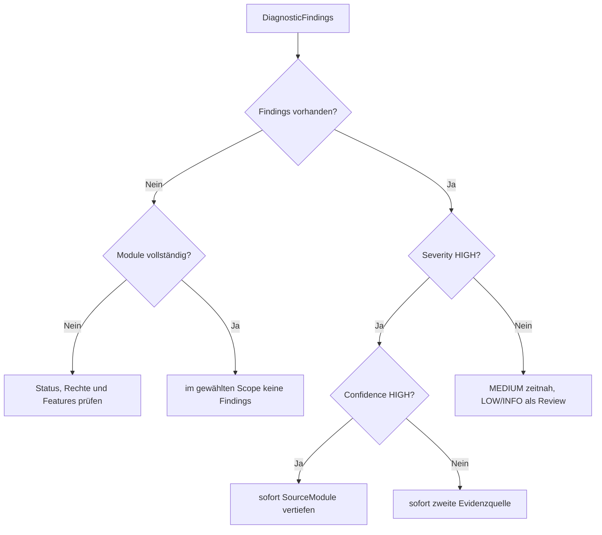

# Server Health: CPU, NUMA, Memory, Integrität und Engine-Evidenz

**Procedures:** 28 (20 nummerierte Abschnitte und 8 ergänzende Module)
**Evidenz:** Momentaufnahme, Konfiguration, kumulative SQLOS-DMVs, kurze Stichprobe, msdb-Historie und vorhandene XE-Dateien  
**Kosten:** LOW bis HIGH_OPT_IN

## Grundregeln

- Hohe SQL-Server-Speichernutzung ist im Steady State häufig erwartbar; SQL Server nutzt freien Speicher als Cache. Entscheidend sind Pressure-Signale, OS-Reserve, Clerk-/Grantkontext und Verlauf.
- Scheduler-, NUMA-, Latch-, Spinlock- und Performance-Counterwerte sind ohne Vergleichsfenster oder Baseline leicht irreführend.
- Keine negative Integritätsevidenz ist kein Integritätsbeweis.
- Konfigurationsfindings sind Review-Hinweise, keine automatischen Änderungsempfehlungen.
- Server-, Dienst-, Registry-, Dateipfad-, Login- und Meldungswerte dürfen in Laufzeitausgaben real erscheinen und sind bei Export oder Weitergabe zu schützen.

---

## 1. [monitor].[USP_ServerCpuTopology]

### Zweck

Die Procedure zeigt CPU-/Socket-/Core-/Scheduler-/NUMA-Topologie und die momentane Schedulerlast.

### Resultsets

1. Modulstatus.
2. `cpuTopology`.
3. `schedulers`.
4. `numaNodes`.

### CPU-Topologie

| Spalte | Bedeutung |
|---|---|
| `cpu_count` | logische CPUs, die SQL Server erkennt |
| `scheduler_count` | Schedulerzahl |
| `hyperthread_ratio` | logische CPUs pro physischem Core gemäß Engineinformation |
| `socket_count` | erkannte Sockets |
| `cores_per_socket` | physische Cores je Socket |
| `numa_node_count` | erkannte NUMA-Nodes |
| `softnuma_configuration_desc` | Soft-NUMA-Konfiguration |
| `sqlserver_start_time` | Reset-/Uptime-Kontext vieler DMVs |
| `affinity_type_desc` | CPU-Affinitätsmodus |

### Scheduler

`parent_node_id`, `status`, `SchedulerCount`, `VisibleOnlineSchedulers`, `OnlineSchedulers`, `CurrentTasks`, `RunnableTasks`, `ActiveWorkers`, `LoadFactor`, `Finding`.

### NUMA-Nodes

`node_id`, `node_state_desc`, `memory_node_id`, `online_scheduler_count`, `idle_scheduler_count`, `active_worker_count`, `avg_load_balance`.

### Interpretation

| Konstellation | Bewertung |
|---|---|
| `RunnableTasks=0` | nur diese Momentaufnahme unauffällig |
| einzelne runnable Tasks in kurzer Stichprobe | nicht automatisch CPU-Druck |
| Runnable Tasks wiederholt auf mehreren Schedulern | CPU-/Worker-/Querylast vertiefen |
| Node ohne sichtbare Online-Scheduler | Affinity, Nodezustand oder spezielle Nodeart prüfen |
| `cpu_count` kleiner als erwartete Hardware | Lizenzierung, VM-Zuordnung, Affinity und Edition prüfen |
| hohe ActiveWorkers ohne Runnable Queue | aktive Last, aber nicht zwingend CPU-Stau |

### Folgeanalyse

`USP_ServerNuma`, `USP_CurrentRequests`, `USP_CurrentWaits`, `USP_PerformanceCounters` und OS-/Hypervisor-Monitoring.

### Kosten

LOW. Momentaufnahme; keine Rate und keine CPU-Auslastungsprozentmessung.

### Parameter und weitere Aufrufbeispiele

| Parameter | Datentyp | Default | Eingabeform und Wirkung |
|---|---|---|---|
| `@PrintMeldungen` | `bit` | `1` | Bei 1 (auch Default) wird bei einem Status ungleich AVAILABLE eine Meldung niedriger Severity mit dem Fehlertext ausgegeben; 0 unterdrückt sie. NULL löst die IF-Bedingung ebenfalls nicht aus. Die Meldung erfolgt nach Befüllung der OUTPUT-Parameter und vor den Resultsets. Numerische 0 bleibt bit 0; von 0 verschiedene konvertierbare Zahlen werden beim Binden bit 1. |
| `@Hilfe` | `bit` | `0` | 0 oder NULL nimmt den normalen Analysepfad. 1 gibt die PRINT-Hilfe aus und kehrt vor Quellzugriff, regulärer Statusinitialisierung und allen vier Status-/Fehler-OUTPUT-Zuweisungen zurück. Zuvor laufen ein angeforderter TABLE-Preflight oder die Ablehnung eines nicht leeren TABLE-Mappings außerhalb TABLE; diese können bereits werfen. @Json ist beim Eintritt auf NULL gesetzt. Numerische 0 bleibt bit 0; von 0 verschiedene konvertierbare Zahlen werden bit 1. |
| `@ResultSetArt` | `varchar(16)` | `'CONSOLE'` | Nach Trim von U+0020-Leerzeichen und UPPER gelten CONSOLE, RAW, TABLE und NONE; NULL wird wie leer behandelt. CONSOLE gibt nur die Console-Helferausgabe der ersten Fachquelle aus, ohne separates Modulstatusresultset; eine Leerzeile des Helfers hat hier NULL für Status und Hinweis. RAW gibt Modulstatus und unbeschriftete Fachresultsets aus. TABLE schreibt ausschließlich die benannte Fachmenge in das gemappte Ziel und gibt kein separates Modulstatusresultset aus. NONE unterdrückt Resultsets. CONSOLE und TABLE werden vor dem regulären Ausgabezweig intern zu NONE. Andere Texte, leer und NULL ergeben INVALID_PARAMETER/IsPartial=1; der nicht normalisierte ungültige Modus gibt dennoch Modulstatus und beschriftete Fachresultsets des ELSE-Zweigs aus. JSON ist davon unabhängig. |
| `@ResultTablesJson` | `nvarchar(max)` | `NULL` | Als TABLE-Eingabe ist ein JSON-Objekt mit genau einem Mapping für den registrierten Namen cpuTopology auf eine vorhandene, leere lokale #temp-Tabelle nötig; diese muss genau eine Seed-/Platzhalterspalte besitzen. Das Ziel wird vor Hilfe und Quellerhebung geprüft; fehlerhafte oder fehlende TABLE-Ziele werfen beim Preflight Fehler 51011, daher werden Status-OUTPUTs nicht regulär gesetzt. Außerhalb von TABLE sind nur NULL, leer oder Leerzeichen erlaubt; jeder andere Inhalt wirft Fehler 51011 vor Hilfe und OUTPUT-Zuweisung. |
| `@JsonErzeugen` | `bit` | `0` | Im normalen Pfad erzeugt 1 unabhängig von @ResultSetArt das JSON-Dokument in @Json; 0 oder NULL erzeugt keines. @Hilfe=1 kehrt vor der JSON-Erzeugung zurück. Leere Fachmengen werden als leere Arrays ausgegeben. Numerische 0 bleibt bit 0; von 0 verschiedene konvertierbare Zahlen werden beim Binden bit 1. |
| `@Json` | `nvarchar(max) OUTPUT` | `NULL` | OUTPUT-Empfänger für das JSON-Dokument; bei Eintritt auf NULL gesetzt und nur bei @JsonErzeugen=1 befüllt. Bindung erfolgt optional mit @Json=@Empfaenger OUTPUT; die Empfängervariable muss nvarchar(max) sein. Ohne OUTPUT-Bindung wird kein Rückgabewert an eine Aufrufervariable übertragen. |
| `@StatusCodeOut` | `varchar(40) OUTPUT` | `NULL` | Optionaler OUTPUT-Empfänger für AVAILABLE, INVALID_PARAMETER, DENIED_PERMISSION, TIMEOUT oder ERROR_HANDLED. AVAILABLE bedeutet kein abgefangener Quellfehler und keine festgestellte ungültige Eingabe; INVALID_PARAMETER bezeichnet ungültige ResultSetArt; DENIED_PERMISSION klassifiziert Quellfehler 229, 297, 300 oder 371; TIMEOUT klassifiziert Fehler 1222; ERROR_HANDLED steht für sonstige im Quell-TRY abgefangene Fehler. Bei Quellfehlern ist IsPartial=1. Bindung z.B. @StatusCodeOut=@Status OUTPUT mit varchar(40)-Variable. Zuweisung geschieht nach Quellversuch/Validierung, vor Meldung und Resultsetausgabe; bei frühem Preflight-THROW oder Hilfe keine reguläre Zuweisung. Hilfe lässt einen gebundenen Anfangswert einschließlich NULL unverändert, auch nach erfolgreichem TABLE-Preflight; ein früher THROW erreicht die reguläre Zuweisung nicht. Im normalen Pfad wird der Anfangswert ersetzt. Ohne OUTPUT-Bindung wird kein Aufruferwert empfangen. |
| `@IsPartialOut` | `bit OUTPUT` | `NULL` | Optionaler OUTPUT-Empfänger: 0 bei AVAILABLE, 1 bei INVALID_PARAMETER und bei abgefangenen Quellfehlern. Das Bit bezeichnet den implementierten Status-/Fehlerpfad, nicht Vollständigkeit einzelner leerer Quellgruppen. Bindung z.B. @IsPartialOut=@Partial OUTPUT mit bit-Variable; Zuweisung gemeinsam mit StatusCodeOut vor Meldung und Resultsets. Hilfe lässt einen gebundenen Anfangswert einschließlich NULL unverändert, auch nach erfolgreichem TABLE-Preflight; ein früher THROW erreicht die reguläre Zuweisung nicht. Im normalen Pfad wird der Anfangswert ersetzt. Ohne OUTPUT-Bindung wird kein Aufruferwert empfangen. |
| `@ErrorNumberOut` | `int OUTPUT` | `NULL` | Optionaler OUTPUT-Empfänger für die SQL-Fehlernummer eines im Quell-TRY abgefangenen Fehlers; bei AVAILABLE und INVALID_PARAMETER bleibt der Wert NULL. Die bekannten Berechtigungs-/Timeoutnummern werden zugleich klassifiziert. Bindung z.B. @ErrorNumberOut=@ErrorNumber OUTPUT mit int-Variable; Zuweisung vor Meldung und Resultsets. Hilfe lässt einen gebundenen Anfangswert einschließlich NULL unverändert, auch nach erfolgreichem TABLE-Preflight; ein früher THROW erreicht die reguläre Zuweisung nicht. Im normalen Pfad wird der Anfangswert ersetzt. Ohne OUTPUT-Bindung wird kein Aufruferwert empfangen. |
| `@ErrorMessageOut` | `nvarchar(2048) OUTPUT` | `NULL` | Optionaler OUTPUT-Empfänger für den Text des im Quell-TRY abgefangenen Fehlers oder die konkrete INVALID_PARAMETER-Begründung; bei AVAILABLE bleibt er NULL. Bindung z.B. @ErrorMessageOut=@ErrorMessage OUTPUT mit nvarchar(2048)-Variable; Zuweisung vor Meldung und Resultsets. Hilfe lässt einen gebundenen Anfangswert einschließlich NULL unverändert, auch nach erfolgreichem TABLE-Preflight; ein früher THROW erreicht die reguläre Zuweisung nicht. Im normalen Pfad wird der Anfangswert ersetzt. Ohne OUTPUT-Bindung wird kein Aufruferwert empfangen. |

**RAW:**

```sql
EXEC [monitor].[USP_ServerCpuTopology] @ResultSetArt=N'RAW';
```

**JSON:**

```sql
DECLARE @Json nvarchar(max);
EXEC [monitor].[USP_ServerCpuTopology] @JsonErzeugen=1,@Json=@Json OUTPUT,@ResultSetArt=N'NONE';
SELECT @Json AS [JsonDocument];
```

**TABLE:**

```sql
CREATE TABLE [#ServerCpuTopology_HelpExample]([Seed] bit NULL);
BEGIN TRY
    EXEC [monitor].[USP_ServerCpuTopology] @ResultSetArt=N'TABLE',@ResultTablesJson=N'{"cpuTopology":"#ServerCpuTopology_HelpExample"}';
END TRY
BEGIN CATCH
    DROP TABLE [#ServerCpuTopology_HelpExample];
    THROW;
END CATCH;
DROP TABLE [#ServerCpuTopology_HelpExample];
```

**Hilfe:**

```sql
EXEC [monitor].[USP_ServerCpuTopology] @Hilfe=1;
```

---

## 2. [monitor].[USP_ServerNuma]

### Zweck

Die Procedure verdichtet NUMA-/Soft-NUMA-Verteilung, Scheduler-Skew und SQL-Memory-Nodes.

### NUMA-Spalten

`node_id`, `node_state_desc`, `memory_node_id`, `online_scheduler_count`, `idle_scheduler_count`, `active_worker_count`, `avg_load_balance`, `SchedulerCount`, `VisibleOnline`, `CurrentTasks`, `RunnableTasks`, `ActiveWorkers`, `LoadFactor`, `RunnablePerScheduler`, `Finding`.

### Memory Nodes

`memory_node_id`, `virtual_address_space_reserved_kb`, `virtual_address_space_committed_kb`, `locked_page_allocations_kb`, `pages_kb`, `shared_memory_reserved_kb`, `shared_memory_committed_kb`.

### Interpretation

- `RunnablePerScheduler` ist ein Snapshotquotient, kein historischer Mittelwert.
- Unterschiede zwischen Nodes können aus Workloadlokalität, Connectionverteilung, Affinity oder Momentaufnahme entstehen.
- CPU-Nodes und Memory-Nodes sind verwandt, aber nicht zwingend identisch.
- `locked_page_allocations_kb` zeigt tatsächlich gesperrte Seiten, nicht nur die Vergabe des LPIM-Rechts.
- VAS reserved ist keine physisch belegte RAM-Menge.
- Ein einzelner heißer Node rechtfertigt keine Affinityänderung ohne Trend- und Plananalyse.

### Plakatives Beispiel

| Node | VisibleOnline | RunnableTasks | RunnablePerScheduler | Bewertung |
|---:|---:|---:|---:|---|
| 0 | 8 | 0 | 0 | aktuell unauffällig |
| 1 | 8 | 24 | 3 | auffällig, wenn über mehrere Samples reproduzierbar |
| 2 | 0 | 0 | `NULL` | Nodezustand/Affinity prüfen, nicht dividieren |

### Folgeanalyse

CPU-Topologie, aktive Requests nach Scheduler, Server Memory und Hypervisor-/NUMA-Konfiguration.

### Parameter und weitere Aufrufbeispiele

| Parameter | Datentyp | Default | Eingabeform und Wirkung |
|---|---|---|---|
| `@PrintMeldungen` | `bit` | `1` | Bei 1 (auch Default) wird bei einem Status ungleich AVAILABLE eine Meldung niedriger Severity mit dem Fehlertext ausgegeben; 0 unterdrückt sie. NULL löst die IF-Bedingung ebenfalls nicht aus. Die Meldung erfolgt nach Befüllung der OUTPUT-Parameter und vor den Resultsets. Numerische 0 bleibt bit 0; von 0 verschiedene konvertierbare Zahlen werden beim Binden bit 1. |
| `@Hilfe` | `bit` | `0` | 0 oder NULL nimmt den normalen Analysepfad. 1 gibt die PRINT-Hilfe aus und kehrt vor Quellzugriff, regulärer Statusinitialisierung und allen vier Status-/Fehler-OUTPUT-Zuweisungen zurück. Zuvor laufen ein angeforderter TABLE-Preflight oder die Ablehnung eines nicht leeren TABLE-Mappings außerhalb TABLE; diese können bereits werfen. @Json ist beim Eintritt auf NULL gesetzt. Numerische 0 bleibt bit 0; von 0 verschiedene konvertierbare Zahlen werden bit 1. |
| `@ResultSetArt` | `varchar(16)` | `'CONSOLE'` | Nach Trim von U+0020-Leerzeichen und UPPER gelten CONSOLE, RAW, TABLE und NONE; NULL wird wie leer behandelt. CONSOLE gibt nur die Console-Helferausgabe der ersten Fachquelle aus, ohne separates Modulstatusresultset; eine Leerzeile des Helfers hat hier NULL für Status und Hinweis. RAW gibt Modulstatus und unbeschriftete Fachresultsets aus. TABLE schreibt ausschließlich die benannte Fachmenge in das gemappte Ziel und gibt kein separates Modulstatusresultset aus. NONE unterdrückt Resultsets. CONSOLE und TABLE werden vor dem regulären Ausgabezweig intern zu NONE. Andere Texte, leer und NULL ergeben INVALID_PARAMETER/IsPartial=1; der nicht normalisierte ungültige Modus gibt dennoch Modulstatus und beschriftete Fachresultsets des ELSE-Zweigs aus. JSON ist davon unabhängig. |
| `@ResultTablesJson` | `nvarchar(max)` | `NULL` | Als TABLE-Eingabe ist ein JSON-Objekt mit genau einem Mapping für den registrierten Namen numaNodes auf eine vorhandene, leere lokale #temp-Tabelle nötig; diese muss genau eine Seed-/Platzhalterspalte besitzen. Das Ziel wird vor Hilfe und Quellerhebung geprüft; fehlerhafte oder fehlende TABLE-Ziele werfen beim Preflight Fehler 51011, daher werden Status-OUTPUTs nicht regulär gesetzt. Außerhalb von TABLE sind nur NULL, leer oder Leerzeichen erlaubt; jeder andere Inhalt wirft Fehler 51011 vor Hilfe und OUTPUT-Zuweisung. |
| `@JsonErzeugen` | `bit` | `0` | Im normalen Pfad erzeugt 1 unabhängig von @ResultSetArt das JSON-Dokument in @Json; 0 oder NULL erzeugt keines. @Hilfe=1 kehrt vor der JSON-Erzeugung zurück. Leere Fachmengen werden als leere Arrays ausgegeben. Numerische 0 bleibt bit 0; von 0 verschiedene konvertierbare Zahlen werden beim Binden bit 1. |
| `@Json` | `nvarchar(max) OUTPUT` | `NULL` | OUTPUT-Empfänger für das JSON-Dokument; bei Eintritt auf NULL gesetzt und nur bei @JsonErzeugen=1 befüllt. Bindung erfolgt optional mit @Json=@Empfaenger OUTPUT; die Empfängervariable muss nvarchar(max) sein. Ohne OUTPUT-Bindung wird kein Rückgabewert an eine Aufrufervariable übertragen. |
| `@StatusCodeOut` | `varchar(40) OUTPUT` | `NULL` | Optionaler OUTPUT-Empfänger für AVAILABLE, INVALID_PARAMETER, DENIED_PERMISSION, TIMEOUT oder ERROR_HANDLED. AVAILABLE bedeutet kein abgefangener Quellfehler und keine festgestellte ungültige Eingabe; INVALID_PARAMETER bezeichnet ungültige ResultSetArt; DENIED_PERMISSION klassifiziert Quellfehler 229, 297, 300 oder 371; TIMEOUT klassifiziert Fehler 1222; ERROR_HANDLED steht für sonstige im Quell-TRY abgefangene Fehler. Bei Quellfehlern ist IsPartial=1. Bindung z.B. @StatusCodeOut=@Status OUTPUT mit varchar(40)-Variable. Zuweisung geschieht nach Quellversuch/Validierung, vor Meldung und Resultsetausgabe; bei frühem Preflight-THROW oder Hilfe keine reguläre Zuweisung. Hilfe lässt einen gebundenen Anfangswert einschließlich NULL unverändert, auch nach erfolgreichem TABLE-Preflight; ein früher THROW erreicht die reguläre Zuweisung nicht. Im normalen Pfad wird der Anfangswert ersetzt. Ohne OUTPUT-Bindung wird kein Aufruferwert empfangen. |
| `@IsPartialOut` | `bit OUTPUT` | `NULL` | Optionaler OUTPUT-Empfänger: 0 bei AVAILABLE, 1 bei INVALID_PARAMETER und bei abgefangenen Quellfehlern. Das Bit bezeichnet den implementierten Status-/Fehlerpfad, nicht Vollständigkeit einzelner leerer Quellgruppen. Bindung z.B. @IsPartialOut=@Partial OUTPUT mit bit-Variable; Zuweisung gemeinsam mit StatusCodeOut vor Meldung und Resultsets. Hilfe lässt einen gebundenen Anfangswert einschließlich NULL unverändert, auch nach erfolgreichem TABLE-Preflight; ein früher THROW erreicht die reguläre Zuweisung nicht. Im normalen Pfad wird der Anfangswert ersetzt. Ohne OUTPUT-Bindung wird kein Aufruferwert empfangen. |
| `@ErrorNumberOut` | `int OUTPUT` | `NULL` | Optionaler OUTPUT-Empfänger für die SQL-Fehlernummer eines im Quell-TRY abgefangenen Fehlers; bei AVAILABLE und INVALID_PARAMETER bleibt der Wert NULL. Die bekannten Berechtigungs-/Timeoutnummern werden zugleich klassifiziert. Bindung z.B. @ErrorNumberOut=@ErrorNumber OUTPUT mit int-Variable; Zuweisung vor Meldung und Resultsets. Hilfe lässt einen gebundenen Anfangswert einschließlich NULL unverändert, auch nach erfolgreichem TABLE-Preflight; ein früher THROW erreicht die reguläre Zuweisung nicht. Im normalen Pfad wird der Anfangswert ersetzt. Ohne OUTPUT-Bindung wird kein Aufruferwert empfangen. |
| `@ErrorMessageOut` | `nvarchar(2048) OUTPUT` | `NULL` | Optionaler OUTPUT-Empfänger für den Text des im Quell-TRY abgefangenen Fehlers oder die konkrete INVALID_PARAMETER-Begründung; bei AVAILABLE bleibt er NULL. Bindung z.B. @ErrorMessageOut=@ErrorMessage OUTPUT mit nvarchar(2048)-Variable; Zuweisung vor Meldung und Resultsets. Hilfe lässt einen gebundenen Anfangswert einschließlich NULL unverändert, auch nach erfolgreichem TABLE-Preflight; ein früher THROW erreicht die reguläre Zuweisung nicht. Im normalen Pfad wird der Anfangswert ersetzt. Ohne OUTPUT-Bindung wird kein Aufruferwert empfangen. |

**RAW:**

```sql
EXEC [monitor].[USP_ServerNuma] @ResultSetArt=N'RAW';
```

**JSON:**

```sql
DECLARE @Json nvarchar(max);
EXEC [monitor].[USP_ServerNuma] @JsonErzeugen=1,@Json=@Json OUTPUT,@ResultSetArt=N'NONE';
SELECT @Json AS [JsonDocument];
```

**TABLE:**

```sql
CREATE TABLE [#ServerNuma_HelpExample]([Seed] bit NULL);
BEGIN TRY
    EXEC [monitor].[USP_ServerNuma] @ResultSetArt=N'TABLE',@ResultTablesJson=N'{"numaNodes":"#ServerNuma_HelpExample"}';
END TRY
BEGIN CATCH
    DROP TABLE [#ServerNuma_HelpExample];
    THROW;
END CATCH;
DROP TABLE [#ServerNuma_HelpExample];
```

**Hilfe:**

```sql
EXEC [monitor].[USP_ServerNuma] @Hilfe=1;
```

---

## 3. [monitor].[USP_ServerMemory]

### Zweck

Die Procedure korreliert OS-, Prozess- und SQL-Memory-Manager-Zustand, größte Memory Clerks und Query Grants.

### Summary

| Spalte | Bedeutung |
|---|---|
| `total_physical_memory_kb`, `available_physical_memory_kb`, `system_memory_state_desc` | Betriebssystemzustand |
| `physical_memory_in_use_kb` | SQL-Prozessspeicher |
| `locked_page_allocations_kb`, `large_page_allocations_kb` | spezielle Prozessallokationen |
| `process_physical_memory_low`, `process_virtual_memory_low` | Engine-Pressureflags |
| `committed_kb`, `committed_target_kb`, `visible_target_kb` | SQL Memory Manager |
| `sql_memory_model_desc` | Speichermodell |
| `min_server_memory_mb`, `max_server_memory_mb` | aktive Konfiguration |
| `LPIMAssessment` | Laufzeitevidenz, keine Rechteprüfung |
| `MemoryFinding` | codebasierter Snapshotbefund |

### Memory Clerks

`type`, `pages_kb`, `virtual_memory_committed_kb`, `awe_allocated_kb`, `shared_memory_committed_kb`.

### Grants

`ActiveOrWaitingGrants`, `RequestedMemoryKb`, `GrantedMemoryKb`, `UsedMemoryKb`, `WaitingGrantCount`.

### Framework-Heuristiken

- weniger als 1.048.576 KB verfügbarer OS-Speicher → `LOW_OS_FREE_MEMORY_REVIEW`;
- `committed_target_kb < committed_kb` → `TARGET_BELOW_COMMITTED`.

Diese Regeln sind Sichtungshilfen. Auf einem kleinen Server ist 1 GB anders zu bewerten als auf einem Server mit mehreren TB RAM.

### Interpretation

| Fall | Bewertung |
|---|---|
| SQL nutzt fast `max server memory`, OS stabil | oft normaler Cache-Steady-State |
| `process_physical_memory_low=1` | starkes Pressure-Signal |
| `committed_target < committed` | SQL versucht Speicher zurückzugeben; Verlauf prüfen |
| `WaitingGrantCount>0` | Query-Execution-Memory-Druck möglich |
| ein Clerk dominiert | Clerktyp und Betriebsfunktion prüfen; Größe allein ist kein Leakbeweis |
| LPIMAssessment nicht bestätigt | beweist weder fehlendes Benutzerrecht noch Fehlkonfiguration |

### Folgeanalyse

`USP_BufferPoolAnalysis`, `USP_CurrentMemoryGrants`, `USP_ResourceGovernorAnalysis`, OS- und Prozessmonitoring.

### Parameter und weitere Aufrufbeispiele

| Parameter | Datentyp | Default | Eingabeform und Wirkung |
|---|---|---|---|
| `@MaxZeilen` | `int` | `100` | int-Eingabe: NULL oder 0 bedeutet unbegrenzt; positive Werte von 1 bis 2147483647 begrenzen die ausgewählten Clerk-Typgruppen. Die TOP-Mitgliedschaft wird nach absteigender Summe aus pages_kb und virtual_memory_committed_kb gewählt; die materialisierten Clerk-Zeilen werden anschließend nach pages_kb DESC ausgegeben beziehungsweise im JSON geordnet. TOP folgt auf den vollständigen Scan und GROUP BY von sys.dm_os_memory_clerks und begrenzt daher weder Scan noch Aggregationsaufwand. Summary und Grants bleiben ungekürzt. Negative Werte setzen INVALID_PARAMETER/IsPartial=1 und überspringen sämtliche Quellabfragen; Hilfe kehrt vor dieser Prüfung zurück. |
| `@PrintMeldungen` | `bit` | `1` | Bei 1 (auch Default) wird bei einem Status ungleich AVAILABLE eine Meldung niedriger Severity mit dem Fehlertext ausgegeben; 0 unterdrückt sie. NULL löst die IF-Bedingung ebenfalls nicht aus. Die Meldung erfolgt nach Befüllung der OUTPUT-Parameter und vor den Resultsets. Numerische 0 bleibt bit 0; von 0 verschiedene konvertierbare Zahlen werden beim Binden bit 1. |
| `@Hilfe` | `bit` | `0` | 0 oder NULL nimmt den normalen Analysepfad. 1 gibt die PRINT-Hilfe aus und kehrt vor Quellzugriff, regulärer Statusinitialisierung und allen vier Status-/Fehler-OUTPUT-Zuweisungen zurück. Zuvor laufen ein angeforderter TABLE-Preflight oder die Ablehnung eines nicht leeren TABLE-Mappings außerhalb TABLE; diese können bereits werfen. @Json ist beim Eintritt auf NULL gesetzt. Numerische 0 bleibt bit 0; von 0 verschiedene konvertierbare Zahlen werden bit 1. |
| `@ResultSetArt` | `varchar(16)` | `'CONSOLE'` | Nach Trim von U+0020-Leerzeichen und UPPER gelten CONSOLE, RAW, TABLE und NONE; NULL wird wie leer behandelt. CONSOLE gibt nur die Console-Helferausgabe der ersten Fachquelle aus, ohne separates Modulstatusresultset; eine Leerzeile des Helfers hat hier NULL für Status und Hinweis. RAW gibt Modulstatus und unbeschriftete Fachresultsets aus. TABLE schreibt ausschließlich die benannte Fachmenge in das gemappte Ziel und gibt kein separates Modulstatusresultset aus. NONE unterdrückt Resultsets. CONSOLE und TABLE werden vor dem regulären Ausgabezweig intern zu NONE. Andere Texte, leer und NULL ergeben INVALID_PARAMETER/IsPartial=1; der nicht normalisierte ungültige Modus gibt dennoch Modulstatus und beschriftete Fachresultsets des ELSE-Zweigs aus. JSON ist davon unabhängig. |
| `@ResultTablesJson` | `nvarchar(max)` | `NULL` | Als TABLE-Eingabe ist ein JSON-Objekt mit genau einem Mapping für den registrierten Namen summary auf eine vorhandene, leere lokale #temp-Tabelle nötig; diese muss genau eine Seed-/Platzhalterspalte besitzen. Das Ziel wird vor Hilfe und Quellerhebung geprüft; fehlerhafte oder fehlende TABLE-Ziele werfen beim Preflight Fehler 51011, daher werden Status-OUTPUTs nicht regulär gesetzt. Außerhalb von TABLE sind nur NULL, leer oder Leerzeichen erlaubt; jeder andere Inhalt wirft Fehler 51011 vor Hilfe und OUTPUT-Zuweisung. |
| `@JsonErzeugen` | `bit` | `0` | Im normalen Pfad erzeugt 1 unabhängig von @ResultSetArt das JSON-Dokument in @Json; 0 oder NULL erzeugt keines. @Hilfe=1 kehrt vor der JSON-Erzeugung zurück. Leere Fachmengen werden als leere Arrays ausgegeben. Numerische 0 bleibt bit 0; von 0 verschiedene konvertierbare Zahlen werden beim Binden bit 1. |
| `@Json` | `nvarchar(max) OUTPUT` | `NULL` | OUTPUT-Empfänger für das JSON-Dokument; bei Eintritt auf NULL gesetzt und nur bei @JsonErzeugen=1 befüllt. Bindung erfolgt optional mit @Json=@Empfaenger OUTPUT; die Empfängervariable muss nvarchar(max) sein. Ohne OUTPUT-Bindung wird kein Rückgabewert an eine Aufrufervariable übertragen. |
| `@StatusCodeOut` | `varchar(40) OUTPUT` | `NULL` | Optionaler OUTPUT-Empfänger für AVAILABLE, INVALID_PARAMETER, DENIED_PERMISSION, TIMEOUT oder ERROR_HANDLED. AVAILABLE bedeutet kein abgefangener Quellfehler und keine festgestellte ungültige Eingabe; INVALID_PARAMETER bezeichnet ungültige ResultSetArt oder negatives @MaxZeilen; DENIED_PERMISSION klassifiziert Quellfehler 229, 297, 300 oder 371; TIMEOUT klassifiziert Fehler 1222; ERROR_HANDLED steht für sonstige im Quell-TRY abgefangene Fehler. Bei Quellfehlern ist IsPartial=1. Bindung z.B. @StatusCodeOut=@Status OUTPUT mit varchar(40)-Variable. Zuweisung geschieht nach Quellversuch/Validierung, vor Meldung und Resultsetausgabe; bei frühem Preflight-THROW oder Hilfe keine reguläre Zuweisung. Hilfe lässt einen gebundenen Anfangswert einschließlich NULL unverändert, auch nach erfolgreichem TABLE-Preflight; ein früher THROW erreicht die reguläre Zuweisung nicht. Im normalen Pfad wird der Anfangswert ersetzt. Ohne OUTPUT-Bindung wird kein Aufruferwert empfangen. |
| `@IsPartialOut` | `bit OUTPUT` | `NULL` | Optionaler OUTPUT-Empfänger: 0 bei AVAILABLE, 1 bei INVALID_PARAMETER und bei abgefangenen Quellfehlern. Das Bit bezeichnet den implementierten Status-/Fehlerpfad, nicht Vollständigkeit einzelner leerer Quellgruppen. Bindung z.B. @IsPartialOut=@Partial OUTPUT mit bit-Variable; Zuweisung gemeinsam mit StatusCodeOut vor Meldung und Resultsets. Hilfe lässt einen gebundenen Anfangswert einschließlich NULL unverändert, auch nach erfolgreichem TABLE-Preflight; ein früher THROW erreicht die reguläre Zuweisung nicht. Im normalen Pfad wird der Anfangswert ersetzt. Ohne OUTPUT-Bindung wird kein Aufruferwert empfangen. |
| `@ErrorNumberOut` | `int OUTPUT` | `NULL` | Optionaler OUTPUT-Empfänger für die SQL-Fehlernummer eines im Quell-TRY abgefangenen Fehlers; bei AVAILABLE und INVALID_PARAMETER bleibt der Wert NULL. Die bekannten Berechtigungs-/Timeoutnummern werden zugleich klassifiziert. Bindung z.B. @ErrorNumberOut=@ErrorNumber OUTPUT mit int-Variable; Zuweisung vor Meldung und Resultsets. Hilfe lässt einen gebundenen Anfangswert einschließlich NULL unverändert, auch nach erfolgreichem TABLE-Preflight; ein früher THROW erreicht die reguläre Zuweisung nicht. Im normalen Pfad wird der Anfangswert ersetzt. Ohne OUTPUT-Bindung wird kein Aufruferwert empfangen. |
| `@ErrorMessageOut` | `nvarchar(2048) OUTPUT` | `NULL` | Optionaler OUTPUT-Empfänger für den Text des im Quell-TRY abgefangenen Fehlers oder die konkrete INVALID_PARAMETER-Begründung; bei AVAILABLE bleibt er NULL. Bindung z.B. @ErrorMessageOut=@ErrorMessage OUTPUT mit nvarchar(2048)-Variable; Zuweisung vor Meldung und Resultsets. Hilfe lässt einen gebundenen Anfangswert einschließlich NULL unverändert, auch nach erfolgreichem TABLE-Preflight; ein früher THROW erreicht die reguläre Zuweisung nicht. Im normalen Pfad wird der Anfangswert ersetzt. Ohne OUTPUT-Bindung wird kein Aufruferwert empfangen. |

**RAW:**

```sql
EXEC [monitor].[USP_ServerMemory] @ResultSetArt=N'RAW';
```

**JSON:**

```sql
DECLARE @Json nvarchar(max);
EXEC [monitor].[USP_ServerMemory] @JsonErzeugen=1,@Json=@Json OUTPUT,@ResultSetArt=N'NONE';
SELECT @Json AS [JsonDocument];
```

**TABLE:**

```sql
CREATE TABLE [#ServerMemory_HelpExample]([Seed] bit NULL);
BEGIN TRY
    EXEC [monitor].[USP_ServerMemory] @ResultSetArt=N'TABLE',@ResultTablesJson=N'{"summary":"#ServerMemory_HelpExample"}';
END TRY
BEGIN CATCH
    DROP TABLE [#ServerMemory_HelpExample];
    THROW;
END CATCH;
DROP TABLE [#ServerMemory_HelpExample];
```

**Hilfe:**

```sql
EXEC [monitor].[USP_ServerMemory] @Hilfe=1;
```

---

## 4. [monitor].[USP_TempDBConfiguration]

### Zweck

Die Procedure inventarisiert TempDB-Dateien, Größe, Growth und ausgewählte Instanzkonfigurationen.

### Files

`file_id`, `name`, `type_desc`, `physical_name`, `SizeMb`, `GrowthValue`, `GrowthType`, `max_size`, `is_percent_growth`.

### Configuration

`name`, `value_in_use` für verfügbare Einstellungen wie:

- `tempdb metadata memory-optimized`,
- `tempdb deferred drop`,
- `mixed page allocation`.

### Interpretation

- Mehrere gleich große Datafiles sind häufig sinnvoll, aber Anzahl nicht blind an CPU-Zahl koppeln.
- Ungleiche Dateigrößen können proportional-fill-Skew erzeugen.
- Prozentwachstum wird mit zunehmender Datei immer größer.
- `max_size` ist in Seiten/Engine-Sonderwerten gespeichert; die Procedure gibt den Rohwert aus.
- Logfile und Datafiles haben unterschiedliche Rollen; nur Datafiles „gleichziehen“.
- Memory-optimized TempDB metadata hilft bei bestimmten Metadatencontention-Szenarien, ist keine universelle Pflicht.

### Beispiele

| Konfiguration | Bewertung |
|---|---|
| 8 gleich große Datafiles, gleiches fixes Growth | plausibler Ausgangspunkt |
| 8 Files, eines 10× größer | Allocation-Skew möglich |
| 10-%-Growth bei 2-TB-Datei | nächster Growth 200 GB; klarer Reviewfall |
| 32 Files auf kleiner OLTP-Instanz ohne Contention | möglicherweise unnötige Komplexität |

### Folgeanalyse

`USP_CurrentTempDB`, `USP_InternalContentionAnalysis`, Datei-/Volume-Kapazität.

### Parameter und weitere Aufrufbeispiele

| Parameter | Datentyp | Default | Eingabeform und Wirkung |
|---|---|---|---|
| `@PrintMeldungen` | `bit` | `1` | Eingabeform: SQL-bit; 0 bedeutet unterdrückt den Severity-10-Hinweis bei Status ungleich AVAILABLE, 1 bedeutet gibt den Severity-10-Hinweis mit Fehlertext aus. NULL ist zulässig und wird in der jeweiligen IF/CASE-Bedingung nicht als 0 behandelt: die Bedingung =1 ist dann nicht wahr. Ein leerer String wird bei SQL-bit-Konvertierung zu 0; andere nicht konvertierbare Eingaben lösen einen Konvertierungsfehler aus. Zahlen 0 bleiben 0, jeder konvertierbare Nichtnullwert ungleich 0 wird zu 1. Bei ausgelassenem Argument gilt der Default. |
| `@Hilfe` | `bit` | `0` | Eingabeform: SQL-bit; 0 bedeutet setzt die Hilfeprüfung nicht auf wahr und führt nach dem Preflight die Erhebung fort, 1 bedeutet druckt die Hilfe und kehrt vor Quellenabfrage und Statusoutputs zurück. NULL ist zulässig und wird in der jeweiligen IF/CASE-Bedingung nicht als 0 behandelt: die Bedingung =1 ist dann nicht wahr. Ein leerer String wird bei SQL-bit-Konvertierung zu 0; andere nicht konvertierbare Eingaben lösen einen Konvertierungsfehler aus. Zahlen 0 bleiben 0, jeder konvertierbare Nichtnullwert ungleich 0 wird zu 1. Bei ausgelassenem Argument gilt der Default. |
| `@ResultSetArt` | `varchar(16)` | `'CONSOLE'` | Eingabeform: ein einzelner Code CONSOLE, RAW, TABLE oder NONE; führende/abschließende Leerzeichen werden entfernt und Groß-/Kleinschreibung wird mit UPPER vereinheitlicht. NULL wird durch COALESCE zu leerem Text, ein leerer oder nur aus Leerzeichen bestehender Wert bleibt leer; alle drei Fälle sind ungültig. Nur die vier genannten Werte sind gültig. CONSOLE und TABLE wählen ihre Fachprojektion und setzen den internen Modus anschließend auf NONE, damit kein generisches Fachresultset zusätzlich ausgegeben wird; RAW liefert rohe Fachresultsets, NONE unterdrückt Resultsets. Ungültige Codes (einschließlich NULL/leer) setzen INVALID_PARAMETER und IsPartial=1; intern werden wegen des nicht-NONE-Modus Status und die nicht-RAW-Fachprojektion ausgegeben. Bei TABLE erfolgt zuerst der Ziel-Preflight; sein Fehler wird geworfen. JSON-Erzeugung ist unabhängig vom ResultSetArt. |
| `@ResultTablesJson` | `nvarchar(max)` | `NULL` | Eingabeform: ein gültiges JSON-Objekt mit genau einer Eigenschaft, deren Name exakt files lautet und deren Stringwert eine vorhandene lokale #temp-Tabelle bezeichnet. Das Ziel muss vor dem Aufruf existieren, leer sein und genau eine Seed-/Platzhalterspalte besitzen; globale ##-Tabellen, permanente Tabellen, Namen mit reserviertem Präfix #Monitor und Namen über 116 Zeichen sind unzulässig. Der Helper ergänzt das Ausgabeschema. Nur bei ResultSetArt=TABLE erforderlich. Außerhalb TABLE werden NULL, leerer oder nur aus Leerzeichen bestehender Inhalt akzeptiert; nichtleerer Inhalt wirft Fehler 51011. Bei TABLE validiert der Preflight JSON und Ziel und wirft bei ungültiger oder fehlender Angabe Fehler 51011; Status-OUTPUT-Parameter werden dann nicht zugewiesen. |
| `@JsonErzeugen` | `bit` | `0` | Eingabeform: SQL-bit; 0 bedeutet lässt @Json nach dem anfänglichen Zurücksetzen auf NULL, 1 bedeutet erstellt das JSON-Dokument mit meta, files, configuration und warnings. NULL ist zulässig und wird in der jeweiligen IF/CASE-Bedingung nicht als 0 behandelt: die Bedingung =1 ist dann nicht wahr. Ein leerer String wird bei SQL-bit-Konvertierung zu 0; andere nicht konvertierbare Eingaben lösen einen Konvertierungsfehler aus. Zahlen 0 bleiben 0, jeder konvertierbare Nichtnullwert ungleich 0 wird zu 1. Bei ausgelassenem Argument gilt der Default. |
| `@Json` | `nvarchar(max) OUTPUT` | `NULL` | Optionaler OUTPUT-Empfang des JSON-Dokuments, etwa @Json=@Payload OUTPUT mit einer nvarchar(max)-Variablen. Der Eingabewert wird beim Eintritt vor TABLE-Preflight und Hilfe auf NULL gesetzt. Bei erfolgreicher Hilfe-Rückkehr bleibt @Json NULL; andere Status-/Fehler-OUTPUTs werden dort nicht zugewiesen. Im normalen Pfad wird @Json nur bei @JsonErzeugen=1 nach der Quellverarbeitung befüllt; sonst bleibt es NULL. Ohne OUTPUT-Bindung wird kein Wert empfangen. |
| `@StatusCodeOut` | `varchar(40) OUTPUT` | `NULL` | Optionaler OUTPUT-Empfang, etwa @StatusCodeOut=@Status OUTPUT mit einer varchar(40)-Variablen. Werte und Bedeutungen: AVAILABLE (kein festgestellter Eingabe- oder abgefangener Quellfehler), INVALID_PARAMETER (ungültige ResultSetArt), DENIED_PERMISSION (abgefangene Quellfehler 229, 297, 300, 371 oder 916), TIMEOUT (Quellfehler 1222), ERROR_HANDLED (übrige abgefangene Quellfehler). Die reguläre Zuweisung erfolgt nach der Quellverarbeitung; Hilfe lässt einen gebundenen Anfangswert einschließlich NULL unverändert und ein früher Preflight-THROW erreicht die Zuweisung nicht. Ohne OUTPUT-Bindung wird kein Wert empfangen. |
| `@IsPartialOut` | `bit OUTPUT` | `NULL` | Optionaler OUTPUT-Parameter für 0 bei AVAILABLE; 1 bei ungültiger ResultSetArt oder abgefangenem Quellfehler. Die Procedure weist den Wert erst nach der Quellverarbeitung zu; bei frühem HELP-Rücksprung bleibt der Empfängerwert außer @Json unverändert. Zum Binden eine passende lokale Variable deklarieren und z.B. @IsPartialOut=@Empfaenger OUTPUT angeben; die Variable muss bit sein. OUTPUT-Bindung ist optional, wenn der Rückgabewert nicht benötigt wird. |
| `@ErrorNumberOut` | `int OUTPUT` | `NULL` | Optionaler OUTPUT-Parameter für bei abgefangenem Quellfehler die Quellfehlernummer; sonst NULL. Die Procedure weist den Wert erst nach der Quellverarbeitung zu; bei frühem HELP-Rücksprung bleibt der Empfängerwert außer @Json unverändert. Zum Binden eine passende lokale Variable deklarieren und z.B. @ErrorNumberOut=@Empfaenger OUTPUT angeben; die Variable muss int sein. OUTPUT-Bindung ist optional, wenn der Rückgabewert nicht benötigt wird. |
| `@ErrorMessageOut` | `nvarchar(2048) OUTPUT` | `NULL` | Optionaler OUTPUT-Parameter für bei Fehler den Fehlertext beziehungsweise bei INVALID_PARAMETER den Hinweis auf die zulässigen ResultSetArt-Werte; sonst NULL. Die Procedure weist den Wert erst nach der Quellverarbeitung zu; bei frühem HELP-Rücksprung bleibt der Empfängerwert außer @Json unverändert. Zum Binden eine passende lokale Variable deklarieren und z.B. @ErrorMessageOut=@Empfaenger OUTPUT angeben; die Variable muss nvarchar(2048) sein. OUTPUT-Bindung ist optional, wenn der Rückgabewert nicht benötigt wird. |

### Aufrufbeispiele

CONSOLE:

```sql
EXEC [monitor].[USP_TempDBConfiguration] @ResultSetArt = 'CONSOLE';
```

RAW:

```sql
EXEC [monitor].[USP_TempDBConfiguration] @ResultSetArt = 'RAW';
```

JSON (unabhängig von der Resultsetausgabe):

```sql
DECLARE @Json nvarchar(max);
EXEC [monitor].[USP_TempDBConfiguration]
      @ResultSetArt = 'NONE'
    , @JsonErzeugen = 1
    , @Json = @Json OUTPUT;
SELECT @Json AS [Json];
```

TABLE (Ziel vor dem TRY als Seed-Tabelle anlegen; beide Pfade räumen sie auf):

```sql
CREATE TABLE [#TempDBConfiguration_HelpExample] ([Seed] bit NULL);
BEGIN TRY
    EXEC [monitor].[USP_TempDBConfiguration]
          @ResultSetArt = 'TABLE'
        , @ResultTablesJson = N'{"files":"#TempDBConfiguration_HelpExample"}';
    DROP TABLE [#TempDBConfiguration_HelpExample];
END TRY
BEGIN CATCH
    IF OBJECT_ID('tempdb..#TempDBConfiguration_HelpExample') IS NOT NULL
        DROP TABLE [#TempDBConfiguration_HelpExample];
    THROW;
END CATCH;
```

HELP (führt keine Quellenabfrage aus; bei TABLE würde der Ziel-Preflight vor HELP laufen):

```sql
EXEC [monitor].[USP_TempDBConfiguration] @Hilfe = 1;
```


---

## 5. [monitor].[USP_ServerConfiguration]

### Zweck

Die Procedure zeigt konfigurierte und laufende Serverwerte und kennzeichnet einige kontextabhängige Reviewfälle.

### Spalten

`configuration_id`, `name`, `minimum`, `maximum`, `ConfiguredValue`, `RunningValue`, `is_dynamic`, `is_advanced`, `Finding`, `Interpretation`.

### Codes

| Finding | Bedeutung |
|---|---|
| `RECONFIGURE_OR_RESTART_PENDING` | gespeicherter und aktiver Wert weichen ab |
| `LOW_DEFAULT_REVIEW` | Cost Threshold ≤ 5 |
| `UNBOUNDED_MEMORY_REVIEW` | Max Server Memory praktisch unbeschränkt |
| `SECURITY_REVIEW` | `xp_cmdshell` oder OLE Automation aktiv |
| `OK_OR_CONTEXT_DEPENDENT` | keine codebasierte Auffälligkeit, aber weiterhin kontextabhängig |

### Interpretation

- MAXDOP 0 ist kein automatischer Fehler; NUMA, SQL-Version, Querytyp und Workload bestimmen den passenden Wert.
- Cost Threshold 5 ist Default und oft nur ein Startpunkt, aber Änderungen benötigen belastbare Parallelitäts-/CPU-Evidenz.
- Unbeschränktes Max Memory kann auf dedizierten kleinen Instanzen funktionieren, lässt aber keine explizite OS-/Nebenprozessreserve.
- `ConfiguredValue <> RunningValue` kann Reconfigure oder Neustart verlangen.
- Ein aktiviertes `xp_cmdshell` kann eine begründete, kontrollierte Abhängigkeit sein; prüfen Sie Exposition und Rechte.

### Folgeanalyse

CPU/NUMA, Memory, Security Configuration und konkrete Workload-DMVs.

### Parameter und weitere Aufrufbeispiele

| Parameter | Datentyp | Default | Eingabeform und Wirkung |
|---|---|---|---|
| `@NurKernparameter` | `bit` | `1` | Eingabeform: SQL-bit; 0 bedeutet der Filterausdruck wählt alle sys.configurations-Zeilen, weil `@NurKernparameter=0` wahr ist, 1 bedeutet der IN-Filter wählt nur die folgende kuratierte Liste: max degree of parallelism; cost threshold for parallelism; max server memory (MB); min server memory (MB); optimize for ad hoc workloads; backup compression default; remote admin connections; contained database authentication; clr enabled; clr strict security; xp_cmdshell; Ole Automation Procedures; external scripts enabled; blocked process threshold (s); query wait (s); affinity mask; affinity64 mask. NULL wirkt ebenfalls wie die Kernliste: für diese Namen ist die IN-Bedingung wahr, für andere bleibt `NULL=0 OR false` unbekannt und die Zeile wird herausgefiltert.. NULL ist zulässig und wird in der jeweiligen IF/CASE-Bedingung nicht als 0 behandelt: die Bedingung =1 ist dann nicht wahr. Ein leerer String wird bei SQL-bit-Konvertierung zu 0; andere nicht konvertierbare Eingaben lösen einen Konvertierungsfehler aus. Zahlen 0 bleiben 0, jeder konvertierbare Nichtnullwert ungleich 0 wird zu 1. Bei ausgelassenem Argument gilt der Default. |
| `@PrintMeldungen` | `bit` | `1` | Eingabeform: SQL-bit; 0 bedeutet unterdrückt die Informationsmeldung bei einem Nicht-AVAILABLE-Status, 1 bedeutet gibt eine Severity-10-Meldung mit Modulname und Fehlertext aus. NULL ist zulässig und wird in der jeweiligen IF/CASE-Bedingung nicht als 0 behandelt: die Bedingung =1 ist dann nicht wahr. Ein leerer String wird bei SQL-bit-Konvertierung zu 0; andere nicht konvertierbare Eingaben lösen einen Konvertierungsfehler aus. Zahlen 0 bleiben 0, jeder konvertierbare Nichtnullwert ungleich 0 wird zu 1. Bei ausgelassenem Argument gilt der Default. |
| `@Hilfe` | `bit` | `0` | Eingabeform: SQL-bit; 0 bedeutet führt die Erhebung ohne Hilfetext fort, 1 bedeutet druckt Hilfe und beendet die Procedure vor Erhebung und Statusoutputs. NULL ist zulässig und wird in der jeweiligen IF/CASE-Bedingung nicht als 0 behandelt: die Bedingung =1 ist dann nicht wahr. Ein leerer String wird bei SQL-bit-Konvertierung zu 0; andere nicht konvertierbare Eingaben lösen einen Konvertierungsfehler aus. Zahlen 0 bleiben 0, jeder konvertierbare Nichtnullwert ungleich 0 wird zu 1. Bei ausgelassenem Argument gilt der Default. |
| `@ResultSetArt` | `varchar(16)` | `'CONSOLE'` | Eingabeform: ein einzelner Code CONSOLE, RAW, TABLE oder NONE; führende/abschließende Leerzeichen werden entfernt und Groß-/Kleinschreibung wird mit UPPER vereinheitlicht. NULL wird durch COALESCE zu leerem Text, ein leerer oder nur aus Leerzeichen bestehender Wert bleibt leer; alle drei Fälle sind ungültig. Nur die vier genannten Werte sind gültig. CONSOLE und TABLE wählen ihre Fachprojektion und setzen den internen Modus anschließend auf NONE, damit kein generisches Fachresultset zusätzlich ausgegeben wird; RAW liefert rohe Fachresultsets, NONE unterdrückt Resultsets. Ungültige Codes (einschließlich NULL/leer) setzen INVALID_PARAMETER und IsPartial=1; intern werden wegen des nicht-NONE-Modus Status und die nicht-RAW-Fachprojektion ausgegeben. Bei TABLE erfolgt zuerst der Ziel-Preflight; sein Fehler wird geworfen. JSON-Erzeugung ist unabhängig vom ResultSetArt. |
| `@ResultTablesJson` | `nvarchar(max)` | `NULL` | Eingabeform: ein gültiges JSON-Objekt mit genau einer Eigenschaft, deren Name exakt configuration lautet und deren Stringwert eine vorhandene lokale #temp-Tabelle bezeichnet. Das Ziel muss vor dem Aufruf existieren, leer sein und genau eine Seed-/Platzhalterspalte besitzen; globale ##-Tabellen, permanente Tabellen, Namen mit reserviertem Präfix #Monitor und Namen über 116 Zeichen sind unzulässig. Der Helper ergänzt das Ausgabeschema. Nur bei ResultSetArt=TABLE erforderlich. Außerhalb TABLE werden NULL, leerer oder nur aus Leerzeichen bestehender Inhalt akzeptiert; nichtleerer Inhalt wirft Fehler 51011. Bei TABLE validiert der Preflight JSON und Ziel und wirft bei ungültiger oder fehlender Angabe Fehler 51011; Status-OUTPUT-Parameter werden dann nicht zugewiesen. |
| `@JsonErzeugen` | `bit` | `0` | Eingabeform: SQL-bit; 0 bedeutet lässt @Json nach dem anfänglichen Zurücksetzen auf NULL, 1 bedeutet erstellt JSON mit meta, configuration und warnings. NULL ist zulässig und wird in der jeweiligen IF/CASE-Bedingung nicht als 0 behandelt: die Bedingung =1 ist dann nicht wahr. Ein leerer String wird bei SQL-bit-Konvertierung zu 0; andere nicht konvertierbare Eingaben lösen einen Konvertierungsfehler aus. Zahlen 0 bleiben 0, jeder konvertierbare Nichtnullwert ungleich 0 wird zu 1. Bei ausgelassenem Argument gilt der Default. |
| `@Json` | `nvarchar(max) OUTPUT` | `NULL` | Optionaler OUTPUT-Empfang des JSON-Dokuments, etwa @Json=@Payload OUTPUT mit einer nvarchar(max)-Variablen. Der Eingabewert wird beim Eintritt vor TABLE-Preflight und Hilfe auf NULL gesetzt. Bei erfolgreicher Hilfe-Rückkehr bleibt @Json NULL; andere Status-/Fehler-OUTPUTs werden dort nicht zugewiesen. Im normalen Pfad wird @Json nur bei @JsonErzeugen=1 nach der Quellverarbeitung befüllt; sonst bleibt es NULL. Ohne OUTPUT-Bindung wird kein Wert empfangen. |
| `@StatusCodeOut` | `varchar(40) OUTPUT` | `NULL` | Optionaler OUTPUT-Empfang, etwa @StatusCodeOut=@Status OUTPUT mit einer varchar(40)-Variablen. Werte und Bedeutungen: AVAILABLE (kein festgestellter Eingabe- oder abgefangener Quellfehler), INVALID_PARAMETER (ungültige ResultSetArt), DENIED_PERMISSION (abgefangene Quellfehler 229, 297, 300 oder 371), TIMEOUT (Quellfehler 1222), ERROR_HANDLED (übrige abgefangene Quellfehler). Die reguläre Zuweisung erfolgt nach der Quellverarbeitung; Hilfe lässt einen gebundenen Anfangswert einschließlich NULL unverändert und ein früher Preflight-THROW erreicht die Zuweisung nicht. Ohne OUTPUT-Bindung wird kein Wert empfangen. |
| `@IsPartialOut` | `bit OUTPUT` | `NULL` | Optionaler OUTPUT-Parameter für die Teilstatuskennzeichnung: 0 bei AVAILABLE, 1 bei INVALID_PARAMETER oder behandeltem Quellfehler. Die Procedure weist den Wert erst nach der Quellverarbeitung zu; bei frühem HELP-Rücksprung bleibt der Empfängerwert außer @Json unverändert. Zum Binden eine passende lokale Variable deklarieren und z.B. @IsPartialOut=@Empfaenger OUTPUT angeben; die Variable muss bit sein. OUTPUT-Bindung ist optional, wenn der Rückgabewert nicht benötigt wird. |
| `@ErrorNumberOut` | `int OUTPUT` | `NULL` | Optionaler OUTPUT-Parameter für bei abgefangenem Quellfehler die Quellfehlernummer; sonst NULL. Die Procedure weist den Wert erst nach der Quellverarbeitung zu; bei frühem HELP-Rücksprung bleibt der Empfängerwert außer @Json unverändert. Zum Binden eine passende lokale Variable deklarieren und z.B. @ErrorNumberOut=@Empfaenger OUTPUT angeben; die Variable muss int sein. OUTPUT-Bindung ist optional, wenn der Rückgabewert nicht benötigt wird. |
| `@ErrorMessageOut` | `nvarchar(2048) OUTPUT` | `NULL` | Optionaler OUTPUT-Parameter für bei Fehler den Quelltext beziehungsweise bei INVALID_PARAMETER den Hinweis auf die zulässigen ResultSetArt-Werte; sonst NULL. Die Procedure weist den Wert erst nach der Quellverarbeitung zu; bei frühem HELP-Rücksprung bleibt der Empfängerwert außer @Json unverändert. Zum Binden eine passende lokale Variable deklarieren und z.B. @ErrorMessageOut=@Empfaenger OUTPUT angeben; die Variable muss nvarchar(2048) sein. OUTPUT-Bindung ist optional, wenn der Rückgabewert nicht benötigt wird. |

### Aufrufbeispiele

CONSOLE:

```sql
EXEC [monitor].[USP_ServerConfiguration] @ResultSetArt = 'CONSOLE';
```

RAW:

```sql
EXEC [monitor].[USP_ServerConfiguration] @ResultSetArt = 'RAW';
```

JSON (unabhängig von der Resultsetausgabe):

```sql
DECLARE @Json nvarchar(max);
EXEC [monitor].[USP_ServerConfiguration]
      @ResultSetArt = 'NONE'
    , @JsonErzeugen = 1
    , @Json = @Json OUTPUT;
SELECT @Json AS [Json];
```

TABLE (Ziel vor dem TRY als Seed-Tabelle anlegen; beide Pfade räumen sie auf):

```sql
CREATE TABLE [#ServerConfiguration_HelpExample] ([Seed] bit NULL);
BEGIN TRY
    EXEC [monitor].[USP_ServerConfiguration]
          @ResultSetArt = 'TABLE'
        , @ResultTablesJson = N'{"configuration":"#ServerConfiguration_HelpExample"}';
    DROP TABLE [#ServerConfiguration_HelpExample];
END TRY
BEGIN CATCH
    IF OBJECT_ID('tempdb..#ServerConfiguration_HelpExample') IS NOT NULL
        DROP TABLE [#ServerConfiguration_HelpExample];
    THROW;
END CATCH;
```

HELP (führt keine Quellenabfrage aus; bei TABLE würde der Ziel-Preflight vor HELP laufen):

```sql
EXEC [monitor].[USP_ServerConfiguration] @Hilfe = 1;
```


---

## 6. [monitor].[USP_TraceFlags]

### Zweck

Die Procedure liest alle aktuell aktiven globalen und sessionbezogenen Trace Flags über `DBCC TRACESTATUS(-1)`.

### Spalten

`TraceFlag`, `Status`, `GlobalFlag`, `SessionFlag`.

### Interpretation

- `GlobalFlag=1` wirkt instanzweit.
- `SessionFlag=1` kann nur für die aufrufende Session gelten.
- Ein aktives Flag ist nicht automatisch schädlich; prüfen Sie SQL-Version, CU, dokumentierten Zweck und Gültigkeit.
- Viele historische Trace Flags sind in neueren Versionen Defaultverhalten, wirkungslos oder nicht mehr empfohlen.
- Runtimeflag kann durch Startupparameter, DBCC TRACEON oder internes Verhalten gesetzt sein.

### Folgeanalyse

`USP_StartupParameters`, Microsoft-Dokumentation der konkreten Flagnummer und Change-Historie.

### Parameter und weitere Aufrufbeispiele

| Parameter | Datentyp | Default | Eingabeform und Wirkung |
|---|---|---|---|
| `@PrintMeldungen` | `bit` | `1` | Eingabeform: SQL-bit; 0 bedeutet unterdrückt die Informationsmeldung bei einem Nicht-AVAILABLE-Status, 1 bedeutet gibt eine Severity-10-Meldung mit Modulname und Fehlertext aus. NULL ist zulässig und wird in der jeweiligen IF/CASE-Bedingung nicht als 0 behandelt: die Bedingung =1 ist dann nicht wahr. Ein leerer String wird bei SQL-bit-Konvertierung zu 0; andere nicht konvertierbare Eingaben lösen einen Konvertierungsfehler aus. Zahlen 0 bleiben 0, jeder konvertierbare Nichtnullwert ungleich 0 wird zu 1. Bei ausgelassenem Argument gilt der Default. |
| `@Hilfe` | `bit` | `0` | Eingabeform: SQL-bit; 0 bedeutet führt nach dem Preflight die DBCC-Erhebung ohne Hilfetext fort, 1 bedeutet druckt Hilfe und kehrt vor DBCC und Statusoutputs zurück. NULL ist zulässig und wird in der jeweiligen IF/CASE-Bedingung nicht als 0 behandelt: die Bedingung =1 ist dann nicht wahr. Ein leerer String wird bei SQL-bit-Konvertierung zu 0; andere nicht konvertierbare Eingaben lösen einen Konvertierungsfehler aus. Zahlen 0 bleiben 0, jeder konvertierbare Nichtnullwert ungleich 0 wird zu 1. Bei ausgelassenem Argument gilt der Default. |
| `@ResultSetArt` | `varchar(16)` | `'CONSOLE'` | Eingabeform: ein einzelner Code CONSOLE, RAW, TABLE oder NONE; führende/abschließende Leerzeichen werden entfernt und Groß-/Kleinschreibung wird mit UPPER vereinheitlicht. NULL wird durch COALESCE zu leerem Text, ein leerer oder nur aus Leerzeichen bestehender Wert bleibt leer; alle drei Fälle sind ungültig. Nur die vier genannten Werte sind gültig. CONSOLE und TABLE wählen ihre Fachprojektion und setzen den internen Modus anschließend auf NONE, damit kein generisches Fachresultset zusätzlich ausgegeben wird; RAW liefert rohe Fachresultsets, NONE unterdrückt Resultsets. Ungültige Codes (einschließlich NULL/leer) setzen INVALID_PARAMETER und IsPartial=1; intern werden wegen des nicht-NONE-Modus Status und die nicht-RAW-Fachprojektion ausgegeben. Bei TABLE erfolgt zuerst der Ziel-Preflight; sein Fehler wird geworfen. JSON-Erzeugung ist unabhängig vom ResultSetArt. |
| `@ResultTablesJson` | `nvarchar(max)` | `NULL` | Eingabeform: ein gültiges JSON-Objekt mit genau einer Eigenschaft, deren Name exakt traceFlags lautet und deren Stringwert eine vorhandene lokale #temp-Tabelle bezeichnet. Das Ziel muss vor dem Aufruf existieren, leer sein und genau eine Seed-/Platzhalterspalte besitzen; globale ##-Tabellen, permanente Tabellen, Namen mit reserviertem Präfix #Monitor und Namen über 116 Zeichen sind unzulässig. Der Helper ergänzt das Ausgabeschema. Nur bei ResultSetArt=TABLE erforderlich. Außerhalb TABLE werden NULL, leerer oder nur aus Leerzeichen bestehender Inhalt akzeptiert; nichtleerer Inhalt wirft Fehler 51011. Bei TABLE validiert der Preflight JSON und Ziel und wirft bei ungültiger oder fehlender Angabe Fehler 51011; Status-OUTPUT-Parameter werden dann nicht zugewiesen. |
| `@JsonErzeugen` | `bit` | `0` | Eingabeform: SQL-bit; 0 bedeutet lässt @Json nach dem anfänglichen Zurücksetzen auf NULL, 1 bedeutet erstellt JSON mit meta, traceFlags und warnings. NULL ist zulässig und wird in der jeweiligen IF/CASE-Bedingung nicht als 0 behandelt: die Bedingung =1 ist dann nicht wahr. Ein leerer String wird bei SQL-bit-Konvertierung zu 0; andere nicht konvertierbare Eingaben lösen einen Konvertierungsfehler aus. Zahlen 0 bleiben 0, jeder konvertierbare Nichtnullwert ungleich 0 wird zu 1. Bei ausgelassenem Argument gilt der Default. |
| `@Json` | `nvarchar(max) OUTPUT` | `NULL` | Optionaler OUTPUT-Empfang des JSON-Dokuments, etwa @Json=@Payload OUTPUT mit einer nvarchar(max)-Variablen. Der Eingabewert wird beim Eintritt vor TABLE-Preflight und Hilfe auf NULL gesetzt. Bei erfolgreicher Hilfe-Rückkehr bleibt @Json NULL; andere Status-/Fehler-OUTPUTs werden dort nicht zugewiesen. Im normalen Pfad wird @Json nur bei @JsonErzeugen=1 nach der Quellverarbeitung befüllt; sonst bleibt es NULL. Ohne OUTPUT-Bindung wird kein Wert empfangen. |
| `@StatusCodeOut` | `varchar(40) OUTPUT` | `NULL` | Optionaler OUTPUT-Empfang, etwa @StatusCodeOut=@Status OUTPUT mit einer varchar(40)-Variablen. Werte und Bedeutungen: AVAILABLE (kein festgestellter Eingabe- oder abgefangener Quellfehler), INVALID_PARAMETER (ungültige ResultSetArt), DENIED_PERMISSION (abgefangene Quellfehler 229, 297, 300 oder 371), ERROR_HANDLED (übrige abgefangene Quellfehler, einschließlich 1222; kein eigener TIMEOUT-Code). Die reguläre Zuweisung erfolgt nach der Quellverarbeitung; Hilfe lässt einen gebundenen Anfangswert einschließlich NULL unverändert und ein früher Preflight-THROW erreicht die Zuweisung nicht. Ohne OUTPUT-Bindung wird kein Wert empfangen. |
| `@IsPartialOut` | `bit OUTPUT` | `NULL` | Optionaler OUTPUT-Parameter für die Teilstatuskennzeichnung: 0 bei AVAILABLE, 1 bei INVALID_PARAMETER oder behandeltem Quellfehler. Die Procedure weist den Wert erst nach der Quellverarbeitung zu; bei frühem HELP-Rücksprung bleibt der Empfängerwert außer @Json unverändert. Zum Binden eine passende lokale Variable deklarieren und z.B. @IsPartialOut=@Empfaenger OUTPUT angeben; die Variable muss bit sein. OUTPUT-Bindung ist optional, wenn der Rückgabewert nicht benötigt wird. |
| `@ErrorNumberOut` | `int OUTPUT` | `NULL` | Optionaler OUTPUT-Parameter für bei abgefangenem DBCC-Fehler die Quellfehlernummer; sonst NULL. Die Procedure weist den Wert erst nach der Quellverarbeitung zu; bei frühem HELP-Rücksprung bleibt der Empfängerwert außer @Json unverändert. Zum Binden eine passende lokale Variable deklarieren und z.B. @ErrorNumberOut=@Empfaenger OUTPUT angeben; die Variable muss int sein. OUTPUT-Bindung ist optional, wenn der Rückgabewert nicht benötigt wird. |
| `@ErrorMessageOut` | `nvarchar(2048) OUTPUT` | `NULL` | Optionaler OUTPUT-Parameter für bei Fehler den Quelltext beziehungsweise bei INVALID_PARAMETER den Hinweis auf die zulässigen ResultSetArt-Werte; sonst NULL. Die Procedure weist den Wert erst nach der Quellverarbeitung zu; bei frühem HELP-Rücksprung bleibt der Empfängerwert außer @Json unverändert. Zum Binden eine passende lokale Variable deklarieren und z.B. @ErrorMessageOut=@Empfaenger OUTPUT angeben; die Variable muss nvarchar(2048) sein. OUTPUT-Bindung ist optional, wenn der Rückgabewert nicht benötigt wird. |

### Aufrufbeispiele

CONSOLE:

```sql
EXEC [monitor].[USP_TraceFlags] @ResultSetArt = 'CONSOLE';
```

RAW:

```sql
EXEC [monitor].[USP_TraceFlags] @ResultSetArt = 'RAW';
```

JSON (unabhängig von der Resultsetausgabe):

```sql
DECLARE @Json nvarchar(max);
EXEC [monitor].[USP_TraceFlags]
      @ResultSetArt = 'NONE'
    , @JsonErzeugen = 1
    , @Json = @Json OUTPUT;
SELECT @Json AS [Json];
```

TABLE (Ziel vor dem TRY als Seed-Tabelle anlegen; beide Pfade räumen sie auf):

```sql
CREATE TABLE [#TraceFlags_HelpExample] ([Seed] bit NULL);
BEGIN TRY
    EXEC [monitor].[USP_TraceFlags]
          @ResultSetArt = 'TABLE'
        , @ResultTablesJson = N'{"traceFlags":"#TraceFlags_HelpExample"}';
    DROP TABLE [#TraceFlags_HelpExample];
END TRY
BEGIN CATCH
    IF OBJECT_ID('tempdb..#TraceFlags_HelpExample') IS NOT NULL
        DROP TABLE [#TraceFlags_HelpExample];
    THROW;
END CATCH;
```

HELP (führt keine Quellenabfrage aus; bei TABLE würde der Ziel-Preflight vor HELP laufen):

```sql
EXEC [monitor].[USP_TraceFlags] @Hilfe = 1;
```


---

## 7. [monitor].[USP_StartupParameters]

### Zweck

Die Procedure liest auf unterstützten Plattformen Registry-basierte SQL-Dienst- und Startparameter.

### Spalten

`registry_key`, `value_name`, `value_data`, `ParameterType` mit `TRACE_FLAG`, `MASTER_DATA_PATH`, `MASTER_LOG_PATH`, `ERRORLOG_PATH` oder `OTHER`.

### Grenzen

- `sys.dm_server_registry` ist plattform-/versionsabhängig; auf Linux wird `UNAVAILABLE_PLATFORM` erwartet.
- Registrywerte sind Konfiguration, nicht zwingend vollständig der aktuell wirksame Prozesszustand.
- `ImagePath` und `ObjectName` können sensible Umgebungswerte enthalten und dürfen nur kontrolliert exportiert oder weitergegeben werden.
- Vergleichen Sie Traceflag-Startupwerte mit dem aktiven Zustand aus `USP_TraceFlags`.

### Folgeanalyse

Trace Flags, OSInformation und Dienstverwaltung außerhalb SQL Server.

---

## 8. [monitor].[USP_OSInformation]

### Zweck

Die Procedure liest vier Quellen unabhängig, sodass ein Fehler nicht alle anderen Resultsets verhindert.

### SourceStatus

`SourceName`, `StatusCode`, `ErrorNumber`, `ErrorMessage`.

### Host

`host_platform`, `host_distribution`, `host_release`, `host_service_pack_level`, `host_sku`, `os_language_version`.

### SystemMemory

`total_physical_memory_kb`, `available_physical_memory_kb`, `total_page_file_kb`, `available_page_file_kb`, `system_memory_state_desc`.

### ProcessMemory

`physical_memory_in_use_kb`, `locked_page_allocations_kb`, `large_page_allocations_kb`, `process_physical_memory_low`, `process_virtual_memory_low`.

### Services

`servicename`, `startup_type_desc`, `status_desc`, `process_id`, `last_startup_time`, `service_account`, `instant_file_initialization_enabled`.

### Interpretation

- SourceStatus je Teilquelle lesen; `PARTIAL` kann trotzdem wertvolle Daten enthalten.
- Pagefile-Freiraum ist kein Ersatz für physische RAM-Beurteilung.
- Service Account ist eine schutzbedürftige Laufzeitidentität.
- Instant File Initialization beschleunigt Datafile-Growth/Restore, nicht Logfile-Growth.
- SQL-Prozessspeicher kann wegen Allokationen außerhalb des durch Max Server Memory gesteuerten Bereichs höher erscheinen.

---

## 9. [monitor].[USP_ServerSecurityConfiguration]

### Zweck

Die Procedure korreliert sicherheitsrelevante Serverkonfiguration, Dienstkonten/IFI und Servereigenschaften.

### Resultsets

1. Modulstatus.
2. SourceStatus.
3. Configuration.
4. Services.
5. Properties.

### Configuration

`ConfigurationName`, `ConfiguredValue`, `RunningValue`, `Finding`.

Findings:

- `XPCMDSHELL_ENABLED`
- `OLE_AUTOMATION_ENABLED`
- `CLR_STRICT_SECURITY_OFF`
- `EXTERNAL_SCRIPTS_ENABLED`
- `OK_OR_CONTEXT_DEPENDENT`

### Services

`ServiceName`, `ServiceAccount`, `StartupTypeDescription`, `StatusDescription`, `InstantFileInitializationEnabled`, `InstantFileInitializationFinding`.

### Properties

`MachineName`, `ServerName`, `Edition`, `IsWindowsAuthenticationOnly`, `CallerIsSysadmin`.

### Interpretation

- „Enabled“ ist ein Exposure-Hinweis, keine Schwachstellenbestätigung.
- Prüfen Sie die tatsächliche Berechtigung, das Proxy- und Credentialmodell, die Signierung und die Nutzung.
- Windows-only Authentication kann Policyziel sein, ist aber nicht für jede Architektur möglich.
- `CallerIsSysadmin` beschreibt nur den analysierenden Kontext.
- Verwenden Sie Server-, Machine- und Service-Account-Werte nur in geschützten Betriebsberichten.

---

## 10. [monitor].[USP_ServerHealthAnalysis]

### Zweck

Die Procedure orchestriert alle Server-Health-Module. Die ersten neun Basismodule sind standardmäßig aktiv; Integrität, Kapazität, Counter, kritische Events, Contention, Buffer Pool und Findings müssen ausdrücklich angefordert werden.

### Reihenfolge

1. ServerCpuTopology
2. ServerNuma
3. ServerMemory
4. TempDBConfiguration
5. ServerConfiguration
6. TraceFlags
7. StartupParameters
8. OSInformation
9. ServerSecurityConfiguration
10. DatabaseIntegrityAnalysis
11. DatabaseCapacityAnalysis
12. PerformanceCounters
13. CriticalEngineEvents
14. InternalContentionAnalysis
15. BufferPoolAnalysis
16. DiagnosticFindings

### Modulstatus

`Ordinal`, `ModuleName`, `StatusCode`, `IsPartial`, `ErrorNumber`, `ErrorMessage`.

### Grenzen

- Childresultsets werden unverändert weitergereicht.
- `@MaxZeilen` gilt je Kindmodul.
- opt-in Module können WAITFOR, Eventfile-I/O, Cross-Database-Zugriffe oder Buffer-Descriptor-Scans auslösen.
- Der Wrapper ist ein Überblick, nicht für häufiges Vollpolling.
- Findings können mehrere gleiche Kindmodule nochmals intern aufrufen; aktivieren Sie diese nicht gleichzeitig ohne Prüfung der zusätzlichen Last.

### Beispiel

```sql
EXEC [monitor].[USP_ServerHealthAnalysis]
      @MitCpu = 1,
      @MitNuma = 1,
      @MitMemory = 1,
      @MitTempDB = 1,
      @MitConfiguration = 1,
      @MitCriticalEvents = 0,
      @MitContention = 0,
      @ResultSetArt = 'CONSOLE';
```

---

## 11. [monitor].[USP_DatabaseIntegrityAnalysis]

### Zweck

Die Procedure korreliert ausschließlich lesende Integritätsevidenz aus Datenbankstatus, PAGE_VERIFY, dem letzten dokumentierten guten CHECKDB, `suspect_pages`, Backupflags, HADR Auto Page Repair und optionaler Seitenauflösung.

Die Procedure führt **kein** DBCC CHECKDB, Restore oder Repair aus.

Fehlt `VIEW SERVER STATE` auf SQL Server 2019 beziehungsweise `VIEW SERVER PERFORMANCE STATE` ab SQL Server 2022, bleibt lesbare Teilevidenz erhalten, der Status wird jedoch ausdrücklich `AVAILABLE_LIMITED` mit `IsPartial=1`; ein sicherheitsgefiltertes leeres Ergebnis wird nicht als vollständige Evidenz behandelt.

### Framework-Schwellen

- `@CheckdbWarnHours=168`
- `@BackupHistoryDays=35`
- `@MitPageDetails=0`

### Hauptresultset

| Spalte | Bedeutung |
|---|---|
| `DatabaseId`, `DatabaseName`, `StateDesc` | Datenbankscope |
| `PageVerifyOptionDesc` | PAGE_VERIFY-Konfiguration |
| `LastGoodCheckDbTime`, `CheckdbAgeHours` | Metadatenevidenz des letzten guten CHECKDB |
| `SuspectPageCount`, `LatestSuspectPageUtc` | suspect-pages-Evidenz |
| `DamagedBackupCount` | Backups mit Damageflag im Historienfenster |
| `BackupWithoutChecksumCount` | Backups ohne Backupchecksum |
| `HadrPageRepairCount`, `HadrPageRepairPendingCount` | Auto-Page-Repair-Evidenz |
| `FindingCode` | normalisierte Triage |
| `EvidenceLimit` | explizite Grenze |

### PageDetails

`DatabaseName`, `FileId`, `PageId`, `EventType`, `LastUpdateDate`, `ObjectId`, `IndexId`, `PartitionId`, `PageTypeDesc`, `AllocUnitId`.

`AllocUnitId` entspricht der dokumentierten Spalte `alloc_unit_id` von [`sys.dm_db_page_info`](https://learn.microsoft.com/en-us/sql/relational-databases/system-dynamic-management-objects/sys-dm-db-page-info-transact-sql?view=sql-server-ver17). Ein Allocation-Unit-Typ wird von dieser DMF nicht geliefert und daher nicht abgeleitet.

### Interpretation

| Befund | Bewertung |
|---|---|
| alle Zähler 0 | keine negative Evidenz, aber kein Integritätsbeweis |
| `CheckdbAgeHours > 168` | Framework-Policyhinweis |
| `SuspectPageCount > 0` | sofortige Nachverfolgung |
| `DamagedBackupCount > 0` | hohe Priorität |
| Page Repair succeeded | weiterhin Korruptions-/I/O-Evidenz; CHECKDB und Infrastruktur prüfen |
| pending Auto Page Repair | akut in AG-Kontext |
| PAGE_VERIFY nicht CHECKSUM | Review, aber Änderung mit Betriebsplanung |

`msdb.dbo.suspect_pages` ist auf 1.000 Zeilen begrenzt und enthält auch reparierte/deallozierte Status. EventType muss mitgelesen werden.

### Folgeanalyse

CHECKDB nach Betriebsplan, Error Log, Storagepfad, BackupChain, AvailabilityDeep und getesteter Restore. Microsoft empfiehlt bei bestätigten CHECKDB-Fehlern grundsätzlich Restore aus gutem Backup vor Repair-Optionen.

---

## 12. [monitor].[USP_DatabaseCapacityAnalysis]

### Zweck

Die Procedure trennt freien Platz **innerhalb der Datei** von freiem Platz **auf dem Volume** und bewertet das nächste Autogrowth.

Fehlt `VIEW SERVER STATE` auf SQL Server 2019 beziehungsweise `VIEW SERVER PERFORMANCE STATE` ab SQL Server 2022, wird insbesondere die Volumensicht als unvollständig markiert: `AVAILABLE_LIMITED`, `IsPartial=1`. Das Resultset selbst wird nicht maskiert oder umgeschrieben.

### Framework-Schwelle

`@MinVolumeFreePercent=10.00`.

### Spalten

`DatabaseId`, `DatabaseName`, `FileId`, `LogicalFileName`, `FileTypeDesc`, `PhysicalName`, `FileSizeMb`, `UsedInFileMb`, `FreeInFileMb`, `FreeInFilePercent`, `GrowthDescription`, `NextGrowthMb`, `MaxSizeMb`, `VolumeMountPoint`, `LogicalVolumeName`, `VolumeTotalMb`, `VolumeAvailableMb`, `VolumeFreePercent`, `FindingCode`, `EvidenceLimit`.

### FindingCodes

- `GROWTH_DISABLED`
- `FILE_MAX_SIZE_REACHED`
- `NEXT_GROWTH_EXCEEDS_VOLUME_FREE`
- `LOW_VOLUME_FREE_PERCENT`
- `PERCENT_GROWTH_REVIEW`
- `NO_CAPACITY_INDICATOR`

### Interpretation

- Viel freier Platz im File kann trotz fast vollem Volume kurzfristig reichen.
- Wenig freier Platz im File ist bei ausreichend Volume und passendem Growth nicht automatisch akut.
- Prozentgrowth skaliert mit Dateigröße.
- `MaxSizeMb=NULL` repräsentiert unbegrenzt, nicht unbekannt.
- Mehrere Dateien auf demselben Volume teilen dieselbe Reserve; Einzelzeilen dürfen nicht additiv als verfügbare Kapazität interpretiert werden.
- Keine Zeit-bis-voll-Prognose ohne Historie.

### Beispiel

| File free | Volume free | Next growth | Bewertung |
|---:|---:|---:|---|
| 500 GB | 20 GB | 100 GB | nächstes Growth unmöglich, trotz großem internem Freiraum nicht sofort voll |
| 1 GB | 2 TB | 512 MB | Growth möglich, aber Häufigkeit/Last prüfen |
| 10 GB | 500 GB | 10 % bei 4-TB-Datei | 400-GB-Growth, deutlicher Reviewfall |

---

## 13. [monitor].[USP_PerformanceCounters]

### Zweck

Die Procedure typisiert SQL-Server-Performance-Counter als Snapshot, Rate, Fraction oder uninterpretierten Rohwert. Optional misst sie 1–60 Sekunden.

### Spalten

| Spalte | Bedeutung |
|---|---|
| `ObjectName`, `CounterName`, `InstanceName` | Counteridentität |
| `CounterType` | numerischer `cntr_type` |
| `Interpretation` | `RAW_SNAPSHOT`, `RATE_PER_SECOND`, `FRACTION_DELTA_PERCENT`, `AVERAGE_DELTA_RATIO`, `RAW_UNINTERPRETED` |
| `MetricValue`, `MetricUnit` | berechneter oder Rohwert |
| `BeforeValue`, `AfterValue`, `DeltaValue` | Counterdelta |
| `BaseBeforeValue`, `BaseAfterValue`, `BaseDeltaValue` | Basiscounter für Quotienten |
| `SampleSeconds` | tatsächlich gemessene Dauer |
| `SqlServerStartTime` | Resetkontext |
| `FindingCode` | Berechnungs-/Qualitätsstatus |

### FindingCodes

- `SAMPLE_REQUIRED_FOR_DELTA_METRIC`
- `COUNTER_RESET_DURING_SAMPLE`
- `BASE_COUNTER_MISSING`
- `BASE_COUNTER_RESET_DURING_SAMPLE`
- `BASE_COUNTER_DELTA_ZERO`
- `COUNTER_TYPE_NOT_AUTOMATICALLY_INTERPRETED`
- `VALUE_AVAILABLE`

### Interpretation

- Ratecounter ohne Sample sind nicht als Rate interpretierbar.
- Liefert `sys.dm_os_performance_counters` keine Zeilen oder nach Ausschluss alleinstehender Basiscounter keine auswertbaren Counter, meldet die Procedure `UNAVAILABLE_OBJECT` und `IsPartial=1`, statt einen Snapshot oder eine Rate zu erfinden.
- Perfmon-Counter können Instanzstart-/Resetkontext besitzen.
- Der Countername allein bestimmt nicht die Einheit; lesen Sie zusätzlich `cntr_type` und den Basecounter.
- Die technische Counteridentität umfasst Objekt, Counter, Instanz und `cntr_type`; gleich benannte Zeilen verschiedener Typen werden nicht miteinander verrechnet.
- Reset-, Rate- und Quotientenlogik liegt in `monitor.TVF_InterpretPerformanceCounter`; dadurch nutzt der deterministische Resetvertrag exakt denselben Rechenpfad wie die DMV-Auswertung.
- Ein Fünf-Sekunden-Sample kann Burstlast zeigen, aber keine Tagesbaseline ersetzen.
- Universelle Alarmgrenzen werden absichtlich nicht erzeugt.

### Beispiel

Ein Batch-Requests/sec-Wert von 10.000 kann auf Hardware A normal und auf Hardware B kritisch sein. Erst CPU, Waits, Latenz, Queueing und SLA machen ihn interpretierbar.

---

## 14. [monitor].[USP_CriticalEngineEvents]

### Zweck

Die Procedure liest begrenzte kritische Ereignisevidenz aus einem vorhandenen `system_health`-Eventfile und optional einen einmaligen `sys.sp_server_diagnostics`-Snapshot.

### Events

`TimestampUtc`, `EventName`, `ErrorNumber`, `Severity`, `ComponentName`, `StateDesc`, `MessageText`, `FindingCode`, optional `EventXml`.

### Typische Codes

- `NON_YIELDING_SCHEDULER`
- `STALLED_DISPATCHER`
- `SEVERE_ERROR_REPORTED`
- `SERVER_DIAGNOSTICS_WARNING_OR_ERROR`
- `MEMORY_OR_RESOURCE_MONITOR_EVENT`
- `CONNECTIVITY_EVENT`
- `DEADLOCK_EVENT`
- `CRITICAL_EVENT_REVIEW`

### Diagnostics

`CreateTime`, `ComponentType`, `ComponentName`, `State`, `StateDesc`, `Data`.

### SourceStatus

`SourceName`, `StatusCode`, `ErrorNumber`, `ErrorMessage`, `Detail`.

### Interpretation

- Default filtert `error_reported` ab Severity 20, lässt aber ausgewählte kritische Fehlernummern wie 701, 802, 823, 824, 825, 832, 833, 8645, 8651 und 17803 durch.
- Ein Event ist Evidenz, nicht automatisch aktuelle Fortdauer.
- Eventfile-Rollover kann Historie verloren haben.
- `sp_server_diagnostics` ist ein One-Shot; manche vollständige Daten benötigen laut SourceStatus mindestens fünf Sekunden.
- MessageText/EventXml können sensible Runtimeinhalte enthalten und dürfen nicht persistiert werden.

### Folgeanalyse

Integrität, Memory, CPU/NUMA, Deadlockparser, Error Log, OS-/Cluster-/Storageüberwachung je FindingCode.

---

## 15. [monitor].[USP_InternalContentionAnalysis]

### Zweck

Die Procedure misst Latch- und optional Spinlock-Deltas und korreliert aktuelle PAGELATCH-/PAGEIOLATCH-Waits mit Seitenressourcen.

### Latches

`LatchClass`, `MeasurementKind`, `WaitingRequests`, `WaitTimeMs`, `MaxObservedWaitTimeMs`, `WaitsPerSecond`, `WaitMsPerSecond`, `CounterResetDetected`.

### Spinlocks

`SpinlockName`, `MeasurementKind`, `Collisions`, `Spins`, `SleepTime`, `Backoffs`, `CollisionsPerSecond`, `BackoffsPerSecond`, `CounterResetDetected`.

### HotPages

`SessionId`, `DatabaseId`, `DatabaseName`, `WaitType`, `WaitTimeMs`, `WaitResource`, `FileId`, `PageId`, optional `PageTypeDesc`, `ObjectId`, `IndexId`.

### Interpretation

- `@SampleSeconds=0` zeigt kumulativ seit Start; Default 5 Sekunden liefert Delta.
- Delta-, Rate- und Resetlogik liegt in `monitor.TVF_InterpretContentionCounter`; der deterministische Resettest verwendet damit exakt denselben Rechenpfad wie die DMV-Auswertung.
- Latchklassen sind interne Synchronisationssymptome; Name allein liefert selten Root Cause.
- Spinlockzahlen sind hardware- und lastabhängig; Backoffrate und CPU-Kontext sind wichtiger als absolute Kollisionen.
- Mehrfach gelieferte technische Latchklassen und Spinlocknamen werden vor dem Start-/Endvergleich pro technischer Identität aggregiert; dadurch entstehen weder doppelte Schlüssel noch willkürliche Einzelzeilenvergleiche.
- PAGELATCH ist In-Memory-Latch, PAGEIOLATCH beinhaltet Seiten-I/O; nicht verwechseln.
- HotPage-Parsing aus WaitResource kann bei abweichenden Formaten fehlschlagen.
- PageDetails zeigt nur aktuell wartende Seiten und ist keine Historie.
- Der automatisierte Page-Detail-Vertrag prüft Opt-in und Ergebnisbegrenzung, erzwingt jedoch keinen künstlichen aktuellen PAGELATCH-Wait. Ein leerer Lauf ist deshalb kein positiver Hot-Page-Nachweis.

Die kumulative Resetgrenze und `DBCC SQLPERF ('sys.dm_os_latch_stats', CLEAR)` sind in der [Microsoft-Referenz zu `sys.dm_os_latch_stats`](https://learn.microsoft.com/en-us/sql/relational-databases/system-dynamic-management-objects/sys-dm-os-latch-stats-transact-sql?view=sql-server-ver17) dokumentiert. Das Framework führt diesen globalen Reset nicht aus.

### Beispiele

| Fall | Bewertung |
|---|---|
| kumulativ hohe Latchzeit nach 200 Tagen | ohne Delta wenig aussagekräftig |
| 5-s-Delta mit 50.000 Backoffs/s und CPU-Druck | reproduzieren und Spinlockklasse recherchieren |
| viele PAGELATCH_EX auf derselben Datenseite | Last-Page-/Allocation-Hotspot möglich |
| PAGEIOLATCH auf vielen Dateien | I/O-/Bufferproblem wahrscheinlicher als einzelne Hot Page |
| CounterResetDetected=1 | Sample verwerfen |

---

## 16. [monitor].[USP_BufferPoolAnalysis]

### Zweck

Die Procedure korreliert Memory Pressure, Resource Semaphores, Memory Clerks und optional die Buffer-Descriptor-Verteilung.

### MemorySnapshot

`PhysicalMemoryInUseKb`, `LockedPageAllocationsKb`, `LargePageAllocationsKb`, `MemoryUtilizationPercent`, `AvailableCommitLimitKb`, `ProcessPhysicalMemoryLow`, `ProcessVirtualMemoryLow`, `TotalPhysicalMemoryKb`, `AvailablePhysicalMemoryKb`, `AvailablePhysicalMemoryPercent`, `SystemMemoryStateDesc`, `FindingCode`, `FindingSeverity`, `EvidenceLimit`.

### Framework-Heuristik

Unter 5 % verfügbarem physischem OS-Speicher → `OS_AVAILABLE_MEMORY_BELOW_5_PERCENT` mit MEDIUM. Engine-Low-Memory-Flags erhalten HIGH.

### ResourceSemaphores

`PoolId`, `ResourceSemaphoreId`, `TotalMemoryKb`, `AvailableMemoryKb`, `GrantedMemoryKb`, `UsedMemoryKb`, `GranteeCount`, `WaiterCount`, `TimeoutErrorCount`, `ForcedGrantCount`.

### MemoryClerks

`ClerkType`, `PagesKb`, `VirtualMemoryReservedKb`, `VirtualMemoryCommittedKb`, `LockedOrAweKb`, `ClerkCount`.

### BufferPool, opt-in

`DatabaseId`, `DatabaseName`, `CachedPages`, `CachedSizeMb`, `DirtyPages`, `DirtySizeMb`, `FreeSpaceMb`, `NumaNodeCount`.

### Interpretation

- `WaiterCount>0` ist aktuelle Grantdruckevidenz.
- Timeout- und Forced-Grant-Zähler sind kumulativ; beachten Sie die Resetzeit.
- CachedSizeMb je DB zeigt Cacheverteilung, nicht „zugeteiltes“ Memory und nicht zwingend Working-Set-Nutzen.
- Dirty Pages sind normale Bestandteile des Schreibcaches; bewerten Sie hohe Werte nur im Checkpoint- und I/O-Kontext.
- Buffer-Descriptor-Scan kann auf großen Instanzen teuer sein.
- Das Modul berechnet absichtlich keine Max-Server-Memory-Empfehlung.

---

## 17. [monitor].[USP_DiagnosticFindings]

### Zweck

Die Procedure aggregiert normalisierte Findings mehrerer Spezialmodule über deren JSON-Verträge. Freie SQL-, Plan-, Mail-, Pfad- oder Ereignistexte werden nicht übernommen.

### Default-Kindmodule

- DatabaseIntegrityAnalysis
- DatabaseCapacityAnalysis
- BufferPoolAnalysis
- BackupChainAnalysis
- AvailabilityDeepAnalysis
- AgentMonitoringAnalysis

Opt-in:

- SchemaDesignAnalysis
- StatisticsDistributionAnalysis
- IntelligentQueryProcessingAnalysis
- InternalContentionAnalysis

### Findings

| Spalte | Bedeutung |
|---|---|
| `FindingOrdinal` | laufinterne Reihenfolge |
| `SourceModule` | erzeugendes Kindmodul |
| `Category` | fachliche Gruppe |
| `Severity` | Triagepriorität |
| `Confidence` | Evidenzstärke |
| `ScopeType`, `ScopeName` | betroffener Scope |
| `FindingCode` | stabiler Code |
| `EvidenceMetric` | findingabhängige Messzahl |
| `Evidence` | komprimierte Evidenz |
| `EvidenceLimit` | zwingend mitzulesende Grenze |
| `RecommendedNextCheck` | Folgeprüfung, kein Eingriff |

### ModuleStatus

`ExecutionOrdinal`, `ModuleName`, `InvocationStatus`, `EvidenceStatus`, `IsPartial`, `ErrorNumber`, `ErrorMessage`.

`EXECUTED` bedeutet, dass das Child in diesem Aufruf frisch lief. `REUSED_PARENT_RESULT` bedeutet, dass ein im selben `USP_ServerHealthAnalysis`-Lauf bereits mit gleichem Scope erhobenes Ergebnis verwendet wurde. Der Status ändert nichts an `IsPartial`: eine unvollständige Parent-Evidenz bleibt unvollständig.

### Interpretation

- Ein leeres Findings-Resultset ist nur bei vollständigen relevanten Kindmodulen sinnvoll.
- Priorisieren Sie Findings mit hoher Severity und hoher Confidence zeitnah.
- HIGH + LOW Confidence → sofort validieren, nicht blind handeln.
- `EvidenceMetric` besitzt keine globale Einheit; SourceModule/FindingCode bestimmen die Bedeutung.
- Aggregatorresultat ist komprimierter als Childresultsets.
- Aktiviertes Contention-Modul misst ein Sample und verlängert den Lauf.
- Direkte Aufrufe von `USP_DiagnosticFindings` lesen ihre aktivierten Quellen frisch; eine Wiederverwendung über unabhängige Aufrufe hinweg findet nicht statt.

### Anfänger-Entscheidungsbaum



## Quellen

- [SQL Server operating-system related DMVs](https://learn.microsoft.com/sql/relational-databases/system-dynamic-management-views/sql-server-operating-system-related-dynamic-management-views-transact-sql)
- [sys.dm_os_nodes](https://learn.microsoft.com/sql/relational-databases/system-dynamic-management-views/sys-dm-os-nodes-transact-sql)
- [sys.dm_os_memory_nodes](https://learn.microsoft.com/sql/relational-databases/system-dynamic-management-views/sys-dm-os-memory-nodes-transact-sql)
- [Troubleshoot memory issues](https://learn.microsoft.com/troubleshoot/sql/database-engine/performance/troubleshoot-memory-issues)
- [TempDB recommendations](https://learn.microsoft.com/sql/relational-databases/databases/tempdb-database)
- [Server configuration options](https://learn.microsoft.com/sql/database-engine/configure-windows/server-configuration-options-sql-server)
- [sys.dm_os_performance_counters](https://learn.microsoft.com/sql/relational-databases/system-dynamic-management-views/sys-dm-os-performance-counters-transact-sql)
- [suspect_pages](https://learn.microsoft.com/sql/relational-databases/system-tables/suspect-pages-transact-sql)
- [DBCC CHECKDB](https://learn.microsoft.com/sql/t-sql/database-console-commands/dbcc-checkdb-transact-sql)
- [Backup checksums](https://learn.microsoft.com/sql/relational-databases/backup-restore/enable-or-disable-backup-checksums-during-backup-or-restore-sql-server)
- [system_health session](https://learn.microsoft.com/sql/relational-databases/extended-events/use-the-system-health-session)
- [sys.dm_os_latch_stats](https://learn.microsoft.com/sql/relational-databases/system-dynamic-management-views/sys-dm-os-latch-stats-transact-sql)
- [sys.dm_os_spinlock_stats](https://learn.microsoft.com/sql/relational-databases/system-dynamic-management-views/sys-dm-os-spinlock-stats-transact-sql)
- [sys.dm_os_buffer_descriptors](https://learn.microsoft.com/sql/relational-databases/system-dynamic-management-views/sys-dm-os-buffer-descriptors-transact-sql)

---

## 18. [monitor].[USP_WorkerPressureAnalysis]

### Zweck

Die Procedure trennt Tasks in `work_queue_count`, die noch auf einen Worker warten, von
gebundenen Workern in `runnable_tasks_count`, die auf CPU-Zeit warten. Ein
kurzes Scheduler-Sample wird mit aggregierten Workern, `THREADPOOL`, Blocking
und einem begrenzten Requestkontext korreliert.

### Leserichtung

1. Prüfen Sie die Schedulerquelle und `CounterResetDetected`.
2. Bewerten Sie Worker Queue und `THREADPOOL` gemeinsam.
3. Lesen Sie die Runnable Queue als getrennte CPU-Spur.
4. Verwenden Sie Blocking, lange Requests und Workerzustände als Kontext.

### Grenzen

Ein Sample ist keine Historie. SQL-, Plan-, Login-, Host- und Programmnamen
werden nicht gelesen. Workerbelegung besitzt keinen universellen Grenzwert;
die Procedure empfiehlt keine automatische Änderung von `max worker threads`.

### Primärquellen

- [sys.dm_os_schedulers](https://learn.microsoft.com/en-us/sql/relational-databases/system-dynamic-management-objects/sys-dm-os-schedulers-transact-sql?view=sql-server-ver17)
- [sys.dm_os_workers](https://learn.microsoft.com/en-us/sql/relational-databases/system-dynamic-management-objects/sys-dm-os-workers-transact-sql?view=sql-server-ver17)

---

## 19. [monitor].[USP_DatabaseConfigurationAnalysis]

### Zweck

Die Procedure inventarisiert sichtbare Datenbankoptionen, Database Scoped Configurations und
Query-Store-Optionen. Ohne Profil wird ausschließlich lokale Variation
ausgewiesen; ein optionales JSON-Profil erzeugt explizite Sollabweichungen.

### Leserichtung

1. Prüfen Sie Datenbank- und Quellstatus auf partielle Sichtbarkeit.
2. Lesen Sie `settings` als Rohinventar.
3. `LOCAL_VARIATION` nicht mit einem Sollwert verwechseln.
4. Bewerten Sie `PROFILE_MISMATCH` nur gegen das freigegebene Aufruferprofil.

### Grenzen

Der häufigste lokale Wert ist nicht automatisch die fachlich geeignete Konfiguration. Katalogsnapshots zeigen
keine Workloadwirkung oder Changehistorie. Die Procedure führt keine DDL aus;
versionsabhängige Optionen werden nur bei vorhandener Katalogspalte gelesen.

### Primärquellen

- [sys.databases](https://learn.microsoft.com/en-us/sql/relational-databases/system-catalog-views/sys-databases-transact-sql?view=sql-server-ver17)
- [sys.database_scoped_configurations](https://learn.microsoft.com/en-us/sql/relational-databases/system-catalog-views/sys-database-scoped-configurations-transact-sql?view=sql-server-ver17)
- [sys.database_query_store_options](https://learn.microsoft.com/en-us/sql/relational-databases/system-catalog-views/sys-database-query-store-options-transact-sql?view=sql-server-ver17)

---

## 20. [monitor].[USP_AuditConfigurationAnalysis]

### Audit configuration analysis

### Zweck

Die Procedure inventarisiert sichtbare SQL-Audits, Server- und Datenbankspezifikationen sowie den verfügbaren Runtimezustand. Sie liest nur Katalog- und Runtime-Metadaten.

### Leserichtung

1. Prüfen Sie `sourceStatus` auf fehlende oder partielle Sicht.
2. Prüfen Sie in `audits` Aktivierung und Runtimezustand.
3. Lesen Sie Server- und Datenbankspezifikationen als getrennte Konfigurationsscopes.
4. Bewerten Sie Warnungen nur gegen die freigegebene Auditpolicy.

### Grenzen

Auditlog-Payloads, Ereignisinhalte, Dateien und Zielpfade werden nicht gelesen. Eine sichtbare Konfiguration belegt weder die Vollständigkeit der Erfassung noch Aufbewahrung oder Auswertbarkeit von Ereignissen.

### Primärquellen

- [SQL Server Audit](https://learn.microsoft.com/en-us/sql/relational-databases/security/auditing/sql-server-audit-database-engine?view=sql-server-ver17)
- [sys.server_audits](https://learn.microsoft.com/en-us/sql/relational-databases/system-catalog-views/sys-server-audits-transact-sql?view=sql-server-ver17)

## [monitor].[USP_CompileContextAnalysis]

Die [Analysebeschreibung](Procedures/USP_CompileContextAnalysis.md) trennt lokale
OPTIMIZED_SP_EXECUTESQL-Capability von serverweiten Countern, Compile-Waits
und zwei aggregierten Memory-Cache-Klassen. Standardmäßig werden nur
Momentaufnahmen gelesen. Ein aktiviertes Sample verwendet genau ein
begrenztes WAITFOR mit getrennten Quellenintervallen. Keine Ausgabe
identifiziert automatisch eine Query, Datenbank oder Compileursache.

## Serverprincipals, Rollen und Login-Policies

Die [Serverprincipal-Analyse](Procedures/USP_ServerPrincipalAnalysis.md) ergänzt die Sicherheitskonfiguration um sichtbare direkte Zuordnungen. Sie berechnet keine effektiven Rechte und weist die Vollständigkeit der Metadatensicht ausdrücklich als unbewiesen aus.

```sql
EXEC [monitor].[USP_ServerPrincipalAnalysis] @MaxZeilen=200, @ResultSetArt='CONSOLE';
```

## Datenbankprincipals, Rollen und Ownership

Die [Datenbankprincipal-Analyse](Procedures/USP_DatabasePrincipalAnalysis.md) liest ausgewählte sichtbare Datenbankkataloge. Fehlende sichtbare SID-Treffer beweisen weder verwaiste Benutzer noch ungültige Owner; effektive Rechte werden nicht berechnet.

Die [RLS- und Maskinginventur](Procedures/USP_RowLevelSecurityAndMaskingInventory.md) liest sichtbare Policy-, Predicate- und Masked-Column-Metadaten. Sie gibt keine Definitionstexte oder Tabellenwerte aus und bewertet weder Wirksamkeit noch Vollständigkeit.

```sql
EXEC [monitor].[USP_DatabasePrincipalAnalysis] @DatabaseNames=N'[ExampleDatabase]', @MaxZeilen=200, @ResultSetArt='CONSOLE';
```

## Effektive Rechte des aktuellen Kontexts

Die [Caller-Rechteanalyse](Procedures/USP_CurrentCallerPermissionAnalysis.md) zeigt die native Enginebewertung auf SERVER- und DATABASE-Ebene. Die Ausgabe ist an den aktiven Ausführungskontext gebunden und beweist keinen konkreten Objektzugriff.

```sql
EXEC [monitor].[USP_CurrentCallerPermissionAnalysis] @MaxZeilen=200, @ResultSetArt='CONSOLE';
```

## Endpoints und Transportverschlüsselung

Die [Endpoint-Transportanalyse](Procedures/USP_EndpointTransportAnalysis.md)
zeigt SQL-sichtbare Katalogzustände und gruppierte native Verbindungsflags.
Die Ausgabe trennt Konfiguration und Beobachtung von TLS-Version, Cipher,
Zertifikatsvertrauen und externer Erreichbarkeit.

```sql
EXEC [monitor].[USP_EndpointTransportAnalysis] @MaxZeilen=200, @ResultSetArt='CONSOLE';
```

## MSDTC und verteilte Transaktionen

[USP_DistributedTransactionInventory](Procedures/USP_DistributedTransactionInventory.md) zeigt lokale SQL-Konfiguration, caller-sichtbare Linked-Server-Promotionflags und aktive verteilte Transaktionsmetadaten. Externe DTC-Gesundheit und Commitnachweise bleiben außerhalb dieses Inventars.

## Database Mirroring

Die [Database-Mirroring-Inventarisierung](Procedures/USP_DatabaseMirroringInventory.md) liest lokale Mirroring-Katalogwerte für ausgewählte ONLINE-Datenbanken. Native NULL-Werte, eingeschränkte Metadatensicht und die fehlende Auswahl nicht ONLINE befindlicher Mirror-Datenbanken bleiben sichtbar; das Verfahren bewertet weder Gesundheit noch Failoverfähigkeit.
