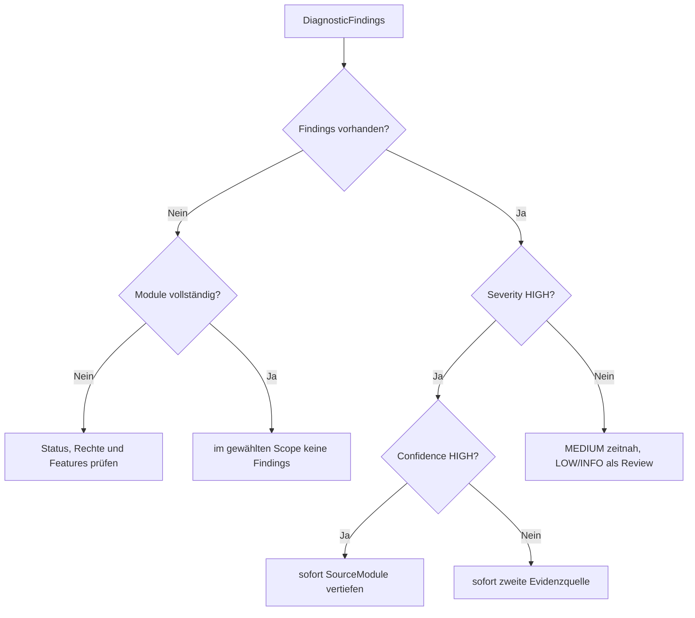

# Server Health: CPU, NUMA, Memory, Integrität und Engine-Evidenz

**Procedures:** 28 (20 nummerierte Abschnitte und 8 ergänzende Module)
**Evidenz:** Momentaufnahme, Konfiguration, kumulative SQLOS-DMVs, kurze Stichprobe, msdb-Historie und vorhandene XE-Dateien  
**Kosten:** LOW bis HIGH_OPT_IN

## Grundregeln

- Hohe SQL-Server-Speichernutzung ist im Steady State häufig erwartbar; SQL Server nutzt freien Speicher als Cache. Entscheidend sind Pressure-Signale, OS-Reserve, Clerk-/Grantkontext und Verlauf.
- Scheduler-, NUMA-, Latch-, Spinlock- und Performance-Counterwerte sind ohne Vergleichsfenster oder Baseline leicht irreführend.
- Keine negative Integritätsevidenz ist kein Integritätsbeweis.
- Konfigurationsfindings sind Review-Hinweise, keine automatischen Änderungsempfehlungen.
- Server-, Dienst-, Registry-, Dateipfad-, Login- und Meldungswerte dürfen in Laufzeitausgaben real erscheinen und sind bei Export oder Weitergabe zu schützen.

---

## 1. [monitor].[USP_ServerCpuTopology]

### Zweck

Die Procedure zeigt CPU-/Socket-/Core-/Scheduler-/NUMA-Topologie und die momentane Schedulerlast.

### Resultsets

1. Modulstatus.
2. `cpuTopology`.
3. `schedulers`.
4. `numaNodes`.

### CPU-Topologie

| Spalte | Bedeutung |
|---|---|
| `cpu_count` | logische CPUs, die SQL Server erkennt |
| `scheduler_count` | Schedulerzahl |
| `hyperthread_ratio` | logische CPUs pro physischem Core gemäß Engineinformation |
| `socket_count` | erkannte Sockets |
| `cores_per_socket` | physische Cores je Socket |
| `numa_node_count` | erkannte NUMA-Nodes |
| `softnuma_configuration_desc` | Soft-NUMA-Konfiguration |
| `sqlserver_start_time` | Reset-/Uptime-Kontext vieler DMVs |
| `affinity_type_desc` | CPU-Affinitätsmodus |

### Scheduler

`parent_node_id`, `status`, `SchedulerCount`, `VisibleOnlineSchedulers`, `OnlineSchedulers`, `CurrentTasks`, `RunnableTasks`, `ActiveWorkers`, `LoadFactor`, `Finding`.

### NUMA-Nodes

`node_id`, `node_state_desc`, `memory_node_id`, `online_scheduler_count`, `idle_scheduler_count`, `active_worker_count`, `avg_load_balance`.

### Interpretation

| Konstellation | Bewertung |
|---|---|
| `RunnableTasks=0` | nur diese Momentaufnahme unauffällig |
| einzelne runnable Tasks in kurzer Stichprobe | nicht automatisch CPU-Druck |
| Runnable Tasks wiederholt auf mehreren Schedulern | CPU-/Worker-/Querylast vertiefen |
| Node ohne sichtbare Online-Scheduler | Affinity, Nodezustand oder spezielle Nodeart prüfen |
| `cpu_count` kleiner als erwartete Hardware | Lizenzierung, VM-Zuordnung, Affinity und Edition prüfen |
| hohe ActiveWorkers ohne Runnable Queue | aktive Last, aber nicht zwingend CPU-Stau |

### Folgeanalyse

`USP_ServerNuma`, `USP_CurrentRequests`, `USP_CurrentWaits`, `USP_PerformanceCounters` und OS-/Hypervisor-Monitoring.

### Kosten

LOW. Momentaufnahme; keine Rate und keine CPU-Auslastungsprozentmessung.

### Parameter und weitere Aufrufbeispiele

| Parameter | Datentyp | Default | Eingabeform und Wirkung |
|---|---|---|---|
| `@PrintMeldungen` | `bit` | `1` | Bei 1 (auch Default) wird bei einem Status ungleich AVAILABLE eine Meldung niedriger Severity mit dem Fehlertext ausgegeben; 0 unterdrückt sie. NULL löst die IF-Bedingung ebenfalls nicht aus. Die Meldung erfolgt nach Befüllung der OUTPUT-Parameter und vor den Resultsets. Numerische 0 bleibt bit 0; von 0 verschiedene konvertierbare Zahlen werden beim Binden bit 1. |
| `@Hilfe` | `bit` | `0` | 0 oder NULL nimmt den normalen Analysepfad. 1 gibt die PRINT-Hilfe aus und kehrt vor Quellzugriff, regulärer Statusinitialisierung und allen vier Status-/Fehler-OUTPUT-Zuweisungen zurück. Zuvor laufen ein angeforderter TABLE-Preflight oder die Ablehnung eines nicht leeren TABLE-Mappings außerhalb TABLE; diese können bereits werfen. @Json ist beim Eintritt auf NULL gesetzt. Numerische 0 bleibt bit 0; von 0 verschiedene konvertierbare Zahlen werden bit 1. |
| `@ResultSetArt` | `varchar(16)` | `'CONSOLE'` | Nach Trim von U+0020-Leerzeichen und UPPER gelten CONSOLE, RAW, TABLE und NONE; NULL wird wie leer behandelt. CONSOLE gibt nur die Console-Helferausgabe der ersten Fachquelle aus, ohne separates Modulstatusresultset; eine Leerzeile des Helfers hat hier NULL für Status und Hinweis. RAW gibt Modulstatus und unbeschriftete Fachresultsets aus. TABLE schreibt ausschließlich die benannte Fachmenge in das gemappte Ziel und gibt kein separates Modulstatusresultset aus. NONE unterdrückt Resultsets. CONSOLE und TABLE werden vor dem regulären Ausgabezweig intern zu NONE. Andere Texte, leer und NULL ergeben INVALID_PARAMETER/IsPartial=1; der nicht normalisierte ungültige Modus gibt dennoch Modulstatus und beschriftete Fachresultsets des ELSE-Zweigs aus. JSON ist davon unabhängig. |
| `@ResultTablesJson` | `nvarchar(max)` | `NULL` | Als TABLE-Eingabe ist ein JSON-Objekt mit genau einem Mapping für den registrierten Namen cpuTopology auf eine vorhandene, leere lokale #temp-Tabelle nötig; diese muss genau eine Seed-/Platzhalterspalte besitzen. Das Ziel wird vor Hilfe und Quellerhebung geprüft; fehlerhafte oder fehlende TABLE-Ziele werfen beim Preflight Fehler 51011, daher werden Status-OUTPUTs nicht regulär gesetzt. Außerhalb von TABLE sind nur NULL, leer oder Leerzeichen erlaubt; jeder andere Inhalt wirft Fehler 51011 vor Hilfe und OUTPUT-Zuweisung. |
| `@JsonErzeugen` | `bit` | `0` | Im normalen Pfad erzeugt 1 unabhängig von @ResultSetArt das JSON-Dokument in @Json; 0 oder NULL erzeugt keines. @Hilfe=1 kehrt vor der JSON-Erzeugung zurück. Leere Fachmengen werden als leere Arrays ausgegeben. Numerische 0 bleibt bit 0; von 0 verschiedene konvertierbare Zahlen werden beim Binden bit 1. |
| `@Json` | `nvarchar(max) OUTPUT` | `NULL` | OUTPUT-Empfänger für das JSON-Dokument; bei Eintritt auf NULL gesetzt und nur bei @JsonErzeugen=1 befüllt. Bindung erfolgt optional mit @Json=@Empfaenger OUTPUT; die Empfängervariable muss nvarchar(max) sein. Ohne OUTPUT-Bindung wird kein Rückgabewert an eine Aufrufervariable übertragen. |
| `@StatusCodeOut` | `varchar(40) OUTPUT` | `NULL` | Optionaler OUTPUT-Empfänger für AVAILABLE, INVALID_PARAMETER, DENIED_PERMISSION, TIMEOUT oder ERROR_HANDLED. AVAILABLE bedeutet kein abgefangener Quellfehler und keine festgestellte ungültige Eingabe; INVALID_PARAMETER bezeichnet ungültige ResultSetArt; DENIED_PERMISSION klassifiziert Quellfehler 229, 297, 300 oder 371; TIMEOUT klassifiziert Fehler 1222; ERROR_HANDLED steht für sonstige im Quell-TRY abgefangene Fehler. Bei Quellfehlern ist IsPartial=1. Bindung z.B. @StatusCodeOut=@Status OUTPUT mit varchar(40)-Variable. Zuweisung geschieht nach Quellversuch/Validierung, vor Meldung und Resultsetausgabe; bei frühem Preflight-THROW oder Hilfe keine reguläre Zuweisung. Hilfe lässt einen gebundenen Anfangswert einschließlich NULL unverändert, auch nach erfolgreichem TABLE-Preflight; ein früher THROW erreicht die reguläre Zuweisung nicht. Im normalen Pfad wird der Anfangswert ersetzt. Ohne OUTPUT-Bindung wird kein Aufruferwert empfangen. |
| `@IsPartialOut` | `bit OUTPUT` | `NULL` | Optionaler OUTPUT-Empfänger: 0 bei AVAILABLE, 1 bei INVALID_PARAMETER und bei abgefangenen Quellfehlern. Das Bit bezeichnet den implementierten Status-/Fehlerpfad, nicht Vollständigkeit einzelner leerer Quellgruppen. Bindung z.B. @IsPartialOut=@Partial OUTPUT mit bit-Variable; Zuweisung gemeinsam mit StatusCodeOut vor Meldung und Resultsets. Hilfe lässt einen gebundenen Anfangswert einschließlich NULL unverändert, auch nach erfolgreichem TABLE-Preflight; ein früher THROW erreicht die reguläre Zuweisung nicht. Im normalen Pfad wird der Anfangswert ersetzt. Ohne OUTPUT-Bindung wird kein Aufruferwert empfangen. |
| `@ErrorNumberOut` | `int OUTPUT` | `NULL` | Optionaler OUTPUT-Empfänger für die SQL-Fehlernummer eines im Quell-TRY abgefangenen Fehlers; bei AVAILABLE und INVALID_PARAMETER bleibt der Wert NULL. Die bekannten Berechtigungs-/Timeoutnummern werden zugleich klassifiziert. Bindung z.B. @ErrorNumberOut=@ErrorNumber OUTPUT mit int-Variable; Zuweisung vor Meldung und Resultsets. Hilfe lässt einen gebundenen Anfangswert einschließlich NULL unverändert, auch nach erfolgreichem TABLE-Preflight; ein früher THROW erreicht die reguläre Zuweisung nicht. Im normalen Pfad wird der Anfangswert ersetzt. Ohne OUTPUT-Bindung wird kein Aufruferwert empfangen. |
| `@ErrorMessageOut` | `nvarchar(2048) OUTPUT` | `NULL` | Optionaler OUTPUT-Empfänger für den Text des im Quell-TRY abgefangenen Fehlers oder die konkrete INVALID_PARAMETER-Begründung; bei AVAILABLE bleibt er NULL. Bindung z.B. @ErrorMessageOut=@ErrorMessage OUTPUT mit nvarchar(2048)-Variable; Zuweisung vor Meldung und Resultsets. Hilfe lässt einen gebundenen Anfangswert einschließlich NULL unverändert, auch nach erfolgreichem TABLE-Preflight; ein früher THROW erreicht die reguläre Zuweisung nicht. Im normalen Pfad wird der Anfangswert ersetzt. Ohne OUTPUT-Bindung wird kein Aufruferwert empfangen. |

**RAW:**

```sql
EXEC [monitor].[USP_ServerCpuTopology] @ResultSetArt=N'RAW';
```

**JSON:**

```sql
DECLARE @Json nvarchar(max);
EXEC [monitor].[USP_ServerCpuTopology] @JsonErzeugen=1,@Json=@Json OUTPUT,@ResultSetArt=N'NONE';
SELECT @Json AS [JsonDocument];
```

**TABLE:**

```sql
CREATE TABLE [#ServerCpuTopology_HelpExample]([Seed] bit NULL);
BEGIN TRY
    EXEC [monitor].[USP_ServerCpuTopology] @ResultSetArt=N'TABLE',@ResultTablesJson=N'{"cpuTopology":"#ServerCpuTopology_HelpExample"}';
END TRY
BEGIN CATCH
    DROP TABLE [#ServerCpuTopology_HelpExample];
    THROW;
END CATCH;
DROP TABLE [#ServerCpuTopology_HelpExample];
```

**Hilfe:**

```sql
EXEC [monitor].[USP_ServerCpuTopology] @Hilfe=1;
```

---

## 2. [monitor].[USP_ServerNuma]

### Zweck

Die Procedure verdichtet NUMA-/Soft-NUMA-Verteilung, Scheduler-Skew und SQL-Memory-Nodes.

### NUMA-Spalten

`node_id`, `node_state_desc`, `memory_node_id`, `online_scheduler_count`, `idle_scheduler_count`, `active_worker_count`, `avg_load_balance`, `SchedulerCount`, `VisibleOnline`, `CurrentTasks`, `RunnableTasks`, `ActiveWorkers`, `LoadFactor`, `RunnablePerScheduler`, `Finding`.

### Memory Nodes

`memory_node_id`, `virtual_address_space_reserved_kb`, `virtual_address_space_committed_kb`, `locked_page_allocations_kb`, `pages_kb`, `shared_memory_reserved_kb`, `shared_memory_committed_kb`.

### Interpretation

- `RunnablePerScheduler` ist ein Snapshotquotient, kein historischer Mittelwert.
- Unterschiede zwischen Nodes können aus Workloadlokalität, Connectionverteilung, Affinity oder Momentaufnahme entstehen.
- CPU-Nodes und Memory-Nodes sind verwandt, aber nicht zwingend identisch.
- `locked_page_allocations_kb` zeigt tatsächlich gesperrte Seiten, nicht nur die Vergabe des LPIM-Rechts.
- VAS reserved ist keine physisch belegte RAM-Menge.
- Ein einzelner heißer Node rechtfertigt keine Affinityänderung ohne Trend- und Plananalyse.

### Plakatives Beispiel

| Node | VisibleOnline | RunnableTasks | RunnablePerScheduler | Bewertung |
|---:|---:|---:|---:|---|
| 0 | 8 | 0 | 0 | aktuell unauffällig |
| 1 | 8 | 24 | 3 | auffällig, wenn über mehrere Samples reproduzierbar |
| 2 | 0 | 0 | `NULL` | Nodezustand/Affinity prüfen, nicht dividieren |

### Folgeanalyse

CPU-Topologie, aktive Requests nach Scheduler, Server Memory und Hypervisor-/NUMA-Konfiguration.

### Parameter und weitere Aufrufbeispiele

| Parameter | Datentyp | Default | Eingabeform und Wirkung |
|---|---|---|---|
| `@PrintMeldungen` | `bit` | `1` | Bei 1 (auch Default) wird bei einem Status ungleich AVAILABLE eine Meldung niedriger Severity mit dem Fehlertext ausgegeben; 0 unterdrückt sie. NULL löst die IF-Bedingung ebenfalls nicht aus. Die Meldung erfolgt nach Befüllung der OUTPUT-Parameter und vor den Resultsets. Numerische 0 bleibt bit 0; von 0 verschiedene konvertierbare Zahlen werden beim Binden bit 1. |
| `@Hilfe` | `bit` | `0` | 0 oder NULL nimmt den normalen Analysepfad. 1 gibt die PRINT-Hilfe aus und kehrt vor Quellzugriff, regulärer Statusinitialisierung und allen vier Status-/Fehler-OUTPUT-Zuweisungen zurück. Zuvor laufen ein angeforderter TABLE-Preflight oder die Ablehnung eines nicht leeren TABLE-Mappings außerhalb TABLE; diese können bereits werfen. @Json ist beim Eintritt auf NULL gesetzt. Numerische 0 bleibt bit 0; von 0 verschiedene konvertierbare Zahlen werden bit 1. |
| `@ResultSetArt` | `varchar(16)` | `'CONSOLE'` | Nach Trim von U+0020-Leerzeichen und UPPER gelten CONSOLE, RAW, TABLE und NONE; NULL wird wie leer behandelt. CONSOLE gibt nur die Console-Helferausgabe der ersten Fachquelle aus, ohne separates Modulstatusresultset; eine Leerzeile des Helfers hat hier NULL für Status und Hinweis. RAW gibt Modulstatus und unbeschriftete Fachresultsets aus. TABLE schreibt ausschließlich die benannte Fachmenge in das gemappte Ziel und gibt kein separates Modulstatusresultset aus. NONE unterdrückt Resultsets. CONSOLE und TABLE werden vor dem regulären Ausgabezweig intern zu NONE. Andere Texte, leer und NULL ergeben INVALID_PARAMETER/IsPartial=1; der nicht normalisierte ungültige Modus gibt dennoch Modulstatus und beschriftete Fachresultsets des ELSE-Zweigs aus. JSON ist davon unabhängig. |
| `@ResultTablesJson` | `nvarchar(max)` | `NULL` | Als TABLE-Eingabe ist ein JSON-Objekt mit genau einem Mapping für den registrierten Namen numaNodes auf eine vorhandene, leere lokale #temp-Tabelle nötig; diese muss genau eine Seed-/Platzhalterspalte besitzen. Das Ziel wird vor Hilfe und Quellerhebung geprüft; fehlerhafte oder fehlende TABLE-Ziele werfen beim Preflight Fehler 51011, daher werden Status-OUTPUTs nicht regulär gesetzt. Außerhalb von TABLE sind nur NULL, leer oder Leerzeichen erlaubt; jeder andere Inhalt wirft Fehler 51011 vor Hilfe und OUTPUT-Zuweisung. |
| `@JsonErzeugen` | `bit` | `0` | Im normalen Pfad erzeugt 1 unabhängig von @ResultSetArt das JSON-Dokument in @Json; 0 oder NULL erzeugt keines. @Hilfe=1 kehrt vor der JSON-Erzeugung zurück. Leere Fachmengen werden als leere Arrays ausgegeben. Numerische 0 bleibt bit 0; von 0 verschiedene konvertierbare Zahlen werden beim Binden bit 1. |
| `@Json` | `nvarchar(max) OUTPUT` | `NULL` | OUTPUT-Empfänger für das JSON-Dokument; bei Eintritt auf NULL gesetzt und nur bei @JsonErzeugen=1 befüllt. Bindung erfolgt optional mit @Json=@Empfaenger OUTPUT; die Empfängervariable muss nvarchar(max) sein. Ohne OUTPUT-Bindung wird kein Rückgabewert an eine Aufrufervariable übertragen. |
| `@StatusCodeOut` | `varchar(40) OUTPUT` | `NULL` | Optionaler OUTPUT-Empfänger für AVAILABLE, INVALID_PARAMETER, DENIED_PERMISSION, TIMEOUT oder ERROR_HANDLED. AVAILABLE bedeutet kein abgefangener Quellfehler und keine festgestellte ungültige Eingabe; INVALID_PARAMETER bezeichnet ungültige ResultSetArt; DENIED_PERMISSION klassifiziert Quellfehler 229, 297, 300 oder 371; TIMEOUT klassifiziert Fehler 1222; ERROR_HANDLED steht für sonstige im Quell-TRY abgefangene Fehler. Bei Quellfehlern ist IsPartial=1. Bindung z.B. @StatusCodeOut=@Status OUTPUT mit varchar(40)-Variable. Zuweisung geschieht nach Quellversuch/Validierung, vor Meldung und Resultsetausgabe; bei frühem Preflight-THROW oder Hilfe keine reguläre Zuweisung. Hilfe lässt einen gebundenen Anfangswert einschließlich NULL unverändert, auch nach erfolgreichem TABLE-Preflight; ein früher THROW erreicht die reguläre Zuweisung nicht. Im normalen Pfad wird der Anfangswert ersetzt. Ohne OUTPUT-Bindung wird kein Aufruferwert empfangen. |
| `@IsPartialOut` | `bit OUTPUT` | `NULL` | Optionaler OUTPUT-Empfänger: 0 bei AVAILABLE, 1 bei INVALID_PARAMETER und bei abgefangenen Quellfehlern. Das Bit bezeichnet den implementierten Status-/Fehlerpfad, nicht Vollständigkeit einzelner leerer Quellgruppen. Bindung z.B. @IsPartialOut=@Partial OUTPUT mit bit-Variable; Zuweisung gemeinsam mit StatusCodeOut vor Meldung und Resultsets. Hilfe lässt einen gebundenen Anfangswert einschließlich NULL unverändert, auch nach erfolgreichem TABLE-Preflight; ein früher THROW erreicht die reguläre Zuweisung nicht. Im normalen Pfad wird der Anfangswert ersetzt. Ohne OUTPUT-Bindung wird kein Aufruferwert empfangen. |
| `@ErrorNumberOut` | `int OUTPUT` | `NULL` | Optionaler OUTPUT-Empfänger für die SQL-Fehlernummer eines im Quell-TRY abgefangenen Fehlers; bei AVAILABLE und INVALID_PARAMETER bleibt der Wert NULL. Die bekannten Berechtigungs-/Timeoutnummern werden zugleich klassifiziert. Bindung z.B. @ErrorNumberOut=@ErrorNumber OUTPUT mit int-Variable; Zuweisung vor Meldung und Resultsets. Hilfe lässt einen gebundenen Anfangswert einschließlich NULL unverändert, auch nach erfolgreichem TABLE-Preflight; ein früher THROW erreicht die reguläre Zuweisung nicht. Im normalen Pfad wird der Anfangswert ersetzt. Ohne OUTPUT-Bindung wird kein Aufruferwert empfangen. |
| `@ErrorMessageOut` | `nvarchar(2048) OUTPUT` | `NULL` | Optionaler OUTPUT-Empfänger für den Text des im Quell-TRY abgefangenen Fehlers oder die konkrete INVALID_PARAMETER-Begründung; bei AVAILABLE bleibt er NULL. Bindung z.B. @ErrorMessageOut=@ErrorMessage OUTPUT mit nvarchar(2048)-Variable; Zuweisung vor Meldung und Resultsets. Hilfe lässt einen gebundenen Anfangswert einschließlich NULL unverändert, auch nach erfolgreichem TABLE-Preflight; ein früher THROW erreicht die reguläre Zuweisung nicht. Im normalen Pfad wird der Anfangswert ersetzt. Ohne OUTPUT-Bindung wird kein Aufruferwert empfangen. |

**RAW:**

```sql
EXEC [monitor].[USP_ServerNuma] @ResultSetArt=N'RAW';
```

**JSON:**

```sql
DECLARE @Json nvarchar(max);
EXEC [monitor].[USP_ServerNuma] @JsonErzeugen=1,@Json=@Json OUTPUT,@ResultSetArt=N'NONE';
SELECT @Json AS [JsonDocument];
```

**TABLE:**

```sql
CREATE TABLE [#ServerNuma_HelpExample]([Seed] bit NULL);
BEGIN TRY
    EXEC [monitor].[USP_ServerNuma] @ResultSetArt=N'TABLE',@ResultTablesJson=N'{"numaNodes":"#ServerNuma_HelpExample"}';
END TRY
BEGIN CATCH
    DROP TABLE [#ServerNuma_HelpExample];
    THROW;
END CATCH;
DROP TABLE [#ServerNuma_HelpExample];
```

**Hilfe:**

```sql
EXEC [monitor].[USP_ServerNuma] @Hilfe=1;
```

---

## 3. [monitor].[USP_ServerMemory]

### Zweck

Die Procedure korreliert OS-, Prozess- und SQL-Memory-Manager-Zustand, größte Memory Clerks und Query Grants.

### Summary

| Spalte | Bedeutung |
|---|---|
| `total_physical_memory_kb`, `available_physical_memory_kb`, `system_memory_state_desc` | Betriebssystemzustand |
| `physical_memory_in_use_kb` | SQL-Prozessspeicher |
| `locked_page_allocations_kb`, `large_page_allocations_kb` | spezielle Prozessallokationen |
| `process_physical_memory_low`, `process_virtual_memory_low` | Engine-Pressureflags |
| `committed_kb`, `committed_target_kb`, `visible_target_kb` | SQL Memory Manager |
| `sql_memory_model_desc` | Speichermodell |
| `min_server_memory_mb`, `max_server_memory_mb` | aktive Konfiguration |
| `LPIMAssessment` | Laufzeitevidenz, keine Rechteprüfung |
| `MemoryFinding` | codebasierter Snapshotbefund |

### Memory Clerks

`type`, `pages_kb`, `virtual_memory_committed_kb`, `awe_allocated_kb`, `shared_memory_committed_kb`.

### Grants

`ActiveOrWaitingGrants`, `RequestedMemoryKb`, `GrantedMemoryKb`, `UsedMemoryKb`, `WaitingGrantCount`.

### Framework-Heuristiken

- weniger als 1.048.576 KB verfügbarer OS-Speicher → `LOW_OS_FREE_MEMORY_REVIEW`;
- `committed_target_kb < committed_kb` → `TARGET_BELOW_COMMITTED`.

Diese Regeln sind Sichtungshilfen. Auf einem kleinen Server ist 1 GB anders zu bewerten als auf einem Server mit mehreren TB RAM.

### Interpretation

| Fall | Bewertung |
|---|---|
| SQL nutzt fast `max server memory`, OS stabil | oft normaler Cache-Steady-State |
| `process_physical_memory_low=1` | starkes Pressure-Signal |
| `committed_target < committed` | SQL versucht Speicher zurückzugeben; Verlauf prüfen |
| `WaitingGrantCount>0` | Query-Execution-Memory-Druck möglich |
| ein Clerk dominiert | Clerktyp und Betriebsfunktion prüfen; Größe allein ist kein Leakbeweis |
| LPIMAssessment nicht bestätigt | beweist weder fehlendes Benutzerrecht noch Fehlkonfiguration |

### Folgeanalyse

`USP_BufferPoolAnalysis`, `USP_CurrentMemoryGrants`, `USP_ResourceGovernorAnalysis`, OS- und Prozessmonitoring.

### Parameter und weitere Aufrufbeispiele

| Parameter | Datentyp | Default | Eingabeform und Wirkung |
|---|---|---|---|
| `@MaxZeilen` | `int` | `100` | int-Eingabe: NULL oder 0 bedeutet unbegrenzt; positive Werte von 1 bis 2147483647 begrenzen die ausgewählten Clerk-Typgruppen. Die TOP-Mitgliedschaft wird nach absteigender Summe aus pages_kb und virtual_memory_committed_kb gewählt; die materialisierten Clerk-Zeilen werden anschließend nach pages_kb DESC ausgegeben beziehungsweise im JSON geordnet. TOP folgt auf den vollständigen Scan und GROUP BY von sys.dm_os_memory_clerks und begrenzt daher weder Scan noch Aggregationsaufwand. Summary und Grants bleiben ungekürzt. Negative Werte setzen INVALID_PARAMETER/IsPartial=1 und überspringen sämtliche Quellabfragen; Hilfe kehrt vor dieser Prüfung zurück. |
| `@PrintMeldungen` | `bit` | `1` | Bei 1 (auch Default) wird bei einem Status ungleich AVAILABLE eine Meldung niedriger Severity mit dem Fehlertext ausgegeben; 0 unterdrückt sie. NULL löst die IF-Bedingung ebenfalls nicht aus. Die Meldung erfolgt nach Befüllung der OUTPUT-Parameter und vor den Resultsets. Numerische 0 bleibt bit 0; von 0 verschiedene konvertierbare Zahlen werden beim Binden bit 1. |
| `@Hilfe` | `bit` | `0` | 0 oder NULL nimmt den normalen Analysepfad. 1 gibt die PRINT-Hilfe aus und kehrt vor Quellzugriff, regulärer Statusinitialisierung und allen vier Status-/Fehler-OUTPUT-Zuweisungen zurück. Zuvor laufen ein angeforderter TABLE-Preflight oder die Ablehnung eines nicht leeren TABLE-Mappings außerhalb TABLE; diese können bereits werfen. @Json ist beim Eintritt auf NULL gesetzt. Numerische 0 bleibt bit 0; von 0 verschiedene konvertierbare Zahlen werden bit 1. |
| `@ResultSetArt` | `varchar(16)` | `'CONSOLE'` | Nach Trim von U+0020-Leerzeichen und UPPER gelten CONSOLE, RAW, TABLE und NONE; NULL wird wie leer behandelt. CONSOLE gibt nur die Console-Helferausgabe der ersten Fachquelle aus, ohne separates Modulstatusresultset; eine Leerzeile des Helfers hat hier NULL für Status und Hinweis. RAW gibt Modulstatus und unbeschriftete Fachresultsets aus. TABLE schreibt ausschließlich die benannte Fachmenge in das gemappte Ziel und gibt kein separates Modulstatusresultset aus. NONE unterdrückt Resultsets. CONSOLE und TABLE werden vor dem regulären Ausgabezweig intern zu NONE. Andere Texte, leer und NULL ergeben INVALID_PARAMETER/IsPartial=1; der nicht normalisierte ungültige Modus gibt dennoch Modulstatus und beschriftete Fachresultsets des ELSE-Zweigs aus. JSON ist davon unabhängig. |
| `@ResultTablesJson` | `nvarchar(max)` | `NULL` | Als TABLE-Eingabe ist ein JSON-Objekt mit genau einem Mapping für den registrierten Namen summary auf eine vorhandene, leere lokale #temp-Tabelle nötig; diese muss genau eine Seed-/Platzhalterspalte besitzen. Das Ziel wird vor Hilfe und Quellerhebung geprüft; fehlerhafte oder fehlende TABLE-Ziele werfen beim Preflight Fehler 51011, daher werden Status-OUTPUTs nicht regulär gesetzt. Außerhalb von TABLE sind nur NULL, leer oder Leerzeichen erlaubt; jeder andere Inhalt wirft Fehler 51011 vor Hilfe und OUTPUT-Zuweisung. |
| `@JsonErzeugen` | `bit` | `0` | Im normalen Pfad erzeugt 1 unabhängig von @ResultSetArt das JSON-Dokument in @Json; 0 oder NULL erzeugt keines. @Hilfe=1 kehrt vor der JSON-Erzeugung zurück. Leere Fachmengen werden als leere Arrays ausgegeben. Numerische 0 bleibt bit 0; von 0 verschiedene konvertierbare Zahlen werden beim Binden bit 1. |
| `@Json` | `nvarchar(max) OUTPUT` | `NULL` | OUTPUT-Empfänger für das JSON-Dokument; bei Eintritt auf NULL gesetzt und nur bei @JsonErzeugen=1 befüllt. Bindung erfolgt optional mit @Json=@Empfaenger OUTPUT; die Empfängervariable muss nvarchar(max) sein. Ohne OUTPUT-Bindung wird kein Rückgabewert an eine Aufrufervariable übertragen. |
| `@StatusCodeOut` | `varchar(40) OUTPUT` | `NULL` | Optionaler OUTPUT-Empfänger für AVAILABLE, INVALID_PARAMETER, DENIED_PERMISSION, TIMEOUT oder ERROR_HANDLED. AVAILABLE bedeutet kein abgefangener Quellfehler und keine festgestellte ungültige Eingabe; INVALID_PARAMETER bezeichnet ungültige ResultSetArt oder negatives @MaxZeilen; DENIED_PERMISSION klassifiziert Quellfehler 229, 297, 300 oder 371; TIMEOUT klassifiziert Fehler 1222; ERROR_HANDLED steht für sonstige im Quell-TRY abgefangene Fehler. Bei Quellfehlern ist IsPartial=1. Bindung z.B. @StatusCodeOut=@Status OUTPUT mit varchar(40)-Variable. Zuweisung geschieht nach Quellversuch/Validierung, vor Meldung und Resultsetausgabe; bei frühem Preflight-THROW oder Hilfe keine reguläre Zuweisung. Hilfe lässt einen gebundenen Anfangswert einschließlich NULL unverändert, auch nach erfolgreichem TABLE-Preflight; ein früher THROW erreicht die reguläre Zuweisung nicht. Im normalen Pfad wird der Anfangswert ersetzt. Ohne OUTPUT-Bindung wird kein Aufruferwert empfangen. |
| `@IsPartialOut` | `bit OUTPUT` | `NULL` | Optionaler OUTPUT-Empfänger: 0 bei AVAILABLE, 1 bei INVALID_PARAMETER und bei abgefangenen Quellfehlern. Das Bit bezeichnet den implementierten Status-/Fehlerpfad, nicht Vollständigkeit einzelner leerer Quellgruppen. Bindung z.B. @IsPartialOut=@Partial OUTPUT mit bit-Variable; Zuweisung gemeinsam mit StatusCodeOut vor Meldung und Resultsets. Hilfe lässt einen gebundenen Anfangswert einschließlich NULL unverändert, auch nach erfolgreichem TABLE-Preflight; ein früher THROW erreicht die reguläre Zuweisung nicht. Im normalen Pfad wird der Anfangswert ersetzt. Ohne OUTPUT-Bindung wird kein Aufruferwert empfangen. |
| `@ErrorNumberOut` | `int OUTPUT` | `NULL` | Optionaler OUTPUT-Empfänger für die SQL-Fehlernummer eines im Quell-TRY abgefangenen Fehlers; bei AVAILABLE und INVALID_PARAMETER bleibt der Wert NULL. Die bekannten Berechtigungs-/Timeoutnummern werden zugleich klassifiziert. Bindung z.B. @ErrorNumberOut=@ErrorNumber OUTPUT mit int-Variable; Zuweisung vor Meldung und Resultsets. Hilfe lässt einen gebundenen Anfangswert einschließlich NULL unverändert, auch nach erfolgreichem TABLE-Preflight; ein früher THROW erreicht die reguläre Zuweisung nicht. Im normalen Pfad wird der Anfangswert ersetzt. Ohne OUTPUT-Bindung wird kein Aufruferwert empfangen. |
| `@ErrorMessageOut` | `nvarchar(2048) OUTPUT` | `NULL` | Optionaler OUTPUT-Empfänger für den Text des im Quell-TRY abgefangenen Fehlers oder die konkrete INVALID_PARAMETER-Begründung; bei AVAILABLE bleibt er NULL. Bindung z.B. @ErrorMessageOut=@ErrorMessage OUTPUT mit nvarchar(2048)-Variable; Zuweisung vor Meldung und Resultsets. Hilfe lässt einen gebundenen Anfangswert einschließlich NULL unverändert, auch nach erfolgreichem TABLE-Preflight; ein früher THROW erreicht die reguläre Zuweisung nicht. Im normalen Pfad wird der Anfangswert ersetzt. Ohne OUTPUT-Bindung wird kein Aufruferwert empfangen. |

**RAW:**

```sql
EXEC [monitor].[USP_ServerMemory] @ResultSetArt=N'RAW';
```

**JSON:**

```sql
DECLARE @Json nvarchar(max);
EXEC [monitor].[USP_ServerMemory] @JsonErzeugen=1,@Json=@Json OUTPUT,@ResultSetArt=N'NONE';
SELECT @Json AS [JsonDocument];
```

**TABLE:**

```sql
CREATE TABLE [#ServerMemory_HelpExample]([Seed] bit NULL);
BEGIN TRY
    EXEC [monitor].[USP_ServerMemory] @ResultSetArt=N'TABLE',@ResultTablesJson=N'{"summary":"#ServerMemory_HelpExample"}';
END TRY
BEGIN CATCH
    DROP TABLE [#ServerMemory_HelpExample];
    THROW;
END CATCH;
DROP TABLE [#ServerMemory_HelpExample];
```

**Hilfe:**

```sql
EXEC [monitor].[USP_ServerMemory] @Hilfe=1;
```

---

## 4. [monitor].[USP_TempDBConfiguration]

### Zweck

Die Procedure inventarisiert TempDB-Dateien, Größe, Growth und ausgewählte Instanzkonfigurationen.

### Files

`file_id`, `name`, `type_desc`, `physical_name`, `SizeMb`, `GrowthValue`, `GrowthType`, `max_size`, `is_percent_growth`.

### Configuration

`name`, `value_in_use` für verfügbare Einstellungen wie:

- `tempdb metadata memory-optimized`,
- `tempdb deferred drop`,
- `mixed page allocation`.

### Interpretation

- Mehrere gleich große Datafiles sind häufig sinnvoll, aber Anzahl nicht blind an CPU-Zahl koppeln.
- Ungleiche Dateigrößen können proportional-fill-Skew erzeugen.
- Prozentwachstum wird mit zunehmender Datei immer größer.
- `max_size` ist in Seiten/Engine-Sonderwerten gespeichert; die Procedure gibt den Rohwert aus.
- Logfile und Datafiles haben unterschiedliche Rollen; nur Datafiles „gleichziehen“.
- Memory-optimized TempDB metadata hilft bei bestimmten Metadatencontention-Szenarien, ist keine universelle Pflicht.

### Beispiele

| Konfiguration | Bewertung |
|---|---|
| 8 gleich große Datafiles, gleiches fixes Growth | plausibler Ausgangspunkt |
| 8 Files, eines 10× größer | Allocation-Skew möglich |
| 10-%-Growth bei 2-TB-Datei | nächster Growth 200 GB; klarer Reviewfall |
| 32 Files auf kleiner OLTP-Instanz ohne Contention | möglicherweise unnötige Komplexität |

### Folgeanalyse

`USP_CurrentTempDB`, `USP_InternalContentionAnalysis`, Datei-/Volume-Kapazität.

### Parameter und weitere Aufrufbeispiele

| Parameter | Datentyp | Default | Eingabeform und Wirkung |
|---|---|---|---|
| `@PrintMeldungen` | `bit` | `1` | Eingabeform: SQL-bit; 0 bedeutet unterdrückt den Severity-10-Hinweis bei Status ungleich AVAILABLE, 1 bedeutet gibt den Severity-10-Hinweis mit Fehlertext aus. NULL ist zulässig und wird in der jeweiligen IF/CASE-Bedingung nicht als 0 behandelt: die Bedingung =1 ist dann nicht wahr. Ein leerer String wird bei SQL-bit-Konvertierung zu 0; andere nicht konvertierbare Eingaben lösen einen Konvertierungsfehler aus. Zahlen 0 bleiben 0, jeder konvertierbare Nichtnullwert ungleich 0 wird zu 1. Bei ausgelassenem Argument gilt der Default. |
| `@Hilfe` | `bit` | `0` | Eingabeform: SQL-bit; 0 bedeutet setzt die Hilfeprüfung nicht auf wahr und führt nach dem Preflight die Erhebung fort, 1 bedeutet druckt die Hilfe und kehrt vor Quellenabfrage und Statusoutputs zurück. NULL ist zulässig und wird in der jeweiligen IF/CASE-Bedingung nicht als 0 behandelt: die Bedingung =1 ist dann nicht wahr. Ein leerer String wird bei SQL-bit-Konvertierung zu 0; andere nicht konvertierbare Eingaben lösen einen Konvertierungsfehler aus. Zahlen 0 bleiben 0, jeder konvertierbare Nichtnullwert ungleich 0 wird zu 1. Bei ausgelassenem Argument gilt der Default. |
| `@ResultSetArt` | `varchar(16)` | `'CONSOLE'` | Eingabeform: ein einzelner Code CONSOLE, RAW, TABLE oder NONE; führende/abschließende Leerzeichen werden entfernt und Groß-/Kleinschreibung wird mit UPPER vereinheitlicht. NULL wird durch COALESCE zu leerem Text, ein leerer oder nur aus Leerzeichen bestehender Wert bleibt leer; alle drei Fälle sind ungültig. Nur die vier genannten Werte sind gültig. CONSOLE und TABLE wählen ihre Fachprojektion und setzen den internen Modus anschließend auf NONE, damit kein generisches Fachresultset zusätzlich ausgegeben wird; RAW liefert rohe Fachresultsets, NONE unterdrückt Resultsets. Ungültige Codes (einschließlich NULL/leer) setzen INVALID_PARAMETER und IsPartial=1; intern werden wegen des nicht-NONE-Modus Status und die nicht-RAW-Fachprojektion ausgegeben. Bei TABLE erfolgt zuerst der Ziel-Preflight; sein Fehler wird geworfen. JSON-Erzeugung ist unabhängig vom ResultSetArt. |
| `@ResultTablesJson` | `nvarchar(max)` | `NULL` | Eingabeform: ein gültiges JSON-Objekt mit genau einer Eigenschaft, deren Name exakt files lautet und deren Stringwert eine vorhandene lokale #temp-Tabelle bezeichnet. Das Ziel muss vor dem Aufruf existieren, leer sein und genau eine Seed-/Platzhalterspalte besitzen; globale ##-Tabellen, permanente Tabellen, Namen mit reserviertem Präfix #Monitor und Namen über 116 Zeichen sind unzulässig. Der Helper ergänzt das Ausgabeschema. Nur bei ResultSetArt=TABLE erforderlich. Außerhalb TABLE werden NULL, leerer oder nur aus Leerzeichen bestehender Inhalt akzeptiert; nichtleerer Inhalt wirft Fehler 51011. Bei TABLE validiert der Preflight JSON und Ziel und wirft bei ungültiger oder fehlender Angabe Fehler 51011; Status-OUTPUT-Parameter werden dann nicht zugewiesen. |
| `@JsonErzeugen` | `bit` | `0` | Eingabeform: SQL-bit; 0 bedeutet lässt @Json nach dem anfänglichen Zurücksetzen auf NULL, 1 bedeutet erstellt das JSON-Dokument mit meta, files, configuration und warnings. NULL ist zulässig und wird in der jeweiligen IF/CASE-Bedingung nicht als 0 behandelt: die Bedingung =1 ist dann nicht wahr. Ein leerer String wird bei SQL-bit-Konvertierung zu 0; andere nicht konvertierbare Eingaben lösen einen Konvertierungsfehler aus. Zahlen 0 bleiben 0, jeder konvertierbare Nichtnullwert ungleich 0 wird zu 1. Bei ausgelassenem Argument gilt der Default. |
| `@Json` | `nvarchar(max) OUTPUT` | `NULL` | Optionaler OUTPUT-Empfang des JSON-Dokuments, etwa @Json=@Payload OUTPUT mit einer nvarchar(max)-Variablen. Der Eingabewert wird beim Eintritt vor TABLE-Preflight und Hilfe auf NULL gesetzt. Bei erfolgreicher Hilfe-Rückkehr bleibt @Json NULL; andere Status-/Fehler-OUTPUTs werden dort nicht zugewiesen. Im normalen Pfad wird @Json nur bei @JsonErzeugen=1 nach der Quellverarbeitung befüllt; sonst bleibt es NULL. Ohne OUTPUT-Bindung wird kein Wert empfangen. |
| `@StatusCodeOut` | `varchar(40) OUTPUT` | `NULL` | Optionaler OUTPUT-Empfang, etwa @StatusCodeOut=@Status OUTPUT mit einer varchar(40)-Variablen. Werte und Bedeutungen: AVAILABLE (kein festgestellter Eingabe- oder abgefangener Quellfehler), INVALID_PARAMETER (ungültige ResultSetArt), DENIED_PERMISSION (abgefangene Quellfehler 229, 297, 300, 371 oder 916), TIMEOUT (Quellfehler 1222), ERROR_HANDLED (übrige abgefangene Quellfehler). Die reguläre Zuweisung erfolgt nach der Quellverarbeitung; Hilfe lässt einen gebundenen Anfangswert einschließlich NULL unverändert und ein früher Preflight-THROW erreicht die Zuweisung nicht. Ohne OUTPUT-Bindung wird kein Wert empfangen. |
| `@IsPartialOut` | `bit OUTPUT` | `NULL` | Optionaler OUTPUT-Parameter für 0 bei AVAILABLE; 1 bei ungültiger ResultSetArt oder abgefangenem Quellfehler. Die Procedure weist den Wert erst nach der Quellverarbeitung zu; bei frühem HELP-Rücksprung bleibt der Empfängerwert außer @Json unverändert. Zum Binden eine passende lokale Variable deklarieren und z.B. @IsPartialOut=@Empfaenger OUTPUT angeben; die Variable muss bit sein. OUTPUT-Bindung ist optional, wenn der Rückgabewert nicht benötigt wird. |
| `@ErrorNumberOut` | `int OUTPUT` | `NULL` | Optionaler OUTPUT-Parameter für bei abgefangenem Quellfehler die Quellfehlernummer; sonst NULL. Die Procedure weist den Wert erst nach der Quellverarbeitung zu; bei frühem HELP-Rücksprung bleibt der Empfängerwert außer @Json unverändert. Zum Binden eine passende lokale Variable deklarieren und z.B. @ErrorNumberOut=@Empfaenger OUTPUT angeben; die Variable muss int sein. OUTPUT-Bindung ist optional, wenn der Rückgabewert nicht benötigt wird. |
| `@ErrorMessageOut` | `nvarchar(2048) OUTPUT` | `NULL` | Optionaler OUTPUT-Parameter für bei Fehler den Fehlertext beziehungsweise bei INVALID_PARAMETER den Hinweis auf die zulässigen ResultSetArt-Werte; sonst NULL. Die Procedure weist den Wert erst nach der Quellverarbeitung zu; bei frühem HELP-Rücksprung bleibt der Empfängerwert außer @Json unverändert. Zum Binden eine passende lokale Variable deklarieren und z.B. @ErrorMessageOut=@Empfaenger OUTPUT angeben; die Variable muss nvarchar(2048) sein. OUTPUT-Bindung ist optional, wenn der Rückgabewert nicht benötigt wird. |

### Aufrufbeispiele

CONSOLE:

```sql
EXEC [monitor].[USP_TempDBConfiguration] @ResultSetArt = 'CONSOLE';
```

RAW:

```sql
EXEC [monitor].[USP_TempDBConfiguration] @ResultSetArt = 'RAW';
```

JSON (unabhängig von der Resultsetausgabe):

```sql
DECLARE @Json nvarchar(max);
EXEC [monitor].[USP_TempDBConfiguration]
      @ResultSetArt = 'NONE'
    , @JsonErzeugen = 1
    , @Json = @Json OUTPUT;
SELECT @Json AS [Json];
```

TABLE (Ziel vor dem TRY als Seed-Tabelle anlegen; beide Pfade räumen sie auf):

```sql
CREATE TABLE [#TempDBConfiguration_HelpExample] ([Seed] bit NULL);
BEGIN TRY
    EXEC [monitor].[USP_TempDBConfiguration]
          @ResultSetArt = 'TABLE'
        , @ResultTablesJson = N'{"files":"#TempDBConfiguration_HelpExample"}';
    DROP TABLE [#TempDBConfiguration_HelpExample];
END TRY
BEGIN CATCH
    IF OBJECT_ID('tempdb..#TempDBConfiguration_HelpExample') IS NOT NULL
        DROP TABLE [#TempDBConfiguration_HelpExample];
    THROW;
END CATCH;
```

HELP (führt keine Quellenabfrage aus; bei TABLE würde der Ziel-Preflight vor HELP laufen):

```sql
EXEC [monitor].[USP_TempDBConfiguration] @Hilfe = 1;
```


---

## 5. [monitor].[USP_ServerConfiguration]

### Zweck

Die Procedure zeigt konfigurierte und laufende Serverwerte und kennzeichnet einige kontextabhängige Reviewfälle.

### Spalten

`configuration_id`, `name`, `minimum`, `maximum`, `ConfiguredValue`, `RunningValue`, `is_dynamic`, `is_advanced`, `Finding`, `Interpretation`.

### Codes

| Finding | Bedeutung |
|---|---|
| `RECONFIGURE_OR_RESTART_PENDING` | gespeicherter und aktiver Wert weichen ab |
| `LOW_DEFAULT_REVIEW` | Cost Threshold ≤ 5 |
| `UNBOUNDED_MEMORY_REVIEW` | Max Server Memory praktisch unbeschränkt |
| `SECURITY_REVIEW` | `xp_cmdshell` oder OLE Automation aktiv |
| `OK_OR_CONTEXT_DEPENDENT` | keine codebasierte Auffälligkeit, aber weiterhin kontextabhängig |

### Interpretation

- MAXDOP 0 ist kein automatischer Fehler; NUMA, SQL-Version, Querytyp und Workload bestimmen den passenden Wert.
- Cost Threshold 5 ist Default und oft nur ein Startpunkt, aber Änderungen benötigen belastbare Parallelitäts-/CPU-Evidenz.
- Unbeschränktes Max Memory kann auf dedizierten kleinen Instanzen funktionieren, lässt aber keine explizite OS-/Nebenprozessreserve.
- `ConfiguredValue <> RunningValue` kann Reconfigure oder Neustart verlangen.
- Ein aktiviertes `xp_cmdshell` kann eine begründete, kontrollierte Abhängigkeit sein; prüfen Sie Exposition und Rechte.

### Folgeanalyse

CPU/NUMA, Memory, Security Configuration und konkrete Workload-DMVs.

### Parameter und weitere Aufrufbeispiele

| Parameter | Datentyp | Default | Eingabeform und Wirkung |
|---|---|---|---|
| `@NurKernparameter` | `bit` | `1` | Eingabeform: SQL-bit; 0 bedeutet der Filterausdruck wählt alle sys.configurations-Zeilen, weil `@NurKernparameter=0` wahr ist, 1 bedeutet der IN-Filter wählt nur die folgende kuratierte Liste: max degree of parallelism; cost threshold for parallelism; max server memory (MB); min server memory (MB); optimize for ad hoc workloads; backup compression default; remote admin connections; contained database authentication; clr enabled; clr strict security; xp_cmdshell; Ole Automation Procedures; external scripts enabled; blocked process threshold (s); query wait (s); affinity mask; affinity64 mask. NULL wirkt ebenfalls wie die Kernliste: für diese Namen ist die IN-Bedingung wahr, für andere bleibt `NULL=0 OR false` unbekannt und die Zeile wird herausgefiltert.. NULL ist zulässig und wird in der jeweiligen IF/CASE-Bedingung nicht als 0 behandelt: die Bedingung =1 ist dann nicht wahr. Ein leerer String wird bei SQL-bit-Konvertierung zu 0; andere nicht konvertierbare Eingaben lösen einen Konvertierungsfehler aus. Zahlen 0 bleiben 0, jeder konvertierbare Nichtnullwert ungleich 0 wird zu 1. Bei ausgelassenem Argument gilt der Default. |
| `@PrintMeldungen` | `bit` | `1` | Eingabeform: SQL-bit; 0 bedeutet unterdrückt die Informationsmeldung bei einem Nicht-AVAILABLE-Status, 1 bedeutet gibt eine Severity-10-Meldung mit Modulname und Fehlertext aus. NULL ist zulässig und wird in der jeweiligen IF/CASE-Bedingung nicht als 0 behandelt: die Bedingung =1 ist dann nicht wahr. Ein leerer String wird bei SQL-bit-Konvertierung zu 0; andere nicht konvertierbare Eingaben lösen einen Konvertierungsfehler aus. Zahlen 0 bleiben 0, jeder konvertierbare Nichtnullwert ungleich 0 wird zu 1. Bei ausgelassenem Argument gilt der Default. |
| `@Hilfe` | `bit` | `0` | Eingabeform: SQL-bit; 0 bedeutet führt die Erhebung ohne Hilfetext fort, 1 bedeutet druckt Hilfe und beendet die Procedure vor Erhebung und Statusoutputs. NULL ist zulässig und wird in der jeweiligen IF/CASE-Bedingung nicht als 0 behandelt: die Bedingung =1 ist dann nicht wahr. Ein leerer String wird bei SQL-bit-Konvertierung zu 0; andere nicht konvertierbare Eingaben lösen einen Konvertierungsfehler aus. Zahlen 0 bleiben 0, jeder konvertierbare Nichtnullwert ungleich 0 wird zu 1. Bei ausgelassenem Argument gilt der Default. |
| `@ResultSetArt` | `varchar(16)` | `'CONSOLE'` | Eingabeform: ein einzelner Code CONSOLE, RAW, TABLE oder NONE; führende/abschließende Leerzeichen werden entfernt und Groß-/Kleinschreibung wird mit UPPER vereinheitlicht. NULL wird durch COALESCE zu leerem Text, ein leerer oder nur aus Leerzeichen bestehender Wert bleibt leer; alle drei Fälle sind ungültig. Nur die vier genannten Werte sind gültig. CONSOLE und TABLE wählen ihre Fachprojektion und setzen den internen Modus anschließend auf NONE, damit kein generisches Fachresultset zusätzlich ausgegeben wird; RAW liefert rohe Fachresultsets, NONE unterdrückt Resultsets. Ungültige Codes (einschließlich NULL/leer) setzen INVALID_PARAMETER und IsPartial=1; intern werden wegen des nicht-NONE-Modus Status und die nicht-RAW-Fachprojektion ausgegeben. Bei TABLE erfolgt zuerst der Ziel-Preflight; sein Fehler wird geworfen. JSON-Erzeugung ist unabhängig vom ResultSetArt. |
| `@ResultTablesJson` | `nvarchar(max)` | `NULL` | Eingabeform: ein gültiges JSON-Objekt mit genau einer Eigenschaft, deren Name exakt configuration lautet und deren Stringwert eine vorhandene lokale #temp-Tabelle bezeichnet. Das Ziel muss vor dem Aufruf existieren, leer sein und genau eine Seed-/Platzhalterspalte besitzen; globale ##-Tabellen, permanente Tabellen, Namen mit reserviertem Präfix #Monitor und Namen über 116 Zeichen sind unzulässig. Der Helper ergänzt das Ausgabeschema. Nur bei ResultSetArt=TABLE erforderlich. Außerhalb TABLE werden NULL, leerer oder nur aus Leerzeichen bestehender Inhalt akzeptiert; nichtleerer Inhalt wirft Fehler 51011. Bei TABLE validiert der Preflight JSON und Ziel und wirft bei ungültiger oder fehlender Angabe Fehler 51011; Status-OUTPUT-Parameter werden dann nicht zugewiesen. |
| `@JsonErzeugen` | `bit` | `0` | Eingabeform: SQL-bit; 0 bedeutet lässt @Json nach dem anfänglichen Zurücksetzen auf NULL, 1 bedeutet erstellt JSON mit meta, configuration und warnings. NULL ist zulässig und wird in der jeweiligen IF/CASE-Bedingung nicht als 0 behandelt: die Bedingung =1 ist dann nicht wahr. Ein leerer String wird bei SQL-bit-Konvertierung zu 0; andere nicht konvertierbare Eingaben lösen einen Konvertierungsfehler aus. Zahlen 0 bleiben 0, jeder konvertierbare Nichtnullwert ungleich 0 wird zu 1. Bei ausgelassenem Argument gilt der Default. |
| `@Json` | `nvarchar(max) OUTPUT` | `NULL` | Optionaler OUTPUT-Empfang des JSON-Dokuments, etwa @Json=@Payload OUTPUT mit einer nvarchar(max)-Variablen. Der Eingabewert wird beim Eintritt vor TABLE-Preflight und Hilfe auf NULL gesetzt. Bei erfolgreicher Hilfe-Rückkehr bleibt @Json NULL; andere Status-/Fehler-OUTPUTs werden dort nicht zugewiesen. Im normalen Pfad wird @Json nur bei @JsonErzeugen=1 nach der Quellverarbeitung befüllt; sonst bleibt es NULL. Ohne OUTPUT-Bindung wird kein Wert empfangen. |
| `@StatusCodeOut` | `varchar(40) OUTPUT` | `NULL` | Optionaler OUTPUT-Empfang, etwa @StatusCodeOut=@Status OUTPUT mit einer varchar(40)-Variablen. Werte und Bedeutungen: AVAILABLE (kein festgestellter Eingabe- oder abgefangener Quellfehler), INVALID_PARAMETER (ungültige ResultSetArt), DENIED_PERMISSION (abgefangene Quellfehler 229, 297, 300 oder 371), TIMEOUT (Quellfehler 1222), ERROR_HANDLED (übrige abgefangene Quellfehler). Die reguläre Zuweisung erfolgt nach der Quellverarbeitung; Hilfe lässt einen gebundenen Anfangswert einschließlich NULL unverändert und ein früher Preflight-THROW erreicht die Zuweisung nicht. Ohne OUTPUT-Bindung wird kein Wert empfangen. |
| `@IsPartialOut` | `bit OUTPUT` | `NULL` | Optionaler OUTPUT-Parameter für die Teilstatuskennzeichnung: 0 bei AVAILABLE, 1 bei INVALID_PARAMETER oder behandeltem Quellfehler. Die Procedure weist den Wert erst nach der Quellverarbeitung zu; bei frühem HELP-Rücksprung bleibt der Empfängerwert außer @Json unverändert. Zum Binden eine passende lokale Variable deklarieren und z.B. @IsPartialOut=@Empfaenger OUTPUT angeben; die Variable muss bit sein. OUTPUT-Bindung ist optional, wenn der Rückgabewert nicht benötigt wird. |
| `@ErrorNumberOut` | `int OUTPUT` | `NULL` | Optionaler OUTPUT-Parameter für bei abgefangenem Quellfehler die Quellfehlernummer; sonst NULL. Die Procedure weist den Wert erst nach der Quellverarbeitung zu; bei frühem HELP-Rücksprung bleibt der Empfängerwert außer @Json unverändert. Zum Binden eine passende lokale Variable deklarieren und z.B. @ErrorNumberOut=@Empfaenger OUTPUT angeben; die Variable muss int sein. OUTPUT-Bindung ist optional, wenn der Rückgabewert nicht benötigt wird. |
| `@ErrorMessageOut` | `nvarchar(2048) OUTPUT` | `NULL` | Optionaler OUTPUT-Parameter für bei Fehler den Quelltext beziehungsweise bei INVALID_PARAMETER den Hinweis auf die zulässigen ResultSetArt-Werte; sonst NULL. Die Procedure weist den Wert erst nach der Quellverarbeitung zu; bei frühem HELP-Rücksprung bleibt der Empfängerwert außer @Json unverändert. Zum Binden eine passende lokale Variable deklarieren und z.B. @ErrorMessageOut=@Empfaenger OUTPUT angeben; die Variable muss nvarchar(2048) sein. OUTPUT-Bindung ist optional, wenn der Rückgabewert nicht benötigt wird. |

### Aufrufbeispiele

CONSOLE:

```sql
EXEC [monitor].[USP_ServerConfiguration] @ResultSetArt = 'CONSOLE';
```

RAW:

```sql
EXEC [monitor].[USP_ServerConfiguration] @ResultSetArt = 'RAW';
```

JSON (unabhängig von der Resultsetausgabe):

```sql
DECLARE @Json nvarchar(max);
EXEC [monitor].[USP_ServerConfiguration]
      @ResultSetArt = 'NONE'
    , @JsonErzeugen = 1
    , @Json = @Json OUTPUT;
SELECT @Json AS [Json];
```

TABLE (Ziel vor dem TRY als Seed-Tabelle anlegen; beide Pfade räumen sie auf):

```sql
CREATE TABLE [#ServerConfiguration_HelpExample] ([Seed] bit NULL);
BEGIN TRY
    EXEC [monitor].[USP_ServerConfiguration]
          @ResultSetArt = 'TABLE'
        , @ResultTablesJson = N'{"configuration":"#ServerConfiguration_HelpExample"}';
    DROP TABLE [#ServerConfiguration_HelpExample];
END TRY
BEGIN CATCH
    IF OBJECT_ID('tempdb..#ServerConfiguration_HelpExample') IS NOT NULL
        DROP TABLE [#ServerConfiguration_HelpExample];
    THROW;
END CATCH;
```

HELP (führt keine Quellenabfrage aus; bei TABLE würde der Ziel-Preflight vor HELP laufen):

```sql
EXEC [monitor].[USP_ServerConfiguration] @Hilfe = 1;
```


---

## 6. [monitor].[USP_TraceFlags]

### Zweck

Die Procedure liest alle aktuell aktiven globalen und sessionbezogenen Trace Flags über `DBCC TRACESTATUS(-1)`.

### Spalten

`TraceFlag`, `Status`, `GlobalFlag`, `SessionFlag`.

### Interpretation

- `GlobalFlag=1` wirkt instanzweit.
- `SessionFlag=1` kann nur für die aufrufende Session gelten.
- Ein aktives Flag ist nicht automatisch schädlich; prüfen Sie SQL-Version, CU, dokumentierten Zweck und Gültigkeit.
- Viele historische Trace Flags sind in neueren Versionen Defaultverhalten, wirkungslos oder nicht mehr empfohlen.
- Runtimeflag kann durch Startupparameter, DBCC TRACEON oder internes Verhalten gesetzt sein.

### Folgeanalyse

`USP_StartupParameters`, Microsoft-Dokumentation der konkreten Flagnummer und Change-Historie.

### Parameter und weitere Aufrufbeispiele

| Parameter | Datentyp | Default | Eingabeform und Wirkung |
|---|---|---|---|
| `@PrintMeldungen` | `bit` | `1` | Eingabeform: SQL-bit; 0 bedeutet unterdrückt die Informationsmeldung bei einem Nicht-AVAILABLE-Status, 1 bedeutet gibt eine Severity-10-Meldung mit Modulname und Fehlertext aus. NULL ist zulässig und wird in der jeweiligen IF/CASE-Bedingung nicht als 0 behandelt: die Bedingung =1 ist dann nicht wahr. Ein leerer String wird bei SQL-bit-Konvertierung zu 0; andere nicht konvertierbare Eingaben lösen einen Konvertierungsfehler aus. Zahlen 0 bleiben 0, jeder konvertierbare Nichtnullwert ungleich 0 wird zu 1. Bei ausgelassenem Argument gilt der Default. |
| `@Hilfe` | `bit` | `0` | Eingabeform: SQL-bit; 0 bedeutet führt nach dem Preflight die DBCC-Erhebung ohne Hilfetext fort, 1 bedeutet druckt Hilfe und kehrt vor DBCC und Statusoutputs zurück. NULL ist zulässig und wird in der jeweiligen IF/CASE-Bedingung nicht als 0 behandelt: die Bedingung =1 ist dann nicht wahr. Ein leerer String wird bei SQL-bit-Konvertierung zu 0; andere nicht konvertierbare Eingaben lösen einen Konvertierungsfehler aus. Zahlen 0 bleiben 0, jeder konvertierbare Nichtnullwert ungleich 0 wird zu 1. Bei ausgelassenem Argument gilt der Default. |
| `@ResultSetArt` | `varchar(16)` | `'CONSOLE'` | Eingabeform: ein einzelner Code CONSOLE, RAW, TABLE oder NONE; führende/abschließende Leerzeichen werden entfernt und Groß-/Kleinschreibung wird mit UPPER vereinheitlicht. NULL wird durch COALESCE zu leerem Text, ein leerer oder nur aus Leerzeichen bestehender Wert bleibt leer; alle drei Fälle sind ungültig. Nur die vier genannten Werte sind gültig. CONSOLE und TABLE wählen ihre Fachprojektion und setzen den internen Modus anschließend auf NONE, damit kein generisches Fachresultset zusätzlich ausgegeben wird; RAW liefert rohe Fachresultsets, NONE unterdrückt Resultsets. Ungültige Codes (einschließlich NULL/leer) setzen INVALID_PARAMETER und IsPartial=1; intern werden wegen des nicht-NONE-Modus Status und die nicht-RAW-Fachprojektion ausgegeben. Bei TABLE erfolgt zuerst der Ziel-Preflight; sein Fehler wird geworfen. JSON-Erzeugung ist unabhängig vom ResultSetArt. |
| `@ResultTablesJson` | `nvarchar(max)` | `NULL` | Eingabeform: ein gültiges JSON-Objekt mit genau einer Eigenschaft, deren Name exakt traceFlags lautet und deren Stringwert eine vorhandene lokale #temp-Tabelle bezeichnet. Das Ziel muss vor dem Aufruf existieren, leer sein und genau eine Seed-/Platzhalterspalte besitzen; globale ##-Tabellen, permanente Tabellen, Namen mit reserviertem Präfix #Monitor und Namen über 116 Zeichen sind unzulässig. Der Helper ergänzt das Ausgabeschema. Nur bei ResultSetArt=TABLE erforderlich. Außerhalb TABLE werden NULL, leerer oder nur aus Leerzeichen bestehender Inhalt akzeptiert; nichtleerer Inhalt wirft Fehler 51011. Bei TABLE validiert der Preflight JSON und Ziel und wirft bei ungültiger oder fehlender Angabe Fehler 51011; Status-OUTPUT-Parameter werden dann nicht zugewiesen. |
| `@JsonErzeugen` | `bit` | `0` | Eingabeform: SQL-bit; 0 bedeutet lässt @Json nach dem anfänglichen Zurücksetzen auf NULL, 1 bedeutet erstellt JSON mit meta, traceFlags und warnings. NULL ist zulässig und wird in der jeweiligen IF/CASE-Bedingung nicht als 0 behandelt: die Bedingung =1 ist dann nicht wahr. Ein leerer String wird bei SQL-bit-Konvertierung zu 0; andere nicht konvertierbare Eingaben lösen einen Konvertierungsfehler aus. Zahlen 0 bleiben 0, jeder konvertierbare Nichtnullwert ungleich 0 wird zu 1. Bei ausgelassenem Argument gilt der Default. |
| `@Json` | `nvarchar(max) OUTPUT` | `NULL` | Optionaler OUTPUT-Empfang des JSON-Dokuments, etwa @Json=@Payload OUTPUT mit einer nvarchar(max)-Variablen. Der Eingabewert wird beim Eintritt vor TABLE-Preflight und Hilfe auf NULL gesetzt. Bei erfolgreicher Hilfe-Rückkehr bleibt @Json NULL; andere Status-/Fehler-OUTPUTs werden dort nicht zugewiesen. Im normalen Pfad wird @Json nur bei @JsonErzeugen=1 nach der Quellverarbeitung befüllt; sonst bleibt es NULL. Ohne OUTPUT-Bindung wird kein Wert empfangen. |
| `@StatusCodeOut` | `varchar(40) OUTPUT` | `NULL` | Optionaler OUTPUT-Empfang, etwa @StatusCodeOut=@Status OUTPUT mit einer varchar(40)-Variablen. Werte und Bedeutungen: AVAILABLE (kein festgestellter Eingabe- oder abgefangener Quellfehler), INVALID_PARAMETER (ungültige ResultSetArt), DENIED_PERMISSION (abgefangene Quellfehler 229, 297, 300 oder 371), ERROR_HANDLED (übrige abgefangene Quellfehler, einschließlich 1222; kein eigener TIMEOUT-Code). Die reguläre Zuweisung erfolgt nach der Quellverarbeitung; Hilfe lässt einen gebundenen Anfangswert einschließlich NULL unverändert und ein früher Preflight-THROW erreicht die Zuweisung nicht. Ohne OUTPUT-Bindung wird kein Wert empfangen. |
| `@IsPartialOut` | `bit OUTPUT` | `NULL` | Optionaler OUTPUT-Parameter für die Teilstatuskennzeichnung: 0 bei AVAILABLE, 1 bei INVALID_PARAMETER oder behandeltem Quellfehler. Die Procedure weist den Wert erst nach der Quellverarbeitung zu; bei frühem HELP-Rücksprung bleibt der Empfängerwert außer @Json unverändert. Zum Binden eine passende lokale Variable deklarieren und z.B. @IsPartialOut=@Empfaenger OUTPUT angeben; die Variable muss bit sein. OUTPUT-Bindung ist optional, wenn der Rückgabewert nicht benötigt wird. |
| `@ErrorNumberOut` | `int OUTPUT` | `NULL` | Optionaler OUTPUT-Parameter für bei abgefangenem DBCC-Fehler die Quellfehlernummer; sonst NULL. Die Procedure weist den Wert erst nach der Quellverarbeitung zu; bei frühem HELP-Rücksprung bleibt der Empfängerwert außer @Json unverändert. Zum Binden eine passende lokale Variable deklarieren und z.B. @ErrorNumberOut=@Empfaenger OUTPUT angeben; die Variable muss int sein. OUTPUT-Bindung ist optional, wenn der Rückgabewert nicht benötigt wird. |
| `@ErrorMessageOut` | `nvarchar(2048) OUTPUT` | `NULL` | Optionaler OUTPUT-Parameter für bei Fehler den Quelltext beziehungsweise bei INVALID_PARAMETER den Hinweis auf die zulässigen ResultSetArt-Werte; sonst NULL. Die Procedure weist den Wert erst nach der Quellverarbeitung zu; bei frühem HELP-Rücksprung bleibt der Empfängerwert außer @Json unverändert. Zum Binden eine passende lokale Variable deklarieren und z.B. @ErrorMessageOut=@Empfaenger OUTPUT angeben; die Variable muss nvarchar(2048) sein. OUTPUT-Bindung ist optional, wenn der Rückgabewert nicht benötigt wird. |

### Aufrufbeispiele

CONSOLE:

```sql
EXEC [monitor].[USP_TraceFlags] @ResultSetArt = 'CONSOLE';
```

RAW:

```sql
EXEC [monitor].[USP_TraceFlags] @ResultSetArt = 'RAW';
```

JSON (unabhängig von der Resultsetausgabe):

```sql
DECLARE @Json nvarchar(max);
EXEC [monitor].[USP_TraceFlags]
      @ResultSetArt = 'NONE'
    , @JsonErzeugen = 1
    , @Json = @Json OUTPUT;
SELECT @Json AS [Json];
```

TABLE (Ziel vor dem TRY als Seed-Tabelle anlegen; beide Pfade räumen sie auf):

```sql
CREATE TABLE [#TraceFlags_HelpExample] ([Seed] bit NULL);
BEGIN TRY
    EXEC [monitor].[USP_TraceFlags]
          @ResultSetArt = 'TABLE'
        , @ResultTablesJson = N'{"traceFlags":"#TraceFlags_HelpExample"}';
    DROP TABLE [#TraceFlags_HelpExample];
END TRY
BEGIN CATCH
    IF OBJECT_ID('tempdb..#TraceFlags_HelpExample') IS NOT NULL
        DROP TABLE [#TraceFlags_HelpExample];
    THROW;
END CATCH;
```

HELP (führt keine Quellenabfrage aus; bei TABLE würde der Ziel-Preflight vor HELP laufen):

```sql
EXEC [monitor].[USP_TraceFlags] @Hilfe = 1;
```


---

## 7. [monitor].[USP_StartupParameters]

### Zweck

Die Procedure liest auf unterstützten Plattformen Registry-basierte SQL-Dienst- und Startparameter.

### Spalten

`registry_key`, `value_name`, `value_data`, `ParameterType` mit `TRACE_FLAG`, `MASTER_DATA_PATH`, `MASTER_LOG_PATH`, `ERRORLOG_PATH` oder `OTHER`.

### Grenzen

- `sys.dm_server_registry` ist plattform-/versionsabhängig; auf Linux wird `UNAVAILABLE_PLATFORM` erwartet.
- Registrywerte sind Konfiguration, nicht zwingend vollständig der aktuell wirksame Prozesszustand.
- `ImagePath` und `ObjectName` können sensible Umgebungswerte enthalten und dürfen nur kontrolliert exportiert oder weitergegeben werden.
- Vergleichen Sie Traceflag-Startupwerte mit dem aktiven Zustand aus `USP_TraceFlags`.

### Folgeanalyse

Trace Flags, OSInformation und Dienstverwaltung außerhalb SQL Server.

### Parameter und weitere Aufrufbeispiele

| Parameter | Datentyp | Default | Eingabeform und Wirkung |
|---|---|---|---|
| `@PrintMeldungen` | `bit` | `1` | 1 gibt nach der Quellenprüfung bei einem Status ungleich AVAILABLE eine Statusmeldung aus; 0 unterdrückt sie. NULL wirkt wie 0; numerische 0 bleibt 0, von 0 verschiedene konvertierbare Zahlen werden bit 1, da nur der Vergleich mit 1 die Ausgabe auslöst. |
| `@Hilfe` | `bit` | `0` | 1 gibt die Parameterhilfe aus und beendet vor den Fachquellen; 0 erhebt Daten. NULL wirkt wie 0; numerische 0 bleibt 0, von 0 verschiedene konvertierbare Zahlen werden bit 1. Bei ResultSetArt TABLE wird der Ziel-Preflight vor der Hilfe ausgeführt. |
| `@ResultSetArt` | `varchar(16)` | `'CONSOLE'` | Nach Bindung an varchar(16): CONSOLE beschriftet startupParameters, RAW liefert die technischen Zeilen und TABLE exportiert startupParameters; NONE unterdrückt Resultsets. Äußere U+0020-Leerzeichen werden entfernt, Großschreibung vereinheitlicht; NULL wird leer und ist ungültig. TABLE/CONSOLE werden intern für reguläre Resultsets zu NONE und danach über eigene Exportzweige bedient. Ungültige Werte setzen INVALID_PARAMETER und IsPartial=1; Quellprüfung läuft dennoch. Bei einem Quellenfehler ersetzt dessen Status INVALID_PARAMETER; bei erfolgreicher Quellenprüfung bleibt INVALID_PARAMETER bestehen. |
| `@ResultTablesJson` | `nvarchar(max)` | `NULL` | Bei TABLE ist ein JSON-Objekt mit startupParameters erforderlich, das auf eine existierende leere lokale #temp-Tabelle mit genau einer Seed-Spalte zeigt. Andernfalls wirft der Preflight vor der Hilfe Fehler 51011. Außerhalb von TABLE ist nur NULL oder leerer/nur aus Leerzeichen bestehender Inhalt zulässig. |
| `@JsonErzeugen` | `bit` | `0` | 1 erzeugt unabhängig von ResultSetArt zusätzlich JSON, 0 erzeugt es nicht; NULL wirkt wie 0; numerische 0 bleibt 0, von 0 verschiedene konvertierbare Zahlen werden bit 1. NONE unterdrückt Resultsets, nicht aber Quellenabfragen oder angefordertes JSON. @Hilfe=1 kehrt vor der JSON-Erzeugung zurück; @Json ist beim Eintritt bereits auf NULL gesetzt. |
| `@Json` | `nvarchar(max) OUTPUT` | `NULL` | Die OUTPUT-Bindung ist optional; zum Empfang eine nvarchar(max)-Variable binden, z. B. @Json=@j OUTPUT. Der Eingangswert wird zu Beginn auf NULL gesetzt. Bei @JsonErzeugen=1 wird nach der Sammlung das JSON-Dokument geschrieben; sonst bleibt er NULL. Der Hilfezweig beendet vor der Erzeugung. |
| `@StatusCodeOut` | `varchar(40) OUTPUT` | `NULL` | Die OUTPUT-Bindung ist optional; zum Empfang eine varchar(40)-Variable binden. Statuswerte: AVAILABLE; INVALID_PARAMETER; UNAVAILABLE_PLATFORM (DMV fehlt und Host ist Linux); UNAVAILABLE_OBJECT (DMV fehlt und Linux ist nicht erkannt); DENIED_PERMISSION (Fehler 229, 297, 300 oder 371); ERROR_HANDLED (sonstiger Registrylesefehler). Zuweisung erst nach Quellenprüfung, nicht bei Hilfe; eine gebundene, mit NULL initialisierte Variable bleibt NULL. |
| `@IsPartialOut` | `bit OUTPUT` | `NULL` | Die OUTPUT-Bindung ist optional; zum Empfang eine bit-Variable binden. 0 bei AVAILABLE, 1 bei invalidem Modus, nicht verfügbarer DMV oder abgefangenem Quellfehler. Im Hilfezweig keine Zuweisung; eine gebundene, mit NULL initialisierte Variable bleibt NULL. |
| `@ErrorNumberOut` | `int OUTPUT` | `NULL` | Die OUTPUT-Bindung ist optional; zum Empfang eine int-Variable binden. Fehlernummer eines abgefangenen Registrylesefehlers, sonst NULL. Im Hilfezweig keine Zuweisung; eine gebundene, mit NULL initialisierte Variable bleibt NULL. |
| `@ErrorMessageOut` | `nvarchar(2048) OUTPUT` | `NULL` | Die OUTPUT-Bindung ist optional; zum Empfang eine nvarchar(2048)-Variable binden. Enthält Quell-/Validierungshinweis oder NULL bei AVAILABLE. Im Hilfezweig keine Zuweisung; eine gebundene, mit NULL initialisierte Variable bleibt NULL. |

```sql
EXEC [monitor].[USP_StartupParameters] @ResultSetArt = 'RAW';
```

```sql
DECLARE @Json nvarchar(max);
EXEC [monitor].[USP_StartupParameters]
      @ResultSetArt = 'NONE'
    , @JsonErzeugen = 1
    , @Json = @Json OUTPUT;
SELECT @Json AS [Json];
```

```sql
CREATE TABLE [#StartupParameters_HelpExample]([Seed] bit NULL);
BEGIN TRY
    EXEC [monitor].[USP_StartupParameters]
          @ResultSetArt = 'TABLE'
        , @ResultTablesJson = N'{"startupParameters":"#StartupParameters_HelpExample"}';
END TRY
BEGIN CATCH
    DROP TABLE [#StartupParameters_HelpExample];
    THROW;
END CATCH;
DROP TABLE [#StartupParameters_HelpExample];
```

```sql
EXEC [monitor].[USP_StartupParameters] @Hilfe = 1;
```

---

## 8. [monitor].[USP_OSInformation]

### Zweck

Die Procedure liest vier Quellen unabhängig, sodass ein Fehler nicht alle anderen Resultsets verhindert.

### SourceStatus

`SourceName`, `StatusCode`, `ErrorNumber`, `ErrorMessage`.

### Host

`host_platform`, `host_distribution`, `host_release`, `host_service_pack_level`, `host_sku`, `os_language_version`.

### SystemMemory

`total_physical_memory_kb`, `available_physical_memory_kb`, `total_page_file_kb`, `available_page_file_kb`, `system_memory_state_desc`.

### ProcessMemory

`physical_memory_in_use_kb`, `locked_page_allocations_kb`, `large_page_allocations_kb`, `process_physical_memory_low`, `process_virtual_memory_low`.

### Services

`servicename`, `startup_type_desc`, `status_desc`, `process_id`, `last_startup_time`, `service_account`, `instant_file_initialization_enabled`.

### Interpretation

- SourceStatus je Teilquelle lesen; `PARTIAL` kann trotzdem wertvolle Daten enthalten.
- Pagefile-Freiraum ist kein Ersatz für physische RAM-Beurteilung.
- Service Account ist eine schutzbedürftige Laufzeitidentität.
- Instant File Initialization beschleunigt Datafile-Growth/Restore, nicht Logfile-Growth.
- SQL-Prozessspeicher kann wegen Allokationen außerhalb des durch Max Server Memory gesteuerten Bereichs höher erscheinen.

### Parameter und weitere Aufrufbeispiele

| Parameter | Datentyp | Default | Eingabeform und Wirkung |
|---|---|---|---|
| `@PrintMeldungen` | `bit` | `1` | 1 gibt nach der Quellenprüfung bei einem Status ungleich AVAILABLE eine Statusmeldung aus; 0 unterdrückt sie. NULL wirkt wie 0; numerische 0 bleibt 0, von 0 verschiedene konvertierbare Zahlen werden bit 1, da nur der Vergleich mit 1 die Ausgabe auslöst. |
| `@Hilfe` | `bit` | `0` | 1 gibt die Parameterhilfe aus und beendet vor den Fachquellen; 0 erhebt Daten. NULL wirkt wie 0; numerische 0 bleibt 0, von 0 verschiedene konvertierbare Zahlen werden bit 1. Bei ResultSetArt TABLE wird der Ziel-Preflight vor der Hilfe ausgeführt. |
| `@ResultSetArt` | `varchar(16)` | `'CONSOLE'` | Nach Bindung an varchar(16): CONSOLE gibt ausschließlich host unter dem Label OSInformation aus; bei leerer host-Tabelle liefert der Helfer eine Leerzeile; die weiteren Quellresultate stehen in RAW beziehungsweise JSON; RAW liefert technische Resultsets; TABLE exportiert nur host; NONE unterdrückt Resultsets. Äußere U+0020-Leerzeichen werden entfernt, Großschreibung vereinheitlicht; NULL wird leer und ist ungültig. TABLE/CONSOLE werden für reguläre Resultsets zu NONE und separat ausgegeben. Ungültige Werte setzen INVALID_PARAMETER und IsPartial=1; Quellprüfung läuft dennoch. |
| `@ResultTablesJson` | `nvarchar(max)` | `NULL` | Bei TABLE ist ein JSON-Objekt mit dem einzelnen Resultatnamen host erforderlich, abgebildet auf eine vorhandene, leere lokale #temp-Tabelle mit genau einer Seed-Spalte. Permanente und globale ##-Tabellen, nichtleere Ziele und Ziele mit fertigem Ausgabeschema werden vom Preflight zurückgewiesen; er läuft vor der Hilfe und Fehler lösen 51011 aus. Außerhalb von TABLE sind NULL, Leertext oder Leerzeichen erlaubt; sonst wird 51011 ausgelöst. |
| `@JsonErzeugen` | `bit` | `0` | 1 erstellt JSON mit meta, sources, host, systemMemory, processMemory, services und warnings als leerem Array; 0 bzw. NULL unterdrückt die Erstellung; numerische 0 bleibt 0 und von 0 verschiedene konvertierbare Zahlen werden bit 1. @Hilfe=1 kehrt vor der JSON-Erzeugung zurück; @Json ist beim Eintritt bereits auf NULL gesetzt. |
| `@Json` | `nvarchar(max) OUTPUT` | `NULL` | Die OUTPUT-Bindung ist optional; zum Empfang eine nvarchar(max)-Variable binden, z. B. @Json=@j OUTPUT. Der Eingangswert wird zu Beginn auf NULL gesetzt. Bei @JsonErzeugen=1 wird nach der Sammlung das JSON-Dokument geschrieben; sonst bleibt er NULL. Der Hilfezweig beendet vor der Erzeugung. |
| `@StatusCodeOut` | `varchar(40) OUTPUT` | `NULL` | Die OUTPUT-Bindung ist optional; zum Empfang eine varchar(40)-Variable binden. AVAILABLE bei vier verfügbaren Quellen; PARTIAL bei mindestens einer verfügbaren und einer fehlgeschlagenen Quelle; INVALID_PARAMETER für ungültige ResultSetArt; bei Gesamtausfall DENIED_PERMISSION für Fehler 229/297/300/371, sonst ERROR_HANDLED. Zuweisung nach Quellversuchen, nicht bei Hilfe; eine gebundene, mit NULL initialisierte Variable bleibt NULL. |
| `@IsPartialOut` | `bit OUTPUT` | `NULL` | Die OUTPUT-Bindung ist optional; zum Empfang eine bit-Variable binden. 0 bei AVAILABLE, sonst 1 sobald eine Quelle ausfällt oder ResultSetArt ungültig ist. Im Hilfezweig keine Zuweisung; eine gebundene, mit NULL initialisierte Variable bleibt NULL. |
| `@ErrorNumberOut` | `int OUTPUT` | `NULL` | Die OUTPUT-Bindung ist optional; zum Empfang eine int-Variable binden. Fehlernummer des ersten Fehlers aus einer fehlgeschlagenen Quelle; die Auswahl ist ohne explizite Sortierung, sonst NULL; im Hilfezweig keine Zuweisung. |
| `@ErrorMessageOut` | `nvarchar(2048) OUTPUT` | `NULL` | Die OUTPUT-Bindung ist optional; zum Empfang eine nvarchar(2048)-Variable binden. Meldung der ersten fehlgeschlagenen Quelle oder Validierungstext, sonst NULL; im Hilfezweig keine Zuweisung. |

```sql
EXEC [monitor].[USP_OSInformation] @ResultSetArt = 'RAW';
```

```sql
DECLARE @Json nvarchar(max);
EXEC [monitor].[USP_OSInformation]
      @ResultSetArt = 'NONE'
    , @JsonErzeugen = 1
    , @Json = @Json OUTPUT;
SELECT @Json AS [Json];
```

```sql
CREATE TABLE [#OSInformation_HelpExample]([Seed] bit NULL);
BEGIN TRY
    EXEC [monitor].[USP_OSInformation]
          @ResultSetArt = 'TABLE'
        , @ResultTablesJson = N'{"host":"#OSInformation_HelpExample"}';
END TRY
BEGIN CATCH
    DROP TABLE [#OSInformation_HelpExample];
    THROW;
END CATCH;
DROP TABLE [#OSInformation_HelpExample];
```

```sql
EXEC [monitor].[USP_OSInformation] @Hilfe = 1;
```

---

## 9. [monitor].[USP_ServerSecurityConfiguration]

### Zweck

Die Procedure korreliert sicherheitsrelevante Serverkonfiguration, Dienstkonten/IFI und Servereigenschaften.

### Resultsets

1. Modulstatus.
2. SourceStatus.
3. Configuration.
4. Services.
5. Properties.

### Configuration

`ConfigurationName`, `ConfiguredValue`, `RunningValue`, `Finding`.

Findings:

- `XPCMDSHELL_ENABLED`
- `OLE_AUTOMATION_ENABLED`
- `CLR_STRICT_SECURITY_OFF`
- `EXTERNAL_SCRIPTS_ENABLED`
- `OK_OR_CONTEXT_DEPENDENT`

### Services

`ServiceName`, `ServiceAccount`, `StartupTypeDescription`, `StatusDescription`, `InstantFileInitializationEnabled`, `InstantFileInitializationFinding`.

### Properties

`MachineName`, `ServerName`, `Edition`, `IsWindowsAuthenticationOnly`, `CallerIsSysadmin`.

### Interpretation

- „Enabled“ ist ein Exposure-Hinweis, keine Schwachstellenbestätigung.
- Prüfen Sie die tatsächliche Berechtigung, das Proxy- und Credentialmodell, die Signierung und die Nutzung.
- Windows-only Authentication kann Policyziel sein, ist aber nicht für jede Architektur möglich.
- `CallerIsSysadmin` beschreibt nur den analysierenden Kontext.
- Verwenden Sie Server-, Machine- und Service-Account-Werte nur in geschützten Betriebsberichten.

### Parameter und weitere Aufrufbeispiele

| Parameter | Datentyp | Default | Eingabeform und Wirkung |
|---|---|---|---|
| `@PrintMeldungen` | `bit` | `1` | 1 gibt nach der Quellenprüfung bei einem Status ungleich AVAILABLE eine Statusmeldung aus; 0 unterdrückt sie. NULL wirkt wie 0; numerische 0 bleibt 0, von 0 verschiedene konvertierbare Zahlen werden bit 1, da nur der Vergleich mit 1 die Ausgabe auslöst. |
| `@Hilfe` | `bit` | `0` | 1 gibt die Parameterhilfe aus und beendet vor den Fachquellen; 0 erhebt Daten. NULL wirkt wie 0; numerische 0 bleibt 0, von 0 verschiedene konvertierbare Zahlen werden bit 1. Bei ResultSetArt TABLE wird der Ziel-Preflight vor der Hilfe ausgeführt. |
| `@ResultSetArt` | `varchar(16)` | `'CONSOLE'` | Nach Bindung an varchar(16): CONSOLE gibt ausschließlich die Sicherheitskonfiguration unter dem Label ServerSecurityConfiguration aus; bei leerer Konfiguration liefert der Helfer eine Leerzeile; Quellenstatus, Dienste und Eigenschaften stehen in RAW beziehungsweise JSON; RAW liefert technische Resultsets; TABLE exportiert nur configuration; NONE unterdrückt Resultsets. Äußere U+0020-Leerzeichen werden entfernt, Großschreibung vereinheitlicht; NULL wird leer und ist ungültig. TABLE/CONSOLE werden für reguläre Resultsets zu NONE und separat ausgegeben. Ungültige Werte setzen INVALID_PARAMETER und IsPartial=1; Quellprüfung läuft dennoch. |
| `@ResultTablesJson` | `nvarchar(max)` | `NULL` | Bei TABLE ist ein JSON-Objekt mit dem einzelnen Resultatnamen configuration erforderlich, abgebildet auf eine vorhandene, leere lokale #temp-Tabelle mit genau einer Seed-Spalte. Permanente und globale ##-Tabellen, nichtleere Ziele und Ziele mit fertigem Ausgabeschema werden vom Preflight zurückgewiesen; er läuft vor der Hilfe und Fehler lösen 51011 aus. Außerhalb von TABLE sind NULL, Leertext oder Leerzeichen erlaubt; sonst wird 51011 ausgelöst. |
| `@JsonErzeugen` | `bit` | `0` | 1 erstellt JSON mit meta, sources, configuration, services, properties und warnings als leerem Array; 0 bzw. NULL unterdrückt die Erstellung. NULL wirkt wie 0; numerische 0 bleibt bit 0, von 0 verschiedene konvertierbare Zahlen werden bit 1. @Hilfe=1 kehrt vor der JSON-Erzeugung zurück; @Json ist beim Eintritt bereits auf NULL gesetzt. |
| `@Json` | `nvarchar(max) OUTPUT` | `NULL` | Die OUTPUT-Bindung ist optional; zum Empfang eine nvarchar(max)-Variable binden, z. B. @Json=@j OUTPUT. Der Eingangswert wird zu Beginn auf NULL gesetzt. Bei @JsonErzeugen=1 wird nach der Sammlung das JSON-Dokument geschrieben; sonst bleibt er NULL. Der Hilfezweig beendet vor der Erzeugung. |
| `@StatusCodeOut` | `varchar(40) OUTPUT` | `NULL` | Die OUTPUT-Bindung ist optional; zum Empfang eine varchar(40)-Variable binden. AVAILABLE bei Erfolg, PARTIAL bei gemischter Quellenverfügbarkeit, INVALID_PARAMETER bei ungültiger ResultSetArt. Bei Gesamtausfall gilt der alphabetisch erste Quellenfehler: DENIED_PERMISSION (229/297/300/371), TIMEOUT (1222) oder ERROR_HANDLED (sonst). Ein ungültiger Modus wird durch Quellenfehlerstatus ersetzt. Zuweisung nach Quellenversuchen, nicht bei Hilfe; eine gebundene, mit NULL initialisierte Variable bleibt NULL. |
| `@IsPartialOut` | `bit OUTPUT` | `NULL` | Die OUTPUT-Bindung ist optional; zum Empfang eine bit-Variable binden. 0 bei AVAILABLE, sonst 1 für invaliden Modus oder mindestens einen ausgefallenen Quellzweig. Im Hilfezweig keine Zuweisung; eine gebundene, mit NULL initialisierte Variable bleibt NULL. |
| `@ErrorNumberOut` | `int OUTPUT` | `NULL` | Die OUTPUT-Bindung ist optional; zum Empfang eine int-Variable binden. Fehlernummer des alphabetisch ersten ausgefallenen Quellenzweigs, sonst NULL. Im Hilfezweig keine Zuweisung; eine gebundene, mit NULL initialisierte Variable bleibt NULL. |
| `@ErrorMessageOut` | `nvarchar(2048) OUTPUT` | `NULL` | Die OUTPUT-Bindung ist optional; zum Empfang eine nvarchar(2048)-Variable binden. Fehlermeldung des alphabetisch ersten ausgefallenen Quellenzweigs, Validierungstext oder NULL bei Erfolg. Im Hilfezweig keine Zuweisung; eine gebundene, mit NULL initialisierte Variable bleibt NULL. |

```sql
EXEC [monitor].[USP_ServerSecurityConfiguration] @ResultSetArt = 'RAW';
```

```sql
DECLARE @Json nvarchar(max);
EXEC [monitor].[USP_ServerSecurityConfiguration]
      @ResultSetArt = 'NONE'
    , @JsonErzeugen = 1
    , @Json = @Json OUTPUT;
SELECT @Json AS [Json];
```

```sql
CREATE TABLE [#ServerSecurityConfiguration_HelpExample]([Seed] bit NULL);
BEGIN TRY
    EXEC [monitor].[USP_ServerSecurityConfiguration]
          @ResultSetArt = 'TABLE'
        , @ResultTablesJson = N'{"configuration":"#ServerSecurityConfiguration_HelpExample"}';
END TRY
BEGIN CATCH
    DROP TABLE [#ServerSecurityConfiguration_HelpExample];
    THROW;
END CATCH;
DROP TABLE [#ServerSecurityConfiguration_HelpExample];
```

```sql
EXEC [monitor].[USP_ServerSecurityConfiguration] @Hilfe = 1;
```

---

## 10. [monitor].[USP_ServerHealthAnalysis]

### Zweck

Die Procedure orchestriert alle Server-Health-Module. Die ersten neun Basismodule sind standardmäßig aktiv; Integrität, Kapazität, Counter, kritische Events, Contention, Buffer Pool und Findings müssen ausdrücklich angefordert werden.

### Reihenfolge

1. ServerCpuTopology
2. ServerNuma
3. ServerMemory
4. TempDBConfiguration
5. ServerConfiguration
6. TraceFlags
7. StartupParameters
8. OSInformation
9. ServerSecurityConfiguration
10. DatabaseIntegrityAnalysis
11. DatabaseCapacityAnalysis
12. PerformanceCounters
13. CriticalEngineEvents
14. InternalContentionAnalysis
15. BufferPoolAnalysis
16. DiagnosticFindings

### Modulstatus

`Ordinal`, `ModuleName`, `StatusCode`, `IsPartial`, `ErrorNumber`, `ErrorMessage`.

### Grenzen

- Childresultsets werden unverändert weitergereicht.
- `@MaxZeilen` gilt je Kindmodul.
- opt-in Module können WAITFOR, Eventfile-I/O, Cross-Database-Zugriffe oder Buffer-Descriptor-Scans auslösen.
- Der Wrapper ist ein Überblick, nicht für häufiges Vollpolling.
- Findings können mehrere gleiche Kindmodule nochmals intern aufrufen; aktivieren Sie diese nicht gleichzeitig ohne Prüfung der zusätzlichen Last.

### Beispiel

```sql
EXEC [monitor].[USP_ServerHealthAnalysis]
      @MitCpu = 1,
      @MitNuma = 1,
      @MitMemory = 1,
      @MitTempDB = 1,
      @MitConfiguration = 1,
      @MitCriticalEvents = 0,
      @MitContention = 0,
      @ResultSetArt = 'CONSOLE';
```

---

## 11. [monitor].[USP_DatabaseIntegrityAnalysis]

### Zweck

Die Procedure korreliert ausschließlich lesende Integritätsevidenz aus Datenbankstatus, PAGE_VERIFY, dem letzten dokumentierten guten CHECKDB, `suspect_pages`, Backupflags, HADR Auto Page Repair und optionaler Seitenauflösung.

Die Procedure führt **kein** DBCC CHECKDB, Restore oder Repair aus.

Fehlt `VIEW SERVER STATE` auf SQL Server 2019 beziehungsweise `VIEW SERVER PERFORMANCE STATE` ab SQL Server 2022, bleibt lesbare Teilevidenz erhalten, der Status wird jedoch ausdrücklich `AVAILABLE_LIMITED` mit `IsPartial=1`; ein sicherheitsgefiltertes leeres Ergebnis wird nicht als vollständige Evidenz behandelt.

### Framework-Schwellen

- `@CheckdbWarnHours akzeptiert Werte ab 1 Stunde (Default 168); aktuell wird der Wert nur validiert. LastGoodCheckDbTime und CheckdbAgeHours bleiben NULL, daher erfolgt kein Altersvergleich.`
- `@BackupHistoryDays=35`
- `@MitPageDetails=0`

### Hauptresultset

| Spalte | Bedeutung |
|---|---|
| `DatabaseId`, `DatabaseName`, `StateDesc` | Datenbankscope |
| `PageVerifyOptionDesc` | PAGE_VERIFY-Konfiguration |
| `LastGoodCheckDbTime`, `CheckdbAgeHours` | Metadatenevidenz des letzten guten CHECKDB |
| `SuspectPageCount`, `LatestSuspectPageUtc` | suspect-pages-Evidenz |
| `DamagedBackupCount` | Backups mit Damageflag im Historienfenster |
| `BackupWithoutChecksumCount` | Backups ohne Backupchecksum |
| `HadrPageRepairCount`, `HadrPageRepairPendingCount` | Auto-Page-Repair-Evidenz |
| `FindingCode` | normalisierte Triage |
| `EvidenceLimit` | explizite Grenze |

### PageDetails

`DatabaseName`, `FileId`, `PageId`, `EventType`, `LastUpdateDate`, `ObjectId`, `IndexId`, `PartitionId`, `PageTypeDesc`, `AllocUnitId`.

`AllocUnitId` entspricht der dokumentierten Spalte `alloc_unit_id` von [`sys.dm_db_page_info`](https://learn.microsoft.com/en-us/sql/relational-databases/system-dynamic-management-objects/sys-dm-db-page-info-transact-sql?view=sql-server-ver17). Ein Allocation-Unit-Typ wird von dieser DMF nicht geliefert und daher nicht abgeleitet.

### Interpretation

| Befund | Bewertung |
|---|---|
| alle Zähler 0 | keine negative Evidenz, aber kein Integritätsbeweis |
| `CheckdbAgeHours > 168` | Framework-Policyhinweis |
| `SuspectPageCount > 0` | sofortige Nachverfolgung |
| `DamagedBackupCount > 0` | hohe Priorität |
| Page Repair succeeded | weiterhin Korruptions-/I/O-Evidenz; CHECKDB und Infrastruktur prüfen |
| pending Auto Page Repair | akut in AG-Kontext |
| PAGE_VERIFY nicht CHECKSUM | Review, aber Änderung mit Betriebsplanung |

`msdb.dbo.suspect_pages` ist auf 1.000 Zeilen begrenzt und enthält auch reparierte/deallozierte Status. EventType muss mitgelesen werden.

### Folgeanalyse

CHECKDB nach Betriebsplan, Error Log, Storagepfad, BackupChain, AvailabilityDeep und getesteter Restore. Microsoft empfiehlt bei bestätigten CHECKDB-Fehlern grundsätzlich Restore aus gutem Backup vor Repair-Optionen.

### Parameter und weitere Aufrufbeispiele

| Parameter | Datentyp | Default | Eingabeform und Wirkung |
|---|---|---|---|
| `@DatabaseNames` | `nvarchar(max)` | `NULL` | Eingabe ist eine bracket-aware Pipe-Liste einteiliger Datenbanknamen: &#124; trennt außerhalb von [...], ]] maskiert ] innen. Äußere Leerzeichen je Element werden entfernt; Rohsegment höchstens 4000 UTF-16-Codeeinheiten, Name höchstens 128 Zeichen. Leere/fehlerhaft geklammerte Elemente, mehrteilige Namen und case-sensitive Duplikate desselben Filtertyps sind ungültig. NULL, leer oder nur Leerzeichen bedeutet keine Namensbegrenzung; ausgelassen entspricht NULL. Nicht mit einem nichtleeren Pattern kombinierbar. |
| `@SystemdatenbankenEinbeziehen` | `bit` | `0` | Bit-Schalter: 0 schließt master, tempdb, model und msdb aus; 1 lässt sie zu. NULL ist ungültig; ausgelassen = 0. Nach bit-Konvertierung bleibt numerisch 0 aus, ein konvertierbarer Nichtnullwert wird 1. Verändert Kandidatenauswahl und systemdatenbankbezogene Warnungen. |
| `@DatabaseNamePattern` | `nvarchar(4000)` | `NULL` | Ein Pattern (nvarchar(4000)); NULL/ausgelassen bedeutet kein Pattern; leer oder nach LTRIM/RTRIM von U+0020-Leerzeichen leer ist ungültig. Andere Whitespacezeichen wie Tabulatoren werden nicht allgemein normalisiert. Äußere U+0020-Leerzeichen werden getrimmt. Unterstützte Modi: LIKE (ohne Präfix oder like:), regex: (case-sensitive, Flag c), regexi: (case-insensitive, Flag i); Präfixerkennung ignoriert Groß-/Kleinschreibung. Der Inhalt nach Präfixentfernung wird nicht erneut getrimmt. LIKE nutzt %, _ und [...] unter SQL_Latin1_General_CP1_CS_AS. Regexsyntax/Treffer werden durch Präfixprüfung nicht validiert. Regexausführung erfordert SQL Server 2025 sowie Compatibility Level mindestens 170 der Installationsdatenbank; sonst wird der Kandidatenpfad mit UNAVAILABLE_FEATURE beendet. Ein nicht-NULL Pattern und eine wirksame Namensliste schließen einander aus. Das Pattern begrenzt Kandidaten, setzt aber keine Mengenobergrenze. |
| `@HighImpactConfirmed` | `bit` | `0` | Bit-Bestätigung der fest verdrahteten Analyseklasse; 0 = nicht bestätigt, 1 = bestätigt. NULL ungültig; ausgelassen = 0. Numerische Werte werden als bit konvertiert: 0 bleibt 0, konvertierbarer Nichtnullwert wird 1. Die Bestätigung selbst erteilt weder Gruppenmitgliedschaft noch Berechtigung; der Helper prüft zusätzlich die aktivierte Klassen-/Gruppenpolicy. |
| `@CheckdbWarnHours` | `int` | `168` | Ganzzahl Stunden, zulässig ab 1; ausgelassen = 168. NULL wird von &lt; 1 nicht zurückgewiesen. Im aktuellen Pfad wird der Wert nur validiert: LastGoodCheckDbTime und CheckdbAgeHours bleiben NULL, ein CHECKDB-Alter wird nicht damit verglichen. |
| `@BackupHistoryDays` | `int` | `35` | Ganzzahl Tage, 1 bis 3650; ausgelassen = 35. NULL wird nicht ausdrücklich zurückgewiesen. Begrenzt nur Backupmetadaten mit backup_finish_date &gt;= DATEADD(DAY,-@BackupHistoryDays,GETDATE()); Basis ist lokale Serverzeit via GETDATE(), nicht UTC. DATEADD setzt einen Kalenderzeitpunkt, keine garantierte Anzahl verstrichener 24-Stunden-Intervalle. Bei NULL wird der DATEADD-Stichtag NULL; der Vergleich backup_finish_date &gt;= NULL trifft auf keine Backupzeile zu. Dies belegt keinen Erfolg der Backups. |
| `@MitPageDetails` | `bit` | `0` | 0 oder NULL überspringt Seitenauflösung; 1 fordert sie nur bei bisherigem Status AVAILABLE an. sys.dm_db_page_info(...,LIMITED) löst höchstens @MaxZeilen suspect_pages-Zeilen der ausgewählten Kandidaten auf; NULL/0 bei @MaxZeilen bedeutet unbegrenzt. Die begrenzte Kandidatenauswahl ordnet LastUpdateDate DESC, DatabaseId, FileId, PageId. RAW ordnet die Details danach nach LastUpdateDate DESC, DatabaseName, FileId, PageId; JSON ordnet nur nach LastUpdateDate DESC. Ein Auflösungsfehler setzt IsPartial=1. Details erscheinen ausschließlich als RAW-Seitendetailresultset beziehungsweise in JSON.pageDetails bei @JsonErzeugen=1; CONSOLE und TABLE enthalten nur integrity-Zeilen, NONE gibt keine normalen Resultsets aus. Es erfolgt kein DBCC CHECKDB. Numerische 0 bleibt bit 0, von 0 verschiedene konvertierbare Zahlen werden bit 1. |
| `@MaxZeilen` | `int` | `1000` | Ganzzahlig; negative Werte ungültig, NULL/0 wird auf den größten bigint-Wert abgebildet (praktisch unbegrenzt), ausgelassen = 1000. Integritätszeilen nach Quellenaggregation: Findings vor NO_INDICATOR_FOUND, dann DatabaseName und DatabaseId. PageDetails hat zusätzlich ein eigenes TOP-Limit in gleicher Höhe. Keine Vorabbegrenzung der Kandidaten/Quellen. |
| `@ResultSetArt` | `varchar(16)` | `'CONSOLE'` | Nach Bindung an varchar(16), Trim von U+0020-Leerzeichen und UPPER gelten RAW, CONSOLE, TABLE und NONE. NULL, leer und andere Texte sind INVALID_PARAMETER; ausgelassen = CONSOLE. RAW liefert Status und die technischen Fachresultsets. CONSOLE liefert nur die lesbare integrity-Fachmenge über den Console-Helfer, ohne separates Statusresultset; TABLE schreibt nur diese benannte Fachmenge in das Ziel. NONE unterdrückt normale Resultsets. TABLE-Zielvorprüfung oder Ablehnung eines nicht leeren Mappings außerhalb TABLE laufen vor @Hilfe=1 und können werfen. Hilfe kehrt danach vor der Analyse und JSON-Erzeugung zurück; angefordertes JSON im normalen Pfad ist unabhängig vom Ausgabemodus. |
| `@ResultTablesJson` | `nvarchar(max)` | `NULL` | Für TABLE ist ein JSON-Objekt mit genau dem Schlüssel integrity erforderlich; der Wert muss ein String mit dem Namen einer vorhandenen lokalen #Temp-Tabelle sein, etwa N'{"integrity":"#DatabaseIntegrityAnalysis_HelpExample"}'. Das Ziel muss leer sein und genau eine beliebig typisierte Seed-Spalte besitzen; beim TABLE-Schreiben richtet der Ausgabehelfer daraus die Zielspalten ein. NULL oder nach Trim von U+0020 leere Eingabe ist in TABLE ungültig. Außerhalb TABLE sind nur NULL oder nach diesem Trim leere Werte zulässig; andere Werte werfen 51011. Diese Prüfung läuft auch bei TABLE zusammen mit @Hilfe=1 vor der Hilfe-Rückkehr. Ausgelassen = NULL. |
| `@JsonErzeugen` | `bit` | `0` | Bit-Schalter 0 = kein JSON, 1 = JSON erzeugen; NULL wirkt wegen IF wie aus; ausgelassen = 0. Zahlen folgen bit-Konvertierung (0 bleibt 0, konvertierbarer Nichtnullwert wird 1). JSON ist unabhängig vom ResultSetArt-Modus. |
| `@Json` | `nvarchar(max) OUTPUT` | `NULL` | Optionales nvarchar(max)-OUTPUT. Beim Eintritt auf NULL gesetzt; bei @JsonErzeugen=1 enthält es meta, integrity, pageDetails und warnings, sonst bleibt es NULL. Als Variable mit OUTPUT binden; Eingabewert bleibt nicht erhalten. |
| `@PrintMeldungen` | `bit` | `1` | Bit-Schalter für Severity-10-RAISERROR mit NOWAIT bei globalem Status ungleich AVAILABLE: 1 aktiviert, 0 unterdrückt; NULL wirkt wie aus; ausgelassen = 1. Kandidatenwarnungen sind davon getrennte Resultate. |
| `@Hilfe` | `bit` | `0` | Bit-Schalter: 1 druckt Hilfe und kehrt vor Analyse-Resultaten zurück, 0 führt Analyse aus; NULL wirkt wie aus; ausgelassen = 0. OUTPUT-Ziele, die erst am normalen Ende gesetzt werden, bleiben im HELP-Pfad unverändert. |
| `@StatusCodeOut` | `varchar(40) OUTPUT` | `NULL` | Optionales varchar(40)-OUTPUT. Im normalen Pfad wird am Ende gesetzt; vor dieser Zuweisung initialisiert die Procedure das Outputziel nicht, und HELP kehrt vorher zurück, sodass ein gebundener vorhandener Variablenwert erhalten bleibt. Globale Werte: AVAILABLE = kein gesetzter Finding- oder Teilstatus; AVAILABLE_WITH_FINDING = bei vorherigem AVAILABLE ohne Teilstatus mindestens eine integrity-Zeile mit FindingCode ungleich NO_INDICATOR_FOUND; dazu zählt CHECKDB_EVIDENCE_UNAVAILABLE. Der aktuelle INSERT-CASE erzeugt NO_INDICATOR_FOUND nicht, daher reicht eine normale nichtleere Integrity-Menge für diesen Status; er bestätigt keinen Schaden; AVAILABLE_LIMITED = Teilquelle oder Kandidatenwarnung begrenzt die Vollständigkeit; INVALID_PARAMETER = ungültige Eingabe; DENIED_GROUP = Analyseklasse laut aktueller Policy nicht freigegeben; DENIED_PERMISSION = erforderliche Abfrage verweigert; ERROR_HANDLED = sonstiger behandelter Analysefehler; INTERNAL_ERROR = interner Kandidatenvorbereitungsfehler; UNAVAILABLE_FEATURE = Regexmodus auf nicht unterstützter Engine-/Installationsdatenbank-Kompatibilität. Beide fest verdrahteten Klassen haben RequiresGroupGate=0, daher verlangen sie keine High-Impact-Bestätigung. Per-Datenbank-Warnungen wie SYSTEM_DATABASE_EXCLUDED (Systemdatenbank aus Scope ausgelassen) und DATABASE_UNAVAILABLE (Kandidat nicht verfügbar) sind Warnungszeilen, keine globalen Codes. Teilstatus wird zusätzlich über @IsPartialOut signalisiert. Als Variable mit OUTPUT-Bindung übergeben; ausgelassen wird kein Wert zurückgegeben. Optionaler Empfang mit @StatusCodeOut=@Empfaenger OUTPUT; die Variable muss varchar(40) sein. Ein Anfangswert einschließlich NULL wird im normalen Pfad überschrieben, bei Hilfe unverändert gelassen; ein früher Preflight-THROW umgeht diese Zuweisung. |
| `@IsPartialOut` | `bit OUTPUT` | `NULL` | Optionales bit-OUTPUT zur Teilvollständigkeit (0 vollständig, 1 Teilquelle/Berechtigungs-/Warnungseinschränkung). HELP erreicht die normale Zuweisung nicht und lässt den bisherigen Variablenwert unverändert. Als Variable mit OUTPUT binden. Optionaler Empfang mit @IsPartialOut=@Empfaenger OUTPUT; die Variable muss bit sein. Ein Anfangswert einschließlich NULL wird im normalen Pfad überschrieben, bei Hilfe unverändert gelassen; ein früher Preflight-THROW umgeht diese Zuweisung. |
| `@ErrorNumberOut` | `int OUTPUT` | `NULL` | Optionales int-OUTPUT für die gespeicherte SQL-Fehlernummer; NULL, wenn keine gespeichert wurde. HELP weist nicht zu. Als Variable mit OUTPUT binden. Optionaler Empfang mit @ErrorNumberOut=@Empfaenger OUTPUT; die Variable muss int sein. Ein Anfangswert einschließlich NULL wird im normalen Pfad überschrieben, bei Hilfe unverändert gelassen; ein früher Preflight-THROW umgeht diese Zuweisung. |
| `@ErrorMessageOut` | `nvarchar(2048) OUTPUT` | `NULL` | Optionales nvarchar(2048)-OUTPUT für gespeicherten Fehler-/Teilhinweis; ohne Hinweis NULL. HELP weist nicht zu. Kandidatenwarnungen bleiben separat. Als Variable mit OUTPUT binden. Optionaler Empfang mit @ErrorMessageOut=@Empfaenger OUTPUT; die Variable muss nvarchar(2048) sein. Ein Anfangswert einschließlich NULL wird im normalen Pfad überschrieben, bei Hilfe unverändert gelassen; ein früher Preflight-THROW umgeht diese Zuweisung. |

```sql
DECLARE @IntegrityJson nvarchar(max)=NULL;
EXEC [monitor].[USP_DatabaseIntegrityAnalysis] @DatabaseNames=N'[ExampleDatabase]', @ResultSetArt='RAW';

EXEC [monitor].[USP_DatabaseIntegrityAnalysis] @DatabaseNames=N'[ExampleDatabase]', @ResultSetArt='RAW', @JsonErzeugen=1, @Json=@IntegrityJson OUTPUT;
SELECT @IntegrityJson AS [DatabaseIntegrityAnalysisJson];

CREATE TABLE [#DatabaseIntegrityAnalysis_HelpExample] ([Seed] bit NULL);
DECLARE @Tables nvarchar(max)=N'{"integrity":"#DatabaseIntegrityAnalysis_HelpExample"}';
BEGIN TRY
    EXEC [monitor].[USP_DatabaseIntegrityAnalysis] @DatabaseNames=N'[ExampleDatabase]', @ResultSetArt='TABLE', @ResultTablesJson=@Tables;
    DROP TABLE [#DatabaseIntegrityAnalysis_HelpExample];
END TRY
BEGIN CATCH
    IF OBJECT_ID('tempdb..#DatabaseIntegrityAnalysis_HelpExample') IS NOT NULL DROP TABLE [#DatabaseIntegrityAnalysis_HelpExample];
    THROW;
END CATCH;

EXEC [monitor].[USP_DatabaseIntegrityAnalysis] @Hilfe=1;
```

---

## 12. [monitor].[USP_DatabaseCapacityAnalysis]

### Zweck

Die Procedure trennt freien Platz **innerhalb der Datei** von freiem Platz **auf dem Volume** und bewertet das nächste Autogrowth.

Fehlt `VIEW SERVER STATE` auf SQL Server 2019 beziehungsweise `VIEW SERVER PERFORMANCE STATE` ab SQL Server 2022, wird insbesondere die Volumensicht als unvollständig markiert: `AVAILABLE_LIMITED`, `IsPartial=1`. Das Resultset selbst wird nicht maskiert oder umgeschrieben.

### Framework-Schwelle

`@MinVolumeFreePercent=10.00`.

### Spalten

`DatabaseId`, `DatabaseName`, `FileId`, `LogicalFileName`, `FileTypeDesc`, `PhysicalName`, `FileSizeMb`, `UsedInFileMb`, `FreeInFileMb`, `FreeInFilePercent`, `GrowthDescription`, `NextGrowthMb`, `MaxSizeMb`, `VolumeMountPoint`, `LogicalVolumeName`, `VolumeTotalMb`, `VolumeAvailableMb`, `VolumeFreePercent`, `FindingCode`, `EvidenceLimit`.

### FindingCodes

- `GROWTH_DISABLED`
- `FILE_MAX_SIZE_REACHED`
- `NEXT_GROWTH_EXCEEDS_VOLUME_FREE`
- `LOW_VOLUME_FREE_PERCENT`
- `PERCENT_GROWTH_REVIEW`
- `NO_CAPACITY_INDICATOR`

### Interpretation

- Viel freier Platz im File kann trotz fast vollem Volume kurzfristig reichen.
- Wenig freier Platz im File ist bei ausreichend Volume und passendem Growth nicht automatisch akut.
- Prozentgrowth skaliert mit Dateigröße.
- `MaxSizeMb=NULL` repräsentiert unbegrenzt, nicht unbekannt.
- Mehrere Dateien auf demselben Volume teilen dieselbe Reserve; Einzelzeilen dürfen nicht additiv als verfügbare Kapazität interpretiert werden.
- Keine Zeit-bis-voll-Prognose ohne Historie.

### Beispiel

| File free | Volume free | Next growth | Bewertung |
|---:|---:|---:|---|
| 500 GB | 20 GB | 100 GB | nächstes Growth unmöglich, trotz großem internem Freiraum nicht sofort voll |
| 1 GB | 2 TB | 512 MB | Growth möglich, aber Häufigkeit/Last prüfen |
| 10 GB | 500 GB | 10 % bei 4-TB-Datei | 400-GB-Growth, deutlicher Reviewfall |

### Parameter und weitere Aufrufbeispiele

| Parameter | Datentyp | Default | Eingabeform und Wirkung |
|---|---|---|---|
| `@DatabaseNames` | `nvarchar(max)` | `NULL` | Eingabe ist eine bracket-aware Pipe-Liste einteiliger Datenbanknamen: &#124; trennt außerhalb von [...], ]] maskiert ] innen. Äußere Leerzeichen je Element werden entfernt; Rohsegment höchstens 4000 UTF-16-Codeeinheiten, Name höchstens 128 Zeichen. Leere/fehlerhaft geklammerte Elemente, mehrteilige Namen und case-sensitive Duplikate desselben Filtertyps sind ungültig. NULL, leer oder nur Leerzeichen bedeutet keine Namensbegrenzung; ausgelassen entspricht NULL. Nicht mit einem nichtleeren Pattern kombinierbar. |
| `@SystemdatenbankenEinbeziehen` | `bit` | `0` | Bit-Schalter: 0 schließt master, tempdb, model und msdb aus; 1 lässt sie zu. NULL ist ungültig; ausgelassen = 0. Nach bit-Konvertierung bleibt numerisch 0 aus, ein konvertierbarer Nichtnullwert wird 1. Verändert Kandidatenauswahl und systemdatenbankbezogene Warnungen. |
| `@DatabaseNamePattern` | `nvarchar(4000)` | `NULL` | Ein Pattern (nvarchar(4000)); NULL/ausgelassen bedeutet kein Pattern; leer oder nach LTRIM/RTRIM von U+0020-Leerzeichen leer ist ungültig. Andere Whitespacezeichen wie Tabulatoren werden nicht allgemein normalisiert. Äußere U+0020-Leerzeichen werden getrimmt. Unterstützte Modi: LIKE (ohne Präfix oder like:), regex: (case-sensitive, Flag c), regexi: (case-insensitive, Flag i); Präfixerkennung ignoriert Groß-/Kleinschreibung. Der Inhalt nach Präfixentfernung wird nicht erneut getrimmt. LIKE nutzt %, _ und [...] unter SQL_Latin1_General_CP1_CS_AS. Regexsyntax/Treffer werden durch Präfixprüfung nicht validiert. Regexausführung erfordert SQL Server 2025 sowie Compatibility Level mindestens 170 der Installationsdatenbank; sonst wird der Kandidatenpfad mit UNAVAILABLE_FEATURE beendet. Ein nicht-NULL Pattern und eine wirksame Namensliste schließen einander aus. Das Pattern begrenzt Kandidaten, setzt aber keine Mengenobergrenze. |
| `@HighImpactConfirmed` | `bit` | `0` | Bit-Bestätigung der fest verdrahteten Analyseklasse SERVER_HEALTH_CURRENT; 0 = nicht bestätigt, 1 = bestätigt. NULL ungültig; ausgelassen = 0. Numerische Werte werden als bit konvertiert: 0 bleibt 0, konvertierbarer Nichtnullwert wird 1. Die Bestätigung selbst erteilt weder Gruppenmitgliedschaft noch Berechtigung; der Helper prüft zusätzlich die aktivierte Klassen-/Gruppenpolicy. |
| `@MinVolumeFreePercent` | `decimal(9,2)` | `10.00` | decimal(9,2) Prozent-Schwelle, gültig 0 bis 100; ausgelassen = 10.00. NULL passiert die Rangeprüfungen, ergibt beim Vergleich UNKNOWN. LOW_VOLUME_FREE_PERCENT entsteht nur bei bekannter Volume-Gesamtgröße &gt; 0 und wenn freier Prozentanteil &lt; Schwelle ist; Gleichheit löst keinen Befund aus. Übergabe an dynamisches SQL als decimal(9,2). |
| `@NurProblematisch` | `bit` | `0` | Bit-Schalter: 0 behält auch NO_CAPACITY_INDICATOR; 1 entfernt NULL-FindingCode und NO_CAPACITY_INDICATOR. NULL erfüllt ebenfalls die IF-Bedingung und löst denselben DELETE-Pfad aus. Die anschließenden WHERE-Vergleiche mit NULL sind UNKNOWN; nach dem DELETE verbleiben reguläre Findingzeilen. Ausgelassen = 0; numerische Nichtnullwerte werden nach bit-Konvertierung 1. Filter erfolgt nach Aggregation und Status, begrenzt keine Scans. |
| `@MaxZeilen` | `int` | `1000` | Ganzzahlig; negative Werte ungültig, NULL/0 unbegrenzt, ausgelassen = 1000. Nach der Datei-Bewertung Findings zuerst, dann VolumeFreePercent, DatabaseName, FileId, DatabaseId. Dieselbe gefilterte und begrenzte Menge gilt für RAW, CONSOLE, TABLE und JSON. Begrenzt nicht Kandidaten, FILEPROPERTY-/Volumeabfragen, Quellenarbeit oder Laufzeit. |
| `@ResultSetArt` | `varchar(16)` | `'CONSOLE'` | Nach Bindung an varchar(16), Trim von U+0020-Leerzeichen und UPPER gelten RAW, CONSOLE, TABLE und NONE. NULL, leer und andere Texte sind INVALID_PARAMETER; ausgelassen = CONSOLE. RAW liefert Status und die technischen Fachresultsets. CONSOLE liefert nur die lesbare capacity-Fachmenge über den Console-Helfer, ohne separates Statusresultset; TABLE schreibt nur diese benannte Fachmenge in das Ziel. NONE unterdrückt normale Resultsets. TABLE-Zielvorprüfung oder Ablehnung eines nicht leeren Mappings außerhalb TABLE laufen vor @Hilfe=1 und können werfen. Hilfe kehrt danach vor der Analyse und JSON-Erzeugung zurück; angefordertes JSON im normalen Pfad ist unabhängig vom Ausgabemodus. |
| `@ResultTablesJson` | `nvarchar(max)` | `NULL` | Für TABLE ist ein JSON-Objekt mit genau dem Schlüssel capacity erforderlich; der Wert muss ein String mit dem Namen einer vorhandenen lokalen #Temp-Tabelle sein, etwa N'{"capacity":"#DatabaseCapacityAnalysis_HelpExample"}'. Das Ziel muss leer sein und genau eine beliebig typisierte Seed-Spalte besitzen; beim TABLE-Schreiben richtet der Ausgabehelfer daraus die Zielspalten ein. NULL oder nach Trim von U+0020 leere Eingabe ist in TABLE ungültig. Außerhalb TABLE sind nur NULL oder nach diesem Trim leere Werte zulässig; andere Werte werfen 51011. Diese Prüfung läuft auch bei TABLE zusammen mit @Hilfe=1 vor der Hilfe-Rückkehr. Ausgelassen = NULL. |
| `@JsonErzeugen` | `bit` | `0` | Bit-Schalter 0 = kein JSON, 1 = JSON erzeugen; NULL wirkt wegen IF wie aus; ausgelassen = 0. Zahlen folgen bit-Konvertierung (0 bleibt 0, konvertierbarer Nichtnullwert wird 1). JSON ist unabhängig vom ResultSetArt-Modus. |
| `@Json` | `nvarchar(max) OUTPUT` | `NULL` | Optionales nvarchar(max)-OUTPUT. Beim Eintritt auf NULL gesetzt; bei @JsonErzeugen=1 enthält es meta, capacity und warnings, sonst bleibt es NULL. Als Variable mit OUTPUT binden; Eingabewert bleibt nicht erhalten. |
| `@PrintMeldungen` | `bit` | `1` | Bit-Schalter für Severity-10-RAISERROR mit NOWAIT bei globalem Status ungleich AVAILABLE: 1 aktiviert, 0 unterdrückt; NULL wirkt wie aus; ausgelassen = 1. Kandidatenwarnungen sind davon getrennte Resultate. |
| `@Hilfe` | `bit` | `0` | Bit-Schalter: 1 druckt Hilfe und kehrt vor Analyse-Resultaten zurück, 0 führt Analyse aus; NULL wirkt wie aus; ausgelassen = 0. OUTPUT-Ziele, die erst am normalen Ende gesetzt werden, bleiben im HELP-Pfad unverändert. |
| `@StatusCodeOut` | `varchar(40) OUTPUT` | `NULL` | Optionales varchar(40)-OUTPUT. Im normalen Pfad wird am Ende gesetzt; vor dieser Zuweisung initialisiert die Procedure das Outputziel nicht, und HELP kehrt vorher zurück, sodass ein gebundener vorhandener Variablenwert erhalten bleibt. Globale Werte: AVAILABLE = kein gesetzter Finding- oder Teilstatus; AVAILABLE_WITH_FINDING = mindestens ein Finding ohne Teilstatus; AVAILABLE_LIMITED = Teilquelle oder Kandidatenwarnung begrenzt die Vollständigkeit; INVALID_PARAMETER = ungültige Eingabe; DENIED_GROUP = Analyseklasse laut aktueller Policy nicht freigegeben; DENIED_PERMISSION = erforderliche Abfrage verweigert; ERROR_HANDLED = sonstiger behandelter Analysefehler; INTERNAL_ERROR = interner Kandidatenvorbereitungsfehler; UNAVAILABLE_FEATURE = Regexmodus auf nicht unterstützter Engine-/Installationsdatenbank-Kompatibilität. Beide fest verdrahteten Klassen haben RequiresGroupGate=0, daher verlangen sie keine High-Impact-Bestätigung. Per-Datenbank-Warnungen wie SYSTEM_DATABASE_EXCLUDED (Systemdatenbank aus Scope ausgelassen) und DATABASE_UNAVAILABLE (Kandidat nicht verfügbar) sind Warnungszeilen, keine globalen Codes; Kapazitätsabfragefehler werden ebenfalls dort je Datenbank erfasst. Teilstatus wird zusätzlich über @IsPartialOut signalisiert. Als Variable mit OUTPUT-Bindung übergeben; ausgelassen wird kein Wert zurückgegeben. Optionaler Empfang mit @StatusCodeOut=@Empfaenger OUTPUT; die Variable muss varchar(40) sein. Ein Anfangswert einschließlich NULL wird im normalen Pfad überschrieben, bei Hilfe unverändert gelassen; ein früher Preflight-THROW umgeht diese Zuweisung. |
| `@IsPartialOut` | `bit OUTPUT` | `NULL` | Optionales bit-OUTPUT zur Teilvollständigkeit (0 vollständig, 1 Teilquelle/Berechtigungs-/Warnungseinschränkung). HELP erreicht die normale Zuweisung nicht und lässt den bisherigen Variablenwert unverändert. Als Variable mit OUTPUT binden. Optionaler Empfang mit @IsPartialOut=@Empfaenger OUTPUT; die Variable muss bit sein. Ein Anfangswert einschließlich NULL wird im normalen Pfad überschrieben, bei Hilfe unverändert gelassen; ein früher Preflight-THROW umgeht diese Zuweisung. |
| `@ErrorNumberOut` | `int OUTPUT` | `NULL` | Optionales int-OUTPUT für die gespeicherte SQL-Fehlernummer; NULL, wenn keine gespeichert wurde. HELP weist nicht zu. Als Variable mit OUTPUT binden. Optionaler Empfang mit @ErrorNumberOut=@Empfaenger OUTPUT; die Variable muss int sein. Ein Anfangswert einschließlich NULL wird im normalen Pfad überschrieben, bei Hilfe unverändert gelassen; ein früher Preflight-THROW umgeht diese Zuweisung. |
| `@ErrorMessageOut` | `nvarchar(2048) OUTPUT` | `NULL` | Optionales nvarchar(2048)-OUTPUT für gespeicherten Fehler-/Teilhinweis; ohne Hinweis NULL. HELP weist nicht zu. Kandidatenwarnungen bleiben separat. Als Variable mit OUTPUT binden. Optionaler Empfang mit @ErrorMessageOut=@Empfaenger OUTPUT; die Variable muss nvarchar(2048) sein. Ein Anfangswert einschließlich NULL wird im normalen Pfad überschrieben, bei Hilfe unverändert gelassen; ein früher Preflight-THROW umgeht diese Zuweisung. |

```sql
DECLARE @CapacityJson nvarchar(max)=NULL;
EXEC [monitor].[USP_DatabaseCapacityAnalysis] @DatabaseNames=N'[ExampleDatabase]', @ResultSetArt='RAW';

EXEC [monitor].[USP_DatabaseCapacityAnalysis] @DatabaseNames=N'[ExampleDatabase]', @ResultSetArt='RAW', @JsonErzeugen=1, @Json=@CapacityJson OUTPUT;
SELECT @CapacityJson AS [DatabaseCapacityAnalysisJson];

CREATE TABLE [#DatabaseCapacityAnalysis_HelpExample] ([Seed] bit NULL);
DECLARE @Tables nvarchar(max)=N'{"capacity":"#DatabaseCapacityAnalysis_HelpExample"}';
BEGIN TRY
    EXEC [monitor].[USP_DatabaseCapacityAnalysis] @DatabaseNames=N'[ExampleDatabase]', @ResultSetArt='TABLE', @ResultTablesJson=@Tables;
    DROP TABLE [#DatabaseCapacityAnalysis_HelpExample];
END TRY
BEGIN CATCH
    IF OBJECT_ID('tempdb..#DatabaseCapacityAnalysis_HelpExample') IS NOT NULL DROP TABLE [#DatabaseCapacityAnalysis_HelpExample];
    THROW;
END CATCH;

EXEC [monitor].[USP_DatabaseCapacityAnalysis] @Hilfe=1;
```

---

## 13. [monitor].[USP_PerformanceCounters]

### Zweck

Die Procedure liest ausgewählte Performance-Counter zweimal. Bei SampleSeconds 0 liegen die Messungen unmittelbar aufeinander; Werte 1 bis 60 fügen eine Wartezeit ein. Unterstützte cntr_type-Werte werden typisiert, unbekannte bleiben Rohwerte.

### Spalten

| Spalte | Bedeutung |
|---|---|
| `ObjectName`, `CounterName`, `InstanceName` | Counteridentität |
| `CounterType` | numerischer `cntr_type` |
| `Interpretation` | `RAW_SNAPSHOT`, `RATE_PER_SECOND`, `FRACTION_DELTA_PERCENT`, `AVERAGE_DELTA_RATIO`, `RAW_UNINTERPRETED` |
| `MetricValue`, `MetricUnit` | berechneter oder Rohwert |
| `BeforeValue`, `AfterValue`, `DeltaValue` | Counterdelta |
| `BaseBeforeValue`, `BaseAfterValue`, `BaseDeltaValue` | Basiscounter für Quotienten |
| `SampleSeconds` | tatsächlich gemessene Dauer |
| `SqlServerStartTime` | Resetkontext |
| `FindingCode` | Berechnungs-/Qualitätsstatus |

### FindingCodes

- `SAMPLE_REQUIRED_FOR_DELTA_METRIC`
- `COUNTER_RESET_DURING_SAMPLE`
- `BASE_COUNTER_MISSING`
- `BASE_COUNTER_RESET_DURING_SAMPLE`
- `BASE_COUNTER_DELTA_ZERO`
- `COUNTER_TYPE_NOT_AUTOMATICALLY_INTERPRETED`
- `VALUE_AVAILABLE`

### Interpretation

- Ratecounter ohne Sample sind nicht als Rate interpretierbar.
- Liefert `sys.dm_os_performance_counters` keine Zeilen oder nach Ausschluss alleinstehender Basiscounter keine auswertbaren Counter, meldet die Procedure `UNAVAILABLE_OBJECT` und `IsPartial=1`, statt einen Snapshot oder eine Rate zu erfinden.
- Perfmon-Counter können Instanzstart-/Resetkontext besitzen.
- Der Countername allein bestimmt nicht die Einheit; lesen Sie zusätzlich `cntr_type` und den Basecounter.
- Die technische Counteridentität umfasst Objekt, Counter, Instanz und `cntr_type`; gleich benannte Zeilen verschiedener Typen werden nicht miteinander verrechnet.
- Reset-, Rate- und Quotientenlogik liegt in `monitor.TVF_InterpretPerformanceCounter`; dadurch nutzt der deterministische Resetvertrag exakt denselben Rechenpfad wie die DMV-Auswertung.
- Ein Fünf-Sekunden-Sample kann Burstlast zeigen, aber keine Tagesbaseline ersetzen.
- Universelle Alarmgrenzen werden absichtlich nicht erzeugt.

### Beispiel

Ein Batch-Requests/sec-Wert von 10.000 kann auf Hardware A normal und auf Hardware B kritisch sein. Erst CPU, Waits, Latenz, Queueing und SLA machen ihn interpretierbar.

### Parameter und weitere Aufrufbeispiele

| Parameter | Datentyp | Default | Eingabeform und Wirkung |
|---|---|---|---|
| `@ObjectNames` | `nvarchar(max)` | `NULL` | Optionaler Filter auf Objektbezeichnungen aus sys.dm_os_performance_counters. Mehrere Werte werden als bracket-aware Pipe-Liste durch monitor.TVF_ParseStringList geparst. Äußere Leerzeichen werden entfernt; Pipe-Zeichen in eckig geklammerten Werten bleiben erhalten, ]] maskiert eine schließende Klammer. Der entquotierte StringValue wird case-sensitive verglichen. NULL lässt alle Objekte zu. Leerstring, leeres Element, ungültige Klammerstruktur, leerer entquotierter Wert oder ein Segment über 4000 UTF-16-Codeeinheiten ergibt INVALID_PARAMETER. Duplikate bleiben erhalten, ändern den EXISTS-Filter aber nicht. Wildcards sind Literale. |
| `@CounterNames` | `nvarchar(max)` | `NULL` | Optionaler Filter auf Counterbezeichnungen mit derselben bracket-aware Pipe-Syntax und denselben Parsergrenzen. NULL lässt alle Counter zu. Der direkte Vergleich ist case-sensitive; zusätzlich wird Name plus N' base' case-insensitive einbezogen, damit die Basiscounter für Quotienten verfügbar sind. Ungültige Listenelemente ergeben INVALID_PARAMETER. Duplikate ändern den EXISTS-Filter nicht; Wildcards werden nicht als Muster ausgewertet. |
| `@SampleSeconds` | `tinyint` | `0` | Angabe in Sekunden. 0 liest zwei unmittelbar aufeinanderfolgende DMV-Stände ohne WAITFOR und erzwingt für Delta-Typen SAMPLE_REQUIRED_FOR_DELTA_METRIC. 1 bis 60 wartet zwischen den Messungen; verwendet wird die tatsächlich gemessene Dauer. Werte über 60 sind INVALID_PARAMETER; tinyint erlaubt 0 bis 255. NULL passiert die &gt;60-Prüfung und löst kein WAITFOR aus; weil der Caller nur bei exakt 0 die Sampledauer auf 0 setzt, wird bei NULL die gemessene UTC-Dauer an die Interpretationsfunktion übergeben. Typen: 65792 RAW_SNAPSHOT; 272696320 und 272696576 RATE_PER_SECOND (Delta geteilt durch Samplesekunden); 537003264 FRACTION_DELTA_PERCENT (100 mal Zählerdelta geteilt durch Basisdelta); 1073874176 AVERAGE_DELTA_RATIO (Zählerdelta geteilt durch Basisdelta); weitere Typen RAW_UNINTERPRETED. Deltas erfordern einen nicht fallenden Zähler; Quotienten zusätzlich eine vorhandene, steigende Basis. Basiscountertypen 1073939458 und 1073939712 werden nicht als Ergebniszeilen ausgegeben. Keine Persistenz. Die gemessene Dauer beginnt vor dem Temp-Tabellenaufbau und dem ersten DMV-Lesen und endet vor dem zweiten Lesen; sie ist keine reine WAITFOR-Dauer. |
| `@MaxZeilen` | `int` | `1000` | Nichtnegative int-Anzahl. Werte unter 0 ergeben INVALID_PARAMETER. Werte von 1 bis 2147483647 begrenzen RAW-/CONSOLE-Zeilen und JSON-Countereinträge; 0 und NULL werden auf die größte bigint-TOP-Grenze abgebildet. Die Begrenzung greift erst nach beiden Snapshots, Interpretation und Materialisierung und begrenzt keine Quellarbeit. TABLE exportiert die materialisierten Counter ohne dieses TOP-Limit. Sortierung nach ObjectName, CounterName und InstanceName; keine repräsentative Stichprobe. |
| `@ResultSetArt` | `varchar(16)` | `'CONSOLE'` | Ausgabeart, normalisiert mit LTRIM/RTRIM und UPPER. RAW liefert Status und technische Counterzeilen; CONSOLE Status und eine beschriftete Helferansicht; TABLE schreibt das einzelne Resultset counters in ein lokales Ziel; NONE unterdrückt reguläre Resultsets. Gültig sind ausschließlich RAW, CONSOLE, TABLE und NONE; NULL oder Leertext ist ungültig. CONSOLE und TABLE werden intern als NONE verarbeitet und anschließend über separate Helfer ausgegeben. JSON ist davon unabhängig. |
| `@ResultTablesJson` | `nvarchar(max)` | `NULL` | Optionales JSON-Mapping auf das lokale #temp-Ziel des einzigen TABLE-Resultsets counters. Nur bei ResultSetArt=TABLE zulässig; ein nichtleerer, getrimmter Wert in einer anderen Ausgabeart löst Fehler 51011 vor Hilfe- und Statusverarbeitung aus. NULL, leer oder nur Leerzeichen bedeutet kein Mapping. Der TABLE-Preflight läuft vor dem Hilfezweig und kann daher auch bei Hilfe scheitern. |
| `@JsonErzeugen` | `bit` | `0` | Bit-Schalter: 0 unterdrückt JSON, 1 erzeugt es; NULL aktiviert den Zweig nicht. Das Objekt enthält meta, counters und warnings; warnings ist ein leeres Array, counters unterliegt MaxZeilen. JSON kann mit jeder Ausgabeart erzeugt werden. |
| `@Json` | `nvarchar(max) OUTPUT` | `NULL` | OUTPUT-Empfänger vom Typ nvarchar(max). Der Eingabewert wird beim Eintritt auf NULL gesetzt, auch bei Hilfe. Mit JsonErzeugen=1 wird später JSON mit meta, counters und warnings zugewiesen; andernfalls bleibt der Wert NULL. Im EXEC mit einer nvarchar(max)-Variablen und OUTPUT binden. |
| `@PrintMeldungen` | `bit` | `1` | Bit-Schalter: 0 unterdrückt Meldungen; 1 sendet bei StatusCode ungleich AVAILABLE eine Severity-10-Meldung mit RAISERROR ... WITH NOWAIT. NULL aktiviert die Meldung nicht. Der Text ist ErrorMessage oder ersatzweise der Statuscode. Die Meldung steuert die Resultsets nicht. |
| `@Hilfe` | `bit` | `0` | Bit-Schalter: 1 druckt Kurzinfos und kehrt vor dem Sampling sowie vor allen vier Status-OUTPUT-Zuweisungen zurück; NULL/0 führt regulär aus. Json wird zuvor bereits auf NULL gesetzt. Ein unzulässiges nichtleeres ResultTablesJson außerhalb TABLE sowie der TABLE-Preflight werden vor dem Hilfezweig verarbeitet. |
| `@StatusCodeOut` | `varchar(40) OUTPUT` | `NULL` | OUTPUT varchar(40) mit globalem Status: AVAILABLE bei erfolgreichem Pfad; INVALID_PARAMETER bei ungültigen Listen-, Sample-, Zeilen- oder Ausgabeangaben; UNAVAILABLE_OBJECT ohne Counterzeilen oder nach Ausschluss nicht auswertbarer Basiscounter; DENIED_PERMISSION bei abgefangenen Fehlernummern 229, 262, 297, 300 oder 371; sonst ERROR_HANDLED. Hilfe lässt den Empfänger unverändert. Mit @StatusCodeOut=@Variable OUTPUT binden. |
| `@IsPartialOut` | `bit OUTPUT` | `NULL` | OUTPUT bit: 1 bei INVALID_PARAMETER, UNAVAILABLE_OBJECT oder abgefangenem Fehler, sonst 0. Das Flag beschreibt nur den vom Modul erkannten Partialzustand und beweist keine allgemeine Vollständigkeit. Hilfe lässt den Empfänger unverändert; mit OUTPUT binden. |
| `@ErrorNumberOut` | `int OUTPUT` | `NULL` | OUTPUT int mit abgefangener SQL-Fehlernummer; im normalen Pfad NULL. Hilfe weist den Wert nicht zu und lässt den Empfänger unverändert. Mit @ErrorNumberOut=@Variable OUTPUT binden. |
| `@ErrorMessageOut` | `nvarchar(2048) OUTPUT` | `NULL` | OUTPUT nvarchar(2048) mit Validierungs-/Unavailable-Text oder abgefangener ERROR_MESSAGE; im regulären AVAILABLE-Pfad NULL. Hilfe weist den Wert nicht zu und lässt den Empfänger unverändert. Mit @ErrorMessageOut=@Variable OUTPUT binden. |

### Beispiele und Ausgabearten
Alle Werte sind synthetisch; jeder Block ist eigenständig.
#### RAW
```sql
EXEC [monitor].[USP_PerformanceCounters] @ObjectNames=N'[SQL Statistics]',@CounterNames=N'Batch Requests/sec',@SampleSeconds=5,@MaxZeilen=100,@ResultSetArt='RAW';
```
#### JSON
```sql
DECLARE @ExampleJson nvarchar(max)=NULL;
EXEC [monitor].[USP_PerformanceCounters] @SampleSeconds=5,@JsonErzeugen=1,@Json=@ExampleJson OUTPUT,@ResultSetArt='NONE';
SELECT @ExampleJson AS [ExampleJson];
```
#### TABLE
```sql
DECLARE @ExampleMap nvarchar(max)=CONCAT(N'{',NCHAR(34),N'counters',NCHAR(34),N':',NCHAR(34),N'#PerformanceCounters_HelpExample',NCHAR(34),N'}');
CREATE TABLE #PerformanceCounters_HelpExample ([Seed] int NULL);
BEGIN TRY
 EXEC [monitor].[USP_PerformanceCounters] @ResultSetArt='TABLE',@ResultTablesJson=@ExampleMap;
 SELECT * FROM #PerformanceCounters_HelpExample;
 DROP TABLE #PerformanceCounters_HelpExample;
END TRY
BEGIN CATCH
 DROP TABLE IF EXISTS #PerformanceCounters_HelpExample;
 THROW;
END CATCH;
```
#### Hilfe
```sql
EXEC [monitor].[USP_PerformanceCounters] @Hilfe=1;
```

---

## 14. [monitor].[USP_CriticalEngineEvents]

### Zweck

Die Procedure liest begrenzte kritische Ereignisevidenz aus einem vorhandenen `system_health`-Eventfile und optional einen einmaligen `sys.sp_server_diagnostics`-Snapshot.

### Events

`TimestampUtc`, `EventName`, `ErrorNumber`, `Severity`, `ComponentName`, `StateDesc`, `MessageText`, `FindingCode`, optional `EventXml`.

### Typische Codes

- `NON_YIELDING_SCHEDULER`
- `STALLED_DISPATCHER`
- `SEVERE_ERROR_REPORTED`
- `SERVER_DIAGNOSTICS_WARNING_OR_ERROR`
- `MEMORY_OR_RESOURCE_MONITOR_EVENT`
- `CONNECTIVITY_EVENT`
- `DEADLOCK_EVENT`
- `CRITICAL_EVENT_REVIEW`

### Diagnostics

`CreateTime`, `ComponentType`, `ComponentName`, `State`, `StateDesc`, `Data`.

### SourceStatus

`SourceName`, `StatusCode`, `ErrorNumber`, `ErrorMessage`, `Detail`.

### Interpretation

- Default filtert `error_reported` ab Severity 20, lässt aber ausgewählte kritische Fehlernummern wie 701, 802, 823, 824, 825, 832, 833, 8645, 8651 und 17803 durch.
- Ein Event ist Evidenz, nicht automatisch aktuelle Fortdauer.
- Eventfile-Rollover kann Historie verloren haben.
- `sp_server_diagnostics` ist ein One-Shot; manche vollständige Daten benötigen laut SourceStatus mindestens fünf Sekunden.
- MessageText/EventXml können sensible Runtimeinhalte enthalten und dürfen nicht persistiert werden.

### Folgeanalyse

Integrität, Memory, CPU/NUMA, Deadlockparser, Error Log, OS-/Cluster-/Storageüberwachung je FindingCode.

### Parameter und weitere Aufrufbeispiele

| Parameter | Datentyp | Default | Eingabeform und Wirkung |
|---|---|---|---|
| `@SourceExtendedEventSessionName` | `nvarchar(258)` | `N'system_health'` | Ein einzelner, einteiliger SQL-Name der Extended-Events-Session. monitor.TVF_ParseSqlNameList verarbeitet bracket-aware Pipe-Listen, äußerer Whitespace wird entfernt, ]] maskiert ], aber dieser Parameter akzeptiert genau einen gültigen Listeneintrag; multipart-Namen und Namen über 128 Zeichen sind ungültig. NULL, leere Eingabe, leere/fehlerhafte Elemente oder mehr als ein gültiger Name führen zu INVALID_PARAMETER. Der Default system_health wird durch die Procedure-Signatur gesetzt. Der Name wird für die Katalogsuche des event_file-Targets verwendet; die Procedure startet oder ändert die Session nicht. |
| `@FilePath` | `nvarchar(4000)` | `NULL` | Optionaler serverseitiger Dateipfad oder XEL-Muster. NULL oder leerer String verwendet den im Katalog für die angegebene Session konfigurierten event_file-Dateinamen; der Eingabewert wird nicht mit LTRIM/RTRIM normalisiert. Ein Suffix .xel wird durch Basisname plus *.xel ersetzt (case-insensitiv); ohne * und ohne .xel wird *.xel angefügt; vorhandenes * bleibt erhalten. Ein expliziter Pfad ersetzt den konfigurierten Pfad und muss für den SQL-Server-Dienstprozess lesbar sein. Gelesen wird mit sys.fn_xe_file_target_read_file; kein Clientpfad und kein Ringbuffer-Fallback. |
| `@VonUtc` | `datetime2(7)` | `NULL` | datetime2(7)-Zeitpunkt in UTC als inklusiver Unterrand: Eventzeitstempel müssen &gt;= VonUtc sein. NULL lässt die Untergrenze offen. Kein Zeitzonenoffset/keine Konvertierung; UTC liefert der Aufrufer. Wird unabhängig von BisUtc vor XML-Parsing angewandt. |
| `@BisUtc` | `datetime2(7)` | `NULL` | datetime2(7)-Zeitpunkt in UTC als exklusiver Oberrand: Eventzeitstempel müssen &lt; BisUtc sein. NULL lässt die Obergrenze offen. Kein Zeitzonenoffset/keine Konvertierung; UTC liefert der Aufrufer. Wird unabhängig von VonUtc vor XML-Parsing angewandt. Sind beide gesetzt, muss VonUtc strikt kleiner sein. |
| `@MinErrorSeverity` | `tinyint` | `20` | Severity-Schwelle 0 bis 25; tinyint lässt keine negativen Eingaben zu, Werte &gt;25 sind INVALID_PARAMETER. Betrifft nur error_reported und wird nach dem TOP-Kandidatenset angewandt. Fehlernummern 701, 802, 823, 824, 825, 832, 833, 8645, 8651 und 17803 passieren unabhängig von der Severity. NULL umgeht die &gt;25-Prüfung; der Severityvergleich ergibt UNKNOWN, sodass normale error_reported-Einträge entfallen und nur die Nummernausnahmen verbleiben. Andere ausgewählte Eventnamen werden nicht nach Severity gefiltert. |
| `@MitSystemHealth` | `bit` | `1` | Bit-Schalter: 1 liest das vorhandene event_file-Target der benannten Session; 0 überspringt die XEL-Quelle. Es werden ausschließlich error_reported, scheduler_monitor_non_yielding_ring_buffer_recorded, scheduler_monitor_non_yielding_iocp_ring_buffer_recorded, scheduler_monitor_stalled_dispatcher_ring_buffer_recorded, sp_server_diagnostics_component_result, memory_broker_ring_buffer_recorded, resource_monitor_ring_buffer_recorded, connectivity_ring_buffer_recorded und xml_deadlock_report berücksichtigt. NULL aktiviert die Quelle nicht und ist nicht eigenständig ungültig. Keine XE-Änderung; kein Ringbuffer-Fallback. Sind beide Quellflags explizit 0, ist die Eingabe INVALID_PARAMETER. Sind Flags NULL/0, kann der Validierungsvergleich UNKNOWN sein und beide Quellen überspringen, während der globale Status AVAILABLE bleibt. |
| `@MitServerDiagnostics` | `bit` | `0` | Bit-Schalter: 1 führt sys.sp_server_diagnostics 0 einmalig ohne Repeat-Modus aus; 0 überspringt die Quelle. NULL aktiviert sie nicht und ist nicht eigenständig ungültig. Vollständige Daten können laut SourceStatus mindestens fünf Sekunden benötigen. Der Aufruf bildet einen separaten aktuellen Snapshot und ist kein XEL-Ereignis. |
| `@MitEventXml` | `bit` | `0` | Bit-Schalter: 1 gibt das vollständige EventXml und Diagnostics-Data aus (einschließlich JSON); 0 oder NULL liefert diese XML-Ausgabefelder als NULL. Event-XML wird für extrahierte Felder und Filter auch ohne Opt-in gelesen und geparst; Diagnostics Data wird durch den One-Shot geliefert, aber nur mit Opt-in ausgegeben. Das Flag reduziert vollständigen XML-Transfer, nicht Parsing oder MessageText (nvarchar(4000)). MessageText/EventXml können sensible Runtimeinhalte enthalten; es gibt keine Persistenz. |
| `@MaxZeilen` | `int` | `500` | Nichtnegative int-Obergrenze. Werte &lt;0 sind INVALID_PARAMETER. Werte 1..2147483647 begrenzen mit TOP das nach Zeit/Eventnamen gefilterte XEL-Kandidatenset, bevor XML extrahiert und Severity angewandt wird. 0 und NULL nutzen die größte bigint-TOP-Grenze. Sortiert wird nach Zeitstempel absteigend, Dateiname und Dateioffset absteigend. Das begrenzt weder das physische Lesen aller passenden Rolloverdateien noch ungefilterte Diagnostics-/SourceStatus-Zeilen; viele neuere Events können ältere relevante Fehler verdrängen. |
| `@ResultSetArt` | `varchar(16)` | `'CONSOLE'` | Nach LTRIM/RTRIM und UPPER normalisierte Ausgabeart. RAW liefert Status und drei technische Resultsets: Events, Diagnostics, SourceStatus. CONSOLE wird intern NONE und danach über InternalEmitConsoleResult ausschließlich aus der Ereignistabelle gerendert; ein Status- oder Diagnostics-Resultset sowie der im Branch vorhandene CONSOLE-Formatierungszweig werden nicht ausgegeben. Leere Ereignisse erzeugen die Helper-Hinweiszeile. TABLE wird intern NONE und schreibt nur events in das lokale Ziel. NONE unterdrückt reguläre Resultsets. Zulässig: RAW, CONSOLE, TABLE, NONE; NULL/Leertext/andere Werte ergeben INVALID_PARAMETER. JSON kann unabhängig erstellt werden. |
| `@ResultTablesJson` | `nvarchar(max)` | `NULL` | TABLE-Aufrufe benötigen ein gültiges JSON-Objekt mit dem Schlüssel events und dem Wert eines bereits angelegten zulässigen lokalen #Temp-Ziels. Der Single-Result-Preflight läuft vor Hilfe und validiert Zuordnung und Ziel; NULL, leerer Text, ungültiges JSON oder fehlendes events-Mapping schlagen im TABLE-Modus fehl. Außerhalb TABLE ist NULL/leer zulässig; ein nichtleerer Wert löst wegen der Caller-Prüfung Fehler 51011 aus. |
| `@JsonErzeugen` | `bit` | `0` | Bit: 0 unterdrückt JSON, 1 erstellt es; NULL aktiviert den IF-Zweig nicht. JSON-Gruppen: meta, events, serverDiagnostics, sources und warnings (leeres Array). Events und Diagnostics stammen aus denselben materialisierten Tabellen wie übrige Ausgaben; der Eventkandidatensatz ist bereits durch MaxZeilen begrenzt. |
| `@Json` | `nvarchar(max) OUTPUT` | `NULL` | OUTPUT nvarchar(max), beim Eintritt auf NULL gesetzt. Mit JsonErzeugen=1 wird später das JSON-Objekt meta/events/serverDiagnostics/sources/warnings zugewiesen, sonst bleibt NULL. Hilfe kehrt nach dem Reset zurück. EXEC mit nvarchar(max)-Empfängervariable und OUTPUT binden. |
| `@PrintMeldungen` | `bit` | `1` | Bit: 0 unterdrückt Meldungen, 1 sendet bei globalem Status ungleich AVAILABLE eine Severity-10-RAISERROR-Meldung WITH NOWAIT. NULL aktiviert die IF nicht. Da Quellenfehler im SourceStatus protokolliert werden, während globale ErrorMessage NULL bleiben kann, meldet dieser Pfad dann den globalen Statuscode. JSON/Resultsets bleiben unabhängig. |
| `@Hilfe` | `bit` | `0` | Bit: 1 druckt Kurzinfos und kehrt vor Sessionparser, Quellenzugriff und Status-OUTPUT-Zuweisungen zurück; NULL/0 läuft regulär. @Json wurde beim Eintritt bereits auf NULL gesetzt. Ungültiges ResultTablesJson außerhalb TABLE sowie TABLE-Preflight werden vorher ausgeführt. |
| `@StatusCodeOut` | `varchar(40) OUTPUT` | `NULL` | OUTPUT varchar(40) mit globalem Status: INVALID_PARAMETER bei ungültiger Session/Zeit/Severity/Quell-/Ausgabeangabe; AVAILABLE_LIMITED bei markierter Teilquelle oder SourceStatus ungleich AVAILABLE; AVAILABLE_WITH_FINDING wenn Events vorhanden und keine Teilquelle gemeldet ist; sonst AVAILABLE. Per-source Codes: UNAVAILABLE_OBJECT bei fehlendem Dateipfad; AVAILABLE bei erfolgreicher Quelle; DENIED_PERMISSION für SQL-Fehler 229/262/297/300/371; XML_UNAVAILABLE_LIMIT für 6335/6336/6337; XML_INVALID für 9400..9431; ERROR_HANDLED für sonstige Quellfehler (Diagnostics nutzt DENIED_PERMISSION oder ERROR_HANDLED). Quellenfehler bleiben im SourceStatus und setzen nicht notwendigerweise globale ErrorNumber/ErrorMessage. Hilfe lässt den Empfänger unverändert. Mit @StatusCodeOut=@Variable OUTPUT binden. |
| `@IsPartialOut` | `bit OUTPUT` | `NULL` | OUTPUT bit: 1 bei ungültigen Eingaben oder markierten/fehlgeschlagenen Teilquellen; sonst 0. 0 beweist nicht, dass system_health-Retention oder Eventauswahl vollständig ist. Teilquellenfehler führen global zu AVAILABLE_LIMITED. Hilfe lässt Empfänger unverändert; mit OUTPUT binden. |
| `@ErrorNumberOut` | `int OUTPUT` | `NULL` | OUTPUT int für einen global gesetzten Fehler; im Quellen-CATCH werden Fehlernummern stattdessen je Quelle in SourceStatus erfasst, daher kann dieser Empfänger NULL bleiben. Hilfe weist ihn nicht zu. Mit @ErrorNumberOut=@Variable OUTPUT binden. |
| `@ErrorMessageOut` | `nvarchar(2048) OUTPUT` | `NULL` | OUTPUT nvarchar(2048) für globale Validierungs-/Fehlermeldung. Fehlertexte einzelner XEL-/Diagnostics-Quellen stehen im SourceStatus und setzen diesen Wert nicht zwingend; dann bleibt er NULL. Hilfe weist ihn nicht zu. Mit @ErrorMessageOut=@Variable OUTPUT binden. |

### Beispiele und Ausgabearten
Die Werte sind synthetisch. Jeder Block ist eigenständig; XEL-Pfade müssen auf dem SQL-Server verfügbar sein.
#### RAW
```sql
DECLARE @ExampleFromUtc datetime2(7)=DATEADD(HOUR,-24,SYSUTCDATETIME());
EXEC [monitor].[USP_CriticalEngineEvents] @VonUtc=@ExampleFromUtc,@MaxZeilen=100,@ResultSetArt='RAW';
```
#### JSON
```sql
DECLARE @ExampleEventsJson nvarchar(max)=NULL;
DECLARE @ExampleFromUtc datetime2(7)=DATEADD(HOUR,-24,SYSUTCDATETIME());
EXEC [monitor].[USP_CriticalEngineEvents] @VonUtc=@ExampleFromUtc,@JsonErzeugen=1,@Json=@ExampleEventsJson OUTPUT,@ResultSetArt='NONE';
SELECT @ExampleEventsJson AS [ExampleJson];
```
#### TABLE
```sql
DECLARE @ExampleEventsMap nvarchar(max)=CONCAT(N'{',NCHAR(34),N'events',NCHAR(34),N':',NCHAR(34),N'#CriticalEngineEvents_HelpExample',NCHAR(34),N'}');
CREATE TABLE #CriticalEngineEvents_HelpExample ([Seed] int NULL);
BEGIN TRY
 DECLARE @ExampleFromUtc datetime2(7)=DATEADD(HOUR,-24,SYSUTCDATETIME());
EXEC [monitor].[USP_CriticalEngineEvents] @VonUtc=@ExampleFromUtc,@ResultSetArt='TABLE',@ResultTablesJson=@ExampleEventsMap;
 SELECT * FROM #CriticalEngineEvents_HelpExample;
 DROP TABLE #CriticalEngineEvents_HelpExample;
END TRY
BEGIN CATCH
 DROP TABLE IF EXISTS #CriticalEngineEvents_HelpExample;
 THROW;
END CATCH;
```
#### Hilfe
```sql
EXEC [monitor].[USP_CriticalEngineEvents] @Hilfe=1;
```

---

## 15. [monitor].[USP_InternalContentionAnalysis]

### Zweck

Die Procedure misst Latch- und optional Spinlock-Deltas und korreliert aktuelle PAGELATCH-/PAGEIOLATCH-Waits mit Seitenressourcen.

### Latches

`LatchClass`, `MeasurementKind`, `WaitingRequests`, `WaitTimeMs`, `MaxObservedWaitTimeMs`, `WaitsPerSecond`, `WaitMsPerSecond`, `CounterResetDetected`.

### Spinlocks

`SpinlockName`, `MeasurementKind`, `Collisions`, `Spins`, `SleepTime`, `Backoffs`, `CollisionsPerSecond`, `BackoffsPerSecond`, `CounterResetDetected`.

### HotPages

`SessionId`, `DatabaseId`, `DatabaseName`, `WaitType`, `WaitTimeMs`, `WaitResource`, `FileId`, `PageId`, optional `PageTypeDesc`, `ObjectId`, `IndexId`.

### Interpretation

- @SampleSeconds=0 zeigt positive kumulative Werte seit Serverstart; 1 bis 60 fordert ein Intervalldelta an. NULL überspringt WAITFOR und liefert wegen der Filterlogik keine Latch-/Spinlock-Deltazeilen.
- Delta-, Rate- und Resetlogik liegt in `monitor.TVF_InterpretContentionCounter`; der deterministische Resettest verwendet damit exakt denselben Rechenpfad wie die DMV-Auswertung.
- Latchklassen sind interne Synchronisationssymptome; Name allein liefert selten Root Cause.
- Spinlockzahlen sind hardware- und lastabhängig; Backoffrate und CPU-Kontext sind wichtiger als absolute Kollisionen.
- Mehrfach gelieferte technische Latchklassen und Spinlocknamen werden vor dem Start-/Endvergleich pro technischer Identität aggregiert; dadurch entstehen weder doppelte Schlüssel noch willkürliche Einzelzeilenvergleiche.
- PAGELATCH ist In-Memory-Latch, PAGEIOLATCH beinhaltet Seiten-I/O; nicht verwechseln.
- HotPage-Parsing aus WaitResource kann bei abweichenden Formaten fehlschlagen.
- @MitPageDetails=1 ergänzt nur gültige Seiten aus dem nachgelagerten Snapshot aktuell wartender Requests über sys.dm_db_page_info(...,'LIMITED'); die Ergänzung ist keine Historie.
- Der automatisierte Page-Detail-Vertrag prüft Opt-in und Ergebnisbegrenzung, erzwingt jedoch keinen künstlichen aktuellen PAGELATCH-Wait. Ein leerer Lauf ist deshalb kein positiver Hot-Page-Nachweis.

Die kumulative Resetgrenze und `DBCC SQLPERF ('sys.dm_os_latch_stats', CLEAR)` sind in der [Microsoft-Referenz zu `sys.dm_os_latch_stats`](https://learn.microsoft.com/en-us/sql/relational-databases/system-dynamic-management-objects/sys-dm-os-latch-stats-transact-sql?view=sql-server-ver17) dokumentiert. Das Framework führt diesen globalen Reset nicht aus.

### Beispiele

| Fall | Bewertung |
|---|---|
| kumulativ hohe Latchzeit nach 200 Tagen | ohne Delta wenig aussagekräftig |
| 5-s-Delta mit 50.000 Backoffs/s und CPU-Druck | reproduzieren und Spinlockklasse recherchieren |
| viele PAGELATCH_EX auf derselben Datenseite | Last-Page-/Allocation-Hotspot möglich |
| PAGEIOLATCH auf vielen Dateien | I/O-/Bufferproblem wahrscheinlicher als einzelne Hot Page |
| CounterResetDetected=1 | Sample verwerfen |

### Parameter und weitere Aufrufbeispiele

| Parameter | Datentyp | Default | Eingabeform und Wirkung |
|---|---|---|---|
| `@SampleSeconds` | `tinyint` | `5` | NULL oder eine ganze Zahl 0 bis 60 Sekunden. 0 überspringt WAITFOR und zeigt positive kumulative Zähler seit Serverstart; 1–60 fordert ein Intervalldelta an. Die tatsächliche Dauer zwischen Sammelzeitpunkten wird in Sekunden gemessen und für Raten verwendet. Werte über 60 sind INVALID_PARAMETER. NULL überspringt wegen der NULL-Vergleiche die Wartezeit und liefert keine Latch-/Spinlock-Deltazeilen; Raten bleiben unbekannt. Bei positivem Sample setzt ein fallender Zähler CounterResetDetected=1 und dessen Differenz/Rate bleibt NULL; ein NULL-Zähler wird nicht als Reset markiert. Bei exakt 0 bleiben die Raten im kumulativen Modus NULL, auch wenn eine tatsächliche Dauer gemessen wurde; der Interpreter fordert für RatePerSecond ein positives angefordertes Sample. |
| `@MitSpinlocks` | `bit` | `1` | NULL, 0 oder 1. Nur 1 liest sys.dm_os_spinlock_stats vor und nach dem Sample, aggregiert gleiche Namen und berechnet deren Werte. 0/NULL überspringt diese Quelle und erzeugt keine Spinlockzeilen; Latches und Hot Pages bleiben davon unabhängig. |
| `@MitHotPages` | `bit` | `1` | 0 oder NULL überspringt die Requestquelle. Nur 1 nimmt nach dem Sample einen Snapshot anderer Requests mit PAGELATCH% oder PAGEIOLATCH% auf. DatabaseId stammt direkt aus request.database_id; der Name wird dazu nachgeschlagen und kann bei fehlender Auflösung NULL bleiben. Nur FileId und PageId werden über TRY_CONVERT aus WaitResource geparst und können bei nicht auflösbaren Angaben NULL bleiben. Der Snapshot ist zeitlich nicht identisch mit dem Counterdelta. Numerische 0 bleibt bit 0; von 0 verschiedene konvertierbare Zahlen werden bit 1. |
| `@MitPageDetails` | `bit` | `0` | NULL, 0 oder 1. Nur 1 ergänzt gültige Hot-Page-Zeilen über sys.dm_db_page_info im Modus LIMITED um Seitentyp, Objekt und Index. Die Kombination @MitPageDetails=1 mit @MitHotPages=0 ist INVALID_PARAMETER. Bei @MitHotPages=NULL löst die Hot-Page-Sammlung wegen ihrer Gleichheitsprüfung nicht aus und es entstehen trotz Detailwert 1 keine Details. 0/NULL lässt die optionalen Metadatenaufrufe aus. |
| `@MaxZeilen` | `int` | `100` | int-Eingabe: NULL oder 0 bedeutet unbegrenzt, positive Werte bis 2147483647 begrenzen Zeilen je sortiertem Fachresultset nur in RAW und JSON. Negative Werte sind INVALID_PARAMETER. CONSOLE liefert die gesamte Latch-Fachmenge ohne dieses Ausgabelimit; TABLE schreibt ebenfalls alle Latches. Die Grenze wirkt nach Sammlung und Aggregation und begrenzt weder DMV-Snapshots noch Hot-Page-Ermittlung oder Page-Info-Aufrufe. |
| `@ResultSetArt` | `varchar(16)` | `'CONSOLE'` | NULL oder Text, der nach Trim und Umwandlung in Großbuchstaben CONSOLE, RAW, TABLE oder NONE ergibt. RAW liefert Statuskontext und drei Fachresultsets. CONSOLE wird intern zu NONE normalisiert und ruft danach den Console-Helper nur für Latches auf: bei Daten eine beschriftete Latchansicht, sonst eine verständliche Leerzeile. TABLE wird ebenfalls zu NONE normalisiert und schreibt ausschließlich Latches in die Zieltabellenzuordnung; NONE unterdrückt normale Resultsets. Die direkten CONSOLE-Resultsetzweige im Procedurekörper sind dadurch nicht erreichbar. NULL/Leertext und andere Werte sind INVALID_PARAMETER. Nichtleeres @ResultTablesJson außerhalb TABLE wirft Fehler 51011. Das TABLE-Mapping wird vor Hilfe und Parameterprüfung vorbereitet. |
| `@ResultTablesJson` | `nvarchar(max)` | `NULL` | NULL oder ein JSON-Objekt mit genau dem Schlüssel latches und einem Stringwert für den Namen einer vorhandenen lokalen #Temp-Tabelle, etwa N'{"latches":"#InternalContentionAnalysis_HelpExample"}'. Für TABLE muss das Ziel leer sein und genau eine beliebig typisierte Seed-Spalte besitzen. NULL, nach Trim von U+0020 leere Eingabe oder fehlerhaftes Mapping scheitern am Preflight vor @Hilfe und Sammlung. Der Preflight prüft das Ziel; erst beim TABLE-Schreiben werden seine Zielspalten eingerichtet. Außerhalb TABLE sind NULL oder nach diesem Trim leere Werte zulässig, sonst wird 51011 geworfen. Globale und permanente Tabellen sowie der reservierte #Monitor-Präfix sind unzulässig. |
| `@JsonErzeugen` | `bit` | `0` | NULL, 0 oder 1. Nur 1 erzeugt zusätzlich das JSON-Dokument im OUTPUT-Parameter @Json, unabhängig vom ResultSet-Modus; NULL/0 erzeugt es nicht. Das Dokument enthält meta, latches, spinlocks und hotPages. @MaxZeilen begrenzt die drei Facharrays, nicht meta. |
| `@Json` | `nvarchar(max) OUTPUT` | `NULL` | OUTPUT-Bindung nvarchar(max), mit vorab deklarierter nvarchar(max)-Variable und OUTPUT zu übergeben. Zu Beginn wird die gebundene Variable auf NULL gesetzt; nur bei @JsonErzeugen=1 wird sie nach der Erfassung mit dem JSON-Dokument belegt. Kein Eingabefilter. |
| `@PrintMeldungen` | `bit` | `1` | NULL, 0 oder 1. Der aktuelle Procedurekörper liest diesen Parameter nicht; er steuert keine PRINT-Ausgabe. Die Hilfe-PRINTs werden von @Hilfe gesteuert. |
| `@Hilfe` | `bit` | `0` | NULL, 0 oder 1. Nur 1 druckt Kurzangaben zu Objekt, Sample, PageDetails, Zeilenlimit und Modi und kehrt vor Sammlung und normaler Parameterprüfung zurück. Ein TABLE-Mapping wird vor diesem Rücksprung vorbereitet. |
| `@StatusCodeOut` | `varchar(40) OUTPUT` | `NULL` | Optionaler varchar(40)-OUTPUT-Empfang. Werte und Bedeutungen: AVAILABLE (regulär abgeschlossen ohne gesetzten Finding- oder Fehlerstatus), AVAILABLE_WITH_FINDING (Counterreset erkannt oder mindestens eine Hot-Page-Zeile), INVALID_PARAMETER (Sample über 60, negatives Zeilenlimit, ungültiger Ausgabemodus oder Seitendetails bei @MitHotPages=0), DENIED_PERMISSION (klassifizierter Berechtigungsfehler bei der Quellsammlung), ERROR_HANDLED (sonstiger abgefangener Sammlungsfehler). Zuweisung nach Erfassung und vor JSON/Resultsets. Optional zum Empfang mit @StatusCodeOut=@Empfaenger OUTPUT und einer varchar(40)-Variablen binden. Ein Anfangswert einschließlich NULL wird im normalen Pfad ersetzt; Hilfe lässt ihn unverändert und ein früher Preflight-THROW umgeht die reguläre Zuweisung. |
| `@IsPartialOut` | `bit OUTPUT` | `NULL` | OUTPUT-Bindung bit. 1 kennzeichnet INVALID_PARAMETER, DENIED_PERMISSION oder ERROR_HANDLED; 0 kennzeichnet den regulären Ablauf einschließlich AVAILABLE_WITH_FINDING. Mit bit-Variable und OUTPUT binden. Bei Hilfe erfolgt keine Zuweisung. Optional zum Empfang mit @IsPartialOut=@Empfaenger OUTPUT und einer bit-Variablen binden. Ein Anfangswert einschließlich NULL wird im normalen Pfad ersetzt; Hilfe lässt ihn unverändert und ein früher Preflight-THROW umgeht die reguläre Zuweisung. |
| `@ErrorNumberOut` | `int OUTPUT` | `NULL` | OUTPUT-Bindung int mit passender Variable und OUTPUT. Enthält bei abgefangenem Sammlungsfehler die SQL-Fehlernummer; im regulären Ablauf und bei ungültigen Parametern bleibt sie NULL. Bei Hilfe erfolgt keine Zuweisung. Optional zum Empfang mit @ErrorNumberOut=@Empfaenger OUTPUT und einer int-Variablen binden. Ein Anfangswert einschließlich NULL wird im normalen Pfad ersetzt; Hilfe lässt ihn unverändert und ein früher Preflight-THROW umgeht die reguläre Zuweisung. |
| `@ErrorMessageOut` | `nvarchar(2048) OUTPUT` | `NULL` | OUTPUT-Bindung nvarchar(2048) mit kompatibler Variable und OUTPUT. Enthält ggf. den abgefangenen Fehlertext oder Parameterhinweis; im fehlerfreien Ablauf NULL. Bei Hilfe erfolgt keine Zuweisung. Optional zum Empfang mit @ErrorMessageOut=@Empfaenger OUTPUT und einer nvarchar(2048)-Variablen binden. Ein Anfangswert einschließlich NULL wird im normalen Pfad ersetzt; Hilfe lässt ihn unverändert und ein früher Preflight-THROW umgeht die reguläre Zuweisung. |

### Aufrufbeispiele

Alle Example-Werte und Tabellennamen sind synthetisch.

#### RAW

```sql
EXEC [monitor].[USP_InternalContentionAnalysis] @SampleSeconds=5,@MitSpinlocks=1,@MitHotPages=1,@MitPageDetails=0,@MaxZeilen=50,@ResultSetArt='RAW';
```

#### JSON

```sql
DECLARE @JsonOut nvarchar(max);
EXEC [monitor].[USP_InternalContentionAnalysis] @SampleSeconds=5,@JsonErzeugen=1,@Json=@JsonOut OUTPUT,@ResultSetArt='NONE';
SELECT @JsonOut AS [Json];
```

#### TABLE

Die Seed-Tabelle mit einer einzelnen Dummy-Spalte wird außerhalb des TRY-Blocks angelegt. Beide Pfade räumen sie mit DROP TABLE IF EXISTS auf.

```sql
CREATE TABLE [#InternalContentionAnalysis_HelpExample]([Seed] int NULL);
BEGIN TRY
    EXEC [monitor].[USP_InternalContentionAnalysis] @ResultSetArt='TABLE',@ResultTablesJson=N'{"latches":"#InternalContentionAnalysis_HelpExample"}';
    SELECT * FROM [#InternalContentionAnalysis_HelpExample];
    DROP TABLE IF EXISTS [#InternalContentionAnalysis_HelpExample];
END TRY
BEGIN CATCH
    DROP TABLE IF EXISTS [#InternalContentionAnalysis_HelpExample];
    THROW;
END CATCH;
```

#### Hilfe

```sql
EXEC [monitor].[USP_InternalContentionAnalysis] @Hilfe=1;
```

---

## 16. [monitor].[USP_BufferPoolAnalysis]

### Zweck

Die Procedure korreliert Memory Pressure, Resource Semaphores, Memory Clerks und optional die Buffer-Descriptor-Verteilung.

### MemorySnapshot

`PhysicalMemoryInUseKb`, `LockedPageAllocationsKb`, `LargePageAllocationsKb`, `MemoryUtilizationPercent`, `AvailableCommitLimitKb`, `ProcessPhysicalMemoryLow`, `ProcessVirtualMemoryLow`, `TotalPhysicalMemoryKb`, `AvailablePhysicalMemoryKb`, `AvailablePhysicalMemoryPercent`, `SystemMemoryStateDesc`, `FindingCode`, `FindingSeverity`, `EvidenceLimit`.

### Framework-Heuristik

Unter 5 % verfügbarem physischem OS-Speicher → `OS_AVAILABLE_MEMORY_BELOW_5_PERCENT` mit MEDIUM. Engine-Low-Memory-Flags erhalten HIGH.

### ResourceSemaphores

`PoolId`, `ResourceSemaphoreId`, `TotalMemoryKb`, `AvailableMemoryKb`, `GrantedMemoryKb`, `UsedMemoryKb`, `GranteeCount`, `WaiterCount`, `TimeoutErrorCount`, `ForcedGrantCount`.

### MemoryClerks

`ClerkType`, `PagesKb`, `VirtualMemoryReservedKb`, `VirtualMemoryCommittedKb`, `LockedOrAweKb`, `ClerkCount`.

### BufferPool, opt-in

DatabaseId, DatabaseName (NULL, wenn der Name nicht auflösbar ist), CachedPages, CachedSizeMb, DirtyPages, DirtySizeMb, FreeSpaceMb und NumaNodeCount.

### Interpretation

- `WaiterCount>0` ist aktuelle Grantdruckevidenz.
- Timeout- und Forced-Grant-Zähler sind kumulativ; beachten Sie die Resetzeit.
- CachedSizeMb je DB zeigt Cacheverteilung, nicht „zugeteiltes“ Memory und nicht zwingend Working-Set-Nutzen.
- Dirty Pages sind normale Bestandteile des Schreibcaches; bewerten Sie hohe Werte nur im Checkpoint- und I/O-Kontext.
- Bei @MitBufferPoolVerteilung=1 liest die Procedure sys.dm_os_buffer_descriptors vor der Gruppierung breit; @MaxZeilen kürzt nur die danach ausgegebenen Datenbankgruppen.
- Das Modul berechnet absichtlich keine Max-Server-Memory-Empfehlung.

### Parameter und weitere Aufrufbeispiele

| Parameter | Datentyp | Default | Eingabeform und Wirkung |
|---|---|---|---|
| `@MitMemoryClerks` | `bit` | `1` | NULL, 0 oder 1. Nur 1 liest sys.dm_os_memory_clerks und gruppiert nach Clerktyp; 0/NULL überspringt diese Quelle und ihr Resultset bleibt leer. MemorySnapshot und Resource Semaphores werden unabhängig gesammelt. |
| `@MitBufferPoolVerteilung` | `bit` | `0` | NULL, 0 oder 1. Nur 1 scannt sys.dm_os_buffer_descriptors und aggregiert gecachte Seiten nach Datenbank-ID und aufgelöstem Namen; 0/NULL ist der sichere Standard und überspringt den breiten Descriptorpfad. Die Quelle wird vor Gruppierung gelesen. MaxZeilen begrenzt nicht den Scan. Nicht aufgelöste Datenbanknamen bleiben NULL. |
| `@MaxZeilen` | `int` | `100` | int-Eingabe: NULL oder 0 bedeutet unbegrenzt; positive Werte bis 2147483647 begrenzen Semaphore-, Clerk- und Buffer-Pool-Gruppen ausschließlich in RAW und JSON. Negative Werte sind INVALID_PARAMETER. MemorySnapshot bleibt ungekürzt; CONSOLE liefert nur den vollständigen MemorySnapshot, TABLE schreibt nur diesen Snapshot. Die Grenze folgt auf Sammlung und Aggregation und begrenzt insbesondere den Descriptor-Scan nicht. |
| `@ResultSetArt` | `varchar(16)` | `'CONSOLE'` | NULL oder Text, der nach Trim und Großschreibung CONSOLE, RAW, TABLE oder NONE ergibt. RAW liefert Statuskontext und vier Fachresultsets. CONSOLE wird intern zu NONE normalisiert und ruft danach den Console-Helper nur für MemorySnapshot auf; die direkte CONSOLE-Resultsetansicht im Procedurekörper ist dadurch nicht erreichbar. TABLE wird ebenfalls zu NONE normalisiert und schreibt ausschließlich MemorySnapshot in die lokale Zieltabellenzuordnung; NONE unterdrückt normale Resultsets. NULL/Leertext und andere Werte setzen INVALID_PARAMETER. Nichtleeres Mapping außerhalb TABLE wirft 51011; das TABLE-Mapping wird vor Hilfe und Parameterprüfung vorbereitet. |
| `@ResultTablesJson` | `nvarchar(max)` | `NULL` | NULL oder ein JSON-Objekt mit genau dem Schlüssel memory und einem Stringwert für den Namen einer vorhandenen lokalen #Temp-Tabelle, etwa N'{"memory":"#BufferPoolAnalysis_HelpExample"}'. Für TABLE muss das Ziel leer sein und genau eine beliebig typisierte Seed-Spalte besitzen. NULL, nach Trim von U+0020 leere Eingabe oder fehlerhaftes Mapping scheitern am Preflight vor @Hilfe und Sammlung. Der Preflight prüft das Ziel; erst beim TABLE-Schreiben werden seine Zielspalten eingerichtet. Außerhalb TABLE sind NULL oder nach diesem Trim leere Werte zulässig, sonst wird 51011 geworfen. Globale und permanente Tabellen sowie der reservierte #Monitor-Präfix sind unzulässig. |
| `@JsonErzeugen` | `bit` | `0` | NULL, 0 oder 1. Nur 1 baut zusätzlich JSON in @Json; 0/NULL lässt @Json NULL. Die Gruppen memory, resourceSemaphores, memoryClerks und bufferPool werden unabhängig von der JSON-Ausgabe gesammelt, wenn ihre Quellen eingeschaltet sind. MaxZeilen begrenzt die drei Gruppenarrays, nicht memory. |
| `@Json` | `nvarchar(max) OUTPUT` | `NULL` | OUTPUT-Bindung nvarchar(max), mit vorab deklarierter nvarchar(max)-Variable und OUTPUT zu übergeben. Beim Eintritt wird sie auf NULL gesetzt; nur @JsonErzeugen=1 belegt sie nach Erfassung mit dem JSON-Dokument. Zusätzlicher Rückgabekanal, kein Resultset. |
| `@PrintMeldungen` | `bit` | `1` | NULL, 0 oder 1. Der aktuelle Procedurekörper liest den Parameter nicht; er steuert keine PRINT-Ausgabe. Die Hilfeausgabe wird von @Hilfe gesteuert. |
| `@Hilfe` | `bit` | `0` | NULL, 0 oder 1. Nur 1 druckt Objektname, Snapshotgrenze, Opt-in-Hinweis und Kurzangaben zu Limit/Modi und kehrt vor Quellensammlung zurück. TABLE-Mapping wird davor vorbereitet. |
| `@StatusCodeOut` | `varchar(40) OUTPUT` | `NULL` | Optionaler varchar(40)-OUTPUT-Empfang. Werte und Bedeutungen: AVAILABLE (kein gesetzter Finding-, Teil- oder Fehlerstatus), AVAILABLE_WITH_FINDING (Semaphore-Waiter oder Speicher-Finding, sofern der Status zuvor AVAILABLE war), AVAILABLE_LIMITED (optionale Clerk- oder Descriptorquelle fehlerhaft), INVALID_PARAMETER (negatives Zeilenlimit oder ungültiger Ausgabemodus), DENIED_PERMISSION (klassifizierter Berechtigungsfehler einer Kernquelle), ERROR_HANDLED (sonstiger abgefangener Kernquellenfehler). Zuweisung nach Sammlung und vor JSON/Resultsets. Optional zum Empfang mit @StatusCodeOut=@Empfaenger OUTPUT und einer varchar(40)-Variablen binden. Ein Anfangswert einschließlich NULL wird im normalen Pfad ersetzt; Hilfe lässt ihn unverändert und ein früher Preflight-THROW umgeht die reguläre Zuweisung. |
| `@IsPartialOut` | `bit OUTPUT` | `NULL` | Optionaler bit-OUTPUT-Empfang. 1 kennzeichnet ungültige Parameter, klassifizierte Berechtigungsfehler oder sonstige Kernquellenfehler einschließlich ERROR_HANDLED sowie Fehler optionaler Clerk-/Descriptorquellen. Ein optionaler Quellfehler führt zu AVAILABLE_LIMITED. Im regulären Ablauf ohne Teilfehler gilt 0, auch bei AVAILABLE_WITH_FINDING. Das Bit ist kein allgemeiner Vollständigkeitsbeweis. Optional zum Empfang mit @IsPartialOut=@Empfaenger OUTPUT und einer bit-Variablen binden. Ein Anfangswert einschließlich NULL wird im normalen Pfad ersetzt; Hilfe lässt ihn unverändert und ein früher Preflight-THROW umgeht die reguläre Zuweisung. |
| `@ErrorNumberOut` | `int OUTPUT` | `NULL` | OUTPUT-Bindung int. Bei abgefangenem Fehler einer Kernquelle oder optionalen Quelle enthält sie die SQL-Fehlernummer; sonst NULL. Bei mehreren optionalen Fehlern bleibt die erste Nummer erhalten. Mit int-Variable und OUTPUT binden; Hilfe weist nicht zu. Optional zum Empfang mit @ErrorNumberOut=@Empfaenger OUTPUT und einer int-Variablen binden. Ein Anfangswert einschließlich NULL wird im normalen Pfad ersetzt; Hilfe lässt ihn unverändert und ein früher Preflight-THROW umgeht die reguläre Zuweisung. |
| `@ErrorMessageOut` | `nvarchar(2048) OUTPUT` | `NULL` | OUTPUT-Bindung nvarchar(2048). Enthält abgefangene Kernquellenmeldung oder ersten optionalen Quellenhinweis; sonst NULL. Mit kompatibler Variable und OUTPUT binden; Hilfe weist nicht zu. Optional zum Empfang mit @ErrorMessageOut=@Empfaenger OUTPUT und einer nvarchar(2048)-Variablen binden. Ein Anfangswert einschließlich NULL wird im normalen Pfad ersetzt; Hilfe lässt ihn unverändert und ein früher Preflight-THROW umgeht die reguläre Zuweisung. |

### Aufrufbeispiele

Alle Example-Werte und Tabellennamen sind synthetisch.

#### RAW

```sql
EXEC [monitor].[USP_BufferPoolAnalysis] @MitMemoryClerks=1,@MitBufferPoolVerteilung=0,@MaxZeilen=50,@ResultSetArt='RAW';
```

#### JSON

```sql
DECLARE @JsonOut nvarchar(max);
EXEC [monitor].[USP_BufferPoolAnalysis] @MitMemoryClerks=1,@MitBufferPoolVerteilung=0,@JsonErzeugen=1,@Json=@JsonOut OUTPUT,@ResultSetArt='NONE';
SELECT @JsonOut AS [Json];
```

#### TABLE

Die Seed-Tabelle mit einer einzelnen Dummy-Spalte wird außerhalb des TRY-Blocks angelegt. Beide Pfade räumen sie mit DROP TABLE IF EXISTS auf.

```sql
CREATE TABLE [#BufferPoolAnalysis_HelpExample]([Seed] int NULL);
BEGIN TRY
    EXEC [monitor].[USP_BufferPoolAnalysis] @ResultSetArt='TABLE',@ResultTablesJson=N'{"memory":"#BufferPoolAnalysis_HelpExample"}';
    SELECT * FROM [#BufferPoolAnalysis_HelpExample];
    DROP TABLE IF EXISTS [#BufferPoolAnalysis_HelpExample];
END TRY
BEGIN CATCH
    DROP TABLE IF EXISTS [#BufferPoolAnalysis_HelpExample];
    THROW;
END CATCH;
```

#### Hilfe

```sql
EXEC [monitor].[USP_BufferPoolAnalysis] @Hilfe=1;
```

---

## 17. [monitor].[USP_DiagnosticFindings]

### Zweck

Die Procedure aggregiert normalisierte Findings mehrerer Spezialmodule über deren JSON-Verträge. Freie SQL-, Plan-, Mail-, Pfad- oder Ereignistexte werden nicht übernommen.

### Default-Kindmodule

- DatabaseIntegrityAnalysis
- DatabaseCapacityAnalysis
- BufferPoolAnalysis
- BackupChainAnalysis
- AvailabilityDeepAnalysis
- AgentMonitoringAnalysis

Opt-in:

- SchemaDesignAnalysis
- StatisticsDistributionAnalysis
- IntelligentQueryProcessingAnalysis
- InternalContentionAnalysis

### Findings

| Spalte | Bedeutung |
|---|---|
| `FindingOrdinal` | laufinterne Reihenfolge |
| `SourceModule` | erzeugendes Kindmodul |
| `Category` | fachliche Gruppe |
| `Severity` | Triagepriorität |
| `Confidence` | Evidenzstärke |
| `ScopeType`, `ScopeName` | betroffener Scope |
| `FindingCode` | stabiler Code |
| `EvidenceMetric` | findingabhängige Messzahl |
| `Evidence` | komprimierte Evidenz |
| `EvidenceLimit` | zwingend mitzulesende Grenze |
| `RecommendedNextCheck` | Folgeprüfung, kein Eingriff |

### ModuleStatus

`ExecutionOrdinal`, `ModuleName`, `InvocationStatus`, `EvidenceStatus`, `IsPartial`, `ErrorNumber`, `ErrorMessage`.

`EXECUTED` bedeutet, dass das Child in diesem Aufruf frisch lief. `REUSED_PARENT_RESULT` bedeutet, dass ein im selben `USP_ServerHealthAnalysis`-Lauf bereits mit gleichem Scope erhobenes Ergebnis verwendet wurde. Der Status ändert nichts an `IsPartial`: eine unvollständige Parent-Evidenz bleibt unvollständig.

### Interpretation

- Ein leeres Findings-Resultset ist nur bei vollständigen relevanten Kindmodulen sinnvoll.
- Priorisieren Sie Findings mit hoher Severity und hoher Confidence zeitnah.
- HIGH + LOW Confidence → sofort validieren, nicht blind handeln.
- `EvidenceMetric` besitzt keine globale Einheit; SourceModule/FindingCode bestimmen die Bedeutung.
- Aggregatorresultat ist komprimierter als Childresultsets.
- Aktiviertes Contention-Modul misst ein Sample und verlängert den Lauf.
- Direkte Aufrufe von `USP_DiagnosticFindings` lesen ihre aktivierten Quellen frisch; eine Wiederverwendung über unabhängige Aufrufe hinweg findet nicht statt.

### Anfänger-Entscheidungsbaum



## Quellen

- [SQL Server operating-system related DMVs](https://learn.microsoft.com/sql/relational-databases/system-dynamic-management-views/sql-server-operating-system-related-dynamic-management-views-transact-sql)
- [sys.dm_os_nodes](https://learn.microsoft.com/sql/relational-databases/system-dynamic-management-views/sys-dm-os-nodes-transact-sql)
- [sys.dm_os_memory_nodes](https://learn.microsoft.com/sql/relational-databases/system-dynamic-management-views/sys-dm-os-memory-nodes-transact-sql)
- [Troubleshoot memory issues](https://learn.microsoft.com/troubleshoot/sql/database-engine/performance/troubleshoot-memory-issues)
- [TempDB recommendations](https://learn.microsoft.com/sql/relational-databases/databases/tempdb-database)
- [Server configuration options](https://learn.microsoft.com/sql/database-engine/configure-windows/server-configuration-options-sql-server)
- [sys.dm_os_performance_counters](https://learn.microsoft.com/sql/relational-databases/system-dynamic-management-views/sys-dm-os-performance-counters-transact-sql)
- [suspect_pages](https://learn.microsoft.com/sql/relational-databases/system-tables/suspect-pages-transact-sql)
- [DBCC CHECKDB](https://learn.microsoft.com/sql/t-sql/database-console-commands/dbcc-checkdb-transact-sql)
- [Backup checksums](https://learn.microsoft.com/sql/relational-databases/backup-restore/enable-or-disable-backup-checksums-during-backup-or-restore-sql-server)
- [system_health session](https://learn.microsoft.com/sql/relational-databases/extended-events/use-the-system-health-session)
- [sys.dm_os_latch_stats](https://learn.microsoft.com/sql/relational-databases/system-dynamic-management-views/sys-dm-os-latch-stats-transact-sql)
- [sys.dm_os_spinlock_stats](https://learn.microsoft.com/sql/relational-databases/system-dynamic-management-views/sys-dm-os-spinlock-stats-transact-sql)
- [sys.dm_os_buffer_descriptors](https://learn.microsoft.com/sql/relational-databases/system-dynamic-management-views/sys-dm-os-buffer-descriptors-transact-sql)

---

## 18. [monitor].[USP_WorkerPressureAnalysis]

### Zweck

Die Procedure trennt Tasks in `work_queue_count`, die noch auf einen Worker warten, von
gebundenen Workern in `runnable_tasks_count`, die auf CPU-Zeit warten. Ein
kurzes Scheduler-Sample wird mit aggregierten Workern, `THREADPOOL`, Blocking
und einem begrenzten Requestkontext korreliert.

### Leserichtung

1. Prüfen Sie die Schedulerquelle und `CounterResetDetected`.
2. Bewerten Sie Worker Queue und `THREADPOOL` gemeinsam.
3. Lesen Sie die Runnable Queue als getrennte CPU-Spur.
4. Verwenden Sie Blocking, lange Requests und Workerzustände als Kontext.

### Grenzen

Ein Sample ist keine Historie. SQL-, Plan-, Login-, Host- und Programmnamen
werden nicht gelesen. Workerbelegung besitzt keinen universellen Grenzwert;
die Procedure empfiehlt keine automatische Änderung von `max worker threads`.

### Primärquellen

- [sys.dm_os_schedulers](https://learn.microsoft.com/en-us/sql/relational-databases/system-dynamic-management-objects/sys-dm-os-schedulers-transact-sql?view=sql-server-ver17)
- [sys.dm_os_workers](https://learn.microsoft.com/en-us/sql/relational-databases/system-dynamic-management-objects/sys-dm-os-workers-transact-sql?view=sql-server-ver17)

### Parameter und weitere Aufrufbeispiele

| Parameter | Datentyp | Default | Eingabeform und Wirkung |
|---|---|---|---|
| `@SampleSeconds` | `tinyint` | `1` | Legt das Scheduler-Sample in Sekunden fest. Zulässig sind 0 bis 60. 0 verwendet eine Scheduleraufnahme und liefert keine Deltas; 1 bis 60 warten für die angegebene Dauer zwischen zwei Scheduleraufnahmen und berechnen daraus Deltas. Worker-, Wait- und Requestdaten bleiben Snapshots am Sampleende. NULL ist ungültig. |
| `@MinRequestElapsedMs` | `int` | `5000` | Schließt aktuelle Requests ab dieser Laufzeit in Millisekunden in den Requestkontext ein. Zulässig sind 0 bis 2.147.483.647; 0 nimmt alle aktuellen Requests auf, sofern sie nicht bereits wegen THREADPOOL oder Blocking erfasst werden. THREADPOOL- und blockierte Requests werden unabhängig von diesem Mindestwert berücksichtigt. Der Wert begrenzt weder die Sampledauer noch die Gesamtzahl der Serverrequests. NULL ist ungültig. |
| `@MaxZeilen` | `int` | `1000` | Begrenzt nur die ausgegebenen Requestzeilen, nicht Scheduler, Waits oder andere Gruppen. Ein positiver Wert ist die Höchstzahl; 0 oder NULL bedeutet unbegrenzt. Negative Werte sind ungültig. Für Werte von 1 bis 2.147.483.646 werden höchstens eine zusätzliche Requestzeile als Kürzungssentinel materialisiert und danach entfernt; die Ausgabe priorisiert THREADPOOL, danach blockierte Requests, danach lange Requests und sortiert innerhalb der Gruppen nach Laufzeit absteigend. Bei 2.147.483.647 gilt die Integer-Obergrenze; es wird keine zusätzliche Sentinelzeile angefordert. Der Statusdatensatz weist eine erkannte Kürzung über HasMoreRequestRows aus. |
| `@ResultSetArt` | `varchar(16)` | `'CONSOLE'` | Wählt die Resultsetausgabe. Nach Entfernen führender und nachfolgender Leerzeichen und Umwandlung in Großbuchstaben sind genau CONSOLE, RAW, TABLE und NONE zulässig. CONSOLE liefert eine beschriftete Summary-Ansicht. RAW liefert sieben getrennte Resultsets in der Reihenfolge moduleStatus, summary, schedulers, waits, requests, sourceStatus, warnings. TABLE schreibt nur die in @ResultTablesJson gemappten Gruppen in bereits vorhandene lokale #Temp-Tabellen. NONE erzeugt keine regulären Resultsets. NULL, Leertext und andere Werte sind ungültig. @JsonErzeugen steuert unabhängig davon die JSON-OUTPUT-Ausgabe. |
| `@ResultTablesJson` | `nvarchar(max)` | `NULL` | Enthält eine TABLE-Zuordnung als JSON-Objekt, etwa {"summary":"#WorkerSummary"}. Erlaubte Namen: moduleStatus, summary, schedulers, waits, requests, sourceStatus, warnings. Ziele müssen vorhandene leere lokale #Temp-Tabellen mit genau einer Seed-Spalte sein; globale Tabellen, reservierte #Monitor-Namen, unbekannte Namen sowie doppelte Zuordnungen oder Ziele werden abgewiesen. Außerhalb von TABLE akzeptiert die Validierung NULL, leeren Text oder nur U+0020-Leerzeichen; jeder andere nichtleere Wert ist ungültig. In TABLE muss der gemeinsame Preflight ein gültiges nichtleeres Mapping und passende Seed-Tabellen validieren. Zielnamen sind höchstens 116 Zeichen lang. Der Preflight prüft die Zuordnung und Ziele; der spätere Writer ersetzt die Seed-Spalte durch das Ergebnisschema. Die Gruppen bedeuten: moduleStatus Modulstatus, summary Zusammenfassung, schedulers Schedulerwerte, waits Wartegruppen, requests Requestkontext, sourceStatus Quellenstatus, warnings Warnungen. |
| `@JsonErzeugen` | `bit` | `0` | 0 lässt @Json NULL; 1 erzeugt das JSON-Dokument unabhängig von @ResultSetArt. NULL ist ungültig. Die Eingabe wird auf bit konvertiert: numerische 0 ergibt 0, von 0 verschiedene numerische Werte ergeben 1. Das Dokument enthält meta, summary, schedulers, waits, requests, sourceStatus und warnings; requests folgt dem Zeilenlimit. |
| `@Json` | `nvarchar(max) OUTPUT` | `NULL` | OUTPUT-Parameter für das optionale JSON-Dokument. Wird am Eintritt auf NULL gesetzt und nur bei @JsonErzeugen=1 befüllt. Ein gebundener Variablenwert kann mit OUTPUT empfangen werden; das Argument darf ausgelassen werden, wenn kein JSON benötigt wird. |
| `@PrintMeldungen` | `bit` | `1` | Steuert nur die Zusatzmeldung mit RAISERROR-Schweregrad 10 und NOWAIT bei einem Status ungleich AVAILABLE. 0 unterdrückt die Meldung, 1 gibt sie aus; Resultsets und OUTPUT-Werte bleiben unabhängig. NULL ist ungültig. Die Eingabe wird auf bit konvertiert: numerische 0 ergibt 0, von 0 verschiedene numerische Werte ergeben 1. |
| `@Hilfe` | `bit` | `0` | Bei 1 wird die PRINT-Hilfe ausgegeben und vor Validierung sowie Fachabfragen zurückgekehrt. @Json ist zu diesem Zeitpunkt NULL; Status-OUTPUT-Parameter werden nicht zugewiesen. Bei 0 oder NULL läuft die normale Analyse. Die Eingabe wird auf bit konvertiert: numerische 0 ergibt 0, von 0 verschiedene numerische Werte ergeben 1. |
| `@StatusCodeOut` | `varchar(40) OUTPUT` | `NULL` | OUTPUT-Status im normalen Analysepfad: AVAILABLE bedeutet keine Teilquellenwarnung; AVAILABLE_LIMITED kennzeichnet mindestens eine eingeschränkte Quelle; INVALID_PARAMETER bezeichnet ungültige Parameter; DENIED_PERMISSION meldet verweigerte Schedulerquelle; TIMEOUT meldet ein Scheduler-Timeout; ERROR_HANDLED meldet einen sonstigen abgefangenen Schedulerfehler. Fehler der Worker-, Wait- und Requestquellen werden als Teilstatus/Warnungen aggregiert und ergeben typischerweise AVAILABLE_LIMITED. Im Hilfe-Pfad erfolgt keine Zuweisung. Das OUTPUT-Argument kann ausgelassen werden, wenn der Status nicht empfangen werden soll. |
| `@IsPartialOut` | `bit OUTPUT` | `NULL` | OUTPUT-Bit: 0 für AVAILABLE, 1 bei AVAILABLE_LIMITED oder Fehlerstatus. Im Hilfe-Pfad erfolgt keine Zuweisung; ein gebundener NULL-Eingang bleibt NULL, ein anderer Anfangswert unverändert. Das OUTPUT-Argument kann ausgelassen werden, wenn der Wert nicht empfangen werden soll. |
| `@ErrorNumberOut` | `int OUTPUT` | `NULL` | OUTPUT-Fehlernummer, sofern für eine maßgebliche Warnung oder einen Schedulerfehler verfügbar, sonst NULL. Im Hilfe-Pfad erfolgt keine Zuweisung; ein gebundener Anfangswert bleibt erhalten. Das OUTPUT-Argument kann ausgelassen werden, wenn der Wert nicht empfangen werden soll. |
| `@ErrorMessageOut` | `nvarchar(2048) OUTPUT` | `NULL` | OUTPUT-Fehler- oder Hinweismeldung, sofern vorhanden, sonst NULL. Im Hilfe-Pfad erfolgt keine Zuweisung; ein gebundener Anfangswert bleibt erhalten. Das OUTPUT-Argument kann ausgelassen werden, wenn der Wert nicht empfangen werden soll. |

### RAW-Resultsets

```sql
EXEC [monitor].[USP_WorkerPressureAnalysis]
      @SampleSeconds=0
    , @ResultSetArt='RAW';
```

### JSON ohne reguläre Resultsets

```sql
DECLARE @WorkerJson nvarchar(max);
EXEC [monitor].[USP_WorkerPressureAnalysis]
      @SampleSeconds=0
    , @ResultSetArt='NONE'
    , @JsonErzeugen=1
    , @Json=@WorkerJson OUTPUT;
SELECT @WorkerJson AS [WorkerPressureAnalysisJson];
```

### TABLE in eine lokale Temp-Tabelle

```sql
CREATE TABLE #WorkerPressureAnalysis_HelpExample (Seed int NULL);
DECLARE @WorkerTableMap nvarchar(max)=N'{"summary":"#WorkerPressureAnalysis_HelpExample"}';
BEGIN TRY
    EXEC [monitor].[USP_WorkerPressureAnalysis]
          @SampleSeconds=0
        , @ResultSetArt='TABLE'
        , @ResultTablesJson=@WorkerTableMap;
    SELECT * FROM #WorkerPressureAnalysis_HelpExample;
    DROP TABLE IF EXISTS #WorkerPressureAnalysis_HelpExample;
END TRY
BEGIN CATCH
    DROP TABLE IF EXISTS #WorkerPressureAnalysis_HelpExample;
    THROW;
END CATCH;
```

### Eingebaute Hilfe

```sql
EXEC [monitor].[USP_WorkerPressureAnalysis] @Hilfe=1;
```

---

## 19. [monitor].[USP_DatabaseConfigurationAnalysis]

### Zweck

Die Procedure inventarisiert sichtbare Datenbankoptionen, Database Scoped Configurations und
Query-Store-Optionen. Ohne Profil wird ausschließlich lokale Variation
ausgewiesen; ein optionales JSON-Profil erzeugt explizite Sollabweichungen.

### Leserichtung

1. Prüfen Sie Datenbank- und Quellstatus auf partielle Sichtbarkeit.
2. Lesen Sie `settings` als Rohinventar.
3. `LOCAL_VARIATION` nicht mit einem Sollwert verwechseln.
4. Bewerten Sie `PROFILE_MISMATCH` nur gegen das freigegebene Aufruferprofil.

### Grenzen

Der häufigste lokale Wert ist nicht automatisch die fachlich geeignete Konfiguration. Katalogsnapshots zeigen
keine Workloadwirkung oder Changehistorie. Die Procedure führt keine DDL aus;
versionsabhängige Optionen werden nur bei vorhandener Katalogspalte gelesen.

### Primärquellen

- [sys.databases](https://learn.microsoft.com/en-us/sql/relational-databases/system-catalog-views/sys-databases-transact-sql?view=sql-server-ver17)
- [sys.database_scoped_configurations](https://learn.microsoft.com/en-us/sql/relational-databases/system-catalog-views/sys-database-scoped-configurations-transact-sql?view=sql-server-ver17)
- [sys.database_query_store_options](https://learn.microsoft.com/en-us/sql/relational-databases/system-catalog-views/sys-database-query-store-options-transact-sql?view=sql-server-ver17)

### Parameter und weitere Aufrufbeispiele

| Parameter | Datentyp | Default | Eingabeform und Wirkung |
|---|---|---|---|
| `@DatabaseNames` | `nvarchar(max)` | `NULL` | Bracket-aware Pipe-Liste exakter, einteiliger SQL-Datenbanknamen, z. B. N'AppDb&#124;[Reporting Db]'. &#124; trennt außerhalb von [...]; ]] maskiert eine schließende Klammer. Äußere Elementleerzeichen werden entfernt. Leere Elemente, ungültige Klammerung, mehrteilige oder überlange Namen und doppelte gültige Namen sind ungültig. NULL, leerer Text oder nur U+0020-Leerzeichen bedeuten keinen Namensfilter; dann gelten alle sichtbaren, online befindlichen und zugreifbaren Kandidaten ohne Datenbanksnapshots. Nur eine nach Entfernung äußerer U+0020-Leerzeichen nichtleere Liste ist mit einem nicht-NULL-Pattern unvereinbar. Nicht vorhandene, ausgeschlossene, offline befindliche oder für den Login nicht zugreifbare explizite Namen erzeugen DATABASE_UNAVAILABLE; explizite Systemnamen master, tempdb, model und msdb ohne Opt-in erzeugen SYSTEM_DATABASE_EXCLUDED. Namen und Duplikate werden case-sensitiv verglichen. |
| `@SystemdatenbankenEinbeziehen` | `bit` | `0` | 0 schließt Systemdatenbanken mit ID 1 bis 4 aus; 1 bezieht sie zusätzlich zu Datenbanken mit ID über 4 ein. NULL ist ungültig. Der Wert wird auf bit konvertiert: numerische 0 ergibt 0, von 0 verschiedene numerische Werte ergeben 1. Auch einbezogene Systemdatenbanken müssen sichtbar, online und zugreifbar sein. |
| `@DatabaseNamePattern` | `nvarchar(4000)` | `NULL` | Filtert Datenbanknamen. NULL bedeutet kein Pattern. Nach Entfernung äußerer U+0020-Leerzeichen wird optional ohne Beachtung der Groß-/Kleinschreibung ein Präfix entfernt: LIKE: für SQL-LIKE, REGEX: für case-sensitive Regex oder REGEXI: für case-insensitive Regex. Ohne Präfix gilt LIKE. Der Rest wird nach Präfixentfernung nicht erneut getrimmt; leerer Eingang und leeres Präfixergebnis sind ungültig. LIKE wird case-sensitiv ausgewertet. Regex erfordert SQL Server 2025 und Compatibility Level 170 der Installationsdatenbank; der Parser validiert die Regex-Syntax nicht vorab. Der Kandidatenhelper führt REGEXP_LIKE aus; eine fehlerhafte Regex kann dabei einen nicht abgefangenen Laufzeitfehler auslösen, ohne normalen Statusabschluss. Nur eine aktive, nichtleere Datenbankliste ist mit einem nicht-NULL-Pattern unvereinbar. |
| `@ProfileJson` | `nvarchar(max)` | `NULL` | NULL verwendet ausschließlich den lokalen Vergleich; Leertext, U+0020-Leertext und ein leeres Array sind ungültig. Ansonsten ein JSON-Array eindeutiger Objekte mit exakt den case-sensitiven Feldnamen settingScope, settingName und expectedValue, z. B. [{"settingScope":"DATABASE","settingName":"AUTO_CLOSE","expectedValue":"OFF"}]. settingScope wird getrimmt und großgeschrieben; erlaubt sind ausschließlich DATABASE für Datenbankoptionen, SCOPED für Database Scoped Configurations und QUERY_STORE für Query-Store-Optionen. settingName wird zu nvarchar(128) konvertiert, getrimmt und muss nichtleer sein. expectedValue wird zu nvarchar(4000) konvertiert und darf nicht NULL sein; leerer Text ist zulässig. Nicht konvertierbare Einträge, ungültiges/leer strukturiertes Array, NULL-Felder, unbekannte Scopes und doppelte Scope/Name-Paare unter case-sensitivem Vergleich sind ungültig. Zusätzliche JSON-Felder werden ignoriert. Einstellungsnamen und Soll-/Istwerte werden mit SQL_Latin1_General_CP1_CI_AS verglichen; reine Unterschiede der Groß-/Kleinschreibung erzeugen keine Abweichung. Ein Name ohne sichtbare passende Einstellung erzeugt PROFILE_SETTING_NOT_VISIBLE. Ohne Profil wird lokale Variation, mit Profil zusätzlich DriftType PROFILE_MISMATCH mit FindingCode EXPLICIT_PROFILE_MISMATCH ausgewiesen; keine Konfiguration wird geändert. |
| `@MaxZeilen` | `int` | `2000` | Begrenzt settings- und drift-Zeilen jeweils separat, nicht die Inventarisierung oder andere Gruppen. Positive Werte sind das jeweilige Maximum; 0 oder NULL bedeutet unbegrenzt. Negative Werte sind ungültig. Die vollständigen Einstellungen und Befunde werden zunächst berechnet und materialisiert, danach werden Zeilen über dem Limit entfernt. settings wird nach DatabaseName, SettingScope und SettingName sortiert; drift nach DriftType, SettingScope, SettingName und DatabaseName. HasMoreSettingRows und HasMoreDriftRows melden erkannte Kürzungen; Die Statuszählung erfolgt vor dem Entfernen überzähliger Zeilen; SettingRowCount und DriftRowCount geben jeweils das Minimum aus Vollmenge und Limit an. Profil, Quellenstatus und Warnungen bleiben ungekürzt. |
| `@ResultSetArt` | `varchar(16)` | `'CONSOLE'` | Wählt reguläre Resultsets. Nach Trim und Umwandlung in Großbuchstaben sind genau CONSOLE, RAW, TABLE und NONE zulässig. CONSOLE liefert eine beschriftete Driftansicht; RAW liefert sechs Resultsets in Reihenfolge moduleStatus, settings, drift, profile, sourceStatus, warnings. TABLE schreibt angeforderte Gruppen in vorhandene lokale #Temp-Tabellen. NONE liefert keine regulären Resultsets. NULL, Leertext und andere Werte sind ungültig. @JsonErzeugen steuert unabhängig den JSON-OUTPUT-Parameter. |
| `@ResultTablesJson` | `nvarchar(max)` | `NULL` | Nur für TABLE ist ein JSON-Objekt mit Resultatnamen und vorhandenen lokalen #Temp-Zielen erforderlich, z. B. {"settings":"#DbSettings"}. Erlaubt sind moduleStatus, settings, drift, profile, sourceStatus und warnings; Namen werden case-sensitiv verglichen. Ziele müssen vorhandene leere lokale #Temp-Tabellen mit genau einer Seed-Spalte sein. ##Tabellen, reservierte #Monitor-Namen, doppelte Zuordnungen/Ziele und unbekannte Resultatnamen sind ungültig. In TABLE muss die Zuordnung nichtleer und gültig sein. Außerhalb von TABLE sind NULL, Leertext und nur U+0020-Leerzeichen zulässig; ein anderer nichtleerer Wert ist ungültig. Zielnamen sind höchstens 116 Zeichen lang. Der Preflight prüft die Zuordnung und Ziele; der spätere Writer ersetzt die Seed-Spalte durch das Ergebnisschema. Die Gruppen bedeuten: moduleStatus Modulstatus, settings Einstellungen, drift Unterschiede, profile Sollprofil, sourceStatus Quellenstatus, warnings Warnungen. |
| `@JsonErzeugen` | `bit` | `0` | 0 lässt @Json auf NULL; 1 befüllt es mit meta, settings, drift, profile, sourceStatus und warnings. settings und drift beachten jeweils @MaxZeilen. NULL ist ungültig. Konvertierung auf bit: numerische 0 ergibt 0, von 0 verschiedene numerische Werte ergeben 1. |
| `@Json` | `nvarchar(max) OUTPUT` | `NULL` | OUTPUT-Parameter für das optionale JSON-Ergebnis. Wird vor Hilfe- und Analyseverzweigung auf NULL gesetzt und nur bei @JsonErzeugen=1 befüllt. Zum Empfangen ist OUTPUT zu binden; der Parameter kann ausgelassen werden, wenn kein JSON benötigt wird. |
| `@PrintMeldungen` | `bit` | `1` | Steuert nur die zusätzliche Meldung mit RAISERROR-Schweregrad 10 und NOWAIT bei Modulstatus ungleich AVAILABLE. 0 unterdrückt die Meldung, 1 gibt sie aus; Resultsets und Status-OUTPUT-Werte bleiben unabhängig. NULL ist ungültig. Konvertierung auf bit: numerische 0 ergibt 0, von 0 verschiedene numerische Werte ergeben 1. |
| `@Hilfe` | `bit` | `0` | Bei 1 wird PRINT-Hilfe ausgegeben und vor Validierung sowie Katalogzugriff zurückgekehrt. @Json wurde zuvor auf NULL gesetzt; Status-OUTPUT-Parameter werden in diesem Pfad nicht beschrieben. Bei 0 oder NULL läuft die Analyse. Konvertierung auf bit: numerische 0 ergibt 0, von 0 verschiedene numerische Werte ergeben 1. |
| `@StatusCodeOut` | `varchar(40) OUTPUT` | `NULL` | OUTPUT-Status im normalen Analysepfad: AVAILABLE bedeutet keine Teilquellenwarnung; AVAILABLE_LIMITED bedeutet, dass mindestens eine Quelle oder Kandidat eingeschränkt war; INVALID_PARAMETER bezeichnet ungültige Auswahl-, Profil-, Zeilen- oder Ausgabeparameter; INTERNAL_ERROR bezeichnet einen internen Kandidaten-/Temp-Tabellenfehler; UNAVAILABLE_FEATURE meldet nicht verfügbare Regex-Funktionalität (SQL Server 2025 und Compatibility Level 170 der Installationsdatenbank erforderlich). DENIED_PERMISSION und TIMEOUT sind Quellenstatus und führen regelmäßig zu AVAILABLE_LIMITED, nicht zu globalen Statuswerten. Der Parameter kann ausgelassen werden; nur beim Empfangen ist OUTPUT-Bindung nötig. Hilfe weist den Parameter nicht zu und erhält den vorherigen Variableninhalt. |
| `@IsPartialOut` | `bit OUTPUT` | `NULL` | OUTPUT-Bit: 0 bei AVAILABLE, 1 bei eingeschränktem oder fehlgeschlagenem Ergebnis. Der Parameter kann ausgelassen werden; nur beim Empfangen ist OUTPUT-Bindung nötig. Hilfe weist ihn nicht zu, daher bleibt ein gebundener NULL-Eingang NULL und ein anderer Anfangswert erhalten. |
| `@ErrorNumberOut` | `int OUTPUT` | `NULL` | OUTPUT-Fehlernummer aus der ersten maßgeblichen Warnung, falls vorhanden, sonst NULL. Der Parameter kann ausgelassen werden; nur beim Empfangen ist OUTPUT-Bindung nötig. Hilfe weist ihn nicht zu und erhält den vorherigen Variableninhalt. |
| `@ErrorMessageOut` | `nvarchar(2048) OUTPUT` | `NULL` | OUTPUT-Fehler- oder Hinweismeldung aus der ersten maßgeblichen Warnung, falls vorhanden, sonst NULL. Der Parameter kann ausgelassen werden; nur beim Empfangen ist OUTPUT-Bindung nötig. Hilfe weist ihn nicht zu und erhält den vorherigen Variableninhalt. |

### RAW-Inventar

```sql
EXEC [monitor].[USP_DatabaseConfigurationAnalysis]
      @DatabaseNames=N'AppDb|[Reporting Db]'
    , @ResultSetArt='RAW';
```

### JSON mit Profil

```sql
DECLARE @ConfigurationJson nvarchar(max);
DECLARE @ConfigurationProfile nvarchar(max)=N'[{"settingScope":"DATABASE","settingName":"AUTO_CLOSE","expectedValue":"OFF"}]';
EXEC [monitor].[USP_DatabaseConfigurationAnalysis]
      @ProfileJson=@ConfigurationProfile
    , @ResultSetArt='NONE'
    , @JsonErzeugen=1
    , @Json=@ConfigurationJson OUTPUT;
SELECT @ConfigurationJson AS [DatabaseConfigurationAnalysisJson];
```

### TABLE in lokale Temp-Tabelle

```sql
CREATE TABLE #DatabaseConfigurationAnalysis_HelpExample (Seed int NULL);
DECLARE @ConfigurationTableMap nvarchar(max)=N'{"settings":"#DatabaseConfigurationAnalysis_HelpExample"}';
BEGIN TRY
    EXEC [monitor].[USP_DatabaseConfigurationAnalysis]
          @ResultSetArt='TABLE'
        , @ResultTablesJson=@ConfigurationTableMap;
    SELECT * FROM #DatabaseConfigurationAnalysis_HelpExample;
    DROP TABLE IF EXISTS #DatabaseConfigurationAnalysis_HelpExample;
END TRY
BEGIN CATCH
    DROP TABLE IF EXISTS #DatabaseConfigurationAnalysis_HelpExample;
    THROW;
END CATCH;
```

### Eingebaute Hilfe

```sql
EXEC [monitor].[USP_DatabaseConfigurationAnalysis] @Hilfe=1;
```

---

## 20. [monitor].[USP_AuditConfigurationAnalysis]

### Audit configuration analysis

### Zweck

Die Procedure inventarisiert sichtbare SQL-Audits, Server- und Datenbankspezifikationen sowie den verfügbaren Runtimezustand. Sie liest nur Katalog- und Runtime-Metadaten.

### Leserichtung

1. Prüfen Sie `sourceStatus` auf fehlende oder partielle Sicht.
2. Prüfen Sie in `audits` Aktivierung und Runtimezustand.
3. Lesen Sie Server- und Datenbankspezifikationen als getrennte Konfigurationsscopes.
4. Bewerten Sie Warnungen nur gegen die freigegebene Auditpolicy.

### Grenzen

Auditlog-Payloads, Ereignisinhalte, Dateien und Zielpfade werden nicht gelesen. Eine sichtbare Konfiguration belegt weder die Vollständigkeit der Erfassung noch Aufbewahrung oder Auswertbarkeit von Ereignissen.

### Primärquellen

- [SQL Server Audit](https://learn.microsoft.com/en-us/sql/relational-databases/security/auditing/sql-server-audit-database-engine?view=sql-server-ver17)
- [sys.server_audits](https://learn.microsoft.com/en-us/sql/relational-databases/system-catalog-views/sys-server-audits-transact-sql?view=sql-server-ver17)

## [monitor].[USP_CompileContextAnalysis]

Die [Analysebeschreibung](Procedures/USP_CompileContextAnalysis.md) trennt lokale
OPTIMIZED_SP_EXECUTESQL-Capability von serverweiten Countern, Compile-Waits
und zwei aggregierten Memory-Cache-Klassen. Standardmäßig werden nur
Momentaufnahmen gelesen. Ein aktiviertes Sample verwendet genau ein
begrenztes WAITFOR mit getrennten Quellenintervallen. Keine Ausgabe
identifiziert automatisch eine Query, Datenbank oder Compileursache.

## Serverprincipals, Rollen und Login-Policies

Die [Serverprincipal-Analyse](Procedures/USP_ServerPrincipalAnalysis.md) ergänzt die Sicherheitskonfiguration um sichtbare direkte Zuordnungen. Sie berechnet keine effektiven Rechte und weist die Vollständigkeit der Metadatensicht ausdrücklich als unbewiesen aus.

```sql
EXEC [monitor].[USP_ServerPrincipalAnalysis] @MaxZeilen=200, @ResultSetArt='CONSOLE';
```

## Datenbankprincipals, Rollen und Ownership

Die [Datenbankprincipal-Analyse](Procedures/USP_DatabasePrincipalAnalysis.md) liest ausgewählte sichtbare Datenbankkataloge. Fehlende sichtbare SID-Treffer beweisen weder verwaiste Benutzer noch ungültige Owner; effektive Rechte werden nicht berechnet.

Die [RLS- und Maskinginventur](Procedures/USP_RowLevelSecurityAndMaskingInventory.md) liest sichtbare Policy-, Predicate- und Masked-Column-Metadaten. Sie gibt keine Definitionstexte oder Tabellenwerte aus und bewertet weder Wirksamkeit noch Vollständigkeit.

```sql
EXEC [monitor].[USP_DatabasePrincipalAnalysis] @DatabaseNames=N'[ExampleDatabase]', @MaxZeilen=200, @ResultSetArt='CONSOLE';
```

## Effektive Rechte des aktuellen Kontexts

Die [Caller-Rechteanalyse](Procedures/USP_CurrentCallerPermissionAnalysis.md) zeigt die native Enginebewertung auf SERVER- und DATABASE-Ebene. Die Ausgabe ist an den aktiven Ausführungskontext gebunden und beweist keinen konkreten Objektzugriff.

```sql
EXEC [monitor].[USP_CurrentCallerPermissionAnalysis] @MaxZeilen=200, @ResultSetArt='CONSOLE';
```

## Endpoints und Transportverschlüsselung

Die [Endpoint-Transportanalyse](Procedures/USP_EndpointTransportAnalysis.md)
zeigt SQL-sichtbare Katalogzustände und gruppierte native Verbindungsflags.
Die Ausgabe trennt Konfiguration und Beobachtung von TLS-Version, Cipher,
Zertifikatsvertrauen und externer Erreichbarkeit.

```sql
EXEC [monitor].[USP_EndpointTransportAnalysis] @MaxZeilen=200, @ResultSetArt='CONSOLE';
```

## MSDTC und verteilte Transaktionen

[USP_DistributedTransactionInventory](Procedures/USP_DistributedTransactionInventory.md) zeigt lokale SQL-Konfiguration, caller-sichtbare Linked-Server-Promotionflags und aktive verteilte Transaktionsmetadaten. Externe DTC-Gesundheit und Commitnachweise bleiben außerhalb dieses Inventars.

## Database Mirroring

Die [Database-Mirroring-Inventarisierung](Procedures/USP_DatabaseMirroringInventory.md) liest lokale Mirroring-Katalogwerte für ausgewählte ONLINE-Datenbanken. Native NULL-Werte, eingeschränkte Metadatensicht und die fehlende Auswahl nicht ONLINE befindlicher Mirror-Datenbanken bleiben sichtbar; das Verfahren bewertet weder Gesundheit noch Failoverfähigkeit.
