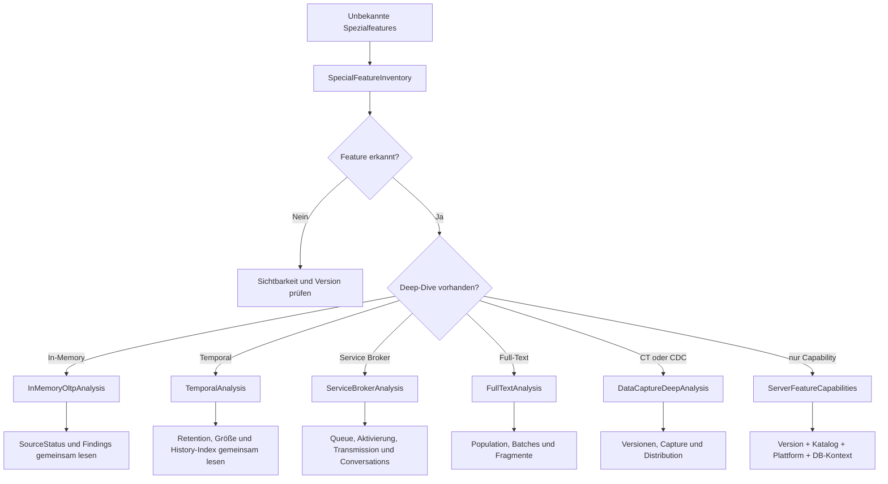

# Versionsadaptive und spezialisierte Analysepfade

**Procedures:** 10
**Evidenz:** Version, Plattform, sichtbare Kataloge, Spezialfeature-Metadaten und isolierte Runtime-DMVs  
**Kosten:** LOW bis HIGH_OPT_IN

## Grundregeln

- SQL-Server-Hauptversion allein beweist nicht, dass ein Feature auf Edition, Plattform, Build, CU, Compatibility Level oder in einer konkreten Datenbank verfügbar ist.
- Katalogobjekterkennung ist belastbarer als hart codierte Versionsannahmen, bleibt aber berechtigungsabhängig.
- `NOT_DETECTED_VISIBLE_SCOPE` bedeutet nur „im sichtbaren Metadatenscope nicht gefunden“.
- Feature-Inventar ist kein Healthcheck.
- In-Memory-, Temporal-, Service-Broker-, Full-Text- und Data-Capture-/Replikations-Findings verwenden konfigurierbare Framework-Heuristiken und führen keine DDL aus.

---

## 1. [monitor].[USP_ServerFeatureCapabilities]

### Zweck

Die Procedure ermittelt versions- und plattformabhängige Diagnosefähigkeiten auf Server- und Datenbankebene. Zusätzlich können Spezialindizes und Query-Store-Replica-Funktionen inventarisiert werden.

### Auswahlhinweis

`N''` und `NULL` schränken den Datenbankscope nicht ein. Ohne explizite Liste
oder Pattern werden alle sichtbaren Online-Benutzerdatenbanken verarbeitet;
Systemdatenbanken bleiben opt-in. Prüfen Sie bei produktiver Automatisierung den Status und
die Warnungen für explizit nicht verfügbare Datenbanken.

### Aufrufe

```sql
EXEC [monitor].[USP_ServerFeatureCapabilities]
      @DatabaseNames = N'[ExampleDatabase]',
      @ResultSetArt = 'RAW';
```

```sql
EXEC [monitor].[USP_ServerFeatureCapabilities]
      @DatabaseNames = NULL,
      @MitSpezialindizes = 1,
      @MitQueryStoreReplicas = 1,
      @MitPlattformdetails = 1,
      @ResultSetArt = 'RAW';
```

### Capabilities

| Spalte | Bedeutung |
|---|---|
| `ScopeName` | `SERVER` oder anderer Scope |
| `FeatureName` | stabiler Featurecode |
| `AvailabilityStatus` | `AVAILABLE`, `UNAVAILABLE_VERSION`, `UNAVAILABLE_PLATFORM` oder weitere Statuswerte |
| `LogicPath` | verwendete oder empfohlene Erkennungs-/Fallbacklogik |
| `MinimumKnownMajorVersion` | bekannte Mindesthauptversion |
| `SourceObject` | Katalog-/Metadatenquelle |
| `Detail` | fachliche Einordnung |
| `RequiredPermission` | benötigte Berechtigung |

### DatabaseFeatures

`DatabaseName`, `CompatibilityLevel`, `StateDesc`, `FeatureName`, `AvailabilityStatus`, `FeatureValue`, `LogicPath`, `Detail`.

Beispielhafte Features:

- `OPTIMIZED_LOCKING`
- `QUERY_STORE_READABLE_SECONDARY`
- `JSON_INDEX_METADATA`
- weitere im Build erkannte datenbankbezogene Fähigkeiten.

### SpecialIndexes

`DatabaseName`, `SchemaName`, `ObjectName`, `IndexName`, `IndexFamily`, `IndexDetails`, `AvailabilityStatus`.

Die genaue Indexgruppe ist versionsabhängig. Das Resultset ist ein Inventar, kein Performanceurteil.

Für `IndexFamily = JSON` enthält `IndexDetails` nur Array-Suchoption,
Pfadanzahl und Disabled-Status. Konkrete SQL/JSON-Pfade liefert der enger
gefilterte Pfad `USP_ObjectInventory`. Beide Wege prüfen
`sys.json_indexes` und `sys.json_index_paths` vor der Referenz und lesen keine
JSON-Dokumentwerte.

### Errors

`DatabaseName`, `ModuleName`, `ErrorNumber`, `ErrorMessage`.

### Serverfeatures im aktuellen Code

| Feature | Interpretation |
|---|---|
| `PERFORMANCE_STATE_PERMISSION` | ab SQL Server 2022 wird für viele Performance-DMVs `VIEW SERVER PERFORMANCE STATE` ausgewiesen, davor `VIEW SERVER STATE` |
| `ZSTD_BACKUP_COMPRESSION` | SQL Server 2025 unterstützt ZSTD als Backupkompressionsalgorithmus; CPU-/Durchsatzwirkung trotzdem testen |
| `RESOURCE_GOVERNOR_STANDARD_EDITION` | SQL Server 2025 erweitert Editionsverfügbarkeit; reale Katalog- und Editionsprüfung bleibt nötig |
| Linux Host Stats | Linux-spezifische DMVs werden nur bei Linux und vorhandenem Systemobjekt als verfügbar markiert |
| Optimized Locking | Datenbankeigenschaft; mit ADR, RCSI und Workload interpretieren |
| Query Store Readable Secondary | SQL Server 2025-/Plattformfunktion; Katalogsicht `sys.query_store_replicas` ist maßgeblich |


### Interpretation

- `AVAILABLE` heißt: Diagnosepfad/Katalog ist nach Erkennung verfügbar. Es heißt nicht, dass das Feature aktiviert, genutzt oder gesund ist.
- `UNAVAILABLE_VERSION` kann auch bedeuten, dass das erwartete Systemobjekt auf diesem Build nicht existiert.
- `UNAVAILABLE_FEATURE`, `UNAVAILABLE_SOURCE_SCHEMA` und
  `AVAILABLE_LIMITED` halten die buildabhängige SQL-Server-2025-Previewgrenze
  der JSON-Indexkataloge explizit.
- `FeatureValue` muss featurebezogen interpretiert werden; Textwerte sind nicht global vergleichbar.
- Optimized Locking kann Lockmemory und bestimmte Blockierungen reduzieren, beseitigt aber nicht jeden Lockkonflikt.
- Query Store für lesbare Secondaries schreibt Ausführungsinformationen zum primären Query Store zurück; Replica-Dimensionen müssen in Auswertungen berücksichtigt werden.
- ZSTD kann schnellere und bessere Kompression bieten, erhöht aber wie andere Kompression CPU-Verbrauch und muss gegen Concurrent Workload getestet werden.

### Folgeanalyse

- In-Memory gefunden → `USP_InMemoryOltpAnalysis`
- Temporal gefunden → `USP_TemporalAnalysis`
- Service Broker gefunden → `USP_ServiceBrokerAnalysis`
- Full-Text gefunden → `USP_FullTextAnalysis`
- Change Tracking oder CDC gefunden → `USP_DataCaptureDeepAnalysis`
- Wenn eine Query-Store-Replica verfügbar ist, berücksichtigen Sie in den Query-Store-Guides die Replica Group.
- Spezialindex → passende Objekt-/Plananalyse
- JSON-Indexmetadaten → `USP_ObjectInventory`; Präsenz und Pfadzahl sind kein Health- oder Rebuildbefund

### Parametervertrag und Beispiele

| Parameter | Datentyp | Default | Eingabeform und Wirkung |
|---|---|---|---|
| `@DatabaseNames` | `nvarchar(max)` | `NULL` | Ausgelassen = NULL. NULL, leer oder nur Leerzeichen: alle sichtbaren zulässigen Online-Datenbanken (Systemdatenbanken abhängig von @SystemdatenbankenEinbeziehen); sonst bracket-aware Pipe-Liste einteiliger SQL-Namen. Ein Pipe trennt nur außerhalb von [...]; ]] maskiert eine schließende Klammer, \| innerhalb [...] bleibt im Namen. Leere, ungültige, mehrteilige, zu lange oder doppelte Namen führen im Helfer zur Auswahlfehlermeldung. |
| `@SystemdatenbankenEinbeziehen` | `bit` | `0` | Ausgelassen = 0. 0 schließt master, tempdb, model und msdb aus; 1 lässt Systemdatenbanken im Kandidatenscope zu. NULL wird vom Kandidatenhelfer als INVALID_PARAMETER abgelehnt. T-SQL konvertiert numerisch 0 zu 0 und jeden Nichtnullwert zu 1. |
| `@DatabaseNamePattern` | `nvarchar(4000)` | `NULL` | Ausgelassen = NULL. NULL lässt den Patternfilter aus; andernfalls alternativ zu @DatabaseNames. Äußere Leerzeichen werden entfernt; Präfixe werden ohne Beachtung der Groß-/Kleinschreibung erkannt: like: (SQL-LIKE), regex: (case-sensitive Regex, Flag c), regexi: (case-insensitive Regex, Flag i); ohne Präfix gilt SQL-LIKE. LIKE nutzt %, _ und SQL-Zeichenklassen [...] mit SQL_Latin1_General_CP1_CS_AS. Nach Präfixentfernung bleibt der Patterninhalt unverändert; leeres Pattern ist ungültig. Regex benötigt SQL Server 2025 und Compatibility Level 170 der Installationsdatenbank; Syntax und Treffer werden erst bei Ausführung bewertet. |
| `@HighImpactConfirmed` | `bit` | `0` | Ausgelassen = 0. Der Wert wird an USP_PrepareDatabaseCandidates übergeben. Die tatsächlich aktivierte Klasse OBJECT_ANALYSIS_CURRENT hat RequiresGroupGate=0; weder 0 noch 1 schaltet hier ein High-Impact-Gruppengate oder verleiht Gruppenberechtigung. NULL wird auch ohne aktives Gate als INVALID_PARAMETER abgelehnt. Numerisch 0 wird bit 0, jeder Nichtnullwert bit 1. |
| `@MitSpezialindizes` | `bit` | `1` | Ausgelassen = 1. 1 erfasst die optionalen Vector-/JSON-Spezialindizes; 0 und NULL lassen diesen Zweig aus. T-SQL konvertiert numerisch 0 zu 0 und jeden Nichtnullwert zu 1. |
| `@MitQueryStoreReplicas` | `bit` | `1` | Ausgelassen = 1. 1 erfasst Query-Store-Replica-Metadaten; 0 und NULL lassen diesen Zweig aus. T-SQL konvertiert numerisch 0 zu 0 und jeden Nichtnullwert zu 1. |
| `@MitPlattformdetails` | `bit` | `1` | Ausgelassen = 1. 1 ergänzt Linux-Host-DMV-Capabilities; 0 und NULL lassen diesen Zweig aus. T-SQL konvertiert numerisch 0 zu 0 und jeden Nichtnullwert zu 1. |
| `@MaxZeilen` | `int` | `5000` | Ausgelassen = 5000. NULL oder 0 bedeutet unbegrenzt; ein positiver Wert begrenzt nach der Erhebung unabhängig je capabilities-, databaseFeatures- und specialIndexes-Export in deren dokumentierter Sortierung. Ein negativer Wert setzt INVALID_PARAMETER. Das Limit reduziert keine Katalogprobes und kürzt keine Warnungen. |
| `@ResultSetArt` | `varchar(16)` | `CONSOLE` | Ausgelassen = CONSOLE. Äußere Leerzeichen werden entfernt und der Wert wird großgeschrieben. Zulässig sind vollständig: CONSOLE (eine formatierte Ausgabe pro Resultset, einschließlich Leerhinweis), RAW (technische Resultsets), TABLE (nur capabilities in Zieltabellen) und NONE (keine fachlichen Resultsets). NULL, leer und jeder andere Wert sind INVALID_PARAMETER. |
| `@ResultTablesJson` | `nvarchar(max)` | `NULL` | Ausgelassen = NULL. Nur bei ResultSetArt=TABLE zulässig; das JSON-Objekt muss genau die registrierte Zuordnung capabilities auf eine vorhandene lokale #Temp-Tabelle enthalten. Nicht-TABLE mit nichtleerem Wert wirft Fehler 51011. TABLE-Preflight läuft vor Hilfe und Katalogprobes. Eine leere vorhandene lokale Tabelle mit einer beliebigen Dummyspalte wird vom Writer an das Quellschema angepasst; keine Seed-Zeile erforderlich. |
| `@JsonErzeugen` | `bit` | `0` | Ausgelassen = 0. 1 erzeugt JSON unabhängig von ResultSetArt; 0 und NULL erzeugen kein JSON. T-SQL konvertiert numerisch 0 zu 0 und jeden Nichtnullwert zu 1. |
| `@Json` | `nvarchar(max) OUTPUT` | `NULL` | Ausgelassen = NULL als OUTPUT-Parameter. Mit OUTPUT binden. Der Eingabewert wird beim Eintritt auf NULL gesetzt; bei @JsonErzeugen=1 enthält der Rückgabewert meta, capabilities, databaseFeatures, specialIndexes und warnings. Hilfe kehrt nach dem TABLE-Preflight ebenfalls mit NULL zurück. |
| `@PrintMeldungen` | `bit` | `1` | Ausgelassen = 1. 1 gibt bei einem Status ungleich AVAILABLE die normale Statuswarnung aus; 0 und NULL unterdrücken diese Meldung. Die Hilfe-PRINT-Ausgabe wird dadurch nicht unterdrückt. T-SQL konvertiert numerisch 0 zu 0 und jeden Nichtnullwert zu 1. |
| `@Hilfe` | `bit` | `0` | Ausgelassen = 0. Nur 1 druckt Hilfe und kehrt vor Auswahl, Katalogprobes und normaler Parameter-/Filtervalidierung zurück; 0 und NULL führen den normalen Ablauf aus. @Json wird davor auf NULL gesetzt. Der TABLE-Zielpreflight und die Ablehnung eines nichtleeren @ResultTablesJson außerhalb von TABLE liegen davor. T-SQL konvertiert numerisch 0 zu 0 und jeden Nichtnullwert zu 1. |

Bitparameter als 0/1 übergeben; T-SQL wandelt numerisch 0 zu 0 und jeden Nichtnullwert zu 1 um. Systemdatenbank- und High-Impact-NULL sind beim Helper-Aufruf ungültig. CONSOLE/RAW liefern Status und capabilities, databaseFeatures, specialIndexes sowie warnings. JSON enthält meta und diese Arrays. TABLE exportiert nur capabilities; NONE unterdrückt Resultsets.

```sql
EXEC [monitor].[USP_ServerFeatureCapabilities] @DatabaseNames=N'[ExampleDatabase]', @ResultSetArt='CONSOLE';
```

```sql
DECLARE @FeatureJson nvarchar(max);
EXEC [monitor].[USP_ServerFeatureCapabilities] @ResultSetArt='NONE', @JsonErzeugen=1, @Json=@FeatureJson OUTPUT;
```

Für TABLE muss das lokale Ziel vor dem Aufruf existieren. Das gemeinsame TABLE-Writer-Verfahren akzeptiert eine leere Einspalten-Dummy-Tabelle und passt sie an das Exportspaltenschema an; die leere Tabelle benötigt keine Seed-Zeile. Ein nichtleeres oder mehrspaltiges abweichendes Ziel ist nicht automatisch anpassbar.

```sql
CREATE TABLE #ServerFeatureCapabilities_HelpExample (Placeholder int NULL);
EXEC [monitor].[USP_ServerFeatureCapabilities] @ResultSetArt='TABLE', @ResultTablesJson=N'{"capabilities":"#ServerFeatureCapabilities_HelpExample"}';
```


### Kosten

LOW bis MEDIUM. Cross-Database-Katalogzugriffe und optionales Spezialindexinventar; keine Benutzerdatenscans.


---

## 2. [monitor].[USP_SpecialFeatureInventory]

### Zweck

Die Procedure erstellt eine aggregierte Nutzungsinventur sichtbarer Spezialfeatures mit begrenzter Quellarbeit. Sie liest keine externen Locations, Credentials, Broker-Payloads, CLR-Binaries, Moduldefinitionen oder Benutzerdaten.

### Erkannte Featuregruppen

- In-Memory OLTP
- System-versioned Temporal Tables
- Service Broker
- Full-Text
- Change Tracking
- Change Data Capture
- Verschlüsselung/Always Encrypted/TDE-Metadaten
- CLR
- External Tables/Data Sources
- External Languages/Libraries
- FILESTREAM/FileTable
- Graph
- Spatial
- XML
- native JSON-/Vector-Typen, soweit versionsseitig sichtbar
- benutzerdefinierte Typen

### Aufrufe

```sql
EXEC [monitor].[USP_SpecialFeatureInventory]
      @DatabaseNames = N'[ExampleDatabase]',
      @ResultSetArt = 'RAW';
```

```sql
EXEC [monitor].[USP_SpecialFeatureInventory]
      @DatabaseNames = NULL,
      @NurErkannteFeatures = 1,
      @ResultSetArt = 'RAW';
```

## Parameter und Aufrufbeispiele

| Parameter | Datentyp | Default | Eingabeform und Wirkung |
|---|---|---|---|
| `@DatabaseNames` | `nvarchar(max)` | `NULL` | Ausgelassen = NULL. NULL, leer oder Leerzeichen bedeutet alle sichtbaren Online-Benutzerdatenbanken, sofern @SystemdatenbankenEinbeziehen sie nicht erweitert; sonst bracket-aware Pipe-Liste einteiliger SQL-Namen. \| trennt nur außerhalb von [...]; ]] maskiert eine schließende Klammer und \| in [...] bleibt Bestandteil des Namens. Leere, ungültige, mehrteilige, überlange und doppelte Namen führen zur Auswahlfehlermeldung. |
| `@SystemdatenbankenEinbeziehen` | `bit` | `0` | Ausgelassen = 0. 0 schließt master, tempdb, model und msdb aus; 1 lässt sie zu. NULL ist INVALID_PARAMETER. T-SQL konvertiert numerisch 0 zu 0 und jeden Nichtnullwert zu 1. |
| `@DatabaseNamePattern` | `nvarchar(4000)` | `NULL` | Ausgelassen = NULL. NULL ohne Patternfilter; alternativ zur Namensliste. Äußere Leerzeichen werden entfernt, Präfixe case-insensitiv erkannt: like: (SQL-LIKE), regex: (case-sensitive Regex, Flag c), regexi: (case-insensitive Regex, Flag i); ohne Präfix gilt SQL-LIKE. LIKE verwendet %, _, Zeichenklassen [...] und SQL_Latin1_General_CP1_CS_AS. Der Inhalt wird nach Präfixentfernung nicht nochmals getrimmt; leerer Inhalt ist ungültig. Regex benötigt SQL Server 2025 und Compatibility Level 170 der Installationsdatenbank. |
| `@HighImpactConfirmed` | `bit` | `0` | Ausgelassen = 0. An USP_PrepareDatabaseCandidates übergeben. Diese Procedure übergibt @AnalysisClass=NULL, daher wird hier kein High-Impact-/Gruppengate aktiviert. NULL ist für den Helper trotzdem INVALID_PARAMETER; 1 gewährt keine Gruppenberechtigung. Numerisch 0 wird bit 0, jeder Nichtnullwert bit 1. |
| `@NurErkannteFeatures` | `bit` | `0` | Ausgelassen = 0. 1 behält ausschließlich DETECTED (sichtbarer Katalogmarker) und CONFIGURED_ONLY (Konfiguration ohne belegte Nutzung); 0 behält zusätzlich NOT_DETECTED_VISIBLE_SCOPE (kein sichtbarer Marker), UNAVAILABLE_VERSION (versionsbedingt nicht verfügbar) und SOURCE_UNAVAILABLE (Quellenfehler). NULL ist INVALID_PARAMETER. T-SQL konvertiert numerisch 0 zu 0 und jeden Nichtnullwert zu 1. |
| `@MaxZeilen` | `int` | `2000` | Ausgelassen = 2000. NULL oder 0 bedeutet unbegrenzt; positiv begrenzt nur den exportierten Featurebestand nach DatabaseName, FeatureCode. Negative Werte setzen INVALID_PARAMETER. Vollständige Inventur, Datenbankstatus und Zähler bleiben erhalten. |
| `@LockTimeoutMs` | `int` | `0` | Ausgelassen = 0 ms. Zulässig ist jeder ganzzahlige Wert von 0 bis 60000 einschließlich; NULL oder außerhalb des Bereichs setzt INVALID_PARAMETER. Der Wert gilt für die Katalogpfade; vor Ausgabe wird der zuvor geltende Session-Lock-Timeout wiederhergestellt. 0 bedeutet NOWAIT und ist kein Berechtigungsopt-in. |
| `@ResultSetArt` | `varchar(16)` | `CONSOLE` | Ausgelassen = CONSOLE. Äußere Leerzeichen werden entfernt, Wert großgeschrieben. Zulässige Werte vollständig: CONSOLE (formatierte Featureausgabe, bei leerem Scope Console-Leerzeile), RAW (Aufrufstatus, Datenbankstatus, Features), TABLE (nur features) und NONE (keine fachlichen Resultsets). NULL, leer oder anderer Wert sind INVALID_PARAMETER. |
| `@ResultTablesJson` | `nvarchar(max)` | `NULL` | Ausgelassen = NULL. Nur TABLE zulässig; JSON-Objekt mit genau der registrierten Zuordnung features auf eine eindeutige vorhandene, leere lokale #Temp-Tabelle. Nicht-TABLE mit nichtleerem Mapping wirft Fehler 51011. TABLE-Preflight erfolgt vor Hilfe und Inventur. Eine leere lokale Zieltabelle mit einer Dummyspalte genügt; der gemeinsame Writer passt sie dem Quellschema an, Seed-Zeile nicht nötig. |
| `@JsonErzeugen` | `bit` | `0` | Ausgelassen = 0. Nur 1 erzeugt JSON, unabhängig vom ResultSetArt; 0 erzeugt keines. NULL ist INVALID_PARAMETER. T-SQL konvertiert numerisch 0 zu 0 und jeden Nichtnullwert zu 1. |
| `@Json` | `nvarchar(max) OUTPUT` | `NULL` | Ausgelassen = NULL als OUTPUT-Parameter. Mit OUTPUT binden. Wird beim Eintritt auf NULL gesetzt; bei @JsonErzeugen=1 enthält das JSON-Objekt meta, databaseStatus und features. Bei Hilfe bleibt es NULL. |
| `@PrintMeldungen` | `bit` | `1` | Ausgelassen = 1. 1 gibt normale Meldungen aus, wenn Status nicht AVAILABLE oder NOT_APPLICABLE ist; 0 unterdrückt sie. NULL ist INVALID_PARAMETER. Help-PRINT bleibt unabhängig davon aktiv. T-SQL konvertiert numerisch 0 zu 0 und jeden Nichtnullwert zu 1. |
| `@Hilfe` | `bit` | `0` | Ausgelassen = 0. Nur 1 druckt Hilfe und kehrt vor der normalen Parameter-/Filtervalidierung zurück; 0 und NULL laufen in die normale Validierung. JSON wird zuvor auf NULL gesetzt. TABLE-Preflight und die Ablehnung eines nichtleeren @ResultTablesJson außerhalb von TABLE erfolgen vor diesem Return. T-SQL konvertiert numerisch 0 zu 0 und jeden Nichtnullwert zu 1. |
| `@StatusCodeOut` | `varchar(40) OUTPUT` | `NULL` | Ausgelassen = NULL als OUTPUT-Parameter; mit OUTPUT binden. Im normalen Abschluss liefert es den Aufrufstatus. Direkt gesetzte Modulwerte sind AVAILABLE, AVAILABLE_LIMITED, NOT_APPLICABLE und INVALID_PARAMETER; vom Kandidatenhelfer oder Quellenpfad übernommene tatsächliche Statuswerte bleiben möglich. Hilfe lässt den übergebenen Wert unverändert. |
| `@IsPartialOut` | `bit OUTPUT` | `NULL` | Ausgelassen = NULL als OUTPUT-Parameter; mit OUTPUT binden. Gibt im normalen Abschluss 0/1 für Vollständigkeit/Teilstatus zurück; Hilfe lässt den übergebenen Wert unverändert. |
| `@ErrorNumberOut` | `int OUTPUT` | `NULL` | Ausgelassen = NULL als OUTPUT-Parameter; mit OUTPUT binden. Enthält die tatsächlich erfasste Fehlernummer oder NULL; Hilfe lässt den übergebenen Wert unverändert. |
| `@ErrorMessageOut` | `nvarchar(2048) OUTPUT` | `NULL` | Ausgelassen = NULL als OUTPUT-Parameter; mit OUTPUT binden. Enthält den tatsächlich erfassten Fehlertext oder NULL; Hilfe lässt den übergebenen Wert unverändert. |

Bitparameter unterliegen der T-SQL-Zahlkonvertierung: 0 ergibt 0, jeder Nichtnullwert ergibt 1. Die NULL-Regeln sind parameterabhängig.

`DETECTED` = sichtbarer Katalogmarker; `CONFIGURED_ONLY` = Konfiguration ohne belegte Laufzeitnutzung; `NOT_DETECTED_VISIBLE_SCOPE` = kein Marker im sichtbaren Scope; `UNAVAILABLE_VERSION` = versionsbedingt nicht verfügbar; `SOURCE_UNAVAILABLE` = Quellenfehler/Evidenzlücke. `DetectedItemCount` summiert je Feature unterschiedliche Metadatenarten. 0 ist ein sichtbarer Nullwert; NULL bedeutet unbekannt/nicht verfügbar. Erst Aufruf- und Datenbankstatus, dann DetectionStatus und EvidenceLimit lesen.

CONSOLE gibt Status-/Datenbankstatus-/Featureinformationen und die formatierte Featureausgabe aus. RAW liefert Aufrufstatus, Datenbankstatus und technische Featurezeilen. TABLE exportiert nur `features`; NONE unterdrückt fachliche Resultsets. JSON wird unabhängig über `@JsonErzeugen` erzeugt.

JSON-Aufruf mit unabhängigem OUTPUT-Wert:

```sql
DECLARE @FeatureJson nvarchar(max);
EXEC [monitor].[USP_SpecialFeatureInventory]
      @DatabaseNames=N'[ExampleDatabase]',
      @ResultSetArt='NONE',
      @JsonErzeugen=1,
      @Json=@FeatureJson OUTPUT;
```

TABLE-Aufruf mit leerem Einspaltenziel; der Writer ersetzt die Dummy-Spalte durch das registrierte Schema:

```sql
CREATE TABLE #SpecialFeatureInventory_HelpExample (Placeholder int NULL);
EXEC [monitor].[USP_SpecialFeatureInventory]
      @DatabaseNames=N'[ExampleDatabase]',
      @ResultSetArt='TABLE',
      @ResultTablesJson=N'{"features":"#SpecialFeatureInventory_HelpExample"}';
```

`ExampleDatabase` ist synthetisch; die Zieltemp-Tabelle muss leer sein.


### DatabaseStatus

| Spalte | Bedeutung |
|---|---|
| `DatabaseName` | Scope |
| `StatusCode`, `IsPartial` | Auswertbarkeit |
| `FeatureRows` | erzeugte Featureinventarzeilen |
| `DetectedFeatureRows` | Zeilen mit erkannter Nutzung/Konfiguration |
| `ErrorNumber`, `ErrorMessage` | behandelter Fehler |
| `Detail` | Aussagegrenze |

### FeatureInventory

| Spalte | Bedeutung |
|---|---|
| `DatabaseName` | Datenbank |
| `FeatureCode` | stabiler technischer Code |
| `FeatureFamily` | lesbare Featuregruppe |
| `DetectionStatus` | etwa erkannt, nicht im sichtbaren Scope erkannt oder versionell nicht verfügbar |
| `DetectedItemCount` | aggregierte Anzahl von Metadatenobjekten/-signalen |
| `ConfigurationState` | Featurekonfiguration, sofern sinnvoll |
| `SourceObjects` | verwendete Systemkataloge |
| `RecommendedModule` | passendes Deep-Dive-Modul |
| `RecommendedModuleStatus` | verfügbar, nicht implementiert oder nicht anwendbar |
| `EvidenceLimit` | explizite Grenze |

### Interpretation

- Zähler verschiedener Features sind nicht untereinander vergleichbar. Bei Service Broker können Queue, Service und Enablement in eine Zahl einfließen; bei Temporal primär aktuelle Tabellen.
- `DetectedItemCount=0` kann fehlende Sichtbarkeit bedeuten.
- Konfiguriert, aber ohne Objekt ist ein anderer Zustand als aktiv genutzt.
- External Scripts enabled ohne externe Bibliothek kann Vorbereitungs- oder Altzustand sein.
- Database Encryption Flag, Always-Encrypted-Schlüsselmetadaten und verschlüsselte Spalten sind unterschiedliche Technologien, die in einer Featuregruppe zusammengefasst werden können.
- `@NurErkannteFeatures=1` verbessert die Lesbarkeit, entfernt aber die explizite Information über nicht erkennbare oder nicht verfügbare Featuregruppen.
- Sichtbare native Vector-Spalten verweisen auf `USP_VectorIndexAnalysis`; erst dieses Modul prüft vorhandene Vector-Indizes und ihre aktuelle Wartungsevidenz.
- Sichtbare native JSON-Spalten verweisen auf `USP_ObjectInventory`; dort
  werden capability-adaptiv JSON-Index- und Pfadmetadaten inventarisiert,
  ohne JSON-Dokumentwerte zu lesen oder eine automatische Healthaussage zu
  erzeugen.

### Plakative und grenzwertige Beispiele

| Befund | Bewertung |
|---|---|
| Temporal erkannt, 500 Tabellen | Deep-Dive und Retention-/Kapazitätsstrategie priorisieren |
| Broker enabled, keine benutzerdefinierten Queues | möglicherweise nur Konfiguration, nicht aktive Nutzung |
| CLR Assembly Count 1 | Sicherheits-/Supportreview, nicht automatisch Risiko |
| Native Vector `UNAVAILABLE_VERSION` | erwartbar vor unterstützter Version |
| 0 Full-Text-Objekte bei eingeschränkter Metadatensicht | keine belastbare Abwesenheitsaussage |

### Folgeanalyse

Verwenden Sie das angegebene `RecommendedModule`. Für `VECTOR` ist `USP_VectorIndexAnalysis` implementiert und versionsadaptiv. Für `JSON` ist der bestehende `USP_ObjectInventory`-Pfad implementiert; eine eigene JSON-Index-Procedure ist für den abgegrenzten Inventarumfang nicht erforderlich. Beide Inventare sind keine Indexgesundheitsbefunde. Wenn ein anderes Deep-Dive-Modul fehlt, müssen Quelle und Betriebsanforderung manuell geprüft werden.

### Kosten

LOW. Aggregierte Systemkatalogabfragen, kein Daten- oder Definitionsscan.

---

## 3. [monitor].[USP_InMemoryOltpAnalysis]

### Zweck

Die Procedure führt eine Best-Effort-Tiefenanalyse der sichtbaren In-Memory-OLTP-Konfiguration und der Runtimeevidenz zu Tabellen- und Indexmemory, Hashindizes, Memory Consumers, Checkpoint Files, aktiven Transaktionen und Resource Pools durch.

### Framework-Schwellen

| Parameter | Typ = Default | Zulässiger Bereich und tatsächlicher Vergleich |
|---|---|---|
| `@MinTableMemoryMb` | `decimal(19,2) = 1024 MB` | Ab 0; WARN wird nicht erzeugt. TableUsedMb + IndexUsedMb ab einschließlich Wert erzeugt den INFO-Kontext `LARGE_MEMORY_CONSUMER_CONTEXT`; bei 0 greift der Vergleich für verfügbare Summen ab 0; SQL NULL wird nicht zu 0 konvertiert und erzeugt keinen FindingCode über diesen Vergleich. |
| `@HashAvgChainWarn` | `decimal(19,4) = 10 Kettenglieder` | 1 bis 100000; WARN bei AverageChainLength strikt größer als Wert. |
| `@HashMaxChainWarn` | `bigint = 100 Kettenglieder` | Ab 1, ohne explizite Obergrenze; WARN bei MaxChainLength größer oder gleich Wert. |
| `@HashMinEmptyBucketPercent` | `decimal(9,4) = 10 %` | 0 bis 100; WARN bei EmptyBucketPercent strikt kleiner als Wert. Bei 0 kann dieser Vergleich keine Warnung auslösen. |
| `@WaitingCheckpointWarnMb` | `decimal(19,2) = 1024 MB` | Ab 0; WARN, wenn die aggregierte Dateigröße im Zustand WAITING FOR LOG TRUNCATION mindestens den Wert erreicht. Bei 0 wird jede passende verfügbare Zeile gewarnt. |
| `@ActiveTransactionWarnCount` | `int = 100 Transaktionen` | Ab 1, ohne explizite Obergrenze; WARN, wenn die aggregierte Anzahl ACTIVE-/VALIDATING-Transaktionen den Wert erreicht oder überschreitet. |
| `@PoolUsedWarnPercent` | `decimal(9,4) = 80 %` | 0 bis 100; WARN für benannte Pools bei Used/Target ab diesem Wert oder OutOfMemoryCount > 0. Bei 0 löst ein verfügbarer Quotient den Auslastungsvergleich aus. |

NULL oder ein Wert außerhalb des jeweiligen Bereichs ist `INVALID_PARAMETER`. Nullverhalten bei Schwellenwert 0 ist damit parameterabhängig; 0 ist kein allgemeines Abschaltzeichen. Die Prüfgrenzen sind keine Herstellerlimits, automatisch passende Bucket-/Memorywerte oder Kapazitätsempfehlungen.


### Filter, Limit und Ausgabe

Für die exakten Listen `@DatabaseNames`, `@SchemaNames`, `@ObjectNames` und `@FullObjectNames` gilt: Das Zeichen `\|` trennt nur außerhalb von `[...]`; in `[...]` bleibt `\|` im Namen, und `]]` maskiert ein inneres `]`.

`@DatabaseNames` (Default=NULL) akzeptiert einteilige Datenbanknamen in einer bracket-aware Pipe-Liste; `]]` maskiert `]`, äußere Elementleerzeichen werden entfernt. NULL/leer/Leerzeichen bedeutet keine Listenbegrenzung; Systemdatenbanken sind bei `@SystemdatenbankenEinbeziehen=0` ausgeschlossen und bei 1 zugelassen. `@DatabaseNamePattern` (Default=NULL; NULL = kein Patternfilter) akzeptiert unpräfigiert oder `like:` für case-sensitives SQL LIKE mit `%`, `_` und `[...]`, `regex:` für case-sensitive Regex und `regexi:` für case-insensitive Regex. Präfixe sind case-insensitive; leeres Pattern ungültig. Regex erfordert SQL Server 2025 und Compatibility Level 170 der Installationsdatenbank; Datenbankliste und Pattern sind exklusiv. Die exakten Schema-/Objektlisten und ihre eigenen Pattern sind jeweils exklusiv. `@FullObjectNames` (Default=NULL; NULL = kein Filter) verlangt immer ein Objekt und erlaubt die Formen Objekt, Schema.Objekt, Datenbank.Schema.Objekt; nur Qualifier dürfen fehlen. PARSENAME prüft Struktur, keine vollständige SQL-Bezeichnergrammatik. Namen werden case-sensitiv verglichen.

`@MitHashIndexStats` (bit; Default=0) lässt die Hashindex-DMV bei 0 aus und aktiviert sie bei 1; `sys.dm_db_xtp_hash_index_stats` kann vollständige Tabellen scannen, was `@MaxZeilen` nicht begrenzt. Dadurch wird `CATALOG_DEEP` aktiviert. `@HighImpactConfirmed` (bit; Default=0) bestätigt diese High-Impact-Nutzung, verleiht aber keine Gruppenautorisierung; ein erforderliches Gruppengate muss unabhängig autorisiert sein. `@NurProblematisch` (bit; Default=0) lässt bei 0 Findings und alle Detailzeilen zu, bei 1 nur WARN-Findings/-Details; TableMemory ist dann leer (nur INFO/NONE) und MemoryConsumer-Details ohne Severity entfallen. Status, Findingszähler und Quellenzeilen bleiben vollständig. `@MaxZeilen` (int; Default=2000) gilt separat je Findings-/Detailresultset; NULL/0 ist unbegrenzt, negativ ungültig. Es begrenzt weder Status-/Quellenzeilen noch vorgelagerte Quellenarbeit. `@LockTimeoutMs` (int; Default=0) darf 0 bis 60000 ms enthalten; 0 bedeutet NOWAIT, danach wird der Sitzungswert auf 0 zurückgesetzt.

`@ResultSetArt` (varchar(16); Default=CONSOLE) akzeptiert getrimmt und case-insensitive genau CONSOLE (formatiertes Findingsresultat), RAW (Meta, Status-/Quellenstatus und sieben fachliche Resultsets), TABLE (nur `findings` ins benannte Ziel) oder NONE (keine Resultsets). Für TABLE muss `@ResultTablesJson` (Default=NULL) ein JSON-Objekt mit genau dem Key `findings` und dem Stringnamen einer vorhandenen, leeren lokalen #Temp-Tabelle mit einer Seed-Spalte enthalten; keine ##- oder permanenten Tabellen. `@JsonErzeugen` (bit; Default=0) erzeugt JSON nur bei 1 und unabhängig vom Resultsetmodus; für dessen Empfang wird `@Json` optional als OUTPUT gebunden. Die JSON-Keys sind `meta`, `databaseStatus`, `sourceStatus`, `findings`, `tableMemory`, `hashIndexes`, `memoryConsumers`, `checkpointFiles`, `transactions` und `resourcePools`. `@Hilfe` (bit; Default=0) druckt bei 1 die Hilfe und kehrt nach dem TABLE-Preflight zurück; NULL folgt dem normalen Pfad.

Die [Procedure-Anleitung](Procedures/USP_InMemoryOltpAnalysis.md#parametervertrag) enthält für jeden der 30 Eingabe- und OUTPUT-Parameter einen eigenen Eintrag mit Typ, Default, zulässiger Datenform, Optionen, NULL-/Leersemantik, Bindung und Wirkung. Sie führt außerdem sichere Normal-, JSON- und TABLE-Beispiele auf.
### Statusresultsets

#### DatabaseStatus

`DatabaseName`, `StatusCode`, `IsPartial`, `MemoryOptimizedTableCount`, `MemoryOptimizedTableTypeCount`, `MemoryOptimizedFilegroupCount`, `SourceFailureCount`, `FindingCount`, `RequiredPermission`, `ErrorNumber`, `ErrorMessage`, `Detail`.

#### SourceStatus

`DatabaseName`, `SourceCode`, `StatusCode`, `IsPartial`, `RowCount`, `RequiredPermission`, `ErrorNumber`, `ErrorMessage`, `Detail`.

Jede Runtime-DMV wird separat behandelt. Ein partieller Hashindexstatus darf Table-Memory- oder Checkpointevidenz nicht entwerten.

### TableMemory

`DatabaseName`, `SchemaName`, `TableName`, `ObjectId`, `DurabilityDesc`, `TableAllocatedMb`, `TableUsedMb`, `IndexAllocatedMb`, `IndexUsedMb`, `TotalAllocatedMb`, `TotalUsedMb`, `UsedPercent`, `Severity`, `FindingCode`, `EvidenceLimit`.

### HashIndex

`DatabaseName`, `SchemaName`, `TableName`, `IndexName`, `ObjectId`, `IndexId`, `ConfiguredBucketCount`, `TotalBucketCount`, `EmptyBucketCount`, `EmptyBucketPercent`, `AverageChainLength`, `MaxChainLength`, `RuntimeStatsStatus`, `Severity`, `FindingCode`, `EvidenceLimit`.

`@MitHashIndexStats=1` ist HIGH_OPT_IN und benötigt `CATALOG_DEEP`, weil `sys.dm_db_xtp_hash_index_stats` laut Hersteller vollständige Tabellenarbeit verursachen kann.

### MemoryConsumer

`DatabaseName`, `MemoryConsumerType`, `MemoryConsumerDesc`, `ConsumerCount`, `AllocationCount`, `AllocatedMb`, `UsedMb`, `UsedPercent`, `EvidenceLimit`.

### Checkpoint

`DatabaseName`, `FileType`, `FileTypeDesc`, `State`, `StateDesc`, `FileCount`, `FileSizeMb`, `FileUsedMb`, `LogicalRowCount`, `Severity`, `FindingCode`, `EvidenceLimit`.

Checkpointfiles sind append-only Data- und Delta-Strukturen und durchlaufen mehrere legitime Zustände. `WAITING FOR LOG TRUNCATION` ist nicht automatisch ein Fehler; prüfen Sie Logtrunkierung, Merge- und Recoverybedarf sowie die Dauer.

### Transaction

`DatabaseName`, `TransactionState`, `TransactionStateDesc`, `ResultDesc`, `TransactionCount`, `Severity`, `FindingCode`, `EvidenceLimit`.

Es werden bewusst keine realen Transaktions-IDs ausgegeben.

### ResourcePool

`DatabaseName`, `ResourcePoolId`, `ResourcePoolName`, `IsDefaultOrUnbound`, `DatabasesUsingPool`, `MinMemoryPercent`, `MaxMemoryPercent`, `MaxMemoryMb`, `TargetMemoryMb`, `UsedMemoryMb`, `UsedPercentOfTarget`, `OutOfMemoryCount`, `Severity`, `FindingCode`, `EvidenceLimit`.

### Findings

`FindingOrdinal`, `DatabaseName`, `SchemaName`, `ObjectName`, `IndexName`, `Severity`, `Confidence`, `FindingCode`, `MetricName`, `MetricValue`, `ThresholdValue`, `Evidence`, `EvidenceLimit`, `RecommendedNextCheck`.

### Interpretation

| Konstellation | Bewertung |
|---|---|
| hohe TableMemory, stabiler Pool, keine OOMs | groß, aber nicht automatisch problematisch |
| durchschnittliche Chain 15, Max 20, workload hauptsächlich point lookup | Bucketreview sinnvoll |
| Max Chain 1000 durch einzelnen Extremwert, Avg 1.2 | Skew-/Schlüsseldistribution prüfen, nicht nur Maxwert |
| EmptyBucketPercent 1 % | Bucketzahl möglicherweise zu klein oder Verteilung ungleich |
| EmptyBucketPercent 99 % | stark überdimensioniert möglich; Memorykosten prüfen |
| viele Checkpointfiles WAITING FOR LOG TRUNCATION | Log-/Backup-/AG-Kontext prüfen |
| PoolUsed 90 %, keine Pressureflags | Watchlist, Verlauf und Growthplan |
| `OutOfMemoryCount>0` | historisch relevante Pressureevidenz; Reset-/Zeitkontext ergänzen |

### Aussagegrenzen

- Runtimewerte sind Momentaufnahmen oder kumulativ seit Restart/Objekterstellung.
- Hashchainqualität hängt von Schlüsselverteilung und Zugriffsmuster ab.
- Resource-Pool-Auslastung allein ist keine Max-Memory-Empfehlung.
- Checkpointfiles werden aggregiert; Dateipfade werden absichtlich nicht gelesen.
- Memory-optimized Table Types können Nutzung erzeugen, ohne dauerhafte Tabelle.

### Folgeanalyse

Query-/XTP-Indexnutzung, aktuelle Grants/Memory, Resource Governor, Log-/Backupstatus und Wiederholungsmessung.

---

## 4. [monitor].[USP_TemporalAnalysis]

### Zweck

Die Procedure analysiert sichtbare system-versioned Temporal Tables, Current-/History-Zuordnung, Periodenspalten, Retentionkonfiguration, approximative Größe/Zeilenzahl und die Indexreihenfolge der History-Tabelle.

Es werden keine aktuellen oder historischen Benutzertabellenzeilen gelesen.

### Framework-Schwellen

| Parameter | Default |
|---|---:|
| `@HistorySizeWarnMb` | 10.240 MB |
| `@HistoryRowsWarn` | 10.000.000 |
| `@HistoryToCurrentRatioWarn` | 10 |
| `@MinHistoryMbForRatioWarn` | 100 MB |

### Statusresultsets

#### DatabaseStatus

`DatabaseName`, `StatusCode`, `IsPartial`, `TemporalTableCount`, `HistoryTableCount`, `SourceFailureCount`, `FindingCount`, `RequiredPermission`, `ErrorNumber`, `ErrorMessage`, `Detail`.

#### SourceStatus

`DatabaseName`, `SourceCode`, `StatusCode`, `IsPartial`, `RowCount`, `RequiredPermission`, `ErrorNumber`, `ErrorMessage`, `Detail`.

### TemporalTable

| Gruppe | Spalten |
|---|---|
| Current | `DatabaseName`, `CurrentSchemaName`, `CurrentTableName`, `CurrentObjectId`, `CurrentIsMemoryOptimized`, `CurrentDurabilityDesc` |
| History | `HistorySchemaName`, `HistoryTableName`, `HistoryObjectId` |
| Period | `PeriodStartColumnName`, `PeriodEndColumnName`, `PeriodStartIsHidden`, `PeriodEndIsHidden` |
| Retention | `DatabaseRetentionEnabled`, `HistoryRetentionPeriod`, `HistoryRetentionUnitDesc`, `RetentionMode` |
| Kapazität | `CurrentRowsApprox`, `HistoryRowsApprox`, `CurrentReservedMb`, `CurrentUsedMb`, `HistoryReservedMb`, `HistoryUsedMb`, `HistoryToCurrentRowRatio` |
| Index | `HistoryIndexCount`, `HasPeriodLeadingHistoryIndex` |
| Bewertung | `AssessmentStatus`, `EvidenceLimit` |

### HistoryIndex

`DatabaseName`, Current-/History-Scope, `IndexName`, `IndexId`, `IndexTypeDesc`, `IsUnique`, `IsDisabled`, `FirstKeyColumnName`, `SecondKeyColumnName`, `IsPeriodLeadingIndex`, `EvidenceLimit`.

Ein Period-leading History-Index wird anhand der erwarteten Reihenfolge **Period End, Period Start** bewertet. Andere Zugriffsmuster können zusätzliche Indizes benötigen.

### Findings

`FindingOrdinal`, Current-/History-Scope, `Severity`, `Confidence`, `FindingCode`, `MetricName`, `MetricValue`, `ThresholdValue`, `Evidence`, `EvidenceLimit`, `RecommendedNextCheck`.

RAW, CONSOLE, TABLE und JSON verwenden dieselbe Findingsauswahl. `@NurProblematisch=1` erhält WARN-Findings; ein positives `@MaxZeilen` begrenzt die nach Severity und FindingOrdinal geordnete Auswahl, während `NULL` und `0` sie vollständig ausgeben. Die zwölf TABLE-Textspalten besitzen explizite Frameworkcollation. Statusarrays, Inventurzähler und der vor der Ausgabebegrenzung berechnete `FindingCount` bleiben erhalten, ebenso Status und Partialität nicht auswertbarer expliziter Datenbanken.

### Interpretation

| Konstellation | Bewertung |
|---|---|
| History 20× Current, aber nur 50 MB | Ratio über Schwelle, durch Mindestgröße eventuell absichtlich nicht gewarnt |
| History 2 TB, Ratio 2 | absolute Kapazität relevant trotz moderatem Verhältnis |
| Retention OFF und update-/delete-intensive Tabelle | unbegrenztes Wachstum möglich; fachliche Aufbewahrung klären |
| Retention ON | beweist keinen erfolgreichen Cleanup |
| kein Period-leading Index | Temporal-Abfragen/Cleanup können leiden; bestehende alternative Indizes und Workload prüfen |
| HistoryIndex disabled | klarer Reviewfall |
| Hidden Period Columns | normal und oft erwünscht |
| Current memory-optimized | spezielle Kombination; Feature-/Versiongrenzen beachten |

### Aussagegrenzen

- Größen/Zeilen stammen approximativ aus Partitionsstatistiken.
- Kein Datenscan: Periodenüberlappungen, ungültige Fachzeiten oder Cleanupfortschritt werden nicht bewiesen.
- Nach `SYSTEM_VERSIONING=OFF` kann die frühere Paarbeziehung verloren sein und wird nicht zuverlässig rekonstruiert.
- Retention Policy muss fachliche und rechtliche Anforderungen erfüllen; Größe allein bestimmt sie nicht.
- Eine große History-Tabelle kann sowohl Storagekosten als auch Temporal-Querykosten erhöhen.

### Folgeanalyse

Kapazität, Index Usage/Physical Stats, Query Store für Temporal Queries, Partitionierungs-/Retentionstrategie und Cleanupmonitoring.

---

## 5. [monitor].[USP_ServiceBrokerAnalysis]

### Zweck

Die Procedure analysiert sichtbare Service-Broker-Konfiguration und gruppierte Betriebsevidenz zu Queues, interner Aktivierung, Transmission Queue und Conversation Endpoints. Queue-Nutzdaten, Nachrichtenkörper und Conversation-Handles werden nicht gelesen.

### Framework-Schwellen

| Parameter | Default | Bedeutung |
|---|---:|---|
| `@TransmissionAgeWarnMinutes` | 60 | Alter des ältesten gruppierten Transmission-Eintrags |
| `@TransmissionRowsWarn` | 1.000 | gruppierte Nachrichtenanzahl als Reviewkontext |
| `@QueueRowsWarn` | 10.000 | approximative Queue-Zeilen als Kapazitätskontext |
| `@ActivationSilenceWarnMinutes` | 60 | Zeit seit letzter Aktivierung bei sichtbarem Rückstand |
| `@ConversationRowsWarn` | 100.000 | sichtbare Conversation Endpoints als Wachstumskontext |

Die Schwellen priorisieren eine manuelle Prüfung. Sie beweisen weder Zustellfehler noch fehlerhafte Kapazität oder eine Poison Message.

### Statusresultsets

#### DatabaseStatus

`DatabaseName`, `StatusCode`, `IsPartial`, `IsBrokerEnabled`, `UserQueueCount`, `UserServiceCount`, `TransmissionMessageCount`, `ConversationEndpointCount`, `SourceFailureCount`, `FindingCount`, `RequiredPermission`, `ErrorNumber`, `ErrorMessage`, `Detail`.

#### SourceStatus

`DatabaseName`, `SourceCode`, `StatusCode`, `IsPartial`, `RowCount`, `RequiredPermission`, `ErrorNumber`, `ErrorMessage`, `Detail`.

Feature-Gate, Queue-Katalog, Kapazität, Queue-Monitor, aktivierte Tasks, Transmission und Conversations werden isoliert bewertet. Eine fehlende DMV-Berechtigung entwertet zugängliche Kataloge nicht.

### Queues

`DatabaseName`, Queue-Scope, Serviceanzahl, Broker-/Queue-Schalter, Aktivierungsprozedur, Ausführungskontext, approximative Zeilen-/Seitenevidenz, Monitorzustand, Aktivierungszeitpunkte, wartende Receiver, aktive Tasks, `AssessmentStatus`, `EvidenceLimit`.

`QueueRowsApprox` stammt aus Partitionsstatistiken. Der Wert enthält keine Aussage zu Alter, Durchsatz, Priorität oder fachlich zulässigem Rückstand.

### TransmissionGroups

Gruppiert werden nicht-payloadhaltige Service-, Ziel-, Contract-, Message-Type-, Status-, Mengen- und Zeiteigenschaften. Eine Zeile in `sys.transmission_queue` ist nicht automatisch ein Fehler: Zustellung, Bestätigung und Retention können Einträge vorübergehend erhalten.

### ConversationStates

Conversation Endpoints werden nach Zustand, Initiator-/Systemflag und Lifetime aggregiert. Handles, Gruppen-IDs, Schlüsselkennungen und Nachrichteninhalt bleiben ausgeschlossen.

### Findings

Wichtige Reviewcodes sind deaktivierte Queue-Schalter, Aktivierungsstillstand bei sichtbarem Rückstand, Transmission-Status oder -Alter, Conversation-Errorzustand, abgelaufene Lifetime und isolierte Evidenzlücken.

JSON, RAW, CONSOLE und TABLE verwenden denselben Findingsausschnitt mit `WARN` vor `INFO` und anschließendem `FindingOrdinal`. `@NurProblematisch = 1` gibt ausschließlich `WARN` aus; `@MaxZeilen` begrenzt positive Mengen, während `0` und `NULL` unbegrenzt sind. Die vollständigen Datenbank- und Quellenzähler bleiben vor der Ausgabeauswahl erhalten. TABLE enthält die bestehenden 13 Findingsspalten mit zehn explizit collatierten Textspalten. Auswahlwarnings werden durch die spätere Quellenaggregation nicht überschrieben.

### Interpretation

| Konstellation | Bewertung |
|---|---|
| `is_receive_enabled=0` | kann nach wiederholten Rollbacks automatisch oder manuell entstehen; Ursache separat belegen |
| Queue-Zeilen hoch, Monitor `RECEIVES_OCCURRING` | Rückstand vorhanden, aber Verarbeitung sichtbar; Trend und Durchsatz prüfen |
| Queue-Zeilen hoch, keine aktiven Tasks | nur bei vollständiger Monitor-/Taskevidenz ein belastbarer Aktivierungs-Reviewfall |
| Transmission-Status gefüllt | konkrete Transport-/Routingevidenz; Ziel, Route, Endpunkt, Zertifikate und Fehlerlog korrelieren |
| Transmission ohne Status | nicht automatisch gesund oder fehlerhaft; Alter und Verlauf ergänzen |
| viele Endpoints | kann legitime langlebige Dialoge oder unvollständigen Dialogabschluss bedeuten |
| Retention aktiviert | erklärt erhaltene Queue-Zeilen und ist kein Fehlerbefund |

### Aussagegrenzen

- Queue-Monitor und aktivierte Tasks sind Momentaufnahmen.
- Eingeschränkte Metadatensichtbarkeit kann einen scheinbaren Leerzustand erzeugen.
- Ein deaktiviertes RECEIVE beweist keine Poison Message.
- Das Modul liest keine Queue-Nutzdaten und führt kein `RECEIVE`, `ALTER QUEUE` oder `END CONVERSATION` aus.
- Kapazitäts-, Routing- und Bereinigungsmaßnahmen benötigen Zeitverlauf, Anwendungs- und Betriebskontext.

### Folgeanalyse

Korrelieren Sie das SQL-Fehlerlog beziehungsweise freigegebene Extended Events mit Routing- und Endpunktkonfiguration, Zertifikaten, Readerdurchsatz, Anwendungstransaktionen und wiederholten Messungen. Exportieren und übermitteln Sie Laufzeitevidenz mit realen Namen oder Inhalten nur kontrolliert.

---

## 6. [monitor].[USP_FullTextAnalysis]

### Zweck

Die Procedure analysiert sichtbare Full-Text-Kataloge und -Indizes sowie aktuelle Populationen, ausstehende Batches, querybare Fragmente, semantische Ähnlichkeitspopulationen und serverweiten Gatherer-/FDHost-Kontext. Tabelleninhalte, Keywords, Stopwords, Parser-Eingaben, Schlüsselwerte, Crawl-Logs und Pfade bleiben ausgeschlossen.

### Framework-Schwellen

| Parameter | Default | Bedeutung |
|---|---:|---|
| `@PopulationAgeWarnMinutes` | 60 | Alter einer aktuell sichtbaren normalen oder semantischen Population |
| `@QueryableFragmentWarn` | 30 | Zahl querybarer Fragmente mit Status 4 oder 6 |
| `@OutstandingBatchWarn` | 100 | aktuell ausstehende Batches pro Tabelle |
| `@FailedDocumentWarn` | 1 | aggregierte aktuell gemeldete Dokumentfehler |
| `@CatalogSizeWarnMb` | 10.240 MB | aggregierte logische Größe querybarer Fragmente |

Alle fünf Werte sind Priorisierungs- oder Kapazitätsheuristiken. Microsoft dokumentiert keinen universellen Fragment-, Batch-, Laufzeit- oder Speichergrenzwert.

### Statusresultsets

#### DatabaseStatus

`DatabaseName`, `StatusCode`, `IsPartial`, `IsFullTextInstalled`, `CatalogCount`, `FullTextIndexCount`, `ActivePopulationCount`, `OutstandingBatchCount`, `FindingCount`, `SourceFailureCount`, `RequiredPermission`, `ErrorNumber`, `ErrorMessage`, `Detail`.

#### SourceStatus

Feature-Gate, Katalog-/Indexmapping, Fragmente, normale Population, Batches und semantische Population werden je Datenbank isoliert. Memory Pools und FDHosts werden einmal serverweit gelesen. SQL Server 2019 benötigt für die Laufzeit-DMVs `VIEW SERVER STATE`, SQL Server 2022 oder neuer `VIEW SERVER PERFORMANCE STATE`.

Auswahlwarnings für nicht auswertbare angeforderte Datenbanken bleiben in `DatabaseStatus` erhalten und bestimmen die Modulpartialität mit. Findings- und Quellenzähler werden vor Ausgabegrenzen gebildet. RAW, CONSOLE, TABLE und JSON verwenden dieselbe Findings-Auswahl: `@NurProblematisch = 1` erhält Warnungen, ein positives `@MaxZeilen` begrenzt nach Warnpriorität und `FindingOrdinal`, `NULL` oder `0` bedeutet unbegrenzt. Negative Limits sind ungültig. Der Export `findings` behält 13 Felder und collatiert alle zehn Textspalten explizit mit `SQL_Latin1_General_CP1_CS_AS`.

### Kataloge und FullTextIndexes

Kataloge liefern Namen, Default-/Accent-Sensitivity-Kontext, sichtbare Indexanzahl sowie aggregierte Fragmentgröße. Indizes liefern Tabelle, Katalog, Enablement, Status des eindeutigen Schlüsselindex, Change-Tracking- und Crawl-Kontext, Spalten-/Semantikanzahl sowie zugeordnete Fragment-, Population- und Batchzahlen.

Der Katalogname und Tabellen-Scope sind normale Runtime-Diagnosewerte. Sie werden nicht in gespeicherte Testevidenz übernommen. Katalogpfade und Schlüsselwerte werden weder gelesen noch ausgegeben.

### Populationen, Batches und Semantik

- `sys.dm_fts_index_population` enthält nur aktuell laufende Full-Text- und semantische Extraktionen. Nullzeilen sind keine Historie und kein Abschlussnachweis.
- Status 7 kann während eines automatischen Merge auftreten; Status 11 meldet eine abgebrochene Population.
- `sys.dm_fts_outstanding_batches` wird ohne Batch-ID, Speicheradressen oder Inhalte nach Tabelle, Fehlercode und Retryzustand aggregiert.
- Dokumentfehler werden nur als Anzahl gelesen. Einzelne Fehler können Inhalte von der Suche ausschließen, ohne die gesamte Population zu stoppen.
- Die semantische Ähnlichkeitspopulation ist die zweite Phase nach der Extraktion und wird nur bei sichtbaren `STATISTICAL_SEMANTICS`-Spalten abgefragt.

### Fragmente, Memory Pools und FDHosts

Nur querybare Fragmente mit Status 4 oder 6 fließen in Fragmentanzahl, logische Größe und Zeilenzahl ein. Viele Fragmente können Full-Text-Abfragen verlangsamen; ein `REORGANIZE` wird jedoch nie automatisch ausgeführt.

Memory Pools sind serverweit gemeinsam genutzter Gatherer-Kontext. FDHosts werden ausschließlich nach Typ aggregiert; Prozess-IDs und Hostnamen bleiben ausgeschlossen. Eine nicht atomare Abweichung zwischen Population- und FDHost-Momentaufnahme besitzt nur geringe Konfidenz.

### Interpretation

| Konstellation | Bewertung |
|---|---|
| Change Tracking `MANUAL` oder `OFF` | zulässige Konfiguration; erwartete Populationsteuerung prüfen |
| `has_crawl_completed=0`, keine aktive Population | kann durch `NO POPULATION` beabsichtigt sein; kein Fehlerbeweis |
| lange Population, Fortschritt steigt | Kapazitäts-/Durchsatzkontext, nicht Stillstand |
| Status 11 | belastbare aktuelle Abbruchmeldung; Ursache in geschützter Laufzeitumgebung prüfen |
| Retry oder `hr_batch<>0` | aktueller Batchreview; Fehlercode und Zeitverlauf korrelieren |
| viele querybare Fragmente | Suchlatenz und Trend prüfen, erst danach Wartung planen |
| Memory Pool groß | gemeinsamer Ressourcenverbrauch, kein datenbankspezifischer Druckbefund |

### Aussagegrenzen

- Katalogmetadaten beweisen keine Vollständigkeit indizierter Inhalte.
- Crawl-Logs liegen außerhalb des Frameworkscopes und dürfen nur in einer kontrollierten Laufzeitumgebung mit geeignetem Zugriff ausgewertet werden.
- Eine leere Laufzeit-DMV ist keine Historie.
- Alter, Batchzahl und Fragmentzahl sind ohne Zeitreihe und Workload kein Ursachenbeweis.
- Das Modul führt kein `ALTER FULLTEXT`, keine Population und keine Reorganisation aus.

Der gemischte Collation-Vertrag `158` erzeugt ausschließlich eine eigene leere Quelldatenbank. Er prüft den negativen Feature-Scope, Exportcollation, Auswahlwarnings und Parameter bei getrennt bestätigten Framework-/Source-Compatibility-Levels. Nichtleere Findingsfilter, positive Limitwirkung und gegatete Full-Text-Quellen benötigen weiterhin einen separaten Feature-Positivnachweis.

### Folgeanalyse

Korrelieren Sie bei einer Folgemessung Fortschritt und Batches, Suchlatenz, I/O- und Logkontext sowie geschützte Full-Text- und Crawl-Logs in der Laufzeitumgebung. Dokumentieren Sie ausschließlich abstrahierte, synthetische Testergebnisse.

---

## 7. [monitor].[USP_DataCaptureDeepAnalysis]

### Zweck

Die Procedure vertieft Change Tracking, CDC und lokal erreichbare Replikation. Sie liest ausschließlich Katalog-, DMV-, Job- und aggregierte Distributionsevidenz. Change-Zeilen, Replikationsbefehle, Kommentare, Fehlertexte, LSNs, Credentials oder Agentjob-Commands werden nicht gelesen; die Konfiguration bleibt unverändert.

### Framework-Schwellen

| Parameter | Default | Bedeutung |
|---|---:|---|
| `@ChangeTrackingClientVersion` | `NULL` | echter zuletzt bestätigter Consumer-Wasserstand für genau eine ausgewählte Datenbank; ohne ihn kein Verlusturteil |
| `@CdcLatencyWarnSeconds` | 300 | aggregierte CDC-Scan-Latenz |
| `@CdcCleanupGraceMinutes` | 60 | Toleranz zusätzlich zur Cleanup-Retention |
| `@ErrorLookbackHours` | 24 | CDC- und lokale Replikationsfehler |
| `@ReplicationLatencyWarnSeconds` | 300 | Delivery-Latenz aus lokaler Agenthistorie |
| `@ReplicationPendingCommandWarn` | 10.000 | undistributed commands am lokalen Distributor |
| `@ReplicationAgentStaleWarnMinutes` | 15 | alte Distribution-History nur zusammen mit sichtbarem Rückstand |

Alle Zeit-, Latenz- und Mengenwerte außer dem CT-Minimumvergleich sind Priorisierungsheuristiken. Ein Wasserstand unter `CHANGE_TRACKING_MIN_VALID_VERSION` bedeutet für diesen Consumer und diese Tabelle, dass eine gültige inkrementelle Enumeration nicht mehr möglich ist.

### Resultsets

`DatabaseStatus` und `SourceStatus` zeigen zuerst Anwendbarkeit und Evidenzlücken. Danach folgen `Findings`, Change-Tracking-Tabellen, CDC-Capture-Instanzen, CDC-Scan-Sitzungen, aggregierte CDC-Fehler, CDC-Jobs, lokal sichtbare Replikationsagenten und aggregierte Replikationsfehler.

Schema- und Objektfilter gelten nur für CT-/CDC-Quelltabellen. Das Feature-Gate bleibt unfiltriert. Replikationsrollen und Agenten besitzen keinen zuverlässigen gemeinsamen Schema-/Tabellenschlüssel und werden deshalb nur über den Datenbankscope begrenzt.

RAW, CONSOLE, TABLE und JSON verwenden innerhalb eines Aufrufs dieselbe gefilterte und begrenzte Findings-Exportmenge mit 13 Feldern. `@NurProblematisch = 1` wählt WARN-Findings; `@MaxZeilen` begrenzt danach nach Warnpriorität und `FindingOrdinal`. NULL und 0 bedeuten unbegrenzt, negative Werte sind ungültig. Die zehn Textfelder sind explizit mit `SQL_Latin1_General_CP1_CS_AS` collatiert. `FindingCount` bleibt der Zähler vor Ausgabefilter und Limit; `CtTableCount` bleibt der native Zähler des unfiltrierten Feature-Gates. Auswahlwarnings und vor der Quellenlesung gesetzte ungültige Datenbankstatus bleiben bei der abschließenden Aggregation erhalten.

### Change Tracking

- `MinValidVersion` ist tabellenspezifisch.
- `@ChangeTrackingClientVersion < MinValidVersion` erzeugt den hochkonfidenten Reinitialisierungsbefund.
- Ein Wasserstand über `CHANGE_TRACKING_CURRENT_VERSION()` ist inkonsistent.
- Ohne Consumer-Wasserstand wird ausdrücklich nur `CT_CLIENT_WATERMARK_NOT_SUPPLIED` ausgegeben.
- Deaktiviertes Auto-Cleanup ist Konfigurationskontext und nicht automatisch ein Fehler.

### CDC

Capture-Instanzen liefern Konfiguration, Drop-Pending und die Zeitgrenze der ältesten verfügbaren LSN. Die Scan-DMV liefert Aggregat und neueste Sitzung; sie wird bei Neustart oder Failover zurückgesetzt und ist auf einer AG-Sekundärreplik leer. CDC-Fehler werden ohne Meldungstext oder LSN nach Nummer, Schweregrad und Phase gruppiert.

Bei kontinuierlichem Capture ist hohe Latenz ein Warnhinweis. Bei zeitgesteuertem Capture wird derselbe Wert als Kontext mit niedrigerer Konfidenz ausgegeben. Das Überschreiten von Retention plus Toleranz ist wegen ruhiger Workloads und Cleanup-Timing nur eine Heuristik.

### Replikation

Lokale Distribution Agents werden mit `MSdistribution_status`, neuester History und Subscription-Status aggregiert. Log Reader und Merge Agent werden getrennt behandelt. `Idle` ohne Rückstand ist kein Fehler. Inaktive Subscriptions oder Fail/Retry sind Reinitialisierungskandidaten, aber kein alleiniger Reinitialisierungsbeweis.

Wenn eine Datenbank eine Replikationsrolle besitzt, aber keine lokale Distribution erreichbar ist, wird `REPLICATION_TOPOLOGY_NOT_LOCALLY_OBSERVABLE` ausgegeben. Remote-Distributor-, Netzwerk- und Subscriber-Zustände werden nicht erraten.

### Aussagegrenzen und Folgeanalyse

- CDC- und Replikationshistorien sind begrenzt und bereinigbar.
- Die Quellen werden nicht atomar gelesen; Zustände können sich zwischen Abfragen ändern.
- Peer-to-Peer-, Pull- und Remote-Topologien können außerhalb der lokalen Sicht liegen.
- Konkrete Fehlertexte, Commands, Zeilenkonflikte und Laufzeitnamen bleiben ausschließlich in der kontrollierten Laufzeitdiagnose.

Korrelieren Sie wiederholte Messungen, den Consumer-spezifischen CT-Wasserstand, den Agentjobausgang, die Netzwerk- und Subscriber-Erreichbarkeit sowie geschützte Laufzeitlogs. Persistieren Sie ausschließlich synthetische Testzustände.

## Anfänger-Entscheidungsbaum



## Quellen

- [What's new in SQL Server 2025](https://learn.microsoft.com/sql/sql-server/what-s-new-in-sql-server-2025)
- [Editions and supported features of SQL Server 2025](https://learn.microsoft.com/sql/sql-server/editions-and-components-of-sql-server-2025)
- [Optimized locking](https://learn.microsoft.com/sql/relational-databases/performance/optimized-locking)
- [Query Store for readable secondary replicas](https://learn.microsoft.com/sql/relational-databases/performance/query-store-for-secondary-replicas)
- [sys.query_store_replicas](https://learn.microsoft.com/en-us/sql/relational-databases/system-catalog-views/sys-query-store-replicas?view=sql-server-ver17)
- [Backup compression and ZSTD](https://learn.microsoft.com/sql/relational-databases/backup-restore/backup-compression-sql-server)
- [In-Memory OLTP overview](https://learn.microsoft.com/sql/relational-databases/in-memory-oltp/overview-and-usage-scenarios)
- [sys.dm_db_xtp_hash_index_stats](https://learn.microsoft.com/sql/relational-databases/system-dynamic-management-views/sys-dm-db-xtp-hash-index-stats-transact-sql)
- [sys.dm_db_xtp_checkpoint_files](https://learn.microsoft.com/sql/relational-databases/system-dynamic-management-views/sys-dm-db-xtp-checkpoint-files-transact-sql)
- [Temporal tables](https://learn.microsoft.com/sql/relational-databases/tables/temporal-tables)
- [Manage temporal history retention](https://learn.microsoft.com/sql/relational-databases/tables/manage-retention-of-historical-data-in-system-versioned-temporal-tables)
- [Temporal table considerations and limitations](https://learn.microsoft.com/sql/relational-databases/tables/temporal-table-considerations-and-limitations)
- [sys.service_queues](https://learn.microsoft.com/sql/relational-databases/system-catalog-views/sys-service-queues-transact-sql)
- [sys.transmission_queue](https://learn.microsoft.com/sql/relational-databases/system-catalog-views/sys-transmission-queue-transact-sql)
- [sys.dm_broker_queue_monitors](https://learn.microsoft.com/sql/relational-databases/system-dynamic-management-objects/sys-dm-broker-queue-monitors-transact-sql)
- [sys.dm_broker_activated_tasks](https://learn.microsoft.com/sql/relational-databases/system-dynamic-management-objects/sys-dm-broker-activated-tasks-transact-sql)
- [sys.conversation_endpoints](https://learn.microsoft.com/sql/relational-databases/system-catalog-views/sys-conversation-endpoints-transact-sql)
- [Work with Change Tracking](https://learn.microsoft.com/sql/relational-databases/track-changes/work-with-change-tracking-sql-server)
- [sys.change_tracking_tables](https://learn.microsoft.com/sql/relational-databases/system-catalog-views/change-tracking-catalog-views-sys-change-tracking-tables)
- [sys.dm_cdc_log_scan_sessions](https://learn.microsoft.com/sql/relational-databases/system-dynamic-management-objects/change-data-capture-sys-dm-cdc-log-scan-sessions)
- [sys.dm_cdc_errors](https://learn.microsoft.com/sql/relational-databases/system-dynamic-management-objects/change-data-capture-sys-dm-cdc-errors)
- [MSdistribution_status](https://learn.microsoft.com/sql/relational-databases/system-views/msdistribution-status-transact-sql)
- [MSdistribution_history](https://learn.microsoft.com/sql/relational-databases/system-tables/msdistribution-history-transact-sql)
- [MSmerge_sessions](https://learn.microsoft.com/sql/relational-databases/system-tables/msmerge-sessions-transact-sql)
- [sys.fulltext_indexes](https://learn.microsoft.com/sql/relational-databases/system-catalog-views/sys-fulltext-indexes-transact-sql)
- [sys.fulltext_index_fragments](https://learn.microsoft.com/sql/relational-databases/system-catalog-views/sys-fulltext-index-fragments-transact-sql)
- [sys.dm_fts_index_population](https://learn.microsoft.com/sql/relational-databases/system-dynamic-management-objects/sys-dm-fts-index-population-transact-sql)
- [sys.dm_fts_outstanding_batches](https://learn.microsoft.com/sql/relational-databases/system-dynamic-management-objects/sys-dm-fts-outstanding-batches-transact-sql)
- [sys.dm_fts_semantic_similarity_population](https://learn.microsoft.com/sql/relational-databases/system-dynamic-management-objects/sys-dm-fts-semantic-similarity-population-transact-sql)
- [sys.dm_fts_memory_pools](https://learn.microsoft.com/sql/relational-databases/system-dynamic-management-objects/sys-dm-fts-memory-pools-transact-sql)
- [sys.dm_fts_fdhosts](https://learn.microsoft.com/sql/relational-databases/system-dynamic-management-objects/sys-dm-fts-fdhosts-transact-sql)

---

## 8. [monitor].[USP_EncryptionAnalysis]

### Zweck

Die Procedure verbindet TDE-Zustand und Scanfortschritt, sichtbaren Zertifikatlebenszyklus, den Verschlüsselungsstatus des letzten sichtbaren nicht-copy-only Full-Backups und aggregierte Always-Encrypted-/Ledger-Metadaten. Jede Quelle besitzt eine eigene Fehlergrenze.

Der benannte Export `databases` besitzt 26 Felder und elf explizit mit `SQL_Latin1_General_CP1_CS_AS` collatierte Textfelder. RAW, CONSOLE, TABLE und JSON verwenden innerhalb eines Aufrufs dieselbe Exportmenge. `@NurProblematisch = 1` wählt HIGH-/MEDIUM-Zeilen; das Limit folgt nach Priorität und `DatabaseId`. NULL und 0 bedeuten unbegrenzt; negative Limits bleiben `INVALID_PARAMETER` und erzeugen eine leere Exportmenge. Quellenstatus und Auswahlwarnings werden nicht durch dieses Limit oder den Problemscope verkürzt. Auswahlwarnings setzen die Modulpartialität nach der Quellenbewertung; erfolgreiche Quellen bleiben unabhängig davon erfolgreich. Der Modulstatus wird vor der Ausgabeauswahl bestimmt.

### Wichtige Trennungen

- TDE schützt Datenbankdateien; explizite Backupverschlüsselung ist ein eigener Mechanismus. Sie wird nur bei `@ExpliziteBackupverschluesselungErwartet=1` als Soll geprüft.
- Ein suspendierter oder abgebrochener TDE-Scan ist direkte Engine-Evidenz. Eine lange Transition ist dagegen ein konfigurierbarer Zeitgrenzwert.
- Zertifikatablauf ist ein Lebenszykluswarnsignal. Er beweist nicht, dass bestehende TDE-Verschlüsselung stoppt.
- Ein leerer lokaler Private-Key-Backupzeitpunkt beweist nicht, dass keine externe autorisierte Kopie existiert.
- Always Encrypted und Ledger werden ausschließlich als aggregierte Anzahlen erfasst; daraus entsteht kein Gesundheitsurteil.

### Ausgeschlossene Daten

Das Modul liest keine Schlüsselpfade, Signaturen, verschlüsselten Werte, Backupmedien, Konten oder privaten Schlüssel und gibt keine Thumbprints aus. Der Besitz nutzbaren Schlüsselmaterials und die Wiederherstellbarkeit können nur durch einen autorisierten externen Restore-Prozess nachgewiesen werden.

### Primärquellen

- [Transparent Data Encryption](https://learn.microsoft.com/en-us/sql/relational-databases/security/encryption/transparent-data-encryption)
- [sys.dm_database_encryption_keys](https://learn.microsoft.com/en-us/sql/relational-databases/system-dynamic-management-objects/sys-dm-database-encryption-keys-transact-sql)
- [sys.certificates](https://learn.microsoft.com/en-us/sql/relational-databases/system-catalog-views/sys-certificates-transact-sql)
- [backupset](https://learn.microsoft.com/en-us/sql/relational-databases/system-tables/backupset-transact-sql)
- [sys.column_master_keys](https://learn.microsoft.com/en-us/sql/relational-databases/system-catalog-views/sys-column-master-keys-transact-sql)
- [sys.column_encryption_keys](https://learn.microsoft.com/en-us/sql/relational-databases/system-catalog-views/sys-column-encryption-keys-transact-sql)

---

## 9. [monitor].[USP_ServerVersionInformation]

### Zweck

Die Procedure liefert eine leichte, offline reproduzierbare Einordnung von Instanzbuild,
Servicing-Zweig und Microsoft-Produktlifecycle. Die Procedure trennt aktuelle
`SERVERPROPERTY`-/Hostevidenz vom Stand der mitgelieferten Frameworkkataloge.

### Sicherer Aufruf

```sql
EXEC [monitor].[USP_ServerVersionInformation]
      @ResultSetArt = 'CONSOLE';
```

`databaseCompatibility` ist opt-in. Die normale Console enthält keine Server-,
Host-, Instanz-, Konto- oder Pfadidentität.

### Parametervertrag und Ausgabe

| Parameter | Datentyp | Default | Eingabeform und Wirkung |
|---|---|---|---|
| `@MitDatenbankKompatibilitaet` | `bit` | `0` | Ausgelassen = 0. 1 aktiviert databaseCompatibility. 0 überspringt dessen Kandidatenpfad; dann müssen @DatabaseNames und @DatabaseNamePattern NULL bleiben, sonst INVALID_PARAMETER. NULL ist im normalen Pfad INVALID_PARAMETER. T-SQL konvertiert numerisch 0 zu 0 und jeden Nichtnullwert zu 1. |
| `@DatabaseNames` | `nvarchar(max)` | `NULL` | Ausgelassen = NULL. Nur bei aktivierter Compatibility-Ausgabe ausgewertet; NULL bedeutet keine Listenbegrenzung, sonst bracket-aware Pipe-Liste einteiliger SQL-Namen (Pipe trennt nur außerhalb von [...], ]] maskiert ]). Wenn Compatibility deaktiviert ist, muss der Parameter NULL sein. |
| `@DatabaseNamePattern` | `nvarchar(4000)` | `NULL` | Ausgelassen = NULL. Nur bei aktivierter Compatibility-Ausgabe; alternativ zur Liste. Äußere Leerzeichen werden entfernt, Präfixe sind case-insensitiv: like: (SQL-LIKE), regex: (case-sensitive Regex, Flag c), regexi: (case-insensitive Regex, Flag i); ohne Präfix gilt SQL-LIKE. LIKE verwendet %, _ und SQL-Zeichenklassen [...] unter SQL_Latin1_General_CP1_CS_AS. Leerer Patterninhalt ist ungültig. Regex benötigt SQL Server 2025 und Compatibility Level 170 der Installationsdatenbank. Bei deaktivierter Compatibility-Ausgabe muss der Wert NULL sein. |
| `@SystemdatenbankenEinbeziehen` | `bit` | `0` | Ausgelassen = 0. Nur bei aktivierter Compatibility-Ausgabe bewirkt 0 den Ausschluss und 1 die Zulassung von master, tempdb, model und msdb. NULL ist auch bei deaktivierter Compatibility-Ausgabe im normalen Pfad INVALID_PARAMETER. T-SQL konvertiert numerisch 0 zu 0 und jeden Nichtnullwert zu 1. |
| `@MaxZeilen` | `int` | `2000` | Ausgelassen = 2000. NULL oder 0 bedeutet unbegrenzt; positiv begrenzt nur databaseCompatibility nach der Auswahl; negativ setzt INVALID_PARAMETER, auch wenn Compatibility deaktiviert ist. |
| `@ResultSetArt` | `varchar(16)` | `CONSOLE` | Ausgelassen = CONSOLE. Äußere Leerzeichen entfernen, großschreiben. Die vollständigen Werte sind CONSOLE (verdichtete Consolezeile), RAW (alle sieben technischen Resultsets), TABLE (gemappte Ziele) und NONE (keine fachlichen Resultsets). NULL, leer und andere Werte sind im normalen Pfad INVALID_PARAMETER. |
| `@ResultTablesJson` | `nvarchar(max)` | `NULL` | Ausgelassen = NULL. Nur TABLE erlaubt; ein JSON-Objekt mit eindeutiger Teilmenge der sieben exakten Schlüssel serverVersion, buildAssessment, lifecycle, instanceFeatures, databaseCompatibility, references und warnings. Jeder Schlüssel erhält ein vorhandenes lokales #Temp-Ziel; alle Ziele sind eindeutig und leer und die JSON-Zuordnung ist vor Quellenzugriff geprüft. Eine leere Einspalten-Dummytabelle kann der Writer an das Quellschema anpassen. Nicht-TABLE mit nichtleerem Mapping ist INVALID_PARAMETER. Der Help-RETURN liegt vor diesem Mapping-Preflight. |
| `@JsonErzeugen` | `bit` | `0` | Ausgelassen = 0. 1 erzeugt JSON unabhängig von ResultSetArt; 0 lässt JSON aus. NULL ist im normalen Pfad INVALID_PARAMETER. T-SQL konvertiert numerisch 0 zu 0 und jeden Nichtnullwert zu 1. |
| `@Json` | `nvarchar(max) OUTPUT` | `NULL` | Ausgelassen = NULL als OUTPUT-Parameter. Mit OUTPUT binden. Der Eingabewert wird gleich bei Eintritt auf NULL gesetzt; bei @JsonErzeugen=1 enthält JSON meta und die benannten Ergebnisarrays. Hilfe lässt @Json bei NULL, nachdem es geleert wurde. |
| `@PrintMeldungen` | `bit` | `1` | Ausgelassen = 1. 1 gibt normale Warnmeldungen bei Status ungleich AVAILABLE aus; 0 unterdrückt sie. NULL ist im normalen Pfad INVALID_PARAMETER. Hilfe-PRINT bleibt aktiv. T-SQL konvertiert numerisch 0 zu 0 und jeden Nichtnullwert zu 1. |
| `@Hilfe` | `bit` | `0` | Ausgelassen = 0. Nur 1 druckt Hilfe und kehrt vor Bewertung, normaler Parameter-/Filtervalidierung und TABLE-Mapping-Preflight zurück; 0 und NULL führen normal weiter. @Json ist davor bereits NULL; die Status-/Fehler-OUTPUT-Werte bleiben beim Help-RETURN unverändert. T-SQL konvertiert numerisch 0 zu 0 und jeden Nichtnullwert zu 1. |
| `@StatusCodeOut` | `varchar(40) OUTPUT` | `NULL` | Ausgelassen = NULL als OUTPUT-Parameter; mit OUTPUT binden. Wird im normalen Abschluss mit dem tatsächlichen Modulstatus belegt. Die Procedure setzt unter anderem AVAILABLE, AVAILABLE_LIMITED und INVALID_PARAMETER; abgefangene Quellenfehler behalten ihren jeweiligen tatsächlichen Status. Beim Help-RETURN bleibt der übergebene Wert unverändert. |
| `@IsPartialOut` | `bit OUTPUT` | `NULL` | Ausgelassen = NULL als OUTPUT-Parameter; mit OUTPUT binden. Liefert im normalen Abschluss 0 für vollständige bzw. 1 für partielle Ausgabe. Beim Help-RETURN bleibt der übergebene Wert unverändert. |
| `@ErrorNumberOut` | `int OUTPUT` | `NULL` | Ausgelassen = NULL als OUTPUT-Parameter; mit OUTPUT binden. Liefert die tatsächlich abgefangene Fehlernummer oder NULL, wenn kein Fehler erfasst wurde. Beim Help-RETURN bleibt der übergebene Wert unverändert. |
| `@ErrorMessageOut` | `nvarchar(2048) OUTPUT` | `NULL` | Ausgelassen = NULL als OUTPUT-Parameter; mit OUTPUT binden. Liefert den tatsächlich erfassten Fehlertext oder NULL, wenn kein Fehler erfasst wurde. Beim Help-RETURN bleibt der übergebene Wert unverändert. |

Bitparameter werden von T-SQL numerisch konvertiert: 0 wird 0, jeder Nichtnullwert wird 1; Werte als 0/1 übergeben. Auch bei @MitDatenbankKompatibilitaet=0 wird ein negatives @MaxZeilen vor der Auswertung abgelehnt. Bei Hilfe wird @Json auf NULL gesetzt; wegen des frühen RETURN werden die vier Status-/Fehler-OUTPUT-Parameter nicht beschrieben. Das TABLE-Mapping und sein Preflight erfolgen erst danach, sodass Help keine Zieltabellen prüft. PrintMeldungen steuert normale Meldungen, nicht die Help-PRINT-Zeilen.

TABLE akzeptiert eine eindeutige Teilmenge der sieben benannten Ziele: serverVersion, buildAssessment, lifecycle, instanceFeatures, databaseCompatibility, references und warnings. databaseCompatibility bleibt opt-in. Das Beispiel nutzt das bestätigte leere Einspalten-Dummy-Verfahren des gemeinsamen TABLE-Writers: die leere Zieltabelle wird beim Schreiben an das Quellschema angepasst; eine Seed-Zeile ist nicht erforderlich.

```sql
CREATE TABLE #ServerVersionInformation_HelpExample (Placeholder int NULL);
EXEC [monitor].[USP_ServerVersionInformation]
      @MitDatenbankKompatibilitaet=1,
      @ResultSetArt='TABLE',
      @ResultTablesJson=N'{"databaseCompatibility":"#ServerVersionInformation_HelpExample"}';
```

Standardaufruf und unabhängige JSON-Ausgabe:

```sql
EXEC [monitor].[USP_ServerVersionInformation] @ResultSetArt='CONSOLE';
DECLARE @VersionJson nvarchar(max);
EXEC [monitor].[USP_ServerVersionInformation] @ResultSetArt='NONE', @JsonErzeugen=1, @Json=@VersionJson OUTPUT;
```


### Interpretation

- `EXACT_MATCH` ist ein exakter Offline-Katalogtreffer, keine Patchfreigabe.
- `OLDER_KNOWN_BUILD` zeigt einen älteren bekannten Katalogeintrag.
- `BUILD_NEWER_THAN_OFFLINE_CATALOG` ist keine Veraltet-Aussage.
- `CATALOG_STALE` bewertet den Katalogstand, nicht den Serverzustand.
- Lifecycle gilt für die Produkt-Hauptversion und ersetzt keine editions- oder
  vertragsspezifische Supportprüfung.

### Primärquellen

- [SERVERPROPERTY](https://learn.microsoft.com/en-us/sql/t-sql/functions/serverproperty-transact-sql?view=sql-server-ver17)
- [SQL Server build versions](https://learn.microsoft.com/en-us/troubleshoot/sql/releases/download-and-install-latest-updates)
- [Microsoft Lifecycle](https://learn.microsoft.com/en-us/lifecycle/)


---

## 10. [monitor].[USP_ExternalRuntimeAnalysis]

### Zweck

Die Procedure trennt External-Runtime-Konfiguration, datenbankbezogene Language-/Libraryregistrierungen, aktive Requests, External Resource Pools, registrierte Execution Stats und Performance Counter. Sie führt keinen externen Code aus und erzeugt deshalb keinen End-to-End-Funktionsnachweis.

Der gemeinsame Findings-Export erhält 13 Felder einschließlich des ursprünglichen Findingordinals und zehn explizit collatierte Textspalten. Nach vollständiger Bewertung teilen TABLE, CONSOLE, RAW und JSON denselben WARN-Filter und dasselbe Limit. `NULL` und `0` bedeuten unbegrenzt; negative Limits bleiben `INVALID_PARAMETER` und verhindern die JSON-Erzeugung nicht. Auswahlpartialität wird spät aggregiert, ohne erfolgreiche Quellenstatus oder vollständige Datenbankzähler zu überschreiben. Die bestehende JSON-Auslassung von NULL-Properties bleibt erhalten.

Common 163 verwendet zwei eigene Unicode-Datenbanken und erfasst vorhandene Standardregistrierungen nativ, ohne Languages oder Libraries anzulegen oder externe Prozesse zu starten. Der begrenzte Vertrag prüft Schema, TABLE-/JSON-Parität, native Konfiguration und Quellkataloge, Poolkonfiguration und Counteridentitäten sowie Auswahl- und Parameterverträge. Positive Findingsfälle hängen von den tatsächlich sichtbaren Standardregistrierungen ab; leere Filter belegen nur Leerakzeptanz. RAW und CONSOLE sind auf Status und begleitendes JSON begrenzt. Sampling, Startfähigkeit und weitere Berechtigungspfade sind damit nicht belegt.

### Resultsets

| Resultset | Zeilengranularität und Aussage |
|---|---|
| `configuration` | Eine Servermomentaufnahme zu Installationsproperty, `external scripts enabled` und aggregiertem Launchpad-Status. |
| `databaseStatus` | Eine Zeile je angeforderter beziehungsweise auswertbarer Datenbank. |
| `sourceStatus` | Eine Zeile je isolierter Quelle und Messpunkt mit Berechtigungs-, Fehler- und Aussagegrenze. |
| `languages`, `libraries` | Sichtbare datenbankbezogene Registrierungen; Datei- und Ownerdetails sind Opt-ins. |
| `activeRequests` | Aktuell aktive External-Script-Requests, dokumentiert über `external_script_request_id` korreliert. |
| `externalPools` | Aktueller Poolzustand und optional resetgeprüfte Deltas. |
| `executionStats`, `performanceCounters` | Kumulative Werte beziehungsweise typisierte Samplemetriken; keine allgemeine Script-Historie. |
| `findings` | Priorisierte Widersprüche und Livehinweise für Triage. |

### Datenschutz und Grenzen

Script- und Batchtexte, Parameter, Environment Variables, Datei- und Libraryinhalt sowie Pfade werden nicht gelesen. Login-, Host-, Client- und External-Worker-Identität sind standardmäßig `NULL`. Selbst mit `@MitDateimetadaten = 1` werden nur `file_name` und `platform_desc` der Language Extension beziehungsweise `platform_desc` der Library gelesen.

`sys.dm_external_script_requests` ist eine flüchtige Momentaufnahme. `sys.dm_external_script_execution_stats` erfasst registrierte Featurefunktionen, nicht beliebige Scripts. External-Pool-Werte gelten seit `statistics_start_time`; Deltas werden bei Reset oder `pool_version`-Wechsel verworfen. Unter Linux sind die dokumentierten cgroup-basierten Einheitengrenzen zu beachten.

### Sicherer Aufruf

```sql
EXEC [monitor].[USP_ExternalRuntimeAnalysis]
      @DatabaseNames = N'[ExampleDatabase]',
      @SampleSeconds = 0,
      @MitDateimetadaten = 0,
      @MitBerechtigungsanalyse = 0,
      @MitSitzungskontext = 0,
      @ResultSetArt = 'CONSOLE';
```

### Folgeanalyse

Ordnen Sie aktive oder blockierte Requests mit `USP_CurrentRequests` und `USP_CurrentBlocking` ein. Prüfen Sie Poolkontext mit `USP_ResourceGovernorAnalysis`, Counter mit `USP_PerformanceCounters` und Betriebsfehler mit `USP_ErrorLogAnalysis` beziehungsweise bereits vorhandener Extended-Events-Evidenz. Die vollständige Leserichtung steht in der [Procedure-Seite](Procedures/USP_ExternalRuntimeAnalysis.md).

---

## 11. [monitor].[USP_ClrAnalysis]

### Zweck

Die Procedure analysiert SQL-CLR-Konfiguration und sichtbare benutzerdefinierte Assemblies, Module, direkte Assemblyreferenzen, CLR-Typen, Host Properties, AppDomains, geladene Assemblies, CLR Tasks, aktive Managed-Code-Requests, Memory Clerks und Counter. Sie ist vom out-of-process Language-Extension-Pfad getrennt.

### Resultsets

| Resultset | Zeilengranularität und Aussage |
|---|---|
| `configuration` | Eine Servermomentaufnahme zu `clr enabled`, `clr strict security`, `lightweight pooling` und optionaler Trust-List-Anzahl. |
| `databaseStatus` | Eine Zeile je Datenbank mit sichtbarer Assembly-, High-Permission- und Modulanzahl. |
| `assemblies` | Eine sichtbare benutzerdefinierte Assembly innerhalb genau einer Datenbank. |
| `assemblyModules`, `assemblyDependencies` | Sichtbare CLR-Objekte, direkte Referenzen und CLR-Typen ohne Definition oder Binärinhalt. |
| `clrProperties`, `appDomains`, `loadedAssemblies`, `clrTasks` | Aktueller Host- und Cachekontext; keine Aufrufhistorie. |
| `activeRequests`, `memory`, `performanceCounters` | Flüchtige Requests, aktuelle Clerkaggregate und kumulative beziehungsweise gesampelte Counter. |
| `findings` | Priorisierte Sicherheits-, Plattform-, Konfigurations- und Livehinweise. |

Der öffentliche Findingsvertrag umfasst unverändert 13 Felder und zehn explizit collatierte Textspalten. TABLE, CONSOLE, RAW und JSON verwenden dieselbe nach vollständiger Modulbewertung materialisierte Problemfilter-/Limitmenge und erhalten die ursprünglichen Findingordinalen. NULL oder 0 bei `@MaxZeilen` bedeutet unbegrenzt; negative Werte werden mit `INVALID_PARAMETER` und sicherem JSON-/Exportpfad abgelehnt. Andere Arrays behalten ihre bisherigen Limits beziehungsweise unbegrenzten Ausgabewege. Auswahlwarnings wirken auf die späte Modulpartialität, ohne erfolgreiche Quellenstatus oder vollständige Zähler zu überschreiben.

Common 164 prüft eigene leere case-unterschiedliche Unicode-CI_AS-Datenbanken ohne Assemblyregistrierung, CLR-Ausführung oder Konfigurations-/Truständerung. Native Konfiguration, Hostproperties, Quellenanzahlen und Identitäten sowie Sample-0-Counterinterpretation werden unabhängig geprüft. Variable Speicher- und Counterwerte bilden keinen atomaren Punktvergleich. Der leere Findingscope belegt Schema, Parität und Parameterakzeptanz; positive Findingsfilter-/Limitwirkung und aktive Featurepfade bleiben unbelegt. RAW/CONSOLE werden nur über Status und begleitendes JSON geprüft.

### Sicherheits- und Korrelationsvertrag

`assembly_id` ist nur innerhalb einer Datenbank eindeutig. Geladene Assemblies werden deshalb zuerst einem AppDomain und dessen Datenbank zugeordnet und erst danach gegen `sys.assemblies` korreliert. Ein serverweiter Join allein über `assembly_id` ist unzulässig.

Assembly-Binärinhalt, SHA2-512-Hash, Trusted-Assembly-Beschreibung, Moduldefinition, SQL-Text und Plan bleiben ausgeschlossen. Der Standardpfad kann daher keinen Assembly-zu-Trust-List-Nachweis erzeugen. Owner-, `EXECUTE AS`- und Trust-List-Kontext erfordern einen expliziten Berechtigungs-Opt-in.

### Sicherer Aufruf

```sql
EXEC [monitor].[USP_ClrAnalysis]
      @DatabaseNames = N'[ExampleDatabase]',
      @SampleSeconds = 0,
      @MitModulzuordnung = 1,
      @MitBerechtigungsanalyse = 0,
      @MitSitzungskontext = 0,
      @ResultSetArt = 'CONSOLE';
```

### Folgeanalyse

Prüfen Sie blockierte Managed-Code-Requests mit `USP_CurrentRequests` und `USP_CurrentBlocking`, Instanzhärtung mit `USP_ServerSecurityConfiguration`, Speicher- und Counterevidenz mit `USP_ServerMemory` und `USP_PerformanceCounters` sowie Lade- oder Hostfehler mit `USP_ErrorLogAnalysis`. Die vollständige Leserichtung steht in der [Procedure-Seite](Procedures/USP_ClrAnalysis.md).

## monitor.USP_ExternalDataAnalysis

[Eigenständige Analysebeschreibung](Procedures/USP_ExternalDataAnalysis.md). Lokale Kataloge, sichtbare Referenzen und aggregierte Modelle bleiben getrennt von externer Nutzbarkeit.

## Begrenzte Upgrade-Featurebeobachtung

[USP_UpgradeFeatureUsageAnalysis](Procedures/USP_UpgradeFeatureUsageAnalysis.md)
liest native Deprecated-Begegnungen und lightweight-pooling-Konfiguration.
Die explizite Zielversion aktiviert nur die dokumentierte begrenzte Regel.
Das Ergebnis ist keine vollständige Upgradeprüfung.
