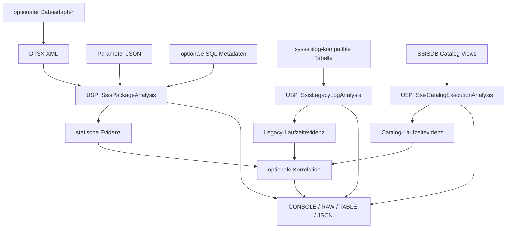

# SSIS-001 – SSIS Package and Execution Analysis

**Stand:** 17. Oktober 2026

**Status:** `PARTIAL_PRODUCT_FUNCTION`; vertiefte Legacy-Interpretation im Backlog

**Zielversionen:** SQL Server 2019, 2022 und 2025

Der direkte DTSX-v2-Parser, der strukturierte SSISDB-Katalogkern und der
freigegebene Legacy-Logkern sind teilweise beziehungsweise im abgegrenzten
Vertragsumfang implementiert. Die folgenden nummerierten Zielabschnitte
enthalten auch frühere Planung; der aktuelle Lieferumfang richtet sich nach
dem [öffentlichen Vertrag](SSIS_001_Phase0_Public_Contract.md), den konkreten
Lieferabschnitten am Dokumentende und dem Implementierungsstatus. Die
[vertiefte Legacy-Loganalyse](#backlog-vertiefte-legacy-loganalyse-vom-16-oktober-2026)
ist ausschließlich für spätere Entwicklung vorgemerkt.

## 1. Auftrag und Abgrenzung

SSIS-001 erweitert SQL Server Analyze um eine statische Analyse von SSIS-Paketen sowie um die Interpretation vorhandener Laufzeitprotokolle. Das Modul trennt Paketdefinition, Datenbankmetadaten und Laufzeitbeobachtung, damit ein mögliches Designrisiko nicht ohne Nachweis als ausgeführter Fehler dargestellt wird.

Geplant sind drei getrennte öffentliche Analyseverfahren:

- `[monitor].[USP_SsisPackageAnalysis]` analysiert ein direkt übergebenes DTSX-Paket und optional übergebene Projekt- oder Paketparameter.
- `[monitor].[USP_SsisLegacyLogAnalysis]` interpretiert vorhandene Einträge einer Tabelle im Format von `sysssislog`.
- `[monitor].[USP_SsisCatalogExecutionAnalysis]` analysiert eine vorhandene Ausführung aus dem Integration Services Catalog `SSISDB`.

Ein optionaler Dateiadapter kann eine `.dtsx`-Datei einlesen und als XML an den statischen Analysekern übergeben. Dieser Adapter gehört wegen seiner Dateisystem- und Berechtigungswirkung nicht in den standardmäßig aktiven Kernpfad.

Nicht Bestandteil der ersten Ausbaustufe sind:

- Ausführung, Validierung oder Änderung eines SSIS-Pakets;
- Entschlüsselung eines Pakets oder sensibler Eigenschaften;
- Herstellung einer Verbindung zu im Paket definierten externen Quellen;
- automatische Änderung von Logging Level, SSISDB-Retention oder Catalog-Konfiguration;
- automatische Anlage oder Änderung von SQL-Agent-Jobs, Extended-Events-Sessions oder SSIS-Umgebungen;
- allgemeine Ausführung beliebiger SQL-Fragmente aus einem Paket;
- vollständige semantische Auswertung der SSIS Expression Language;
- vollständige Analyse beliebiger Script Tasks, Script Components oder nicht bekannter Custom Components.

## 2. Zielarchitektur



Architekturentscheidungen:

- Der DTSX-Parser arbeitet ausschließlich auf einer übergebenen XML-Instanz. Dateisystem-, SSISDB- und zukünftige ISPAC-Zugriffe sind Quellenadapter vor dem Parser.
- Die statische Paketdefinition wird pro Aufruf einmal in interne temporäre Tabellen materialisiert. Mehrere Resultsets dürfen dieselben XML-Bereiche nicht unabhängig erneut vollständig shredden.
- Paketdefinition, optionale SQL-Metadaten und Laufzeitdaten besitzen getrennte SourceStatus- und Evidenzebenen.
- Eine fehlende optionale Quelle verwirft erfolgreich ermittelte andere Quellen nicht.
- Der vollständige Frameworkinstaller enthält nach Implementierung den Kern und die freigegebenen Laufzeitanalysen. Zusätzlich ist ein eigenständig installierbares SSIS-001-Paket vorgesehen.
- Der optionale Dateiadapter bleibt separat installierbar und standardmäßig deaktiviert.

## 3. Quellen und Eingabewege

### 3.1 Direkte DTSX-Übergabe

Die primäre Quelle ist ein direkt übergebener Parameter vom Datentyp `xml`. DTSX ist ein XML-basiertes Dateiformat. Paketdateien können abhängig von ihrem Protection Level teilweise oder vollständig verschlüsselt sein. Der Parser muss deshalb zwischen ungültigem XML, nicht unterstütztem Format, verschlüsseltem Inhalt und lediglich fehlenden sensitiven Werten unterscheiden.

Die direkte Übergabe ist der Standard, weil sie:

- keine Dateisystemberechtigung des SQL-Server-Prozesses benötigt;
- aus SSMS, PowerShell, .NET oder einer anderen aufrufenden Anwendung möglich ist;
- eine Prüfung und gegebenenfalls Entschlüsselung außerhalb des Analyseframeworks erlaubt;
- den statischen Analysekern unabhängig von Paketablage und Deploymentmodell hält.

Der Parser erkennt die Paketformatversion und verwendete XML-Namespaces. Die erste Implementierung priorisiert das dokumentierte DTSX-Version-2-Format. Nicht vollständig unterstützte Formate liefern einen strukturierten Capability-Status und keine heuristisch erfundene Vollanalyse.

### 3.2 Paket- und Projektparameter als JSON

Parameterwerte werden optional als versioniertes JSON-Dokument übergeben. Vorgesehen ist folgende logische Struktur:

```json
{
  "schemaVersion": 1,
  "parameters": [
    {
      "scope": "Project",
      "name": "ExampleProjectParameter",
      "dataType": "String",
      "value": "ExampleValue",
      "sensitive": false
    },
    {
      "scope": "Package",
      "name": "ExamplePackageParameter",
      "dataType": "Int32",
      "value": 100,
      "sensitive": false
    }
  ]
}
```

Das Analyseverfahren prüft mindestens:

- JSON-Schemaversion und syntaktische Gültigkeit;
- unbekannte, doppelte oder im falschen Scope übergebene Parameter;
- Datentyp und `NULL`-Zulässigkeit;
- im Paket definierte, aber nicht auflösbare Parameterreferenzen;
- übergebene Werte für als sensitiv gekennzeichnete Parameter.

Sensitive Werte dürfen für eine ausdrücklich angeforderte, rein temporäre Referenzauflösung verwendet werden. Sie werden weder in Findings, Warnings, JSON, TABLE-Ausgaben noch in Fehlermeldungen wiedergegeben. Der Standardpfad wertet direkte Referenzen aus und implementiert keinen vollständigen Interpreter der SSIS Expression Language.

### 3.3 Optionaler Dateiadapter

SQL Server kann Dateien über `OPENROWSET(BULK...)` einlesen. Für XML ist `SINGLE_BLOB` vorgesehen, damit die im XML deklarierte Zeichenkodierung durch den XML-Parser berücksichtigt werden kann.

Der Dateiadapter ist eine eigene Procedure, beispielsweise:

```sql
[monitor].[USP_SsisPackageFileLoad]
    @PackageFilePath nvarchar(4000),
    @PackageXml      xml OUTPUT,
    @Hilfe           bit = 0;
```

Verbindliche Sicherheitsgrenzen:

- ausschließlich `.dtsx`;
- ausschließlich konfigurierte Root-Verzeichnisse;
- keine Wildcards und keine Verzeichnisauflistung;
- UNC-Pfade standardmäßig nicht freigegeben;
- Pfadnormalisierung und segmentweise Prüfung vor dynamischem SQL;
- ausschließlich Lesen; kein Schreiben, Verschieben oder Löschen;
- keine Ausgabe des vollständigen Pfads ohne dafür vorgesehenen Opt-in;
- maximale zulässige Paketgröße mit sichtbarer Ablehnung nach dem Read;
- eigener Capability-, Permission- und Fehlerstatus.

Der Dateipfad kann in der `BULK`-Syntax nicht wie ein regulärer Wertparameter verwendet werden. Ein T-SQL-Adapter benötigt deshalb eng begrenztes dynamisches SQL mit korrekt escaptem Literal. Ein verlässliches Größenlimit vor dem ersten Byte-Read ist im reinen Kernpfad nicht vorauszusetzen. Diese Einschränkung ist ein weiterer Grund, den Dateiadapter optional zu halten.

### 3.4 SSISDB-Projektartefakt und ISPAC

`SSISDB.catalog.get_project` kann den Binärstream eines bereitgestellten Projekts als `varbinary(max)` liefern. Der Stream repräsentiert ein Projektartefakt und nicht unmittelbar eine einzelne XML-Paketinstanz. Das Entpacken eines ISPAC- oder Projektstreams wird deshalb nicht als T-SQL-Kernfunktion geplant.

Zulässige spätere Adapter:

- PowerShell- oder .NET-Hilfsprogramm, das einzelne DTSX-Dateien extrahiert;
- optionaler SQLCLR-Adapter mit eigenem Installations- und Sicherheitsvertrag;
- CI/CD-Schritt, der DTSX-Dateien vor dem Deployment analysiert;
- direkte Übergabe einer bereits extrahierten Paketdatei.

Der erste Release analysiert SSISDB-Ausführungsdaten, extrahiert aber keine Paketbinärstreams innerhalb des T-SQL-Kerns.

## 4. Geplante öffentliche Procedures

### 4.1 `[monitor].[USP_SsisPackageAnalysis]`

Die Procedure analysiert ein DTSX-Paket statisch und kann bei freigegebenen SQL-Server-Quellen zusätzliche Metadaten verifizieren.

Vorgesehener Parameterrahmen:

```sql
@PackageXml                    xml,
@PackageParametersJson         nvarchar(max)  = NULL,
@AnalysisDepth                 varchar(16)    = 'STANDARD',
@ResolveSqlMetadata            bit            = 0,
@CheckLookupDataUniqueness     bit            = 0,
@DatabaseNames                 nvarchar(max)  = NULL,
@DatabaseNamePattern           nvarchar(4000) = NULL,
@SystemdatenbankenEinbeziehen  bit            = 0,
@HighImpactConfirmed           bit            = 0,
@MaxZeilen                     int            = 100,
@LockTimeoutMs                 int            = 0,
@ResultSetArt                  varchar(16)    = 'CONSOLE',
@ResultTablesJson              nvarchar(max)  = NULL,
@JsonErzeugen                  bit            = 0,
@Json                          nvarchar(max)  = NULL OUTPUT,
@Hilfe                         bit            = 0
```

Die endgültigen Namen, Datentypen, Defaults, Status-OUTPUT-Parameter und Resultsetreihenfolgen werden in Phase 0 als öffentlicher Vertrag festgeschrieben.

### 4.2 `[monitor].[USP_SsisLegacyLogAnalysis]`

Die Procedure liest eine explizit benannte, `sysssislog`-kompatible Tabelle und analysiert eine angegebene Execution ID.

Vorgesehener Parameterrahmen:

```sql
@LoggingDatabase        sysname,
@LoggingSchema          sysname          = N'dbo',
@LoggingTable           sysname          = N'sysssislog',
@ExecutionId            uniqueidentifier,
@PackageXml             xml              = NULL,
@IncludeTimeline        bit              = 1,
@IncludeRawEvents       bit              = 0,
@MaxZeilen              int              = 1000,
@LockTimeoutMs          int              = 0,
@ResultSetArt           varchar(16)      = 'CONSOLE',
@ResultTablesJson       nvarchar(max)    = NULL,
@JsonErzeugen           bit              = 0,
@Json                    nvarchar(max)    = NULL OUTPUT,
@Hilfe                   bit              = 0
```

Datenbank, Schema und Tabelle werden getrennt übergeben, gegen Sichtbarkeit und erwartete Spalten validiert und ausschließlich mit `QUOTENAME` in dynamisches SQL eingesetzt.

### 4.3 `[monitor].[USP_SsisCatalogExecutionAnalysis]`

Die Procedure analysiert eine vorhandene SSISDB-Ausführung über die öffentlichen Catalog Views.

Vorgesehener Parameterrahmen:

```sql
@ExecutionId             bigint,
@IncludeMessages         bit            = 1,
@IncludeParameters       bit            = 1,
@IncludePerformance      bit            = 1,
@IncludeRawEvents        bit            = 0,
@MaxZeilen               int            = 1000,
@LockTimeoutMs           int            = 0,
@ResultSetArt            varchar(16)    = 'CONSOLE',
@ResultTablesJson        nvarchar(max)  = NULL,
@JsonErzeugen            bit            = 0,
@Json                    nvarchar(max)  = NULL OUTPUT,
@Hilfe                   bit            = 0
```

Der SSISDB-Pfad ist capability-basiert. Der statische XML-Analyzer bleibt auch verfügbar, wenn auf der Instanz kein SSIS Catalog vorhanden ist. SSISDB wird von SQL Server auf Linux nicht unterstützt; dieser Quellenstatus ist ausdrücklich als Plattformgrenze auszugeben.

## 5. Verbindliches Evidenzmodell

Jedes Finding besitzt eine Evidenzebene. Die Ebene begrenzt die zulässige Aussage.

| Evidenzebene | Bedeutung | Zulässige Aussage |
|---|---|---|
| `STATIC_CERTAIN` | direkte, eindeutig interpretierbare Paketkonfiguration | die konkrete Konfiguration ist im übergebenen Paket vorhanden |
| `STATIC_HEURISTIC` | statisches Muster mit fachlich begründeter Unsicherheit | die Konfiguration kann ein Risiko darstellen und benötigt Gegenprüfung |
| `METADATA_VERIFIED` | sichtbare SQL-Server-Katalogmetadaten bestätigen oder widerlegen eine Annahme | Objekt-, Spalten-, Index- oder Typmerkmal wurde im gelesenen Scope verifiziert |
| `DATA_VERIFIED` | eine ausdrücklich freigegebene Datenprüfung bestätigt das Ergebnis | die gelesene Datenmenge enthält den geprüften Zustand |
| `RUNTIME_OBSERVED` | Legacy- oder SSISDB-Protokoll enthält die Beobachtung | der Zustand wurde innerhalb des vorhandenen Logging- und Retentionfensters protokolliert |
| `UNRESOLVED` | Format, Ausdruck, Verschlüsselung oder Custom Component verhindert eine belastbare Aussage | die konkrete Eigenschaft konnte nicht ausgewertet werden |

Die Findings verwenden mindestens folgende Felder:

```text
RuleId
Severity
Category
EvidenceLevel
PackagePath
ObjectType
ObjectName
Finding
Evidence
Impact
Recommendation
CanAutoVerify
VerificationCost
SourceStatus
```

Ein statisches Risiko wird nicht allein durch seine Existenz zu `ERROR`. Severity und EvidenceLevel sind getrennte Dimensionen.

## 6. Statische DTSX-Analyse

### 6.1 Package Summary

Das Summary enthält mindestens:

- Paketname, Beschreibung und erkannte Paketformatversion;
- Protection Level und erkannte Verschlüsselungsgrenze;
- TargetServerVersion oder ersatzweise die sicher ableitbare Versionsinformation;
- Anzahl Tasks, Container, Event Handler und Data Flow Tasks;
- Anzahl Quellen, Ziele, Lookups, Transformationen und Verbindungen;
- Anzahl Parameter, Variablen und Expressions;
- Anzahl nicht auflösbarer Komponenten oder Eigenschaften;
- Finding-Anzahl nach Severity und Evidenzebene.

### 6.2 Control-Flow-Graph

Der Control Flow wird als Graph und nicht nur als lineare Schrittliste ausgegeben. Er enthält:

- Parent Container und Package Path;
- Task- oder Containertyp;
- Aktivierungsstatus;
- eingehende und ausgehende Precedence Constraints;
- Success-, Failure- und Completion-Bedingung;
- Constraint Expression und logische Verknüpfung;
- TransactionOption, IsolationLevel und RetainSameConnection, soweit relevant;
- FailPackageOnFailure, FailParentOnFailure und MaximumErrorCount;
- DelayValidation und DisableEventHandlers;
- Schleifen- und Sequenzcontainer;
- Event Handler und deren Auslöser.

### 6.3 Data-Flow-Graph und Lineage

Der Data Flow enthält:

- Task, Komponente, Input, Output und Pfad;
- regulären, Fehler- und No-Match-Ausgang;
- Quell- und Zielspaltenzuordnung;
- SSIS-Datentyp, Länge, Precision, Scale und Codepage;
- Lineage-ID und externe Metadatenreferenz;
- synchrone oder asynchrone Verarbeitung, soweit aus den Metadaten ableitbar;
- Sortierungsmetadaten und SortKeyPosition;
- verwendete und ungenutzte Outputs;
- erkennbare Zeilenflussverzweigungen und Zusammenführungen.

### 6.4 Verbindungen, Quellen und Ziele

Ausgegeben werden:

- Connection-Manager-Typ und referenzierende Tasks oder Komponenten;
- Verbindungsname und Expression-Bindungen;
- SourceType wie Tabelle, View, SQL Command, Variable oder Datei;
- Zielobjekt und Write Mode, soweit eindeutig ableitbar;
- Fast-Load-Einstellungen, Batch- und Commitgröße;
- verwendete Spalten;
- harte Abhängigkeiten von Server-, Datenbank-, Datei- oder Verzeichnisnamen;
- ungenutzte Connection Manager.

Sensitive Bestandteile von Connection Strings, Kennwörter, Tokens und Parameterwerte werden nicht ausgegeben.

### 6.5 Expressions und Parameterabhängigkeiten

Die erste Version unterstützt belastbar:

- Literale;
- direkte Projektparameterreferenzen;
- direkte Paketparameterreferenzen;
- direkte Variablenreferenzen;
- einfache Property Expressions mit eindeutig erkennbaren Referenzen.

Komplexe Stringoperationen, Typkonvertierungen, bedingte Ausdrücke und proprietäre Expressions werden als Ausdruck inventarisiert, aber nur bei sicherer Implementierung ausgewertet. Ein nicht auflösbarer Ausdruck erhält `UNRESOLVED_EXPRESSION` und keinen erfundenen Wert.

## 7. Regelkatalog

### 7.1 Lookup-Regeln

Lookup-Analysen besitzen hohe Priorität, weil mehrere passende Referenzzeilen zu nichtdeterministischen oder cacheabhängigen Ergebnissen führen können. SSIS gibt bei mehreren Treffern den ersten von der Lookup-Abfrage gelieferten Treffer zurück. Eine Warnung wegen Mehrfachtreffern wird nur unter bestimmten Cachebedingungen erzeugt.

Geplante Regeln:

- Lookup-Schlüssel werden nicht durch einen geeigneten Unique Index abgesichert.
- Die Referenzabfrage kann mehrere Zeilen je Lookup-Schlüssel liefern.
- Eine freigegebene Datenprüfung findet tatsächliche Duplikate.
- No-Match-Ausgang ist fachlich erforderlich, aber nicht verbunden.
- Error Output ist nicht verbunden oder auf Ignore Failure gesetzt.
- No-Match-Zeilen werden ignoriert, obwohl nachfolgend Lookup-Spalten benötigt werden.
- Full Cache wird für eine nach Metadaten große Referenzquelle verwendet.
- Partial oder No Cache kann bei hohem Eingangsvolumen viele Einzelzugriffe verursachen.
- Lookup-Eingang und Referenzschlüssel besitzen inkompatible Datentypen, Längen, Precision, Scale oder Codepages.
- Cachemodus und Datenbankcollation können zu unterschiedlicher Stringvergleichssemantik führen.
- Nullable Lookup-Schlüssel besitzen keine erkennbare Sonderbehandlung.
- Mehrere Lookups verwenden dieselbe Referenzquelle und könnten unnötige Mehrfachzugriffe verursachen.
- Die Referenzabfrage transportiert deutlich mehr Spalten als im Lookup ausgegeben werden.

### 7.2 Datenintegrität und Typkonvertierung

Geplante Regeln:

- Stringlänge wird verkürzt.
- Unicode wird in einen nicht-Unicode-Datentyp konvertiert.
- Precision oder Scale wird reduziert.
- numerischer Datentyp wird verengt.
- Truncation oder Conversion Error ist auf Ignore Failure gestellt.
- Error Output ist nicht verbunden.
- fehlerhafte Datensätze werden ohne nachvollziehbaren Auditpfad verworfen.
- Conditional Split besitzt keinen Default Output.
- ein regulärer oder Fehleroutput endet ohne nachfolgende Komponente.
- Zielspalte ist nach verifizierter Metadatenlage `NOT NULL`, aber nicht zugeordnet.
- Sortierungsmetadaten eines Merge oder Merge Join sind unvollständig oder widersprüchlich.
- Flat-File-Metadaten und nachfolgende Typkonvertierungen widersprechen einander.
- ErrorCode und ErrorColumn werden erzeugt, aber nicht in interpretierbare Informationen übersetzt.

### 7.3 Performance und Ressourcenverbrauch

Geplante Regeln:

- Sort-Transformation, obwohl eine sortierte Quellabfrage möglich oder bereits konfiguriert ist.
- mehrere Sorts mit derselben Sortierreihenfolge.
- Aggregate, Sort, Fuzzy- oder andere asynchrone Transformation auf unnötig breitem Datenstrom.
- ungenutzte Spalten werden durch mehrere Komponenten transportiert.
- BLOB- oder MAX-Spalten werden früh geladen und über lange Pfade mitgeführt.
- OLE DB Command wird für einen Datenstrom verwendet, obwohl die Komponente das SQL-Statement zeilenweise ausführt.
- OLE DB Destination verwendet bei erwartbar großem Volumen keinen geeigneten Fast-Load-Pfad.
- FastLoadMaxInsertCommitSize, RowsPerBatch oder Table Lock besitzen eine auffällige Konfiguration.
- mehrere parallele Pfade lesen dieselbe Quelle oder schreiben dasselbe Ziel.
- Full-Cache-Lookup besitzt potenziell hohe PreExecute-Kosten.
- manuell gesetzte Buffergrößen sind außerhalb plausibler Grenzen.
- Komponenten erfordern zusätzliche Buffer, ohne dass nachfolgende Komponenten die erzeugte Ordnung oder Aggregation nutzen.

Diese Regeln verwenden keine pauschalen universellen Grenzwerte. Sie berücksichtigen Komponententyp, Metadaten, Datenbreite und vorhandene Laufzeitevidenz.

### 7.4 Control Flow, Fehlerbehandlung und Restartability

Geplante Regeln:

- Task ist nicht erreichbar oder besitzt widersprüchliche Constraints.
- Task oder Container ist dauerhaft deaktiviert.
- Precedence Constraint referenziert eine nicht auflösbare Variable oder einen Parameter.
- Ausdruck kann mit den übergebenen Parameterwerten nach sicherer Auswertung nicht wahr werden.
- parallele Pfade verändern dasselbe Ziel ohne erkennbare Serialisierung.
- TransactionOption von Parent und Child ist widersprüchlich.
- Checkpoints sind aktiviert, aber unvollständig oder nicht konsistent konfiguriert.
- Paket besitzt keine erkennbare sichere Wiederanlaufstrategie für bereits teilweise geschriebene Ziele.
- MaximumErrorCount ist ungewöhnlich konfiguriert und kann Fehler zu früh oder zu spät eskalieren.
- Timeout ist unbegrenzt, obwohl eine blockierende externe Operation erkennbar ist.
- Execute SQL Task enthält mehrere verändernde Statements ohne klaren Transaktionsvertrag.
- Schleifencontainer besitzt keine sicher erkennbare Fortschrittsbedingung.
- Event Handler kann denselben Fehler mehrfach protokollieren oder eine Fehlereskalation verdecken.
- Execute Package Task verweist auf ein nicht mitgeliefertes oder nicht auflösbares Paket.
- Parameter, Variable, Connection Manager oder Event Handler ist definiert, aber nicht referenziert.

### 7.5 Security und Wartbarkeit

Geplante Regeln:

- sensibler Wert oder Credential ist im Paketinhalt erkennbar;
- Connection String enthält eingebettete Zugangsdaten;
- Protection Level ist für den erkannten Betriebsweg ungeeignet;
- `EncryptSensitiveWithUserKey` wird für einen pakettypischen Servicekonto-Betrieb verwendet;
- `DontSaveSensitive` ist gesetzt, aber erforderliche externe Bereitstellung ist nicht erkennbar;
- vollständige oder partielle Verschlüsselung verhindert eine belastbare Analyse;
- Script Task oder Script Component bildet eine nicht analysierbare Black Box;
- Custom Component besitzt kein bekanntes Regelprofil;
- Execute Process Task startet ein externes Programm;
- SQL Commands oder Dateiverbindungen enthalten harte umgebungsspezifische Namen;
- mehrere Properties werden gleichzeitig statisch und per Expression gesetzt.

Eine nicht bekannte Custom Component ist kein automatischer Fehler. Sie wird als `UNRESOLVED_COMPONENT` inventarisiert und kann später durch ein metadatengesteuertes Komponentenprofil ergänzt werden.

## 8. SQL-Metadatenverifikation

Die statische Analyse kann ausgewählte SQL-Server-Metadaten ergänzen, wenn Quelle, Datenbank und Objekt sicher auflösbar sind. Der Standard bleibt `@ResolveSqlMetadata = 0`.

Zulässige Metadatenprüfungen:

- Datenbank-, Schema-, Tabellen- und Viewexistenz;
- Spaltenexistenz und Datentyp;
- Nullability, Länge, Precision, Scale und Collation;
- Unique- und Primary-Key-Indizes für Lookup-Schlüssel;
- Zielspaltenzuordnung;
- einfache Abhängigkeiten von Views und Modulen, soweit ohne breite Textanalyse verfügbar.

Nicht automatisch ausgeführt werden:

- im Paket enthaltene freie SQL Commands;
- Stored Procedures mit unbekannten Seiteneffekten;
- Abfragen gegen externe Server oder Nicht-SQL-Server-Quellen;
- beliebige Validierungs- oder Teststatements.

Für eine Lookup-Datenprüfung gilt:

1. Die Referenzquelle und Schlüsselspalten müssen sicher auflösbar sein.
2. Eine Unique-Index-Prüfung erfolgt zunächst ausschließlich über Katalogmetadaten.
3. Eine tatsächliche `GROUP BY`-Duplikatprüfung ist `DATA_VERIFIED`, ressourcenintensiv und benötigt `@CheckLookupDataUniqueness = 1` sowie `@HighImpactConfirmed = 1`.
4. Die Prüfung verwendet enge Limits, `LOCK_TIMEOUT`, einen dokumentierten `MAXDOP`-Vertrag und keine persistente Zwischentabelle.
5. Bei komplexen SQL Commands wird eine synthetische Prüfvorlage ausgegeben, aber nicht automatisch ausgeführt.

Systemkataloge werden entsprechend dem Frameworkvertrag direkt über `sys.*` gelesen. `OBJECT_ID()` und `OBJECT_NAME()` werden für Cross-Database-Auflösung vermieden. Kataloganreicherungen verwenden `WITH (NOLOCK)` und einen lokal gesetzten, anschließend wiederhergestellten `LOCK_TIMEOUT`.

## 9. Legacy-Laufzeitanalyse aus `sysssislog`

### 9.1 Quellenvertrag

`sysssislog` enthält eine Zeile je protokolliertem Ereignis eines Pakets, Tasks oder Containers, wenn der SQL Server Log Provider verwendet wird. Die Procedure akzeptiert auch eine anders benannte Tabelle, sofern die erforderlichen Spalten und kompatiblen Datentypen vorhanden sind.

Erforderliche Kernspalten:

```text
id
Event
Computer
Operator
Source
SourceID
ExecutionID
StartTime
EndTime
DataCode
DataBytes
Message
```

Die Spalte `endtime` ist in der dokumentierten Tabelle nicht funktionsfähig und entspricht `starttime`. Laufzeiten werden deshalb aus zusammengehörenden Ereignissen wie `OnPreExecute` und `OnPostExecute` rekonstruiert.

Eine Paketausführung kann mehrere Execution IDs erzeugen, beispielsweise für Validierung und eigentliche Ausführung oder für Child Packages. Die Procedure analysiert die explizit übergebene ID und weist auf angrenzende, wahrscheinlich zusammengehörende IDs hin, ohne sie ungefragt zusammenzuführen.

### 9.2 Geplante Ausgaben

`executionSummary` enthält:

- ersten und letzten beobachteten Zeitstempel;
- abgeleiteten Status Success, Failure, Cancelled oder Incomplete;
- Anzahl Fehler, Warnings und TaskFailed-Ereignisse;
- erste wahrscheinliche technische Ursache;
- zuletzt fehlgeschlagenen Task;
- Anzahl beteiligter Tasks, Container und Iterationen;
- geschätzte Gesamtdauer und Evidenzgrenze.

`timeline` enthält:

- Zeitstempel und Abstand zum vorherigen Ereignis;
- Event, Source, SourceID und ExecutionID;
- DataCode und klassifizierte Message;
- Severity und ParseConfidence;
- geschätzte Iteration;
- Package Path, sofern das DTSX-Paket zusätzlich übergeben wurde.

`taskDurations` rekonstruiert mindestens:

- `OnPreValidate` bis `OnPostValidate`;
- `OnPreExecute` bis `OnPostExecute`;
- Paketstart bis Paketende;
- wiederholte Schleifeniterationen je SourceID.

Ausgegeben werden Dauer je Ausführung, Summe, Durchschnitt, Maximum, prozentualer Anteil an der Paketlaufzeit und unvollständige Start-/Endpaare.

### 9.3 Root-Cause- und Fehlerkettenanalyse

Der Analyzer unterscheidet:

- ursprüngliche Fehlermeldung;
- `OnError` auf Taskebene;
- propagierte Fehler auf Container- und Paketebene;
- `OnTaskFailed`;
- nachfolgende Warnungen und Informationsmeldungen;
- Wiederholung desselben Tasks mit späterem Erfolg;
- Fortsetzung des Pakets nach einem Fehler.

Identische oder eng zusammengehörende Meldungen werden als Fehlergruppe dargestellt. Die Deduplizierung darf den Rohzugriff nicht verhindern; `@IncludeRawEvents = 1` liefert weiterhin die vollständigen gelesenen Ereignisse.

### 9.4 Data-Flow- und Logging-Qualität

Falls die entsprechenden Ereignisse protokolliert wurden, werden unter anderem ausgewertet:

- `OnPipelineRowsSent`;
- `PipelineComponentTime`;
- `BufferSizeTuning`;
- `PipelineExecutionPlan`;
- `PipelineExecutionTrees`;
- `PipelineInitialization`;
- `PipelineBufferLeak`.

Mögliche Ableitungen:

- Zeilen je Pfad und Durchsatz;
- Quellen oder Ziele mit null Zeilen;
- unerwartete starke Reduktion oder Vervielfachung;
- Fehlerpfade mit Datensätzen;
- langsamste Komponenten;
- auffällige Bufferanpassungen;
- potenziell nicht freigegebene Buffer.

Freie Meldungstexte sind versions-, komponenten- und sprachabhängig. Jeder extrahierte Wert besitzt deshalb `ParseConfidence`. Ein unbekanntes Format bleibt als Rohmeldung erhalten.

Die Procedure bewertet zusätzlich die Logging-Qualität:

- fehlen `OnError` oder `OnTaskFailed`;
- fehlen passende Pre-/Post-Ereignisse;
- fehlen Row-Count- oder Komponentenzeitereignisse;
- ist die Ausführung nur partiell rekonstruierbar;
- werden sensible SQL-, Prozess- oder Parameterinformationen protokolliert;
- erzeugt die Ausführung unverhältnismäßig viele redundante Einträge.

## 10. SSISDB-Laufzeitanalyse

`SSISDB` stellt strukturierte Catalog Views für Ausführungen, Executables, Meldungen, Parameter, Data-Flow-Phasen und Zeilenzahlen bereit. Der SSISDB-Analyzer verwendet ausschließlich dokumentierte öffentliche Views und Procedures.

Geplante Quellen:

- `catalog.executions`;
- `catalog.executable_statistics`;
- `catalog.event_messages` und bei Bedarf `catalog.event_message_context`;
- `catalog.execution_parameter_values`;
- `catalog.execution_component_phases`;
- `catalog.execution_data_statistics`;
- weitere dokumentierte Catalog Views nur nach Capability- und Spaltenprüfung.

Geplante Ausgaben:

- Execution Summary mit Status, Dauer, Caller, Environment und Logging Level;
- Executable Timeline einschließlich Iterationen und Execution Path;
- Fehlergruppen, Root Cause und propagierte Folgeereignisse;
- verwendete Parameter mit konsequenter Unterdrückung sensitiver Werte;
- Komponentenphasen und aktive Zeit;
- Zeilenzahlen und Durchsatz zwischen Data-Flow-Komponenten;
- Logging- und Retentiongrenzen;
- Findings aus der Korrelation mit einem optional übergebenen Paket-XML.

`catalog.execution_component_phases` liefert Detailwerte nur bei geeignetem Logging Level, insbesondere Performance oder Verbose. Fehlende Zeilen bedeuten deshalb nicht automatisch, dass eine Komponente keine Zeit verbraucht hat. `catalog.execution_data_statistics` ist ebenfalls von der vorhandenen Logging-Evidenz abhängig.

## 11. Korrelation von Design und Laufzeit

Der größte fachliche Nutzen entsteht durch die Korrelation statischer Paketmerkmale mit Laufzeitbeobachtungen.

| Statische Beobachtung | mögliche Laufzeitevidenz | Ergebnis |
|---|---|---|
| Lookup-Eindeutigkeit nicht abgesichert | Duplicate-Warning oder bestätigte Duplikate | Designrisiko wird bestätigt oder bleibt offen |
| OLE DB Command vorhanden | hoher Komponentenzeitanteil und viele Eingangszeilen | zeilenweise Zieloperation als wahrscheinlicher Engpass |
| Sort oder Aggregate als asynchrone Komponente | lange ProcessInput-, PrimeOutput- oder PreExecute-Phase | Materialisierungs- oder Sortierkosten beobachtet |
| Error Output verbunden | protokollierte Zeilen am Fehlerpfad | Fehlerbehandlung tatsächlich genutzt |
| Full-Cache-Lookup | lange PreExecute-Phase | Cacheaufbau als Laufzeitanteil sichtbar |
| parallele Zielpfade | zeitliche Überlappung und SQL-Blocking-Evidenz | möglicher Zielkonflikt benötigt Gegenprüfung |
| unbegrenzter Timeout | sehr lange oder unvollständige Taskausführung | Betriebsrisiko durch Laufzeitbeobachtung verstärkt |
| Pfad statisch vorhanden | dauerhaft null gesendete Zeilen | ungenutzter oder datenabhängiger Pfad |

Eine Korrelation verändert die ursprünglichen Evidenzzeilen nicht. Sie erzeugt zusätzliche Findings mit Verweisen auf die beteiligten statischen und dynamischen Quellen.

## 12. Geplante Resultsets

| Resultset | Inhalt |
|---|---|
| `moduleStatus` | Gesamtstatus, Paketformat, Analysepfade, Partialität, Plattform und Grenzen |
| `sourceStatus` | Capability, Berechtigung, Read-Zeitpunkt, Fehler und Kosten je Quelle |
| `packageSummary` | Paketmetadaten, Objektzahlen, Protection Level und Finding-Zusammenfassung |
| `parameters` | Definition, Scope, Datentyp, Referenzen und Auflösungsstatus ohne sensitive Werte |
| `connections` | Connection Manager, Nutzung, Typ und sichere Metadaten |
| `controlFlow` | Tasks, Container, Event Handler und Precedence Constraints |
| `dataFlowComponents` | Quellen, Ziele, Transformationen und Komponentenmetadaten |
| `dataFlowPaths` | Verbindungen, Lineage, reguläre und Fehlerpfade |
| `columnLineage` | Spaltenherkunft, Datentypänderungen und Zielzuordnung |
| `lookups` | Referenzquelle, Schlüssel, Cachemodus, Outputs und Verifikationsstatus |
| `expressions` | Property Expressions, Referenzen und Auflösungsstatus |
| `executionSummary` | Legacy- oder SSISDB-Ausführungszusammenfassung |
| `timeline` | protokollierte Ereignisse in Zeitfolge |
| `taskDurations` | rekonstruierte oder strukturierte Task- und Containerlaufzeiten |
| `componentPerformance` | SSISDB-Phasen oder interpretierte Legacy-Komponentenwerte |
| `rowFlow` | Zeilenzahlen und Durchsatz, sofern protokolliert |
| `findings` | deterministische und heuristische Befunde mit Evidenzebene |
| `warnings` | Verschlüsselung, Kürzung, unlesbare Quelle, Parsing- und Logginggrenzen |

Nicht jede öffentliche Procedure liefert jedes Resultset. Phase 0 legt die verbindliche Reihenfolge und Schemaversion je Procedure fest.

## 13. Performance-, Locking- und Fehlervertrag

- Das Paket-XML wird je Aufruf einmal validiert und pro logischem Bereich höchstens einmal breit gelesen.
- Wiederverwendete Paketknoten werden in internen Temp-Tabellen materialisiert.
- XML-Namespaces werden versionsbezogen gebunden. Breite `local-name()`-Scans sind nur ein begrenzter Fallback und kein Standardpfad.
- Jede SQL-Server-Katalogquelle wird je Aufruf höchstens einmal gelesen.
- SSISDB-Ausführungsviews werden nach `execution_id` eingeschränkt und nicht ohne Filter gescannt.
- Legacy-Loggingtabellen werden nach `executionid` und, soweit verfügbar, unterstützenden Zeit- oder ID-Spalten eingeschränkt.
- Vor einer Legacy-Analyse werden geeignete vorhandene Indizes inventarisiert. Das Framework legt keine Indizes in fremden Loggingtabellen an.
- Kataloganreicherungen verwenden die Frameworkstrategie für `WITH (NOLOCK)` und lokales `LOCK_TIMEOUT`.
- Datenprüfungen sind getrennte High-Impact-Pfade und werden nicht durch `STANDARD` aktiviert.
- Fehler je Quelle werden isoliert; vorhandene Teilresultate bleiben verfügbar.
- Das Modul führt keine Paketkomponente, kein SQL Command und keinen externen Prozess aus.
- Das Modul verändert weder SSISDB noch fremde Loggingtabellen.

## 14. Datenschutz und Security

Standardmäßig nicht ausgeben oder persistieren:

- Kennwörter, Tokens und sensitive Connection-String-Bestandteile;
- Werte sensitiver Projekt-, Paket- oder Umgebungsparameter;
- vollständige Dateipfade;
- Operator-, Computer-, Login- oder Hostwerte ohne dafür vorgesehenen Laufzeit-Opt-in;
- Script- oder Assembly-Binärinhalte;
- DataBytes ohne dokumentierten und sicheren Decoder;
- vollständige freie SQL Commands in CONSOLE-Zusammenfassungen;
- Paket-XML, Parameter-JSON oder Log-Rohdaten in einer Frameworktabelle.

Das Framework bleibt zustandslos. TABLE- und JSON-Ausgaben können technische Namen, SQL-Textfragmente, Pfade oder Laufzeitidentitäten enthalten, wenn der Benutzer den entsprechenden Ausgabepfad ausdrücklich aktiviert. High-Impact-Freigabe ist keine Datenschutzfreigabe.

Repository-Tests und Fixtures verwenden ausschließlich synthetische Pakete, synthetische Datenbankobjekte, synthetische Pfade und synthetische Loggingzeilen. Reale Paketdateien, Connection Strings, Servernamen, Firmennamen, Benutzerdaten oder Ausführungsprotokolle dürfen nicht in das Repository gelangen.

## 15. Frameworkintegration

Nach Implementierung sind mindestens folgende Integrationen erforderlich:

- `VW_AnalyseClassCatalog`
  - `SSIS_PACKAGE_STATIC`;
  - `SSIS_METADATA_DEEP`;
  - `SSIS_LEGACY_LOG`;
  - `SSIS_CATALOG_RUNTIME`.
- `VW_AnalysisCatalog`, `VW_AnalysisSearchTerm`, `VW_AnalysisRelation`
  - Suchbegriffe SSIS, DTSX, Package, Data Flow, Control Flow, Lookup, sysssislog, SSISDB und Execution ID.
- Analysis Navigator
  - Routing nach Paketdefinition, Laufzeitfehler, Lookup, langsamer Data Flow und Loggingqualität.
- Beziehungen
  - SSIS → Current Requests, Blocking, Query Store, Execution Plan, Extended Events, SQL Agent und Server Security.
- Capability-Inventar
  - DTSX-XML-Parser, optionaler File Read, SSISDB, Legacy-Loggingquelle und unterstützte Paketformate.
- Installer, Objektinventar, Procedure-Referenz, Resultsetinventar, Beispiele, Analysis Guides und Testverträge.

Jede Procedure-Seite erhält den Abschnitt **Source Select** mit den tatsächlichen Basiszugriffen, Join-Schlüsseln, Filtern, Logging-Level-Grenzen, sensiblen Spalten und bewusst nicht gelesenen Quellen.

## 16. Packaging und eigenständige Installation

SSIS-001 soll unabhängig vom vollständigen Framework installierbar sein. Der Teilinstaller enthält ausschließlich:

- Schema und zwingende gemeinsame Status-, Ausgabe- und JSON-/TABLE-Helfer;
- Paketformat- und Komponentenmetadaten;
- interne DTSX-Parser und Regelengine;
- Legacy-Log-Parser;
- SSISDB-Quellenadapter;
- die drei öffentlichen Kernprocedures;
- optionale Metadatenverifikation, soweit ihre Abhängigkeiten geschlossen sind.

Der Dateiadapter wird als separat zuschaltbarer Bestandteil behandelt. Er darf nicht stillschweigend durch die Installation des statischen XML-Kerns aktiviert werden.

Vorgesehene Installationswege entsprechen dem bestehenden Standalone-Muster:

- SQLCMD-Include-Installer;
- generierter eingebetteter Einzelinstaller unter `Code/Install/generated`;
- Integration in `Install_All.sql` und dessen generierte Ausgabe;
- maschinenlesbares Abhängigkeitsinventar für SSIS-001.

Die exakten Dateinamen und Objektabhängigkeiten werden in Phase 0 festgeschrieben.

## 17. Umsetzungsphasen

| Phase | Inhalt | Exit-Kriterium |
|---|---|---|
| 0 | öffentliche Parameter, Resultsets, Statuscodes, Packaging, Datenschutz und Quellenprojektionen festschreiben | Vertragsreview ohne T-SQL-Implementierung abgeschlossen |
| 1 | Paketformat-Erkennung und statisches Inventar für Package, Control Flow, Data Flow, Connections und Expressions | synthetische DTSX-Fixtures werden deterministisch inventarisiert |
| 2 | Regelengine für Lookup, Datentypen, Fehlerpfade, Performance, Restartability und Security | High-Confidence-Regeln besitzen positive und negative Tests |
| 3 | optionale SQL-Metadaten- und Eindeutigkeitsprüfung | Katalog- und High-Impact-Datenpfade sind getrennt und belastbar begrenzt |
| 4 | `USP_SsisLegacyLogAnalysis` | Timeline, Dauer, Fehlerkette, Iterationen und Loggingqualität getestet |
| 5 | `USP_SsisCatalogExecutionAnalysis` | strukturierte Ausführung, Meldungen, Parameter, Phasen und Row Flow getestet |
| 6 | statische und dynamische Korrelation | Findings referenzieren nachvollziehbar beide Evidenzquellen |
| 7 | Standalone-Installer, Frameworkintegration, Dokumentation und finale Testmatrix | SQL Server 2019, 2022 und 2025 freigegeben |
| 8 | optionaler File-/ISPAC-Adapter | separater Security- und Installationsvertrag erfüllt |

## 18. Abnahmematrix

Verpflichtend:

- Entwicklung und erster Laufzeitnachweis mit aktivem Feature auf SQL Server 2025;
- finale Tests auf SQL Server 2019, 2022 und 2025;
- Windows für SSISDB- und SSIS-Runtime-Pfade;
- Linux mit korrektem `UNAVAILABLE_PLATFORM` für SSISDB und weiterhin funktionsfähiger XML-Analyse;
- gültiges DTSX-Version-2-Paket, ungültiges XML, verschlüsseltes Paket und nicht unterstütztes Format;
- Control Flow mit Sequenz, Parallelität, Schleife, Event Handler und komplexen Constraints;
- Data Flow mit Source, Destination, Lookup, Conditional Split, Sort, Aggregate, Error Output und unverbundenem Output;
- Lookup mit Unique Index, ohne Unique Index und mit synthetischen Duplikaten;
- Unicode-, Längen-, Precision- und Scale-Konvertierungen;
- Script Task und unbekannte Custom Component als sichtbare Analysegrenze;
- direkte Parameterreferenz, fehlender Parameter und nicht auflösbarer Ausdruck;
- `sysssislog` mit vollständigem Lauf, unvollständigem Lauf, Schleifeniterationen, propagierten Fehlern und mehreren angrenzenden Execution IDs;
- SSISDB-Ausführung mit Basic-, Performance- und Verbose-Logging, soweit die Quellen verfügbar sind;
- vollständig und teilweise eingeschränkte Berechtigungen;
- `CONSOLE`, `RAW`, `TABLE`, `NONE` und JSON;
- `LOCK_TIMEOUT`, nicht lesbare Datenbank, fehlende Loggingtabelle und fehlender SSIS Catalog;
- statische Prüfung, dass sensitive Werte und Binärpayloads nicht in den Standardpfad gelangen;
- Prüfung, dass kein Analysepfad Pakete, SQL Commands, externe Programme oder SSISDB-Änderungen ausführt;
- Dokumentationsgate für Source Select, Primärquellen, Kosten, sensible Felder, Evidenzgrenze und Gegenprobe;
- eigenständiger Installer und Gesamtinstaller erzeugen denselben öffentlichen SSIS-001-Vertrag.

`NOT_EXECUTED` ist kein Laufzeitnachweis. Ein leerer oder synthetischer Test ersetzt keinen Laufzeitnachweis mit aktivem Feature für die jeweilige dokumentierte Quelle.

## 19. Offene Architekturentscheidungen für Phase 0

Vor der Implementierung sind verbindlich zu entscheiden:

1. endgültige Resultsetnamen und Schemaversionen der drei Procedures;
2. unterstützte DTSX-Formatversionen im ersten Release;
3. exakte Grenzen der einfachen Expression-Auswertung;
4. Komponentenprofilmodell für Microsoft- und Custom Components;
5. Statuscodes für Verschlüsselung, unbekannte Komponenten und partielle Lineage;
6. Kostenklasse und Limits der optionalen Lookup-Datenprüfung;
7. zulässige Session-, Operator- und Computerfelder in Laufzeitausgaben;
8. eigener Installerpfad und maschinenlesbares Abhängigkeitsinventar;
9. ob der optionale Dateiadapter Bestandteil von SSIS-001 oder ein eigenes Teilpaket wird;
10. ob eine spätere ISPAC-Extraktion über SQLCLR oder ausschließlich außerhalb des T-SQL-Frameworks erfolgt.

## 20. Primärquellen

- [Microsoft Open Specifications: DTSX Version 2](https://learn.microsoft.com/en-us/openspecs/sql_data_portability/ms-dtsx2/fb216aa4-62ab-41c8-a6d5-5b1002739d21)
- [Microsoft Open Specifications: DTSX Structures](https://learn.microsoft.com/en-us/openspecs/sql_data_portability/ms-dtsx2/1e88a799-3702-4512-9b1d-efce172b1c61)
- [Microsoft: OPENROWSET BULK](https://learn.microsoft.com/en-us/sql/t-sql/functions/openrowset-bulk-transact-sql?view=sql-server-ver17)
- [Microsoft: sysssislog](https://learn.microsoft.com/en-us/sql/relational-databases/system-tables/sysssislog-transact-sql?view=sql-server-ver17)
- [Microsoft: Integration Services Logging](https://learn.microsoft.com/en-us/sql/integration-services/performance/integration-services-ssis-logging?view=sql-server-ver17)
- [Microsoft: Lookup Transformation](https://learn.microsoft.com/en-us/sql/integration-services/data-flow/transformations/lookup-transformation?view=sql-server-ver17)
- [Microsoft: Synchronous and Asynchronous Transformations](https://learn.microsoft.com/en-us/sql/integration-services/understanding-synchronous-and-asynchronous-transformations?view=sql-server-ver17)
- [Microsoft: OLE DB Command Transformation](https://learn.microsoft.com/en-us/sql/integration-services/data-flow/transformations/ole-db-command-transformation?view=sql-server-ver17)
- [Microsoft: OLE DB Destination](https://learn.microsoft.com/en-us/sql/integration-services/data-flow/ole-db-destination?view=sql-server-ver17)
- [Microsoft: Access Control for Sensitive Data in Packages](https://learn.microsoft.com/en-us/sql/integration-services/security/access-control-for-sensitive-data-in-packages?view=sql-server-ver17)
- [Microsoft: SSIS Catalog](https://learn.microsoft.com/en-us/sql/integration-services/catalog/ssis-catalog?view=sql-server-ver17)
- [Microsoft: Catalog Views](https://learn.microsoft.com/en-us/sql/integration-services/system-views/views-integration-services-catalog?view=sql-server-ver17)
- [Microsoft: catalog.executable_statistics](https://learn.microsoft.com/en-us/sql/integration-services/system-views/catalog-executable-statistics?view=sql-server-ver17)
- [Microsoft: catalog.event_messages](https://learn.microsoft.com/en-us/sql/integration-services/system-views/catalog-event-messages?view=sql-server-ver17)
- [Microsoft: catalog.execution_component_phases](https://learn.microsoft.com/en-us/sql/integration-services/system-views/catalog-execution-component-phases?view=sql-server-ver17)
- [Microsoft: catalog.execution_data_statistics](https://learn.microsoft.com/en-us/sql/integration-services/system-views/catalog-execution-data-statistics?view=sql-server-ver17)
- [Microsoft: catalog.get_project](https://learn.microsoft.com/en-us/sql/integration-services/system-stored-procedures/catalog-get-project-ssisdb-database?view=sql-server-ver17)

## Katalogkernabnahme vom 16. Oktober 2026

Der Benutzer hat den konkreten Katalogvertrag mit 17 Parametern und zehn
Ergebnisschemas sowie eine separate eigene Framework-Testdatenbank freigegeben.
Der [konkrete Vertrag](SSIS_001_Phase0_Public_Contract.md#konkreter-katalogvertrag-vom-16-oktober-2026)
konkretisiert für diesen Analyzer die zuvor geplante API. Der in den drei
Windowsversuchen verwendete Stand der Quelle
`Code/10_SSIS/030_USP_SsisCatalogExecutionAnalysis.sql` besitzt Version 1.0.0
und für die damalige Windows-Quelldatei mit CRLF-Zeilenenden SHA256
`92368A3543D1C13C1E3BD4B67070CFAF02CA3AC8CA5B84496332E9EB399DCD09`.
Der normalisierte Git-Blob mit LF-Zeilenenden besitzt SHA256
`A5D0F34D0B5F23DEEB9F80762EA60F6C3C1BE8A7549BA6E86DBD76C9F30045F8`.
Die Zeileninhalte sind identisch; die Windowsquelle blieb über alle drei
Windowsversuche unverändert. Dieser Vergleich ersetzt keine Head-CI.

Die abschließende Integration bindet ausschließlich den generischen
CONSOLE-Endblock an den bestehenden `InternalEmitConsoleResult`. Die gleichen
Status-, Execution- und Hinweiswerte werden dafür in einer eigenen typisierten
Temp-Tabelle materialisiert. Der gesamte vorausgehende Quellen-, RAW-, TABLE-
und JSON-Körper ist textidentisch zum Windowsstand. Der finale Windowsdateihash
ist `7952882C4175FD08F123D013D0AFC97FBCE9F842E97F92719D9F0EC10F7DA4C7`,
der zugehörige Git-LF-Hash
`8427B52B5BC7DB6628AC6A557294FBD1C103B83DE334FF219178EFCB471A0CB2`.
Die gebundene Windows-Fachkernevidenz wird wiederverwendet; der neue Rendererpfad
wird durch die aktuelle Linux-Head-CI geprüft. Ein zusätzlicher vollständiger
Windowslauf dieses Gesamtstands wird nicht behauptet; das Windowsbudget bleibt
geschlossen.

Voraussetzung war die regulär veröffentlichte
[Windows-/SSISDB-Abnahme des Labs](https://github.com/gecompat/SQL_Server_Lab/blob/main/Documentation/Quality/SSISDB_WINDOWS_RUNTIME_ACCEPTANCE_2026-10-16.md).
Die Analyze-Consumerprüfung verwendete ausschließlich den dort erhaltenen
isolierten Run und den veröffentlichten Zugangsbefehl. Es wurden weder ein Host
oder eine VM angelegt noch SSIS installiert, Pakete ausgeführt oder Logging,
Rechte und Retention verändert. Nur die eigene temporäre Frameworkdatenbank
wurde angelegt, installiert und nach Datenbank-ID, Anlagezeit und Ownership
gebunden entfernt. Die Quellenausführungen und der übrige Datenbankbestand
blieben erhalten.

| Versuch | Ergebnis und Grenze |
|---|---|
| 1 | FAILED_NOT_QUALIFIED. Installation und Integrationstest 201 liefen erfolgreich. Die erste private Referenzparität scheiterte an einem EXCEPT-Collationkonflikt zwischen SSISDB und Framework. |
| 2 | FAILED_NOT_QUALIFIED. Nach der ersten Referenzkorrektur blieb ein EXCEPT-Collationkonflikt mit der tempdb-Collation. Die genaue Statementzuordnung wurde in diesen beiden Versuchen nicht gespeichert und bleibt unbekannt. |
| 3 | PASS auf SQL Server 17.0.1000.7. Die Referenztexte und die private erwartete Statusspalte waren explizit CS_AS-gebunden. Werte-, NULL-, Mengen- und Statusguards blieben erhalten. |

Alle drei Versuche behalten ihre ursprünglichen Ergebnisse und privaten
Originalartefakte. Das Windowsbudget ist mit drei von drei geschlossen.
Installation und Integrationstest aus Versuch 1 werden nur bei unveränderten
Testbytes und den sechs gebundenen Installationsquellen wiederverwendet.
Ein eigener Quellenreview, die eng geprüften Adapterkorrekturen und der
Ergebnisreview ersetzen keine erforderliche Head-CI.

Versuch 3 prüfte je drei echte Ausführungen mit nativen Status 7, 4 und 1
bei Zeilengrenzen 0, 1 und 2. Neun Fälle bestanden die native Referenzparität,
die physische TABLE-/JSON-Parität aller Felder, den N+1-Count und die unabhängig
aus nativen Quellenzahlen abgeleiteten Quellen- und Modulstatus.
Unbegrenzte Sammlungen blieben auch bei einer fehlgeschlagenen oder noch nicht
gestarteten Ausführung AVAILABLE mit IsPartial=0 und ohne native Fehler.
Gekappte Sammlungen waren AVAILABLE_LIMITED; Beobachtungszahlen sind dabei
Untergrenzen. RAW lieferte zehn Mengen, CONSOLE eine und NONE keine fachliche
Menge. Alle drei Modi lieferten bei angefordertem JSON zehn benannte Arrays.
Calleroptionen, Locktimeout und Transaktionszahl blieben erhalten.

Die echte Quelle enthielt für Erfolg und Fehler je eine Root-Executable-
Statistik und zugehörige Namensmetadaten, jeweils vier Ereignisse sowie
in allen drei Fällen sechs Parameterdefinitionen. Die nicht gestartete
Ausführung hatte keine Statistik oder Ereignisse. Phasen und Row-Flow waren
tatsächlich leer. Die positiven Root-Metadaten sind kein Nachweis ausgeführter
Tasks oder Schleifen. Der bereitgestellte administrative Lab-Zugang ist keine
Least-Privilege-Abnahme.

Positive Task-/Schleifen-, Performance-/Verbose-, Phasen-, RowFlow-, eingeschränkte
Berechtigungs- und Legacy-Log-Abnahmen bleiben offen. Der Paketparser bleibt
in seinem bestehenden Umfang begrenzt. SSIS-001 bleibt PARTIAL_PRODUCT_FUNCTION;
dieser Katalogkernnachweis ist kein SSIS- oder Gesamtfertigstellungsnachweis.
Linux prüft ausschließlich den fehlenden Katalog und den Plattformfallback.
Die Testauswahl folgt der aktuellen CI_Test_Strategy und keiner historischen
Drei-Versionen-Matrix dieses Planungsdokuments.

## Freigegebener Legacy-Kern vom 16. Oktober 2026

Der [konkrete Legacy-Vertrag](SSIS_001_Phase0_Public_Contract.md#konkreter-legacy-vertrag-vom-16-oktober-2026) konkretisiert die frühere Planung. Implementiert werden eine explizite Datenbank und GUID, alle gespeicherten Meldungen als Default, beratende Indexmetadaten ohne Indexpflicht, begrenzte Ereignissammlung und konservative Zeitpaare. Automatisches Freitextparsing, Looprekonstruktion, Root-Cause- und Propagationsbehauptungen bleiben außerhalb dieses Umfangs. Synthetische Formattests ersetzen keine echte Providerabnahme. SSIS-001 bleibt PARTIAL_PRODUCT_FUNCTION.

Die kanonische Quelle ist `Code/10_SSIS/020_USP_SsisLegacyLogAnalysis.sql`
mit Version 1.0.0, 20 Parametern und neun Schemas mit insgesamt 94 Spalten.
Integrationstest 202 prüft synthetische kompatible Tabellen, native
TABLE-Metadaten, alle TABLE-/JSON-Feldwerte, N+1, Meldungs-Opt-outs, lange
Unicode-Texte, konservative Paarbildung und isolierte echte SQL-Berechtigungsfehler.
Die Rechtegegenproben verwenden ausschließlich einen eigenen Datenbankbenutzer
ohne Login und eigene Testobjekte. Das ist keine allgemeine Rollenqualifikation
für fremde Loggingquellen und kein SSIS-Providerlauf.

Die [Lieferung in PR 389](https://github.com/gecompat/SQL_Server_Analyze/pull/389)
bindet die jeweiligen exakten CI-Heads. Der erste
[funktionale Kandidat](https://github.com/gecompat/SQL_Server_Analyze/actions/runs/38924235676)
scheiterte vor Test 202 am noch unveränderten Navigator-Sollwert 109 statt 110.
Der zweite [Kandidat](https://github.com/gecompat/SQL_Server_Analyze/actions/runs/38925353954)
erreichte Test 202 und scheiterte an dessen Hilfsschema: CollationName war als
sysname ohne ausdrückliches NULL deklariert und wies die zulässigen NULL-Werte
der Nichttextspalten zurück. Beide Fehlhistorien bleiben unqualifiziert;
die beiden Fehlerläufe belegen die späteren Testteile nicht. Die Korrekturen ändern
die Inventarzählung und die ausdrücklich nullable Testfacette. Der unabhängige
Schemavergleich bleibt beidseitig; fachliche Orakel werden nicht abgeschwächt.

Der dritte [Kandidat](https://github.com/gecompat/SQL_Server_Analyze/actions/runs/38926830430)
bestand diese Metadatenprüfung und die unabhängigen nativen Fehlergegenproben.
Er stoppte anschließend korrekt mit Frameworkfehler 51011, weil der Test
seine gefüllten TABLE-Ziele erneut verwendete. Die Testreparatur leert nur
die neun eigenen Export-Temps unmittelbar vor dem jeweils nächsten TABLE-Aufruf.
Der Produktguard und alle Schema-, Mengen- und Wertorakel bleiben erhalten.
Auch dieser Lauf bleibt insgesamt FAILED_NOT_QUALIFIED; seine nachfolgenden
Testteile sind kein ausgeführter Nachweis.

Der vierte [Kandidat](https://github.com/gecompat/SQL_Server_Analyze/actions/runs/38928733729)
blieb ebenfalls FAILED_NOT_QUALIFIED. TRUNCATE entfernte die Daten, stellte aber
die vom TABLE-Preflight geforderte einzelne Seed-Spalte nicht wieder her.
Die engere Testreparatur bindet die neun eigenen Exportobjekte bei der Anlage
an ihre Objekt-IDs und stellt vor jedem TABLE-Aufruf genau deren Seed-Schema
wieder her. Die übrigen Spalten werden anhand dieser IDs und quotierter Namen
entfernt. Die unveränderten Produktguards werden nicht umgangen. Die originale
Fehlhistorie und die erfolgreichen eigenen Runtime-Cleanups bleiben erhalten.

Zum Liefergate gehören exakte Head-CI und reguläre Integration am abschließenden
Lieferstand. Die spätere begrenzte Providerabnahme ist nachfolgend getrennt
vom synthetischen CI-Ergebnis dokumentiert. Weitere native Engines und weitere
Rollen bleiben offen.

## Legacy-Providerabnahme vom 18. Oktober 2026

Der unveränderte Legacy-Analyzer v1.0.0 besteht die begrenzte Abnahme von vier
eigenen synthetischen Paketen auf Windows mit SQL Server und SSIS 17.0.1000.7.
Die Pakete wurden tatsächlich ausgeführt; der SQL-Server-Log-Provider erzeugte
die untersuchten sysssislog-Zeilen. Die Referenz verwendet native SDK-Callbacks
und die gespeicherten Providerwerte. In die Loggingquelle wurden keine
synthetischen Ereigniszeilen als Ersatz für Providererzeugung eingefügt.
Die beobachtete Berechtigung war sysadmin; daraus folgt keine allgemeine
Rollen- oder Least-Privilege-Qualifikation.

Die Abnahme kombiniert gebundene Einzelbelege aus drei Versuchen. Sie ist
kein neuer gemeinsamer Vierfällelauf. Native11 und Native12 bleiben insgesamt
`FAILED_NOT_QUALIFIED`; ihre bereits erfolgreichen Einzelprüfungen werden
unverändert wiederverwendet. Native13 besteht mit Exitcode 0 und führt nur
den SQL-Fehlerfall für die noch offenen Ausgabeprüfungen sowie den Lookup-Miss
erneut aus. Die vier Pakete wurden weiterhin gemeinsam erzeugt; die früheren
grünen Basic- und Duplicate-Prüfungen wurden nicht wiederholt.

| Synthetischer Fall | Tatsächlicher Paketausgang | Providerzeilen | Herkunft der drei erfolgreichen Cap-Prüfungen |
|---|---|---:|---|
| `ExampleBasicSuccess` | Erfolg | 12 | Native11, erfolgreiche Einzelbelege wiederverwendet |
| `ExampleSqlFailure` | Erwarteter SQL-Fehler | 16 | Native11, erfolgreiche Einzelbelege wiederverwendet; Ausgabearten separat in Native13 |
| `ExampleLookupDuplicate` | Erfolg mit Full-Cache-Duplikatwarnung `0x802090E4` | 60 | Native12, erfolgreiche Einzelbelege wiederverwendet |
| `ExampleLookupMiss` | Erwarteter No-Match-Fehler `0xC020901E` | 61 | Native13, neu ausgeführt |

Jeder Fall besitzt Prüfungen mit Cap 0, 1 und 2. Insgesamt bestehen zwölf
gebundene Einzelprüfungen: sechs aus Native11, drei aus Native12 und drei neue
aus Native13. Sie vergleichen alle 94 Feldwerte der neun TABLE-Exporte mit
JSON. Die unabhängige native Gegenprüfung vergleicht die gespeicherten
Timelinefelder sowie ausgewählte Mengen, Erstfehler- und Diagnosetexte und
Paarzeiten; sie ist kein unabhängiges Orakel für alle 94 abgeleiteten Felder.
Die N+1-Begrenzung wird gegen die native Zeilenmenge geprüft.
Die Lookup-Gegenproben binden die
tatsächliche Komponenten-ID, den Namen, die Klasse und den Task des jeweils
hashgebundenen Pakets sowie Fehlercode und ordinal gleichen vollständigen
Providertext. Kontrollierte Zielmengen prüfen die fachlichen Fixtureergebnisse.
Diese Bindungen gehören zum Testorakel; der Analyzer erhält dadurch keinen
Freitextparser oder allgemeinen Root-Cause-Vertrag.

Native13 bestätigt außerdem neun RAW-, ein CONSOLE- und null NONE-Resultsets.
RAW und JSON stimmen in allen Feldern überein. Der vollständige erste
gespeicherte Fehlertext bleibt in RAW und CONSOLE ordinal identisch zur
nativen Quelle. Konservative Zeitpaare werden gegen denselben Ereignispuffer
geprüft; sie beweisen weder Schleifen noch den Erfolg einer Paketausführung.

### Herkunft und erhaltene Fehlhistorie

Die geprüfte Produktbasis ist der gelieferte Legacy-Kern v1.0.0.
Die kanonische Git-LF-Quelle
`Code/10_SSIS/020_USP_SsisLegacyLogAnalysis.sql` besitzt SHA-256
`7B3F12D1BD715A5D33F8395BE421966B92685D7AD767210917B22BBE792DE3FD`;
die tatsächlich installierte CRLF-Fassung besitzt
`9943A0A6A14F94999BC9112044690E03FC478B13FE129ADBE47CA477D4070E4B`.
Sieben installierte Produkt- und Helperquellen bleiben zwischen den
wiederverwendeten Belegen unverändert. Alle 63 final gebundenen Quellen und
Evidenzeingaben bleiben auch nach Native13 unverändert.

Die Originalergebnisse, Captures und Prüfquellen werden privat aufbewahrt.
Sie werden wegen ihrer Runtimeidentitäten und Umgebungsdaten nicht in das
Repository übernommen. Die folgenden SHA-256-Werte identifizieren die
ausgewerteten privaten Ergebnisdateien; Hashes allein ersetzen weder deren
Inhalt noch eine unabhängige Wiederholung.

| Privater Beleg | SHA-256 |
|---|---|
| Native11, tatsächliche Runtimefortsetzung und sechs erfolgreiche Caps | `9956297BD6446901EB4A0C59D8937F69288AE668A9E17F53E38B4D43AA02E76A` |
| Native12, insgesamt fehlgeschlagen mit drei erfolgreichen Duplicate-Caps | `C99A0C09A23EC2B89A3D9A8B55D0CD91044E879EA56AE7D23E8CF6CEC81E2741` |
| Native13, erfolgreiches Ergebnis | `E6A9A4C68BE51CDBC829145A1021C1510E04A4698FF0916D3789E41EE5FCD245` |
| Abschlussauswertung mit Herkunft und Aussagegrenzen | `AFDD2255954913D1B6685EA4C045414B407F44F671C942420A86D775F3CC3DCD` |

Die früheren Fehlversuche bleiben erhalten. Native11 stoppte am privaten
Bare-Name-Guard, der den tatsächlichen Komponentennamen mit ID-Suffix
zurückwies. Native12 stoppte am privaten Meldungsnamenvorfilter: Die originale
No-Match-Meldung enthält keinen Komponentennamen und wurde deshalb
ausgeschlossen. Die Korrektur entfernt nur diesen Vorfilter; Komponenten-,
Task-, Code- und ordinaler Volltextvergleich bleiben erhalten. Die begrenzten
Runnerkorrekturen wurden unabhängig geprüft; es bestehen keine offenen P1/P2.
Beide Befunde belegen keinen Produktfehler. Die frühere Ladeursache der
Standardkomponenten in Native5 bleibt unbekannt. Erfolgreiche spätere
Providerläufe erklären diesen früheren Fehler nicht nachträglich.

### Cleanup und verbleibender Umfang

Eigene Framework- und Loggingdatenbanken sowie Gasttemporärdaten wurden
identitätsgebunden entfernt; die Cleanupfehlerzahl ist null und das
Datenbankinventar wurde restauriert. Die drei geschützten eigenen
Katalogbaseline-Ausführungen blieben während der Prüfungen stabil.
Anschließend wurden ausschließlich die eigene VM und ihre eigene virtuelle
Festplatte über den öffentlichen Lab-Lifecycle entfernt; ihre Abwesenheit
und der Runstatus REMOVED sind bestätigt. Fremde Runs und erhaltene
Katalogfixtures wurden nicht verändert; ein neuer vollständiger Fremdhashnachweis
wird daraus nicht abgeleitet. Eine eigene verschlüsselte Credentialdatei
bleibt privat erhalten, weil ihre Löschung automatisch durch die Policy
blockiert wurde. Ein erneuter oder alternativer Löschversuch erfolgte nicht;
ein vollständiger privater Dateicleanup wird nicht behauptet.

Die Abnahme schließt ausschließlich diese vier Fälle für den unveränderten
Legacy-Kern. Weitere native Engines, Providerkonfigurationen, Rollen,
Least Privilege, positive zusätzliche Katalogquellen sowie Task-, Schleifen-,
Performance-, Verbose-, Phasen- und RowFlow-Auswertung bleiben offen.
Der zurückgestellte Erweiterungsbacklog wird nicht aktiviert. `SSIS-001`
bleibt `PARTIAL_PRODUCT_FUNCTION`; WI-0009 GATE-0001 bleibt unverändert offen.
Die Dokumentationsintegration startet keine weiteren nativen Prüfungen und
ändert weder öffentliche Parameter und Schemas noch Produktversionen oder
Maturityflags.

## Backlog: Vertiefte Legacy-Loganalyse vom 16. Oktober 2026

### Auftrag, Ausgangslage und Status

Der Benutzer hat ausschließlich die Ablage dieses Erweiterungsplans für spätere
Entwicklung beauftragt. Dieser Abschnitt aktiviert weder Implementierung noch
Runtimeversuche, Instrumentierung, Labentwicklung oder eine Änderung öffentlicher
Verträge. Er erweitert das bestehende Arbeitselement `SSIS-001`; eine neue
Kennung wird nicht vergeben. Priorität ist P2, die erwartete Kostenklasse
`MEDIUM_TO_HIGH`. `SSIS-001` bleibt `PARTIAL_PRODUCT_FUNCTION`.

Ausgangsbasis ist der bereits implementierte Legacy-Kern mit 20 Parametern,
neun Resultsets, einer expliziten lokalen Loggingquelle und genau einer
Execution-ID. `@IncludeMessages = 1` liefert dort standardmäßig die vollständigen
gespeicherten Meldungen. `@IncludeMessages = 0` unterbindet deren fachlichen
Quellzugriff. Indexhinweise sind beratend; zusätzliche Quellindizes sind keine
Voraussetzung. Diese Eigenschaften und die bestehende Bedeutung von
`@MaxZeilen` werden durch den Backlog nicht geändert.

Ziel der Erweiterung ist die strukturierte Auswertung vorhandener nativer
Ereignisse und Meldungen. Jede Kennzahl soll Quelle, Scope, Zeitbasis,
Berechnung und Aussagegrenze erkennen lassen. Historische Vergleiche sowie ein
optionales Format für eigene strukturierte Kennzahlen sind ausdrücklich
Bestandteil der Planung. Der Analyzer bleibt zustandslos und verändert weder
Pakete noch Loggingeinstellungen oder Quelltabellen.

### Quellenmatrix und zusätzliche Informationen

Die Quellenmatrix beschreibt Fähigkeiten unter der Voraussetzung, dass die
benötigten Ereignisse, Identifikatoren und Meldungsdetails tatsächlich vorliegen.
Ein Ereignisname allein garantiert keinen auswertbaren Payload.

| Analysebereich | Ereignisse beziehungsweise Meldungsfamilien | Geplante Information und Aussagegrenze |
|---|---|---|
| Ablauf und Validierung | `PackageStart`, `PackageEnd`, passende Pre-/Post-Execute- und Pre-/Post-Validate-Ereignisse sowie bekannte Phasenmeldungen | Intervalle, Validierungsanteile und wiederholte Ausführungen werden getrennt rekonstruiert. Die Paketdauer benötigt passende Paketgrenzen; sonst wird nur der beobachtete Zeitraum angegeben. |
| Wiederholungen und Parallelität | Eindeutige Paare je Execution-ID und Source-ID; optional verifizierte Paketstruktur | Vorkommensanzahl, Summe, Mittelwert, Maximum und Streuung werden ausgewertet. Vorkommen beweisen keine Schleifen oder Retries. Überlappende Executables sind keine gemessenen CPU-Threads. |
| Komponentenphasen | `PipelineComponentTime`, interpretierbare Informationsmeldungen und Pipeline-Abschlussereignisse | Gemeldete Phasenzeiten und passende Meilensteine werden je Data-Flow-Vorkommen und Komponente erfasst. Komponentenzeit ist keine CPU-Zeit; Phasensummen sind keine exklusive Paketlaufzeit. |
| Zeilenfluss | `OnPipelineRowsSent`, bekannte Schreib- und Dateizeilenmeldungen | Zeilen je Pfad, Input und Vorkommen, Übergabegrößen und zeitliche Verteilung werden ausgegeben. Transportierte, als geschrieben gemeldete und fachlich bestätigte Zeilen bleiben unterschiedliche Messgrößen. |
| Datenflussstruktur | `PipelineExecutionPlan`, `PipelineExecutionTrees` und eindeutig zuordenbare Pfadkennungen | Beobachtbare Komponentenbeziehungen, Execution Trees und geplante Threadzuordnungen werden rekonstruiert. Die Ausgabe belegt weder vollständige Paketlineage noch tatsächliche Threadauslastung. |
| Lookup und Cache | Bekannte `DTS_I_TXLOOKUP_CACHE_*`, `DTS_I_TXLOOKUP_PARTIALPERF*` und Cacheaufbau-Meldungen | Cachezeilen, Aufbauzeiten, gemeldeter Speicher, Referenzkommandos und Lookupoperationen werden erfasst. Verhältniszahlen benötigen dieselbe Bezugsmenge; eine universelle Cache-Hit-Rate wird nicht erfunden. |
| Buffer und Speicher | `BufferSizeTuning`, `PipelineInitialization`, `PipelineBufferLeak` und ausdrückliche Speicherwarnungen | Gemeldete Größen, Zeilenkapazitäten, Anpassungsgründe und Leaks werden zugeordnet. Anpassungen allein beweisen keinen Speichermangel; tatsächliches Spooling benötigt eigene Evidenz. |
| Provideraufrufe | Bekannte `Diagnostic`-Meldungen mit `ExternalRequest_pre` und `ExternalRequest_post` | Eindeutige Paare liefern Aufrufintervalle und Häufigkeiten je Methode. Offene Paare und wiederholte Verbindungsaufbauten werden sichtbar. Fehlende Gegenereignisse können durch unvollständiges Logging entstehen. |
| Execute SQL Task | `ExecuteSQLExecutingQuery` und passende Providerdiagnosen | Verbindungs-, Vorbereitungs- und Abschlussmeilensteine werden ausgewertet. Deren Abstände sind keine garantierten reinen Verbindungs-, Compile- oder SQL-Ausführungszeiten. Betroffene SQL-Zeilen benötigen zusätzliche ausdrückliche Meldungen. |
| Fehler und Datenqualität | `OnError`, `OnTaskFailed`, `OnWarning`, bekannte Fehlercodes und passende `DiagnosticEx`-Spaltenabbildungen | Fehlergruppen, technische Codes und auflösbare Komponenten- und Spaltenbezüge werden ausgegeben. Eine wahrscheinliche Ursprungsmeldung wird von bewiesener Fehlerpropagation und Root Cause getrennt. |
| Transaktionen und Wiederanlauf | Bekannte Transaktions-, Final-Commit- und Checkpointmeldungen | Gemeldete Aktionen, passende Intervalle und beobachtete Wiederaufnahme werden dargestellt. Ein lokales Abschlussereignis garantiert keinen dauerhaften übergeordneten Commit, keine Idempotenz und keinen erfolgreichen Restore. |
| Spezielle Tasks | Bulk Insert, Execute Process, File System, FTP, MSMQ, Send Mail, Transfer-, Web-Service-, WMI- und XML-Task-Ereignisse | Operationsart, verfügbare Meilensteine, ausdrücklich gemeldete Ergebnisse und Timeouts werden interpretiert. Reine Startereignisse ergeben weder Dauer noch Erfolg. Ein Prozessende liefert nur bei entsprechendem Payload einen Exitcode. |
| Fortschritt und Änderungen | `OnProgress`, `OnVariableValueChanged` und `OnExecStatusChanged` | Verwertbarer Fortschritt, Änderungshäufigkeit und ausdrücklich protokollierte Debugzustände werden erfasst. Variablenwerte sind nicht automatisch verfügbar. Eine Ereignislücke beweist keinen Stillstand. |

Die Herstellerreferenz enthält darüber hinaus Hinweise zu ungenutzten Spalten,
redundanter Sortierung, Rehashing, Lookup-Duplikaten, Typ- und Längenkonflikten
sowie Fehlerausgängen. Diese Hinweise werden als protokollierte Beobachtungen
klassifiziert. Ihr Fehlen beweist weder eine passende Konfiguration noch
fehlerfreie Daten. Insbesondere hängt die Lookup-Duplikatwarnung vom Cachemodus ab.

### Evidenz, Rekonstruktion und Kennzahlen

Die spätere Implementierung erhält einen versionierten Ereignis- und
Meldungskatalog. Jeder Decoder benennt seine öffentlichen Primärquellen,
unterstützten Engine-/Komponenten- und Sprachformate, Eingabefelder, Einheiten,
Zuordnungsschlüssel und Aggregationsart. Zunächst werden belegte englische und
deutsche Formate unterstützt. Codes werden ereignisbezogen interpretiert;
`datacode` ist kein universeller Outcome- oder HRESULT-Vertrag. Unbekannte
Formate bleiben als nicht interpretiert sichtbar.

Jede Kennzahl referenziert Loggingquelle, Execution-ID, Source-ID, zugeordnetes
Vorkommen und die tatsächlich verwendeten Log-IDs. Quelle, Parserkennung,
Berechnung, Einheit, ursprünglicher Zeitbezug und Verfügbarkeitsgrund werden
getrennt ausgegeben. Bestehende Evidenz- und Quellenstatus werden nicht
umdefiniert. Gemeldeter Wert, berechnetes Intervall und heuristischer Befund
bleiben nachvollziehbar getrennt.

Fehlende Kennzahlen bleiben NULL. Eine Nullmenge benötigt ausdrückliche
Evidenz; fehlende Zeilenmeldungen ergeben nicht null verarbeitete Datensätze.
Deaktiviertes Logging, nicht durchlaufene Zweige, gelöschte Daten und fehlende
Sichtbarkeit sind ohne weitere Quelle nicht sicher unterscheidbar. Die
Loggingabdeckung wird deshalb je Task und Kennzahl bewertet. Lückenhafte
Mengen werden als beobachtete Teilmengen und nicht als vollständige Summen
ausgegeben. Gleichlautende Meldungen mit verschiedenen Log-IDs werden nicht
automatisch dedupliziert; eine Gruppierung erhält ihre Ursprungszeilen.

Start-/Endpaare werden zustandsbezogen je Quelle und Vorkommen rekonstruiert.
Fehlende, überlappende und widersprüchliche Paare bleiben mehrdeutig. Eine
Log-ID ist eine stabile Ordnungshilfe, kein Beweis einer feingranularen
Ausführungsreihenfolge. `endtime` bleibt ein Rohfeld und kein Dauerendpunkt.
Native Zeitstempel werden ohne erfundene Zeitzone oder UTC-Konvertierung
erhalten. Uhrenrücksprünge und nicht positive Zeitintervalle verhindern die
betroffene Durchsatz- oder Dauerberechnung.

Zeilen werden je Pfad und Vorkommen aggregiert. Verzweigungen, Multicast,
Zusammenführungen und Aggregationen werden berücksichtigt, soweit ihre
Struktur bekannt ist. Es gibt keine Gesamtsumme aller Pfade als vermeintliche
Zahl eindeutiger Datensätze. `OnPipelineRowsSent` zählt keine physischen Buffer.
Durchsatz benennt seinen Nenner, beispielsweise die beobachtete Dauer des
Data Flows. Pipeline-Mengen und gemeldete Zielschreibmengen werden weder
gleichgesetzt noch addiert.

Zeitliche Überlappungen werden über Intervallvereinigungen berücksichtigt.
Kindzeiten werden nicht unbereinigt von Containerzeiten subtrahiert.
Unbekannte Elternbeziehungen bleiben unbekannt. Kandidaten für laufzeitprägende
Ketten dürfen nur bei ausreichend belegtem Graphen gezeigt werden; der
Analyzer behauptet ohne weitere Ablauf- und Schedulingevidenz keinen exakten
kritischen Pfad. `OnQueryCancel` allein belegt keinen Abbruch. Fehlende
Fehlerereignisse oder ein einzelnes Post-Ereignis ergeben keinen pauschalen
Erfolgsnachweis.

Optimierungshinweise enthalten Beobachtung, mögliche Auswirkung, Empfehlung,
Gegenprüfung und Aussagegrenze. Hohe Komponentenzeit oder viele Referenzaufrufe
können eine gezielte Prüfung begründen; sie beweisen keinen fehlenden Index,
SQL-Wait, Netzwerkfehler oder Nutzen einer bestimmten Konfigurationsänderung.
Es gibt keine automatische DDL, Tuningaktion oder Loggingumschaltung.

### Geplante Schnittstellen und Ausgaben

Vor einer späteren Umsetzung wird ein eigener öffentlicher Erweiterungsvertrag
mit unabhängigem fachlichem Review festgeschrieben. Der heutige Legacy-v1-
Aufruf und seine neun nativen Schemas bleiben bis dahin unverändert. Der
Entwurf eines künftigen v2-Datenmodells erhält die bisherigen Resultsetnamen
und ergänzt strukturierte Mengen für `taskDurations`, `rowFlow`,
`componentPerformance`, `providerCalls`, `taskOperations`, `metrics`,
`pipelineGraph` und `history`. Namen und Version sind hier Entwurfsbestand;
sie werden nicht in aktive Inventare oder den freigegebenen Vertrag übernommen.

`metrics` nimmt typisierte Lookup-, Cache-, Buffer-, Transaktions-, Checkpoint-
und eigene Kennzahlen auf. Ereignisartige Beobachtungen behalten Ereignistyp
und Zeitbezug. Zusätzliche native Codes benötigen dadurch kein eigenes
Resultset. COUNTER-, Zeit- und Zustandswerte dürfen nicht denselben
Summierungsregeln folgen.

Alle Ausgabearten verwenden denselben pro Aufruf materialisierten Bestand.
CONSOLE bleibt ein gemeinsames fachliches Resultset mit Übersicht und
nachvollziehbaren Detailverweisen. RAW, benannter TABLE-Export und JSON
transportieren dieselben begrenzten Fachmengen. Ausgabelimits und
Lesebegrenzungen müssen unterscheidbar sein; eine gekürzte Quellmenge erlaubt
keine als vollständig ausgewiesene Berechnung. Eine spätere Trennung von
Lese- und Ausgabelimits benötigt eine ausdrückliche Vertragsversionierung,
weil der heutige Parameter `@MaxZeilen` auch den Ereignispuffer begrenzt.

Die frühere Idee eines zusätzlichen `rawEvents`-Resultsets wird durch die
vorhandene `timeline` mit vollständigen gespeicherten Meldungen abgedeckt.
Ein neuer Raw-Payload-Pfad und die entfallenen Parameter `@PackageXml` oder
`@IncludeRawEvents` werden nicht stillschweigend wieder eingeführt. Optionale
Paketkorrelation bleibt ein getrennter, später zu versionierender Adapter;
die Übereinstimmung mit der ausgeführten Paketversion muss belegt werden.

### Historische Vergleiche als Opt-in

Der Standard bleibt die Einzelanalyse. Der Erweiterungsentwurf sieht einen
getrennten Historienaufruf für eine explizite JSON-Liste von höchstens 100
Execution-IDs aus derselben Loggingquelle vor. Es gibt keine automatische
Suche über alle Datenbanken und keine Zusammenführung benachbarter IDs im
heutigen Einzelaufruf. Wiederholungen innerhalb einer ID und verschiedene
Paketläufe bleiben unterschiedliche Ebenen.

Verglichen werden Laufzeiten, Mengen, passend normierter Durchsatz,
Wiederholungen und wiederkehrende Fehlergruppen. Die Ausgabe nennt Zahl
angefragter, gelesener, eingeschränkter und tatsächlich vergleichbarer Läufe.
Median und Streuung werden aus den verwertbaren Beobachtungen ermittelt;
P95 wird erst ab 20 verwertbaren Beobachtungen ausgegeben. Diese Untergrenze
ist eine Entwurfsentscheidung, kein statistischer Stabilitätsnachweis.

Paketversion, Struktur, Loggingabdeckung und Mengenbasis bestimmen die
Vergleichbarkeit, soweit sie belegt werden können. Gleiche Namen oder GUIDs
beweisen keine unveränderte Paketversion. Bei unzureichender Vergleichbarkeit
bleiben beschreibende Werte mit Einschränkung; ein automatischer
Regressionsbefund entsteht nicht. Ohne ausdrücklich vorgegebene fachliche
Schwellen gibt es Rangfolgen und Verteilungen, aber keine SLA-Verletzung und
keinen universellen Performancealarm. Automatisch ermittelte historische
Ursachen oder Prognosen sind kein Teil dieses Entwurfs.

### Optionaler Vertrag für eigene Kennzahlen

Für `ScriptTaskLogEntry` wird ein optionales JSON-Format v1 geplant. Ein
Eintrag enthält eine eindeutige Formatkennung, Schemaversion, Ereignis-ID,
Taskinstanz, Kennzahl, numerischen Wert, Einheit und Aggregationsart. Bei
geordneten Zählern kommen Sequenz und explizite Zählerepoche hinzu. Das
Format muss vor Verwendung als eigener Vertrag mit synthetischen Beispielen
und positiven sowie negativen Tests beschrieben werden.

| Aggregationsart | Bedeutung |
|---|---|
| `DELTA` | Eindeutig identifizierte Beiträge derselben Kennzahl und Taskinstanz werden addiert. |
| `CUMULATIVE` | Geordnete Zählerstände werden innerhalb derselben Epoche ausgewertet; Stände werden nicht summiert. Ohne passende Vergleichswerte gibt es keine berechnete Rate. |
| `GAUGE` | Ein zeitbezogener Momentanwert bleibt ein Zustand; er wird nicht zu einer Menge aufsummiert. |
| `FINAL` | Ein ausdrücklich abschließender Wert bezeichnet die gemeldete Gesamtmenge einer Taskinstanz. Er wird nicht zusätzlich zu ihren Deltas addiert. |

Vorgesehene Standardkennzahlen sind gelesene, eingefügte, aktualisierte,
gelöschte und verworfene Zeilen, gelesene und geschriebene Bytes sowie
ausdrücklich gemessene Dauern. Eigene und native Kennzahlen bleiben getrennte
Quellen. Ein Produzent kann dieselbe fachliche Menge mehrfach melden; ihre
Addition ist ohne definierte Semantik unzulässig. Eigene Werte sind
Produzentenmeldungen und kein unabhängiger Beweis fachlicher Korrektheit.

Jede Nachricht muss in die tatsächliche message-Kapazität passen. Für den
nativen SQL-Logprovider wird ein einzelnes kompaktes JSON-Dokument innerhalb
der dokumentierten 2048 Zeichen vorgesehen. Eine automatische Fragmentierung
oder Rekonstruktion abgeschnittener Nachrichten ist nicht geplant.
Unbekannte Versionen, doppelte Ereignis-IDs, fehlende Sequenzen, Zählerresets
und unpassende Einheiten werden als eingeschränkt oder nicht interpretierbar
ausgegeben. Der Analyzer fügt keine Script Tasks hinzu und ändert keine Pakete.

### Zugriff, Eigenlast und Datenschutz

Der Zugriff bleibt auf eine explizite lokale Loggingquelle mit vorhandenen
Berechtigungen begrenzt. Bezeichner werden vor dynamischem SQL validiert und
quotiert. Ereignisse werden je ausgewähltem Scope einmal materialisiert;
Parser und Ausgabewege lesen sie nicht unabhängig erneut. Fehlende Indizes
bleiben Hinweise ohne automatische DDL oder pauschale Verweigerung.

Als künftiger Entwurfswert wird eine gesonderte Obergrenze von einer Million
gelesenen Ereignissen je Aufruf mit N-plus-eins-Überlaufprobe vorgesehen.
Dieser Wert ändert den heutigen Default nicht. Historie teilt dasselbe
Aufrufbudget über alle IDs. Zusätzliche Max-/Lob- oder unbegrenzte Pfade
behalten das bestehende High-Impact-Prinzip. Das Zeitbudget ist kooperativ
und garantiert keinen Abbruch eines bereits laufenden SELECT. Sperrwartezeit,
Quellmenge, Parserlast und Ausgabemenge werden getrennt dokumentiert.

Die Standarddiagnose behält die bereits freigegebenen vollständigen
gespeicherten Meldungen. Eine spätere Interpretation darf diesen Text nicht
anonymisieren, kürzen oder durch eine eigene Zusammenfassung ersetzen.
Strukturierte Zusammenfassungen werden als zusätzliche Projektionen
bereitgestellt. Bei `@IncludeMessages = 0` werden weder die Meldungsquelle noch
darauf angewiesene Decoder fachlich gelesen; daraus folgende Lücken bleiben
sichtbar. Operator-, Computer-, Login-, Host- und Binärspalten bleiben im
heutigen Zugriff ausgeschlossen. Ein künftiger Identitätsadapter benötigt
einen eigenen expliziten Vertrag.

`DiagnosticEx` wird nur für erkannte Spaltenabbildungen ausgewertet. Andere
XML-Bereiche wie Parameterwerte werden nicht in neue strukturierte
Resultsets übernommen. Unbekannte DataBytes bleiben ungelesen. Es gibt
keine persistente Kopie von Paket-XML, Originalmeldungen oder Laufzeitdaten.
Repositoryartefakte, Fixtures und gespeicherte Nachweise enthalten
ausschließlich synthetische Daten. Ein vorhandener Laufzeitzugriff ist keine
Freigabe zur Veröffentlichung realer Logs.

### Priorisierte Entwicklungsreihenfolge und Abnahme

Die am 17. Oktober 2026 für den Backlog festgelegte Feinplanung ersetzt die
bisherige grobe Vier-Schritte-Tabelle. Die Nummern bezeichnen die empfohlene
Reihenfolge innerhalb von `SSIS-001`; sie sind keine neuen Arbeitselemente.
Die Priorität P2 und der Status `PARTIAL_PRODUCT_FUNCTION` bleiben erhalten.
Der Auftrag umfasst ausschließlich diese Planungsablage. Weder die folgende
Reihenfolge noch ihre Abnahmekriterien erteilen eine Implementierungs-,
Instrumentierungs-, Lab- oder Runtimefreigabe.

Die vorhandenen Legacy- und SSISDB-Kerne bilden die Ausgangsbasis. Zunächst
werden verlässliche Einzellaufkennzahlen geplant, anschließend vertiefte
Diagnosen, Laufvergleiche und eigene Messwerte. Damit beantworten die ersten
drei Schritte bereits die ursprünglichen Fragen nach Laufzeiten und
Datensatzmengen. Jeder spätere Umsetzungsschritt benötigt den hierfür
gesondert freigegebenen fachlichen Umfang.

Für den ersten begrenzten Laufzeitabschnitt liegt ein
[konkreter freigegebener Vertrag mit Abnahmeplan](SSIS_001_Phase0_Public_Contract.md#freigegebene-erweiterung-legacy-tasklaufzeiten-und-loggingabdeckung-vom-18-oktober-2026)
vor. Er konkretisiert das notwendige Fundament aus Schritt 1 und die
quellenbezogenen Daueraggregate aus Schritt 2. Der Benutzer hat anschließend
diesen geprüften Vertrag samt begrenzter Implementierung, Abnahmeplan und
regulärer PR-Lieferung ausdrücklich freigegeben. Die bisherigen
Legacy-Aufrufe und die abgeschlossene Vierfälle-Providerabnahme bleiben erhalten.

| Reihenfolge | Entwicklungsumfang | Abhängigkeiten | Abnahmekriterien für eine spätere Lieferung |
|---|---|---|---|
| 1 | Erweiterungsvertrag, Ereigniskatalog und Loggingqualität | Der vorhandene Legacy-Kern, dokumentierte Ereignisformate und eine definierte Testdatengrundlage werden verwendet. | Zuordnungsschlüssel, Einheiten, Aggregationen und Ausgabeversionierung sind festgelegt und unabhängig fachlich geprüft. Fehlende, abgeschnittene und unbekannte Informationen erhalten eindeutige Status. Bestehende Aufrufe behalten ihre Bedeutung. |
| 2 | Tasklaufzeiten, Validierung, Wiederholungen und Fehlerbasis | Schritt 1 ist erforderlich. | Eindeutige Ereignispaare liefern korrekte Intervalle. Parallelität, gleiche Namen, wiederholte Vorkommen und fehlende Endereignisse sind getestet. Mehrdeutige Fälle erhalten keine erfundene Dauer oder Erfolgsmeldung. Fehlergruppen erhalten ihre Ursprungsereignisse. |
| 3 | Komponentenphasen, Zeilenmengen und Durchsatz | Schritt 1 ist erforderlich; Schritt 2 wird für zeitbezogene Kennzahlen benötigt. Passende Pipelineereignisse müssen vorliegen. | Mengen stimmen je Pfad, Input und Vorkommen. Multicast, Verzweigungen und Aggregationen erzeugen keine falschen Gesamtsummen. Große Zähler, ausdrückliche Nullmengen und fehlende Meldungen bleiben unterscheidbar. Jeder Durchsatz nennt seine Zeitbasis. |
| 4 | Lookup-/Cachewerte, Buffer, Provideraufrufe und Execute-SQL-Meilensteine | Schritte 1 und 2 sind erforderlich; Schritt 3 wird für volumenbezogene Verhältniszahlen benötigt. | Bekannte Formate liefern nachvollziehbare Werte und Einheiten. Offene Providerpaare und unvollständige Cacheinformationen bleiben sichtbar. Unbekannte Meldungen erzeugen keine Zahlen. Hinweise behaupten keine unbelegten SQL-Waits, Speicherursachen oder Cache-Hit-Raten. |
| 5 | Spezielle Tasks, Transaktionen, Checkpoints und Fortschritt | Schritte 1 und 2 sowie passende Ereignisse der jeweiligen Taskfamilie sind erforderlich. | Operationsbeginn, Abschluss, Timeout und ausdrücklich gemeldetes Ergebnis bleiben getrennt. Startereignisse ergeben keinen Erfolg. Checkpoints und Commitmeldungen werden korrekt zugeordnet, ohne Wiederanlauffähigkeit oder dauerhafte Transaktionsabschlüsse zu garantieren. Fortschrittslücken gelten nicht automatisch als Stillstand. |
| 6 | Pipelinegraphen, Fehler-Spaltenzuordnung und optionale Paketkorrelation | Schritt 1 und die Komponenten-/Pfadzuordnung aus Schritt 3 sind erforderlich. DTSX-Korrelation benötigt zusätzlich eine belegte Paketbindung. | Bekannte Graphkanten und Spaltenabbildungen sind korrekt zugeordnet; unbekannte Endpunkte bleiben partiell. Abgeschnittenes DiagnosticEx wird erkannt. Gleiche Namen oder GUIDs gelten nicht als Versionsnachweis. Ein exakter kritischer Pfad wird ohne ausreichende Evidenz nicht behauptet. |
| 7 | Historische Vergleiche als Opt-in | Verlässliche Einzellaufwerte aus Schritten 2 und 3 sind erforderlich. Zusätzliche Kennzahlen benötigen nur die jeweils verwendeten Decoder aus Schritten 4 bis 6. | Höchstens 100 explizite Execution-IDs teilen ein begrenztes Aufrufbudget. Vergleichbarkeit berücksichtigt Loggingabdeckung, Paketstand und Mengenbasis. Stichprobengröße und Ausschlüsse sind sichtbar; P95 erscheint erst ab 20 verwertbaren Beobachtungen. Ohne fachliche Schwellen entstehen keine SLA-Alarme. |
| 8 | Eigene strukturierte Kennzahlen als Opt-in | Schritt 1 und ein gesondert festgelegter Produzentenvertrag sind erforderlich. Die übrigen nativen Decoder sind keine Voraussetzung. | DELTA, CUMULATIVE, GAUGE und FINAL werden korrekt verarbeitet. Duplikate, Sequenzlücken, Zählerresets, Epochen und Einheiten sind getestet. Native und eigene Mengen werden nicht doppelt gezählt. Nachrichten passen in die Quellkapazität; der Analyzer verändert keine Pakete. |

Die Abhängigkeiten sind nicht durchgehend linear. Schritt 7 darf bei einer
späteren gesonderten Umsetzung bereits die belastbar verfügbaren Laufzeit-
und Mengenkennzahlen vergleichen; er muss nicht auf sämtliche speziellen
Taskdecoder oder auf eigene JSON-Meldungen warten. Schritt 8 benötigt keine
vollständig implementierte Historie. Seine spätere Position folgt daraus,
dass native Logs bereits vorhanden sein können, während eigene Kennzahlen
zusätzliche Instrumentierung durch den Anwender benötigen.

Für jeden später freigegebenen Lieferabschnitt gelten zusätzlich:

- CONSOLE, RAW, TABLE und JSON liefern konsistente Ergebnisse. Dokumentation,
  betroffene Inventare und Installer werden im jeweiligen Abschnitt gemeinsam
  aktualisiert; diese Integration wird nicht bis zum Ende aller acht Schritte
  aufgeschoben. Änderungen öffentlicher Schemas benötigen vorherige
  Vertragsversionierung.
- Synthetische Positiv- und Negativtests prüfen Berechnungen und Aussagegrenzen.
  Behauptete native Decoderfähigkeiten benötigen zusätzlich kontrollierte echte
  SSIS-Protokolle mit unabhängig bekannten Erwartungswerten.
- Fehlende Provider-Testquellen blockieren die jeweilige positive
  Runtimeabnahme. Die zusätzlichen SSISDB-Performance-/Verbose-/RowFlow-
  Nachweise bleiben gesonderte Abnahmen und werden durch diese Feinplanung
  nicht als erfüllt ausgewiesen.
- Bestehende Meldungsdefaults, Datenschutzgrenzen und geschlossene Budgets
  bleiben erhalten. Der aktuelle Legacy-v1-Aufruf wird nicht durch die
  Planung eines Erweiterungsvertrags verändert.

Die spätere Testauswahl folgt ausschließlich der
[CI-Teststrategie](../Quality/CI_Test_Strategy.md). Der Entwicklungsstandard
ist SQL Server 2025 mit betroffenem Umfang; zusätzliche native Versionen und
Plattformen benötigen einen konkreten Strategieauslöser. Ein breiteres altes
Planungsgate löst keine pauschale Drei-Versionen-Wiederholung aus.

Verpflichtende Szenarien des Erweiterungsslices sind:

- Vollständiges, fehlendes und nur taskweise vorhandenes Logging; NULL-Felder,
  fehlende IDs, identische Namen und getrennte Execution-IDs.
- Wiederholte Vorkommen, verschachtelte und parallele Intervalle, gleiche
  Zeitstempel, widersprüchliche Reihenfolgen, Uhrenrücksprünge und offene Paare.
- Verzweigungen, Multicast, Aggregationen, bekannte Fehlerpfade, ausdrückliche
  Nullmengen und Zeilenzahlen oberhalb des int-Bereichs.
- Unterschiedliche Phasen- und Zählersemantiken, Provideraufrufe ohne
  Gegenereignis, Folgefehler und widersprüchliche Abschlussinformationen.
- Englische und deutsche akzeptierte Formate, unbekannte Sprachen,
  abgeschnittene Meldungen, ungültiges XML/JSON und unbekannte Schemaversionen.
- DELTA-, CUMULATIVE-, GAUGE- und FINAL-Meldungen mit Duplikaten, Lücken,
  Epochenwechsel, Nullwerten, Überläufen und unpassenden Einheiten.
- Historie mit Paketwechsel, veränderter Loggingabdeckung, unterschiedlich
  großen Mengen und unzureichender Stichprobe.
- Berechtigungs- und Quellenfehler, Sperrwartezeit, kooperative Zeitgrenzen,
  Lese-/Ausgabelimits, High-Impact-Ablehnung und Parität aller Ausgabeformen.
- Synthetische sensitive Zusatzspalten und unbekannte XML-Bereiche; der
  Standardquellzugriff projiziert sie nicht, auch nicht indirekt über
  berechnete Spalten. Die vorhandene Meldungsoption wird separat geprüft.

Decoder benötigen neben synthetischen Tests kontrollierte echte
SSIS-Providerprotokolle mit unabhängig bekannten Erwartungswerten, soweit
eine positive Runtimefähigkeit behauptet wird. Ein synthetischer Parserfall
belegt keine native Providererzeugung. Eine reine neue Fehler- oder
Phasenmeldung beweist noch keine Gesamtursache. Bereits geschlossene Budgets
werden nicht zurückgesetzt. Externe Labfunktionen und die getrennten
SSISDB-Performance-/Verbose-/RowFlow-Abnahmen bleiben eigene Voraussetzungen;
ihre Bereitstellung ist nicht Bestandteil dieser Backlogablage.

### Primärquellen und Quellenstand

Die folgenden öffentlichen Microsoft-Quellen wurden am 16. Oktober 2026 für
die Planung ausgewertet. Die Auswertung ist Quellenrecherche, kein eigener
SSIS-Runtimeversuch. Decoder müssen später die jeweils tatsächlich
unterstützte Version und das nachgewiesene Meldungsformat binden.

- [sysssislog](https://learn.microsoft.com/en-us/sql/relational-databases/system-tables/sysssislog-transact-sql?view=sql-server-ver17) beschreibt den SQL-Provider und die endtime-Grenze.
- [SSIS Logging](https://learn.microsoft.com/en-us/sql/integration-services/performance/integration-services-ssis-logging?view=sql-server-ver17) beschreibt auswählbare Details, Standard- und spezielle Taskereignisse sowie die DiagnosticEx-Kappung.
- [Data Flow Task](https://learn.microsoft.com/en-us/sql/integration-services/control-flow/data-flow-task?view=sql-server-ver17) beschreibt Pfadzeilen, Pipelineereignisse und Meldungsbeispiele.
- [SSIS error and message reference](https://learn.microsoft.com/en-us/sql/integration-services/integration-services-error-and-message-reference?view=sql-server-ver17) beschreibt native Informations-, Warn- und Fehlercodes einschließlich Cache-, Schreib-, Transaktions- und Checkpointmeldungen.
- [Troubleshooting Tools for Package Connectivity](https://learn.microsoft.com/en-us/sql/integration-services/troubleshooting/troubleshooting-tools-for-package-connectivity?view=sql-server-ver17) beschreibt Before-/After-Meldungen externer Provideraufrufe.
- [Execute SQL Task](https://learn.microsoft.com/en-us/sql/integration-services/control-flow/execute-sql-task?view=sql-server-ver17) beschreibt ExecuteSQLExecutingQuery und dessen Meilensteine.
- [Data Flow Performance Features](https://learn.microsoft.com/en-us/sql/integration-services/data-flow/data-flow-performance-features?view=sql-server-ver17) trennt Bufferanpassung und zusätzlich benötigte Performance-Counter-Evidenz.
- [Logging in the Script Task](https://learn.microsoft.com/en-us/sql/integration-services/extending-packages-scripting/task/logging-in-the-script-task?view=sql-server-ver17) beschreibt die freiwillige Ausgabe eigener Messwerte über Dts.Log.
- [OnQueryCancel](https://learn.microsoft.com/en-us/dotnet/api/microsoft.sqlserver.dts.runtime.wrapper.idtsevents100.onquerycancel?view=sqlserver-2019) beschreibt die Abbruchabfrage und ihre Ergebnisabhängigkeit.

## Taskintervalle und Loggingabdeckung: Abnahme vom 18. Oktober 2026

Die freigegebene Erweiterung von `monitor.USP_SsisLegacyLogAnalysis` v1.1.0
ergänzt an Position 21 ausschließlich IncludeTaskAnalysis bit=0. Ohne Opt-in
bleiben SchemaVersion 1 und die neun bisherigen Ausgabegruppen erhalten.
Bei 1 folgen die beiden neuen Mengen taskDurations mit 23 und
taskLoggingCoverage mit 25 Spalten, SchemaVersion 2 und drei zusätzliche
CONSOLE-Zähler im selben Grid. Die Kennzahlen verwenden den bisherigen
geprüften Ereignispuffer und den vollständig abgeschlossenen konservativen
Paarbestand vor Exportbegrenzungen. SourceType bleibt UNRESOLVED.

Die synthetischen Fallgruppen S01–S14 der freigegebenen Spezifikation sind
abgegrenzt geprüft. Integration203 prüft unter anderem genaue Sollwerte,
Identitäten und Evidenz-IDs, vollständige neue TABLE-/JSON-Parität,
physische Schemas, N+1, Nullwerte und Meldungsopt-out. Ergänzende eigene
Gegenproben bestätigen ordinal verschiedene Namen, inkompatible Quellen
und den tatsächlichen nativen Fehler 229 samt gleichem vollständigem
Fehlertext aus direktem Zugriff und Opt-in-Analyzer. Das ist keine allgemeine
Rollen- oder Least-Privilege-Qualifikation.

S13 verwendet getrennte private, quellgebundene extrahierte Originalstufen.
Vier Pfade bestehen: Budgetende vor Beginn, Budgetende vor gemeinsamer
Übernahme, tatsächlicher Zusatzfehler 547 und tatsächlicher Fehler 547 der
vorherigen Ableitung bei weiterhin gültigem Puffer. Die neuen Mengen und
Counts bleiben entsprechend leer beziehungsweise NULL, gültige frühere
Mengen und das ursprüngliche Fehlerpaar werden erhalten. Die Fehler stammen
aus eigenen synthetischen Temp-Constraints; ein kontrollierter Zeitübergang
liegt zwischen unveränderten Stufenfragmenten. Diese Pfadprüfung ist kein
natürlich aufgetretener Fehler des unveränderten Gesamtanalyzers.
Öffentliche Faultparameter und Produkt-, Lab- oder System-Overrides wurden
nicht ergänzt.

Die zwei neuen nativen Szenarien N01 und N02 bestehen auf Windows mit SQL
Server und SSIS 17.0.5015.4 sowie beobachtetem sysadmin. N01 führt denselben
SQL-Task tatsächlich dreimal in einem For-Loop aus; SDK-Callbacks und drei
eigene SQL-Schreibnachweise bestätigen die Vorkommen. Die Zahl der
Validierungen wird nicht als drei vorausgesetzt. N02 führt zwei getrennte
Source-IDs mit gleichem Anzeigenamen tatsächlich parallel aus. Ein dritter
Task wird mit abgeschaltetem Logging ausgeführt und erhält keine erfundene
Analyzerzeile. Beide nativen Execution-Ausschnitte enthalten jeweils 21
Providerzeilen; zusätzliche SDK-Callbacks bleiben getrennt erhalten.

Zehn aufrufgebundene Consumer-Captures bestehen mit insgesamt 1456
Prüfungen. Ein unabhängiges Referenzorakel auf den gespeicherten Providerzeiten
prüft alle 48 neuen Felder einschließlich Identität, SQL-GUID-Sortierung,
Evidenzmitgliedschaft, Status, Counts und dezimaler Aggregate. Davon getrennt
stehen RAW-/TABLE-/JSON-Parität und RAW11/CONSOLE1/NONE0. Ausgelassener,
ausgeschalteter und NULL-Opt-in-Parameter liefern weiterhin RAW9 und
SchemaVersion 1. Acht reine Capture-Mutationen werden erwartungsgemäß
zurückgewiesen; sie starten weder SQL noch SDK oder Pakete.
Für die 94 bisherigen Felder wird daraus kein neuer unabhängiger nativer
All-field-Nachweis abgeleitet. Der Compatibility Level der privaten
Windows-Datenbanken wurde nicht separat im Capture gespeichert und bleibt
für diese Abnahme UNKNOWN; CI qualifiziert ihre tatsächlich ausgeführte
Engine-/CL-Kombination separat.

Die Produktquelle `Code/10_SSIS/020_USP_SsisLegacyLogAnalysis.sql` besitzt
Git-LF-SHA-256 78044AD156186620999B691D5DAB389A713228FC42AAFE14FAEB46F96BF6C774
und Windows-CRLF-SHA-256 8BE968127D442E9BF918452B6D0C5DEA85F9E643B517E51E42475B576A17B200.
Originale Pakete, Callback- und Providerdaten, Aufrufkontexte, Bindungen,
Fehlhistorien und Ergebnisse bleiben privat. Es wurden nur eigene isolierte
Testdatenbanken, Pakete und synthetische Quellen verwendet. Callerframes
sowie Quell- und SQL-Schreibnachweise sind vor und nach den Consumern gleich.
Die Datenbanken der qualifizierten Läufe sind ID-, Erstellungszeit-,
Besitzer- und markierungsgebunden entfernt; Datenbankinventar, Quellenpins
und Cleanup werden getrennt ausgewiesen. Der frühe synthetische
Arrangefehler entstand vor der Markierung. Ein separater Recoverybeleg
dokumentiert dafür die Entfernung der leeren eigenen Datenbank anhand von
ID und Erstellungszeit; eine zusätzliche native Nach-Abwesenheitsmenge wurde
in diesem Recoverybeleg nicht gespeichert. Der ursprüngliche Fehlerrecord
bleibt unverändert. Es wurden keine VM, Installation, Images oder
fremden Testfixtures verändert.

Der erste neue native Versuch bleibt FAILED_NOT_QUALIFIED: Die lokale
Windows-PowerShell-Hülle fand Get-FileHash nicht und stoppte vor Execute.
Ein mechanischer Wechsel auf SHA-256 desselben Dateipuffers wurde lokal
gegen Get-FileHash verglichen; erst der zweite Versuch führte N01 und N02
aus. Der erste synthetische Aufbau scheiterte vor Produktprüfung an einem
Schema-Batch, ein weiterer vor Abschluss an einem Testinsert nach entfernten
Meldungsspalten. Ein ergänzender Deltaaufbau fehlte zunächst das eigene
monitor-Schema; seine korrigierte Fortsetzung prüfte nur die offenen Fälle.
Alle Fehlversuche und ihre Cleanupnachweise bleiben erhalten. Erfolgreiche
unveränderte Fälle wurden für diese Reparaturen nicht erneut ausgeführt,
soweit sie bereits qualifiziert und gebunden waren.

Die abgeschlossene Vierfälle-Providerabnahme des v1-Kerns bleibt unverändert
erhalten. SSIS-001 bleibt PARTIAL_PRODUCT_FUNCTION. Tasktyp- und
Looprekonstruktion, exklusive Zeit, CPU-Zeit, Phasen, Zeilenfluss, Durchsatz,
Lookup-Decoder, Historie, eigene Kennzahlen und zusätzliche Katalog- oder
Rollenabnahmen sind hier nicht geliefert. WI-0009 GATE-0001 bleibt offen.

## Freigegebener Legacy-Zeilenfluss vom 18. Oktober 2026

Der Benutzer hat den geprüften [Erweiterungsvertrag](SSIS_001_Phase0_Public_Contract.md#freigegebene-erweiterung-legacy-zeilenfluss-aus-onpipelinerowssent-vom-18-oktober-2026)
für OnPipelineRowsSent samt begrenzter Abnahme und regulärer PR-Lieferung
freigegeben. Version 1.2.0 ergänzt an Position 22 IncludeRowFlowAnalysis,
rowFlowEvents mit 19 und rowFlow mit 25 Feldern. Die vier Kombinationen mit
IncludeTaskAnalysis behalten SchemaVersion 1/2 beziehungsweise ergänzen 3.
ORPS_EN_1 und ORPS_EN_2 interpretieren nur die festgelegten englischen Profile; PathID ist
keine OutputId. Potenziell gekappte Texte gehen nicht in Summen ein.

Die 14 synthetischen Gruppen und die beiden neuen nativen Szenarien werden
gesondert qualifiziert. Eine Abnahme wird erst nach tatsächlicher Ausführung
als bestanden dokumentiert. Geschlossene Task- und Vierfällebudgets bleiben
erhalten. Weitere Phasen, Raten, Lookupdecoder, Historie und allgemeine
Katalog-/Rollenabnahmen bleiben offen; SSIS-001 bleibt PARTIAL_PRODUCT_FUNCTION.

### Tatsächliche Row-Flow-Abnahmegrenze vom 18. Oktober 2026

Die folgenden Grenzen dokumentieren den Zustand vor der freigegebenen
ORPS_EN_2-Ergänzung. Die historischen Paketversuche bleiben unverändert.

Die Integration 204 für R-S01 bis R-S12 und fünf gesonderte extrahierte
R-S08-/R-S13-Stufen bestehen auf SQL Server 2025/CL170. R-S14-Mutationen
positiver nativer Ergebnismengen sind wegen der fehlenden Profilzulassung
NOT_EXECUTED. Ein erster Testhelper-Compilefehler
vor dem Consumer bleibt als fehlgeschlagene Historie erhalten. Zwei eigene
Paketszenarien wurden tatsächlich auf Windows SQL/SSIS 17.0.5015.4/CL170
ausgeführt; sechs Consumeraufnahmen des ersten Falls werden getrennt
wiederverwendet, zwei neue Aufnahmen gehören zum zweiten Fall. Eigene
Datenbanken sind entfernt und die Vorherinventare restauriert.

Das tatsächliche native Format entspricht jedoch nicht ORPS_EN_1. Alle
beobachteten Kandidaten bleiben korrekt UNSUPPORTED_FORMAT; eine positive
native Pfadsummen- oder 44-Feldabnahme liegt nicht vor. Die 682 Vergleiche
des ersten Falls prüfen konservative Ausgaben und Parität. Die zusätzliche
positive Profilprüfung schlägt fehl; die Gesamtabnahme bleibt
FAILED_NOT_QUALIFIED. Frühere Adapterfehler werden nicht rückwirkend als
bestanden umklassifiziert.

Die [konkrete Vertragsentscheidung](SSIS_001_Phase0_Public_Contract.md#erforderliche-vertragsentscheidung-beobachtetes-natives-zeilenflussformat-vom-18-oktober-2026)
beschreibt das tatsächlich beobachtete vollständige englische Format und
die enge Ergänzung ORPS_EN_2. Der Benutzer hat diese Ergänzung und die
begrenzte Consumerabnahme ausdrücklich freigegeben. Die neue Abnahme nutzt
wiederhergestellte hashgebundene Originaldaten; Paketwiederholungen und
Budgetrücksetzungen sind ausgeschlossen. Der Row-Flow-Slice ist bis zur
Qualifikation und PR-Integration noch nicht regulär geliefert.

### Qualifizierte ORPS_EN_2-Consumerabnahme vom 18. Oktober 2026

Die freigegebene Profilergänzung besteht die neue begrenzte Consumerabnahme
auf Windows SQL Server 2025 Version 17.0.5015.4 mit CL170 und beobachtetem
sysadmin. Dafür wurden ausschließlich die erhaltenen hashgebundenen eigenen
Originalproviderzeilen der beiden früheren Paketszenarien mit ihren IDs,
Typen und vollständigen Meldungstexten in eine neue eigene isolierte
Loggingtabelle übernommen. Es gab keine neue SSIS-Paketausführung und keine
VM-, Setup- oder Änderung einer früheren Quelle.

Ein Arrange-/Consumerversuch umfasst einen neuen synthetischen EN2-Block
mit 22 Kandidaten und sechs geänderte Consumerkonstellationen. Der lineare
Fall liefert drei geparste Kandidaten und eine Pfadgruppe mit der bekannten
Zielmenge 10007. Der zweite Fall liefert 25 geparste Kandidaten und 13
beobachtete Gruppen aus Wiederholungen, verschiedenen Pfaden und überlappender
Ausführung gleichnamiger Sources mit getrennten GUIDs. Die sieben gespeicherten
Payloadwerte werden aus dem Originaltext unabhängig bestimmt. SDK-Namen,
Source-IDs, erhaltene Callbacks und bekannte Zielmengen bilden zusätzliche
Gegenproben; numerische Authoring-IDs werden nicht den Runtime-IDs gleichgesetzt.

Alle 44 neuen Felder werden unabhängig gegen die Originalzeilen geprüft.
RAW11 beziehungsweise RAW13, TABLE/JSON mit physischem Schema, CONSOLE1,
NONE0 und der N+1-Präfixfall bestehen. Die Referenzprüfung umfasst 4833
Prüfschritte einschließlich 14 abgewiesener Mutationen von Format,
Runtimekennungen, Source, Paar, Menge, NULL, Evidenz und Callerframe.
Originalzeilen und Callerzustand bleiben vor und nach den Consumeraufrufen
identisch. Beide eigenen Testdatenbanken sind entfernt, CleanupErrors ist 0
und das vorherige Datenbankinventar ist restauriert.

Die zwei bereits erfolgreichen Originalcaptures für Meldungs-Opt-out und
Task-only werden gebunden wiederverwendet. Die Produktlogik außerhalb des
Zeilenflussblocks ist gegenüber dem vorherigen geprüften Stand textidentisch.
Unveränderte erfolgreiche synthetische Prüfungen und extrahierte Stufen
werden nicht lokal wiederholt. R-S14 ist durch die neuen gebundenen
Mutationsprüfungen erfüllt. Die früheren nativen Gesamtversuche bleiben
FAILED_NOT_QUALIFIED; die neue positive Aussage betrifft den Analyzerconsumer
gegen zuvor nativ erzeugtes Material, keinen neuen vollständigen Providerlauf.

Derselbe unabhängige Reviewer prüft die Quellen-, Adapter- und Ergebnisdeltas.
Die erforderliche exakte Head-CI und reguläre Integration bleiben eigene
Liefergates. SSIS-001 bleibt PARTIAL_PRODUCT_FUNCTION; zusätzliche Profile,
Sprachen, Katalog-RowFlow, Phasen, Durchsatz, Looprekonstruktion und allgemeine
Rollenabnahmen sowie WI-0009 GATE-0001 bleiben offen.
